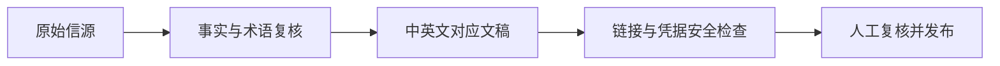

# 采集与筛选方法

## 时间与频率

- 每日北京时间 11:00 执行，覆盖执行前约 30 分钟截止的最近 24 小时。
- 延迟发布或前一日遗漏的信息允许次日补录，并明确标注原始日期。
- 周一汇总上周一至周日；每月、每季度、每年首日汇总上一完整自然周期。

## 主题范围

- LLM 与基础模型
- 多模态、视频、语音、3D、世界模型、空间智能、具身智能
- AI 应用、Agent、开发工具与生产工作流
- AI 游戏、互动内容与创作工具
- 公司、融资、并购、算力、政策与行业报告
- KOL、研究者和创业者的关键判断

## 选取规则

- 日报目标为 20–30 条；信息不足时不以低质量内容凑数。
- 最低覆盖与动态竞争并用，不机械平均分配。
- 综合评分：行业影响 35%、产品/内容相关性 30%、传播热度 20%、信源可信度 15%。
- 重大官方发布强制收录；同一事件合并，不把转发和二次报道重复计数。

## 可信度

- **高：** 官方一手资料、论文，或多个可靠信源相互印证。
- **中：** 权威媒体、研究者或知名 KOL 的独家信息，尚未完全交叉验证。
- **低：** 社区热议、用户实测或传闻，只进入观察名单并明确标注。

## 写作规则

- 自 2026-10-18 起，日报及后续周期汇总同时提供中文与英文完整版本；历史未翻译内容明确标为仅中文。
- 中文版保留原始专有名词与原文标题；英文版逐条对齐事实、日期、信源链接、视角、可信度、交叉验证与趋势状态，不增加未经原版核实的断言。
- 每份双语文档顶部提供对应语言的 Markdown 链接；HTML 版本也提供语言切换。若一版未完成，不把另一版标成已可切换。
- 每条都解释“为什么重要”；S/A 级内容按相关性补充产品、内容、投资或 Yoroll 启示。
- 区分事实、厂商主张与分析判断。
- 无法读取原始页面时不根据标题补全事实。
- 历史日报不静默改写；纠错在新日报和趋势追踪中记录。

## 术语规范

- 仓库定位写作“AI 行业资讯与研究简报”或英文 *AI industry briefing*。AI 已是 *artificial intelligence* 的缩写，不再与 *intelligence* 叠用来命名新闻栏目。
- “开放权重模型”（*open-weight model*）指权重可获取；只有代码、权重及许可条件都支持相应含义时才使用“开源”（*open source*）。模型可下载、API 可用和免费使用分别标注。
- “世界模型”仅用于对环境状态与动态建模的系统；AI 辅助编写游戏代码、单次视频生成或机器人演示不自动等于可持续运行的游戏世界模型。
- 区分基础模型、Agent 系统、产品功能和演示；区分模型基准成绩、独立任务评测、真实使用效果和商业回报。
- 多篇同一发布方材料属于内部互证，不写成独立交叉验证。英文固定使用 *editorial planning*、*investment monitoring* 等明确表达，保留产品名和正式基准名称，不擅自改名。

## 仓库安全

- 不提交 `.env` 或任何本地配置、凭据、密钥文件；仓库 `.gitignore` 默认排除常见文件名与私钥格式，即使被强制暂存也由安全检查拒绝。
- `scripts/check_bilingual.py` 在发布校验中调用 `scripts/check_repository_safety.py`，扫描被跟踪和未忽略的新文件；错误仅报告文件及规则，不输出疑似凭据内容。提交前仍须人工复核新增文本与 HTML。
- 自动扫描只能识别已知模式，不能证明不存在所有秘密。如果发现真实泄露，应先撤销/轮换凭据，再按明确批准的方案处理 Git 历史与远端缓存；普通删除提交不会清除历史。

## 发布规则

- GitHub 仓库首页 `README.md` 默认英文，中文首页为 `README.zh-CN.md`；两版都将“当前关键趋势”置于历史内容之前。`en/README.md` 只保留兼容旧链接的入口；日报目录仍为中文 `daily/`、英文 `en/daily/`。
- 双版本生成、链接检查、日期/条目/信源对齐和格式校验全部通过后再提交并推送。
- 失败时不发布半成品；任务需报告失败原因。

