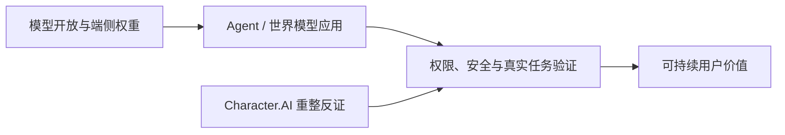

# AI News

面向产品决策、内容选题与投资观察的 AI 情报库。每日覆盖 LLM、多模态与世界模型、AI 应用、AI 游戏、公司与资本、研究报告及关键 KOL 观点。

## 最新内容

- [2026-10-14 AI 日报（含 Character.AI 重大补漏）](daily/2026-10/2026-10-14.md) · [图文 HTML](daily/2026-10/2026-10-14.html)
- [2026-10-13 AI 日报](daily/2026-10/2026-10-13.md) · [图文 HTML](daily/2026-10/2026-10-13.html)
- [2026-10-12 AI 日报（补漏与趋势版）](daily/2026-10/2026-10-12.md) · [图文 HTML](daily/2026-10/2026-10-12.html)
- [2026-W41 AI 周报（10-05 至 10-11，部分补档）](weekly/2026-W41.md) · [图文 HTML](weekly/2026-W41.html)
- [2026-10-11 AI 日报（事后补档）](daily/2026-10/2026-10-11.md)
- [2026-10-10 AI 日报（事后补档）](daily/2026-10/2026-10-10.md)
- [2026-10-09 AI 日报](daily/2026-10/2026-10-09.md)
- [2026-10-08 AI 日报](daily/2026-10/2026-10-08.md)
- [2026-10-07 AI 日报](daily/2026-10/2026-10-07.md)
- [2026-10-06 AI 日报（事后补档）](daily/2026-10/2026-10-06.md)
- [2026-10-05 AI 日报（周末短版）](daily/2026-10/2026-10-05.md)
- [2026-W40 AI 周报（资料完整性受限）](weekly/2026-W40.md)
- [2026-10-04 AI 日报（事后补档）](daily/2026-10/2026-10-04.md)
- [2026-10-03 AI 日报（事后补档）](daily/2026-10/2026-10-03.md)
- [2026-10-02 AI 日报（事后补档）](daily/2026-10/2026-10-02.md)
- [2026-10-01 AI 日报（事后补档）](daily/2026-10/2026-10-01.md)
- [2026-09 AI 月报（部分日期缺档）](monthly/2026-09.md)
- [2026-Q3 AI 季报（仅记录 9 月部分）](quarterly/2026-Q3.md)
- [2026-09-30 AI 日报](daily/2026-09/2026-09-30.md)
- [2026-09-29 AI 日报](daily/2026-09/2026-09-29.md)
- [2026-09-28 AI 日报（短版）](daily/2026-09/2026-09-28.md)
- [2026-W39 AI 周报（09-21 至 09-27）](weekly/2026-W39.md)
- [2026-09-27 AI 日报（短版）](daily/2026-09/2026-09-27.md)
- [2026-09-26 AI 日报](daily/2026-09/2026-09-26.md)
- [2026-09-25 AI 日报](daily/2026-09/2026-09-25.md)
- [2026-09-24 AI 日报](daily/2026-09/2026-09-24.md)
- [2026-09-23 AI 日报](daily/2026-09/2026-09-23.md)
- [2026-09-22 AI 日报](daily/2026-09/2026-09-22.md)
- [2026-09-21 AI 日报](daily/2026-09/2026-09-21.md)
- [2026-W38 AI 周报（09-14 至 09-20）](weekly/2026-W38.md)
- [2026-09-20 AI 日报](daily/2026-09/2026-09-20.md)
- [2026-09-19 AI 日报](daily/2026-09/2026-09-19.md)
- [2026-09-18 AI 日报](daily/2026-09/2026-09-18.md)
- [2026-09-16 AI 日报](daily/2026-09/2026-09-16.md)
- [2026-09-15 AI 日报](daily/2026-09/2026-09-15.md)
- [2026-W37 AI 周报（09-07 至 09-13）](weekly/2026-W37.md)
- [2026-09-14 AI 日报](daily/2026-09/2026-09-14.md)
- [2026-09-13 AI 日报](daily/2026-09/2026-09-13.md)
- [2026-09-12 AI 日报](daily/2026-09/2026-09-12.md)
- [2026-09-11 AI 日报](daily/2026-09/2026-09-11.md)
- [2026-09-10 AI 日报](daily/2026-09/2026-09-10.md)
- [2026-09-08 AI 日报](daily/2026-09/2026-09-08.md)
- [完整历史索引](INDEX.md)
- [持续趋势追踪](TRACKERS.md)
- [采集与筛选方法](METHODOLOGY.md)
- [决策与运行记录](docs/decision-log.md)

## 当前关键趋势

1. **前沿模型竞争进入可用性与成本复测。** Gemini 4 Argon 扩大至付费 API/订阅，Liquid AI 发布端侧开放权重模型；厂商性能须独立复测，Argon 入门价 11 月末到期。
2. **世界模型出现机器人闭环新案例。** Google 展示视频世界模型控制与 Real2Sim；[Odyssey-3](daily/2026-10/2026-10-09.md)仍是可玩方向的独立观察对象，演示不证明游戏运行时成熟。
3. **AI 娱乐商业化出现强反证。** Character.AI 进入 Chapter 11 并寻求资产出售，平台当前仍运行；不能将 Disney 特定 IP 许可误写成完成整体收购。
4. **Agent 工程和治理随工作量扩张。** Anthropic 自建 Scion 源码管理，Google 公布 Argon 安全控制；公司自述不替代审查质量、安全性和真实 ROI。
5. **内容创作与分发更可交互。** Meta 开放自然语言推荐反馈，Higgsfield 把长视频做成多工具流程；需检验用户控制效果与真实制作成本。

> 10 月 1–4 日、6 日、10–11 日为事后补档；10 月 12 日晚于固定推送时刻。10 月 14 日按 11:04 北京时间截稿，含一条 10 月 12 日 Character.AI 重大补漏。10 月 9 日日报有 10 月 12 日勘误。9 月月报与 Q3 季报均有资料缺口，不能视作全周期完整扫描。

> 本仓库提供研究信息，不构成投资、医疗或法律建议。关键决策应回到原始信源复核。
