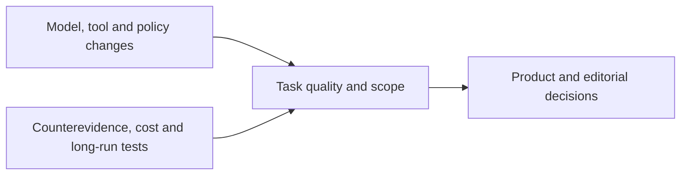

<h1>AI News</h1>

Source-verified global AI industry briefings for product decisions and editorial planning with investment monitoring and technical context as additional lenses

<strong>English</strong> · <a href="README.zh-CN.md">中文</a>

<a href="en/daily/2026-10/2026-10-20.md">Read the latest brief</a> · <a href="en/weekly/2026-W42.md">Read W42</a> · <a href="en/INDEX.md">Browse the archive</a>

---

Daily coverage spans large language models (LLMs), multimodal and world models, AI applications, AI in gaming, company developments, research, and notable expert perspectives. We prioritize primary sources and label publication time, independent corroboration, confidence, and trend status. New briefs from October 18, 2026 onward have complete English and Chinese editions. Earlier reports remain Chinese-only until translated and reviewed.

## Current key trends

1. **Model competition is shifting from announcements to cost per completed task.** [MiniMax M3.1 Flash](en/daily/2026-10/2026-10-20.md) is available via API but its weights remain forthcoming; [DeepSeek 1017](en/daily/2026-10/2026-10-18.md) offers downloadable weights. Compare licenses, hardware, quality, retries, and end-to-end task cost; vendor scores are not independent evaluations.
2. **World-model research is following distinct paths: interactive simulation, robot control, and laboratory digital twins.** [Matrix-Game 4.0](daily/2026-10/2026-10-16.md) offers a single-user demo, while [OneWM and VERID](daily/2026-10/2026-10-17.md) illustrate research and physical-lab paths. None substitutes for sustained player testing.
3. **Agent competition extends to tools and persistent state.** [DeepSeek Search/Fetch and Tencent's memory-writing model](en/daily/2026-10/2026-10-18.md) add infrastructure options. AtMem's replay counterexample calls for tests of source quality, omitted and incorrect memory writes, latency, and total cost.
4. **Adoption, governance, and economic value remain separate questions.** Anthropic's [proposed Public Benefit Fund](en/daily/2026-10/2026-10-19.md) still needs stockholder approval and implementation evidence; its internal employment observations cannot establish labor-market effects. Stack Overflow and Itaú case studies still lack independent net-return audits.
5. **Multimodal production is becoming a structured, reviewable workflow.** [Gemini Notebook's outline and producer-note review](en/daily/2026-10/2026-10-20.md) adds a pre-render checkpoint. Asset reuse and sound consistency should ultimately be judged by rework time and finished quality.
6. **Safety, policy, and delivery constraints are becoming concrete.** [China's proposed export catalog and immediate registration](en/daily/2026-10/2026-10-18.md) are distinct. [Nscale's power-access setback](en/daily/2026-10/2026-10-19.md) shows that announced compute capacity is not guaranteed delivery; multi-step agent behavior still needs outside testing.

## Historical content

- [2026-10-20 AI Daily Brief](en/daily/2026-10/2026-10-20.md) · [中文](daily/2026-10/2026-10-20.md)
- [2026-10-19 AI Daily Brief](en/daily/2026-10/2026-10-19.md) · [中文](daily/2026-10/2026-10-19.md)
- [2026-W42 Weekly Brief](en/weekly/2026-W42.md) · [中文](weekly/2026-W42.md)
- [2026-10-18 AI Daily Brief](en/daily/2026-10/2026-10-18.md) · [中文](daily/2026-10/2026-10-18.md)
- [2026-10-17 AI Daily Brief](daily/2026-10/2026-10-17.md) · Chinese only
- [Full English archive index](en/INDEX.md) · [Complete Chinese archive](INDEX.md) · [Methodology (Chinese)](METHODOLOGY.md)

> Research information only; not investment, medical, or legal advice. Check primary sources before consequential decisions.
