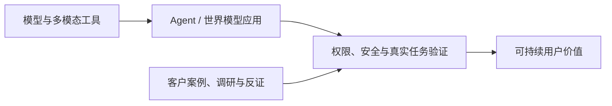

# AI News

面向产品决策、内容选题与投资观察的 AI 情报库。每日覆盖 LLM、多模态与世界模型、AI 应用、AI 游戏、公司与资本、研究报告及关键 KOL 观点。

## 最新内容

- [2026-10-18 AI 日报（出口登记、DeepSeek 1017、Agent 记忆）](daily/2026-10/2026-10-18.md) · [图文 HTML](daily/2026-10/2026-10-18.html)
- [2026-10-17 AI 日报（Beam 权重、Agent 用工、科学闭环与百灵访谈）](daily/2026-10/2026-10-17.md) · [图文 HTML](daily/2026-10/2026-10-17.html)
- [2026-10-16 AI 日报（Matrix-Game 4.0、Muse Spark Open、Step 5 权重）](daily/2026-10/2026-10-16.md) · [图文 HTML](daily/2026-10/2026-10-16.html)
- [2026-10-15 AI 日报](daily/2026-10/2026-10-15.md) · [图文 HTML](daily/2026-10/2026-10-15.html)
- [2026-10-14 AI 日报（含 Character.AI 重大补漏）](daily/2026-10/2026-10-14.md) · [图文 HTML](daily/2026-10/2026-10-14.html)
- [2026-10-13 AI 日报](daily/2026-10/2026-10-13.md) · [图文 HTML](daily/2026-10/2026-10-13.html)
- [2026-10-12 AI 日报（补漏与趋势版）](daily/2026-10/2026-10-12.md) · [图文 HTML](daily/2026-10/2026-10-12.html)
- [2026-W41 AI 周报（10-05 至 10-11，部分补档）](weekly/2026-W41.md) · [图文 HTML](weekly/2026-W41.html)
- [2026-10-11 AI 日报（事后补档）](daily/2026-10/2026-10-11.md)
- [2026-10-10 AI 日报（事后补档）](daily/2026-10/2026-10-10.md)
- [2026-10-09 AI 日报](daily/2026-10/2026-10-09.md)
- [2026-10-08 AI 日报](daily/2026-10/2026-10-08.md)
- [2026-10-07 AI 日报](daily/2026-10/2026-10-07.md)
- [2026-10-06 AI 日报（事后补档）](daily/2026-10/2026-10-06.md)
- [2026-10-05 AI 日报（周末短版）](daily/2026-10/2026-10-05.md)
- [2026-W40 AI 周报（资料完整性受限）](weekly/2026-W40.md)
- [2026-10-04 AI 日报（事后补档）](daily/2026-10/2026-10-04.md)
- [2026-10-03 AI 日报（事后补档）](daily/2026-10/2026-10-03.md)
- [2026-10-02 AI 日报（事后补档）](daily/2026-10/2026-10-02.md)
- [2026-10-01 AI 日报（事后补档）](daily/2026-10/2026-10-01.md)
- [2026-09 AI 月报（部分日期缺档）](monthly/2026-09.md)
- [2026-Q3 AI 季报（仅记录 9 月部分）](quarterly/2026-Q3.md)
- [2026-09-30 AI 日报](daily/2026-09/2026-09-30.md)
- [2026-09-29 AI 日报](daily/2026-09/2026-09-29.md)
- [2026-09-28 AI 日报（短版）](daily/2026-09/2026-09-28.md)
- [2026-W39 AI 周报（09-21 至 09-27）](weekly/2026-W39.md)
- [2026-09-27 AI 日报（短版）](daily/2026-09/2026-09-27.md)
- [2026-09-26 AI 日报](daily/2026-09/2026-09-26.md)
- [2026-09-25 AI 日报](daily/2026-09/2026-09-25.md)
- [2026-09-24 AI 日报](daily/2026-09/2026-09-24.md)
- [2026-09-23 AI 日报](daily/2026-09/2026-09-23.md)
- [2026-09-22 AI 日报](daily/2026-09/2026-09-22.md)
- [2026-09-21 AI 日报](daily/2026-09/2026-09-21.md)
- [2026-W38 AI 周报（09-14 至 09-20）](weekly/2026-W38.md)
- [2026-09-20 AI 日报](daily/2026-09/2026-09-20.md)
- [2026-09-19 AI 日报](daily/2026-09/2026-09-19.md)
- [2026-09-18 AI 日报](daily/2026-09/2026-09-18.md)
- [2026-09-16 AI 日报](daily/2026-09/2026-09-16.md)
- [2026-09-15 AI 日报](daily/2026-09/2026-09-15.md)
- [2026-W37 AI 周报（09-07 至 09-13）](weekly/2026-W37.md)
- [2026-09-14 AI 日报](daily/2026-09/2026-09-14.md)
- [2026-09-13 AI 日报](daily/2026-09/2026-09-13.md)
- [2026-09-12 AI 日报](daily/2026-09/2026-09-12.md)
- [2026-09-11 AI 日报](daily/2026-09/2026-09-11.md)
- [2026-09-10 AI 日报](daily/2026-09/2026-09-10.md)
- [2026-09-08 AI 日报](daily/2026-09/2026-09-08.md)
- [完整历史索引](INDEX.md)
- [持续趋势追踪](TRACKERS.md)
- [采集与筛选方法](METHODOLOGY.md)
- [决策与运行记录](docs/decision-log.md)

## 当前关键趋势

**10 月 18 日新增约束与工具层：** [今日短版](daily/2026-10/2026-10-18.md)核对了中国技术出口目录草案与已经生效的临时登记、DeepSeek 1017 权重及 Search/Fetch 定价、记忆写入模型与真实回放反证。海外技术授权与 API 调用不能混为一谈；榜分也不等于产品可靠性。
1. **开放权重进入实际交付竞争。** [Beam 501B 已交付，Ling 3.1 Flash 为 14 日补漏](daily/2026-10/2026-10-17.md)；与 Muse Spark Open、Step 5 Preview 一起评估许可、推理硬件、有效上下文及任务成本。
2. **世界模型分化为可玩工程、机器人控制与实验数字孪生。** [Matrix-Game 4.0](daily/2026-10/2026-10-16.md)提供单人演示，[OneWM/VERID](daily/2026-10/2026-10-17.md)提供研究/实体实验路线；不能互相代替可玩性或真实环境验证。
3. **Agent 使用深度在上升，组织后果与 ROI 仍需分层。** Anthropic 内部用工变化有较细数据，却不能外推整体劳动力市场；Stack Overflow 与 Itaú 客户案例仍缺独立净收益审计。
4. **多模态生产走向连续工作流。** MiniMax Design V3 的跨任务素材复用、Mirelo SFX 2.0 的跨片段声音一致性，都要以返工时间和成片质量评价。
5. **科学 AI 需要区分模型、环境与成果。** GPT-Rosalind 学术计划、Leash Bio 已测环境、Google VERID 实体实验及量子电路研究的证据层级不同，不能直接推出商业或临床成果。
6. **安全从单条回答转向连续行为与终端防护。** Anthropic 多步滥用压力测试和 Google Android 反诈扩展仍需外部效果复测。

> 10 月 1–4 日、6 日、10–11 日为事后补档；10 月 12 日晚于固定推送时刻。10 月 15 日任务于北京时间 10:56 提前触发，10 月 16 日于 11:01 触发并补入 10 月 14 日漏项；Matrix-Game 4.0 的 10 月 15 日 11:42 发布报道归 16 日日报。10 月 14 日含 Character.AI 重大补漏；10 月 9 日日报有 10 月 12 日勘误。9 月月报与 Q3 季报均有资料缺口。

> 本仓库提供研究信息，不构成投资、医疗或法律建议。关键决策应回到原始信源复核。
