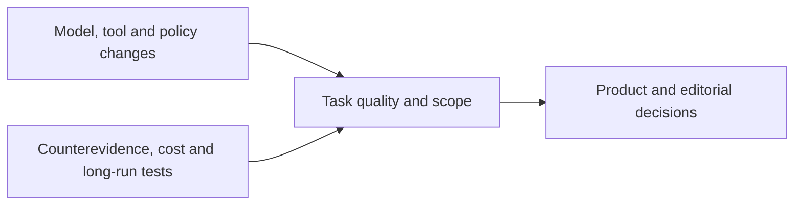

<h1>AI News</h1>

Source-verified global AI industry briefings for product decisions and editorial planning with investment monitoring and technical context as additional lenses

<strong>English</strong> · <a href="README.zh-CN.md">中文</a>

<a href="en/daily/2026-11/2026-11-23.md">Read the latest brief</a> · <a href="en/weekly/2026-W47.md">Read W47</a> · <a href="en/monthly/2026-10.md">Read October</a> · <a href="en/INDEX.md">Browse the archive</a>

---

Daily coverage spans large language models (LLMs), multimodal and world models, AI applications, AI in gaming, company developments, research, and notable expert perspectives. We prioritize primary sources and label publication time, independent corroboration, confidence, and trend status. New briefs from October 18, 2026 onward have complete English and Chinese editions. Earlier reports remain Chinese-only until translated and reviewed.

## Current key trends

**Latest edition:** The [November 23 brief](en/daily/2026-11/2026-11-23.md) covers the Lean/Mathlib verification of a Claude-assisted Riemann Hypothesis proof, a new OpenAI chief scientist essay, and a medicinal chemistry benchmark catch-up. The [W47 weekly brief](en/weekly/2026-W47.md) synthesizes November 16–22 releases and the proof catch-up by its original event date.

1. **Policy boundaries now affect model supply chains, not only app access.** The [US Federal Register's DeepSeek order](en/daily/2026-10/2026-10-21.md) applies to federal civilian procurement and IT systems, including specified third-party implementations; it is not a universal US private-use ban. Check the July signature and October publication timeline.
2. **Model competition is shifting from announcements to cost per completed task.** [GPT-6.1 Terra](en/daily/2026-10/2026-10-27.md) adds a lower-priced visual/computer-use option, but its strong benchmark figures are vendor-reported. [MiniMax M3.1 Flash weights](en/daily/2026-10/2026-10-24.md) are downloadable under a community license requiring attribution and authorization above $20 million annual revenue. Compare licenses, hardware, quality, retries, and end-to-end cost.
3. **World-model research is following distinct paths: interactive simulation, robot control, and laboratory digital twins.** [NVIDIA Cosmos 3 checkpoints](en/daily/2026-11/2026-11-06.md) add controllable driving and robotics simulation; their downstream fidelity remains unproven independently. [Tencent Hy-Nomas](en/daily/2026-10/2026-10-25.md) provides weights, code, and a demo for text/camera-steered video segments, but its 24 FPS output is playback rate, not measured generation speed. [Matrix-Game 4.0](daily/2026-10/2026-10-16.md) offers a single-user demo. Neither substitutes for sustained player testing.
4. **Agent competition extends to tools, context, and vertical workflows.** [OpenAI's Orchestra Bio acquisition and Gemini's car/SMB entry points](en/daily/2026-10/2026-10-21.md) expand distribution; [DeepSeek Search/Fetch and Tencent's memory-writing model](en/daily/2026-10/2026-10-18.md) add infrastructure options. Audit permissions, state quality, latency, and task cost.
5. **Adoption, governance, and economic value remain separate questions.** [OpenAI Signals](en/daily/2026-10/2026-10-27.md) measures work-related messages on individual ChatGPT plans, excluding Enterprise and Codex; it is not a productivity estimate. Anthropic has [closed its IPO and concurrent placement](en/daily/2026-11/2026-11-21.md); fund deployment and business returns remain open. Its [proposed Public Benefit Fund](en/daily/2026-10/2026-10-19.md) has separate governance status.
6. **Multimodal production is becoming a structured, reviewable workflow.** [Gemini Notebook's outline and producer-note review](en/daily/2026-10/2026-10-20.md) adds a pre-render checkpoint. Asset reuse and sound consistency should ultimately be judged by rework time and finished quality.
7. **Safety, deployment, and delivery constraints are becoming concrete.** [China's proposed export catalog and immediate registration](en/daily/2026-10/2026-10-18.md) are distinct. [GDC's air-gapped search preview](en/daily/2026-10/2026-10-21.md) needs independent boundary validation; [Nscale's power-access setback](en/daily/2026-10/2026-10-19.md) shows announced compute is not guaranteed delivery.
8. **High-capability model access and operational stops are now product constraints.** [Fable and Mythos 5.2](en/daily/2026-11/2026-11-10.md) share an underlying model but differ in safeguards and verified access. OpenAI's Control Room covers research inference workloads, with a vendor-stated maximum stop delay of 35 seconds; independent coverage and timing checks remain open.
9. **Agent competition now spans model tiers, editable artifacts and commercial discovery.** [Gemini 4 Carbon, Muse Ember, Claude Sheets and ChatGPT Business Agents](en/daily/2026-11/2026-11-11.md) have distinct access, pricing and product roles. Compare completed tasks, permissions and conversion rather than vendor scores alone.
10. **Routing, creative control and inspectable model artifacts need different acceptance tests.** [Hydrogen, Flow and SOV-Transcribe-1](en/daily/2026-11/2026-11-13.md) affect cost, storytelling consistency and voice accuracy, while the [Qwen, ERNIE, Praxis-1 and PAN 2 catch-up](en/daily/2026-11/2026-11-12.md) separates preview access, promised weights, robot control and world simulation.
11. **Governance and interface changes can matter as much as a new model.** [NVIDIA's leadership transition, Gemini Wallet, llama.cpp 1.0 and A2UI](en/daily/2026-11/2026-11-14.md) require delivery, permission, integration and UI safety checks respectively.
12. **Model tiers and distribution now change together.** [Qwen4-Max, Hy4 flash and Hugging Face/OpenRouter](en/daily/2026-11/2026-11-17.md) alter API choice, price and routing; promised weights, vendor cost claims and actual bills need separate verification.
13. **Agent safety is moving from internal controls to legal and external review.** California's lawsuit establishes filing, not liability; OpenAI's new assessor agreements establish access plans, not findings. The [November 17 brief](en/daily/2026-11/2026-11-17.md) tracks both alongside Google threat intelligence.
14. **Frontier and vertical models now compete within permissioned workflows.** [GPT-6.2, Microsoft MAI, Gemini Tasks and NVIDIA's fiscal Q3](en/daily/2026-11/2026-11-18.md) provide model, agent and compute evidence. Keep vendor benchmark claims, application rollouts, licensed weights and shipped hardware in separate verification tracks.
15. **Interactive world models now have a limited consumer test, while external safety evidence deepens.** [Project Genie, the GAO report and Tencent's results](en/daily/2026-11/2026-11-19.md) call for separate tests of player experience, safeguard effectiveness and AI product unit economics.
16. **Developer access is the next world-model test, while agent tools move closer to execution.** [Genie 4 API access, Gemini Mac and Tool Retrieval](en/daily/2026-11/2026-11-20.md) need matched tests of control latency, permissions and complete-task cost. Alibaba's AI cloud growth and application loss have distinct reporting periods.
17. **World state, agent adaptation and capital deployment now need different evidence.** [WM^MLLM and WorldRuler](en/daily/2026-11/2026-11-21.md) are author-evaluated research, Inkling 2 Mini has inspectable weights, and Anthropic's IPO has closed. Test playability and task economics; track actual deployment of proceeds.
18. **Interactive artifacts and response latency need direct tests.** [ChatGPT Space and FastFrames](en/daily/2026-11/2026-11-22.md) highlight collaboration permissions and input-to-frame latency. The former is a limited product rollout; the latter is author-evaluated research with inspectable artifacts.
19. **AI-assisted research needs inspectable claims and independent verification.** [Lean/Mathlib and MIT checks](en/daily/2026-11/2026-11-23.md) provide formal evidence for the Claude-assisted Riemann Hypothesis proof; a readable mathematical account and longer scholarly review remain. Pachocki's perplexity proposal is a viewpoint, while MedChemBench is a vendor benchmark rather than a laboratory outcome.

## Historical content

- [2026-11-23 AI Daily Brief (formal proof verification, research viewpoint, benchmark catch-up)](en/daily/2026-11/2026-11-23.md) · [中文](daily/2026-11/2026-11-23.md)
- [2026-W47 Weekly Brief](en/weekly/2026-W47.md) · [中文](weekly/2026-W47.md)
- [2026-11-22 AI Daily Brief (no major new update; two catch-ups)](en/daily/2026-11/2026-11-22.md) · [中文](daily/2026-11/2026-11-22.md)
- [2026-11-21 AI Daily Brief (10 verified items; two paper catch-ups)](en/daily/2026-11/2026-11-21.md) · [中文](daily/2026-11/2026-11-21.md)
- [2026-11-20 AI Daily Brief (11 verified items; two catch-ups)](en/daily/2026-11/2026-11-20.md) · [中文](daily/2026-11/2026-11-20.md)
- [2026-11-19 AI Daily Brief (14 high-signal items)](en/daily/2026-11/2026-11-19.md) · [中文](daily/2026-11/2026-11-19.md)
- [2026-11-18 AI Daily Brief (13 high-signal items)](en/daily/2026-11/2026-11-18.md) · [中文](daily/2026-11/2026-11-18.md)
- [2026-11-17 AI Daily Brief (15 high-signal items)](en/daily/2026-11/2026-11-17.md) · [中文](daily/2026-11/2026-11-17.md)
- [2026-11-16 AI Daily Brief (no major new update; one catch-up)](en/daily/2026-11/2026-11-16.md) · [中文](daily/2026-11/2026-11-16.md)
- [2026-W46 Weekly Brief](en/weekly/2026-W46.md) · [中文](weekly/2026-W46.md)
- [2026-11-15 AI Daily Brief (no major new update)](en/daily/2026-11/2026-11-15.md) · [中文](daily/2026-11/2026-11-15.md)
- [2026-11-14 AI Daily Brief](en/daily/2026-11/2026-11-14.md) · [中文](daily/2026-11/2026-11-14.md)
- [2026-11-13 AI Daily Brief](en/daily/2026-11/2026-11-13.md) · [中文](daily/2026-11/2026-11-13.md)
- [2026-11-12 AI Daily Brief (retrospective catch-up)](en/daily/2026-11/2026-11-12.md) · [中文](daily/2026-11/2026-11-12.md)
- [2026-11-11 AI Daily Brief](en/daily/2026-11/2026-11-11.md) · [中文](daily/2026-11/2026-11-11.md)
- [2026-11-10 AI Daily Brief](en/daily/2026-11/2026-11-10.md) · [中文](daily/2026-11/2026-11-10.md)
- [2026-11-09 AI Daily Brief, late catch-up](en/daily/2026-11/2026-11-09.md) · [中文](daily/2026-11/2026-11-09.md)
- [2026-W45 Weekly Brief](en/weekly/2026-W45.md) · [中文](weekly/2026-W45.md)
- [2026-11-08 AI Daily Brief](en/daily/2026-11/2026-11-08.md) · [中文](daily/2026-11/2026-11-08.md)
- [2026-11-07 AI Daily Brief](en/daily/2026-11/2026-11-07.md) · [中文](daily/2026-11/2026-11-07.md)
- [2026-11-06 AI Daily Brief](en/daily/2026-11/2026-11-06.md) · [中文](daily/2026-11/2026-11-06.md)
- [2026-11-05 AI Daily Brief](en/daily/2026-11/2026-11-05.md) · [中文](daily/2026-11/2026-11-05.md)
- [2026-11-04 AI Daily Brief](en/daily/2026-11/2026-11-04.md) · [中文](daily/2026-11/2026-11-04.md)
- [2026-11-03 AI Daily Brief](en/daily/2026-11/2026-11-03.md) · [中文](daily/2026-11/2026-11-03.md)
- [2026-W44 Weekly Brief, incomplete coverage](en/weekly/2026-W44.md) · [中文](weekly/2026-W44.md)
- [2026-10 Monthly Brief, incomplete coverage](en/monthly/2026-10.md) · [中文](monthly/2026-10.md)
- [2026-11-02 AI Daily Brief, late catch-up](en/daily/2026-11/2026-11-02.md) · [中文](daily/2026-11/2026-11-02.md)
- [2026-10-27 AI Daily Brief, late](en/daily/2026-10/2026-10-27.md) · [中文](daily/2026-10/2026-10-27.md)
- [2026-10-26 AI Daily Brief, backfilled](en/daily/2026-10/2026-10-26.md) · [中文](daily/2026-10/2026-10-26.md)
- [2026-W43 Weekly Brief](en/weekly/2026-W43.md) · [中文](weekly/2026-W43.md)
- [2026-10-25 AI Daily Brief](en/daily/2026-10/2026-10-25.md) · [中文](daily/2026-10/2026-10-25.md)
- [2026-10-24 AI Daily Brief](en/daily/2026-10/2026-10-24.md) · [中文](daily/2026-10/2026-10-24.md)
- [2026-10-23 AI Daily Brief](en/daily/2026-10/2026-10-23.md) · [中文](daily/2026-10/2026-10-23.md)
- [2026-10-22 AI Daily Brief](en/daily/2026-10/2026-10-22.md) · [中文](daily/2026-10/2026-10-22.md)
- [2026-10-21 AI Daily Brief](en/daily/2026-10/2026-10-21.md) · [中文](daily/2026-10/2026-10-21.md)
- [2026-10-20 AI Daily Brief](en/daily/2026-10/2026-10-20.md) · [中文](daily/2026-10/2026-10-20.md)
- [2026-10-19 AI Daily Brief](en/daily/2026-10/2026-10-19.md) · [中文](daily/2026-10/2026-10-19.md)
- [2026-W42 Weekly Brief](en/weekly/2026-W42.md) · [中文](weekly/2026-W42.md)
- [2026-10-18 AI Daily Brief](en/daily/2026-10/2026-10-18.md) · [中文](daily/2026-10/2026-10-18.md)
- [2026-10-17 AI Daily Brief](daily/2026-10/2026-10-17.md) · Chinese only
- [Full English archive index](en/INDEX.md) · [Complete Chinese archive](INDEX.md) · [Methodology (Chinese)](METHODOLOGY.md)

> Research information only; not investment, medical, or legal advice. Check primary sources before consequential decisions.
