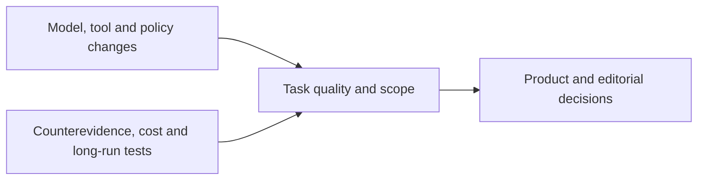

<h1>AI News</h1>

Source-verified global AI industry briefings for product decisions and editorial planning with investment monitoring and technical context as additional lenses

<strong>English</strong> · <a href="README.zh-CN.md">中文</a>

<a href="en/daily/2026-10/2026-10-27.md">Read the latest brief</a> · <a href="en/weekly/2026-W43.md">Read W43</a> · <a href="en/INDEX.md">Browse the archive</a>

---

Daily coverage spans large language models (LLMs), multimodal and world models, AI applications, AI in gaming, company developments, research, and notable expert perspectives. We prioritize primary sources and label publication time, independent corroboration, confidence, and trend status. New briefs from October 18, 2026 onward have complete English and Chinese editions. Earlier reports remain Chinese-only until translated and reviewed.

## Current key trends

**Latest edition:** The [late October 27 brief](en/daily/2026-10/2026-10-27.md) covers GPT-6.1 Terra, Anthropic's proposed-IPO filing, and OpenAI's AI-assisted research claims with their independent-review gaps. [October 26](en/daily/2026-10/2026-10-26.md) was backfilled separately as a no-major-update edition. The [W43 review](en/weekly/2026-W43.md) covers October 19–25.

1. **Policy boundaries now affect model supply chains, not only app access.** The [US Federal Register's DeepSeek order](en/daily/2026-10/2026-10-21.md) applies to federal civilian procurement and IT systems, including specified third-party implementations; it is not a universal US private-use ban. Check the July signature and October publication timeline.
2. **Model competition is shifting from announcements to cost per completed task.** [GPT-6.1 Terra](en/daily/2026-10/2026-10-27.md) adds a lower-priced visual/computer-use option, but its strong benchmark figures are vendor-reported. [MiniMax M3.1 Flash weights](en/daily/2026-10/2026-10-24.md) are downloadable under a community license requiring attribution and authorization above $20 million annual revenue. Compare licenses, hardware, quality, retries, and end-to-end cost.
3. **World-model research is following distinct paths: interactive simulation, robot control, and laboratory digital twins.** [Tencent Hy-Nomas](en/daily/2026-10/2026-10-25.md) provides weights, code, and a demo for text/camera-steered video segments, but its 24 FPS output is playback rate, not measured generation speed. [Matrix-Game 4.0](daily/2026-10/2026-10-16.md) offers a single-user demo. Neither substitutes for sustained player testing.
4. **Agent competition extends to tools, context, and vertical workflows.** [OpenAI's Orchestra Bio acquisition and Gemini's car/SMB entry points](en/daily/2026-10/2026-10-21.md) expand distribution; [DeepSeek Search/Fetch and Tencent's memory-writing model](en/daily/2026-10/2026-10-18.md) add infrastructure options. Audit permissions, state quality, latency, and task cost.
5. **Adoption, governance, and economic value remain separate questions.** [OpenAI Signals](en/daily/2026-10/2026-10-27.md) measures work-related messages on individual ChatGPT plans, excluding Enterprise and Codex; it is not a productivity estimate. Anthropic's [proposed IPO filing](en/daily/2026-10/2026-10-27.md) does not establish valuation or completed listing, while its [proposed Public Benefit Fund](en/daily/2026-10/2026-10-19.md) still needs approval.
6. **Multimodal production is becoming a structured, reviewable workflow.** [Gemini Notebook's outline and producer-note review](en/daily/2026-10/2026-10-20.md) adds a pre-render checkpoint. Asset reuse and sound consistency should ultimately be judged by rework time and finished quality.
7. **Safety, deployment, and delivery constraints are becoming concrete.** [China's proposed export catalog and immediate registration](en/daily/2026-10/2026-10-18.md) are distinct. [GDC's air-gapped search preview](en/daily/2026-10/2026-10-21.md) needs independent boundary validation; [Nscale's power-access setback](en/daily/2026-10/2026-10-19.md) shows announced compute is not guaranteed delivery.

## Historical content

- [2026-10-27 AI Daily Brief, late](en/daily/2026-10/2026-10-27.md) · [中文](daily/2026-10/2026-10-27.md)
- [2026-10-26 AI Daily Brief, backfilled](en/daily/2026-10/2026-10-26.md) · [中文](daily/2026-10/2026-10-26.md)
- [2026-W43 Weekly Brief](en/weekly/2026-W43.md) · [中文](weekly/2026-W43.md)
- [2026-10-25 AI Daily Brief](en/daily/2026-10/2026-10-25.md) · [中文](daily/2026-10/2026-10-25.md)
- [2026-10-24 AI Daily Brief](en/daily/2026-10/2026-10-24.md) · [中文](daily/2026-10/2026-10-24.md)
- [2026-10-23 AI Daily Brief](en/daily/2026-10/2026-10-23.md) · [中文](daily/2026-10/2026-10-23.md)
- [2026-10-22 AI Daily Brief](en/daily/2026-10/2026-10-22.md) · [中文](daily/2026-10/2026-10-22.md)
- [2026-10-21 AI Daily Brief](en/daily/2026-10/2026-10-21.md) · [中文](daily/2026-10/2026-10-21.md)
- [2026-10-20 AI Daily Brief](en/daily/2026-10/2026-10-20.md) · [中文](daily/2026-10/2026-10-20.md)
- [2026-10-19 AI Daily Brief](en/daily/2026-10/2026-10-19.md) · [中文](daily/2026-10/2026-10-19.md)
- [2026-W42 Weekly Brief](en/weekly/2026-W42.md) · [中文](weekly/2026-W42.md)
- [2026-10-18 AI Daily Brief](en/daily/2026-10/2026-10-18.md) · [中文](daily/2026-10/2026-10-18.md)
- [2026-10-17 AI Daily Brief](daily/2026-10/2026-10-17.md) · Chinese only
- [Full English archive index](en/INDEX.md) · [Complete Chinese archive](INDEX.md) · [Methodology (Chinese)](METHODOLOGY.md)

> Research information only; not investment, medical, or legal advice. Check primary sources before consequential decisions.
