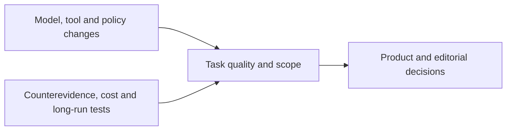

<h1>AI News</h1>

Evidence-linked global AI intelligence for product decisions and story ideas with investment watch and AI literacy as secondary lenses

<strong>English</strong> · <a href="README.zh-CN.md">中文</a>

<a href="en/daily/2026-10/2026-10-19.md">Read the latest brief</a> · <a href="en/weekly/2026-W42.md">Read W42</a> · <a href="en/INDEX.md">Browse the archive</a>

---

Daily coverage spans LLMs, multimodal and world models, AI applications, AI games, companies, research, and consequential expert views. We prioritize primary sources and label publication time, cross-checking, confidence, and trend status. New briefs from October 18, 2026 onward have complete English and Chinese editions. Earlier reports remain Chinese-only until translated and reviewed.

## Current key trends

1. **Open models compete on delivery, not announcements.** [DeepSeek V4.1 Flash 1017](en/daily/2026-10/2026-10-18.md) joins [Beam and Ling 3.1 Flash](daily/2026-10/2026-10-17.md) as accessible weights. Compare license, hardware, effective context, and full task cost; vendor scores are not independent tests.
2. **World models are splitting into playable systems, robot control, and lab digital twins.** [Matrix-Game 4.0](daily/2026-10/2026-10-16.md) offers a single-player demo, while [OneWM and VERID](daily/2026-10/2026-10-17.md) illustrate research and physical-lab paths. None substitutes for long-session player validation.
3. **Agent competition extends to tools and persistent state.** [DeepSeek Search/Fetch and Tencent's memory writer](en/daily/2026-10/2026-10-18.md) add infrastructure options. AtMem's replay counterexample calls for tests of source quality, missed and false writes, latency, and total cost.
4. **Adoption, governance, and economic value remain separate questions.** Anthropic's [proposed Public Benefit Fund](en/daily/2026-10/2026-10-19.md) still needs stockholder approval and implementation evidence; its internal employment observations cannot establish labor-market effects. Stack Overflow and Itaú case studies still lack independent net-return audits.
5. **Multimodal production is becoming a structured workflow.** Asset reuse across tasks and sound consistency across clips should ultimately be judged by rework time and finished quality.
6. **Safety, policy, and delivery constraints are becoming concrete.** [China's proposed export catalog and immediate registration](en/daily/2026-10/2026-10-18.md) are distinct. [Nscale's power-access setback](en/daily/2026-10/2026-10-19.md) shows that announced compute capacity is not guaranteed delivery; multi-step agent behavior still needs outside testing.

## Historical content

- [2026-10-19 AI Daily Brief](en/daily/2026-10/2026-10-19.md) · [中文](daily/2026-10/2026-10-19.md)
- [2026-W42 Weekly Brief](en/weekly/2026-W42.md) · [中文](weekly/2026-W42.md)
- [2026-10-18 AI Daily Brief](en/daily/2026-10/2026-10-18.md) · [中文](daily/2026-10/2026-10-18.md)
- [2026-10-17 AI Daily Brief](daily/2026-10/2026-10-17.md) · Chinese only
- [Full English archive index](en/INDEX.md) · [Complete Chinese archive](INDEX.md) · [Methodology (Chinese)](METHODOLOGY.md)

> Research information only; not investment, medical, or legal advice. Check primary sources before consequential decisions.
