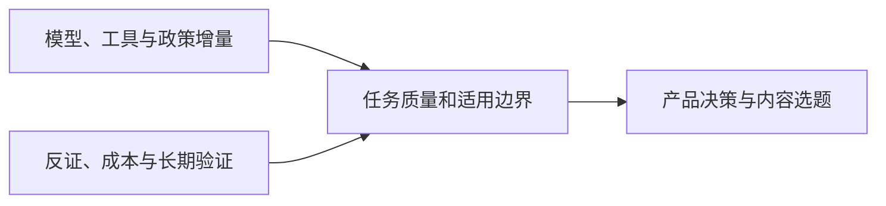

<h1>AI News</h1>

面向产品决策与内容选题的全球 AI 情报库 兼顾投资观察与行业知识扫盲

<a href="README.md">English</a> · <strong>中文</strong>

<a href="daily/2026-10/2026-10-18.md">阅读最新日报</a> · <a href="INDEX.md">浏览完整索引</a>

---

每日覆盖 LLM、多模态与世界模型、AI 应用、AI 游戏、公司、研究报告及关键观点。优先一手信源，标注发布时间、交叉验证、可信度和趋势状态。10 月 18 日起的新日报同步提供中英文完整版本；此前档案暂为中文。

## 当前关键趋势

1. **开放权重进入实际交付竞争。** [DeepSeek V4.1 Flash 1017](daily/2026-10/2026-10-18.md)与此前的 [Beam、Ling 3.1 Flash](daily/2026-10/2026-10-17.md)需按许可、硬件、有效上下文和完整任务成本比较；厂商榜分不是独立实测。
2. **世界模型分化为可玩工程、机器人控制和实验数字孪生。** [Matrix-Game 4.0](daily/2026-10/2026-10-16.md)已有单人演示，[OneWM 与 VERID](daily/2026-10/2026-10-17.md)分别提供研究和实体实验路线，不能互相替代长期可玩性验证。
3. **Agent 的竞争扩展到工具与连续状态。** [DeepSeek Search/Fetch 与腾讯记忆写入模型](daily/2026-10/2026-10-18.md)带来基础设施增量；AtMem 的回放反证提示要检验来源质量、漏写、误写、延迟及总成本。
4. **组织采用与投资价值仍需分层。** Anthropic 内部用工观察不能外推整体劳动力市场；Stack Overflow、Itaú 的客户案例尚缺独立净收益审计。
5. **多模态生产走向可编排工作流。** 跨任务素材复用、跨片段声音一致性等能力，应以返工时间和成片质量验收。
6. **安全与政策走向具体控制。** [中国技术出口目录草案与即时登记](daily/2026-10/2026-10-18.md)必须区分；Agent 多步行为和终端防护仍需独立复测。

## 历史内容

- [2026-10-18 AI 日报](daily/2026-10/2026-10-18.md) · [English](en/daily/2026-10/2026-10-18.md)
- [2026-10-17 AI 日报](daily/2026-10/2026-10-17.md)
- [2026-10-16 AI 日报](daily/2026-10/2026-10-16.md)
- [2026-W41 AI 周报](weekly/2026-W41.md)
- [完整历史索引](INDEX.md) · [持续趋势追踪](TRACKERS.md) · [采集与筛选方法](METHODOLOGY.md)

> 本仓库提供研究信息，不构成投资、医疗或法律建议。关键决策请回到原始信源复核。
