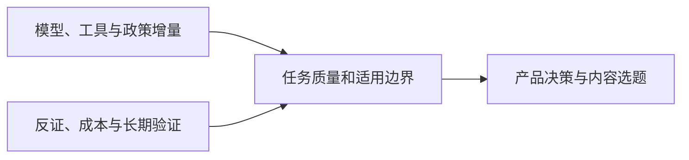

<h1>AI News</h1>

面向产品决策与内容选题的全球 AI 行业资讯与研究简报 兼顾投资观察与技术背景梳理

<a href="README.md">English</a> · <strong>中文</strong>

<a href="daily/2026-10/2026-10-20.md">阅读最新日报</a> · <a href="weekly/2026-W42.md">阅读 W42 周报</a> · <a href="INDEX.md">浏览完整索引</a>

---

每日覆盖大语言模型（LLM）、多模态模型与世界模型、AI 应用、AI 游戏、公司动态、研究报告及专家观点。优先一手信源，标注发布时间、独立交叉验证情况、可信度和趋势状态。10 月 18 日起的新日报同步提供中英文完整版本；此前档案暂为中文。

## 当前关键趋势

1. **模型竞争从发布转向单位任务成本。** [MiniMax M3.1 Flash](daily/2026-10/2026-10-20.md)已有 API，但权重未发布；[DeepSeek 1017](daily/2026-10/2026-10-18.md)已有可下载权重。按许可、硬件、质量、重试和完整任务成本比较；厂商榜分不是独立实测。
2. **世界模型分化为可玩工程、机器人控制和实验数字孪生。** [Matrix-Game 4.0](daily/2026-10/2026-10-16.md)已有单人演示，[OneWM 与 VERID](daily/2026-10/2026-10-17.md)分别提供研究和实体实验路线，不能互相替代长期可玩性验证。
3. **Agent 的竞争扩展到工具与连续状态。** [DeepSeek Search/Fetch 与腾讯记忆写入模型](daily/2026-10/2026-10-18.md)带来基础设施增量；AtMem 的回放反证提示要检验来源质量、漏写、误写、延迟及总成本。
4. **组织采用、公司治理与投资价值仍需分层。** Anthropic [公益基金拟议股权安排](daily/2026-10/2026-10-19.md)仍待股东批准与执行披露；其内部用工观察不能外推整体劳动力市场。Stack Overflow、Itaú 的客户案例尚缺独立净收益审计。
5. **多模态生产走向可编排、可审阅的工作流。** [Gemini Notebook 的大纲与制作说明审阅](daily/2026-10/2026-10-20.md)增加生成前检查点。跨任务素材复用和跨片段声音一致性仍应以返工时间和成片质量验收。
6. **安全、政策与交付约束变得具体。** [中国技术出口目录草案与即时登记](daily/2026-10/2026-10-18.md)必须区分；[Nscale 供电瓶颈](daily/2026-10/2026-10-19.md)说明宣布的算力容量不等于按期交付。Agent 多步行为仍需独立复测。

## 历史内容

- [2026-10-20 AI 日报](daily/2026-10/2026-10-20.md) · [English](en/daily/2026-10/2026-10-20.md)
- [2026-10-19 AI 日报](daily/2026-10/2026-10-19.md) · [English](en/daily/2026-10/2026-10-19.md)
- [2026-W42 AI 周报](weekly/2026-W42.md) · [English](en/weekly/2026-W42.md)
- [2026-10-18 AI 日报](daily/2026-10/2026-10-18.md) · [English](en/daily/2026-10/2026-10-18.md)
- [2026-10-17 AI 日报](daily/2026-10/2026-10-17.md)
- [完整历史索引](INDEX.md) · [持续趋势追踪](TRACKERS.md) · [采集与筛选方法](METHODOLOGY.md)

> 本仓库提供研究信息，不构成投资、医疗或法律建议。关键决策请回到原始信源复核。
