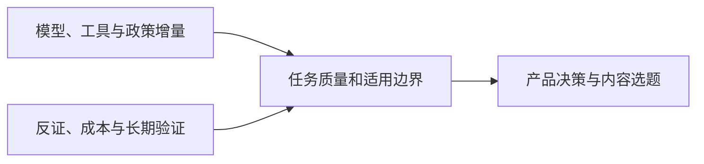

<h1>AI News</h1>

面向产品决策与内容选题的全球 AI 行业资讯与研究简报 兼顾投资观察与技术背景梳理

<a href="README.md">English</a> · <strong>中文</strong>

<a href="daily/2026-10/2026-10-27.md">阅读最新日报</a> · <a href="weekly/2026-W43.md">阅读 W43 周报</a> · <a href="INDEX.md">浏览完整索引</a>

---

每日覆盖大语言模型（LLM）、多模态模型与世界模型、AI 应用、AI 游戏、公司动态、研究报告及专家观点。优先一手信源，标注发布时间、独立交叉验证情况、可信度和趋势状态。10 月 18 日起的新日报同步提供中英文完整版本；此前档案暂为中文。

## 当前关键趋势

**最新一期：** [10 月 27 日延迟版](daily/2026-10/2026-10-27.md)覆盖 GPT-6.1 Terra、Anthropic 拟议 IPO 申报与 OpenAI 的 AI 辅助科研声明，并标注独立核验缺口。[10 月 26 日](daily/2026-10/2026-10-26.md)按无重大更新单独补档；[W43 周报](weekly/2026-W43.md)复盘 19–25 日。

1. **政策边界开始影响模型供应链，而非仅是 App 访问。** [美国《联邦公报》的 DeepSeek 令](daily/2026-10/2026-10-21.md)针对联邦民事机构采购与 IT 系统，也包含特定第三方实现；不是美国私人使用全面禁令。7 月签署与 10 月刊登应分清。
2. **模型竞争从发布转向单位任务成本。** [GPT-6.1 Terra](daily/2026-10/2026-10-27.md)新增较低价视觉/计算机操作选项，但亮眼榜分来自厂商自报。[MiniMax M3.1 Flash 权重](daily/2026-10/2026-10-24.md)已可下载，采用需署名且年收入超过 2000 万美元需授权的社区许可。按许可、硬件、质量、重试和完整任务成本比较。
3. **世界模型分化为可玩工程、机器人控制和实验数字孪生。** [腾讯 Hy-Nomas](daily/2026-10/2026-10-25.md)提供可由文字/相机控制分段视频的权重、代码和演示，但 24 FPS 为播放帧率，非实测生成速度。[Matrix-Game 4.0](daily/2026-10/2026-10-16.md)已有单人演示；两者都不能替代长期玩家测试。
4. **Agent 竞争扩展到工具、上下文和垂直流程。** [Orchestra Bio 收购及 Gemini 车载/小企业入口](daily/2026-10/2026-10-21.md)扩大分发；[DeepSeek Search/Fetch 与腾讯记忆写入模型](daily/2026-10/2026-10-18.md)增加基础设施选项。须验收权限、状态质量、延迟及任务成本。
5. **采用、治理与经济价值仍需分层。** [OpenAI Signals](daily/2026-10/2026-10-27.md)统计个人版 ChatGPT 的工作相关消息，排除 Enterprise 与 Codex，不能视为生产率。Anthropic 的[拟议 IPO 申报](daily/2026-10/2026-10-27.md)不等于已定估值或上市；[公益基金股权提议](daily/2026-10/2026-10-19.md)仍待批准。
6. **多模态生产走向可编排、可审阅的工作流。** [Gemini Notebook 的大纲与制作说明审阅](daily/2026-10/2026-10-20.md)增加生成前检查点。跨任务素材复用和跨片段声音一致性仍应以返工时间和成片质量验收。
7. **安全、部署和交付约束变得具体。** [中国技术出口目录草案与即时登记](daily/2026-10/2026-10-18.md)必须区分；[GDC 隔离网络检索预览](daily/2026-10/2026-10-21.md)需要独立边界验证；[Nscale 供电瓶颈](daily/2026-10/2026-10-19.md)说明宣布的算力不等于按期交付。

## 历史内容

- [2026-10-27 AI 日报（延迟版）](daily/2026-10/2026-10-27.md) · [English](en/daily/2026-10/2026-10-27.md)
- [2026-10-26 AI 日报（事后补档）](daily/2026-10/2026-10-26.md) · [English](en/daily/2026-10/2026-10-26.md)
- [2026-W43 AI 周报](weekly/2026-W43.md) · [English](en/weekly/2026-W43.md)
- [2026-10-25 AI 日报](daily/2026-10/2026-10-25.md) · [English](en/daily/2026-10/2026-10-25.md)
- [2026-10-24 AI 日报](daily/2026-10/2026-10-24.md) · [English](en/daily/2026-10/2026-10-24.md)
- [2026-10-23 AI 日报](daily/2026-10/2026-10-23.md) · [English](en/daily/2026-10/2026-10-23.md)
- [2026-10-22 AI 日报](daily/2026-10/2026-10-22.md) · [English](en/daily/2026-10/2026-10-22.md)
- [2026-10-21 AI 日报](daily/2026-10/2026-10-21.md) · [English](en/daily/2026-10/2026-10-21.md)
- [2026-10-20 AI 日报](daily/2026-10/2026-10-20.md) · [English](en/daily/2026-10/2026-10-20.md)
- [2026-10-19 AI 日报](daily/2026-10/2026-10-19.md) · [English](en/daily/2026-10/2026-10-19.md)
- [2026-W42 AI 周报](weekly/2026-W42.md) · [English](en/weekly/2026-W42.md)
- [2026-10-18 AI 日报](daily/2026-10/2026-10-18.md) · [English](en/daily/2026-10/2026-10-18.md)
- [2026-10-17 AI 日报](daily/2026-10/2026-10-17.md)
- [完整历史索引](INDEX.md) · [持续趋势追踪](TRACKERS.md) · [采集与筛选方法](METHODOLOGY.md)

> 本仓库提供研究信息，不构成投资、医疗或法律建议。关键决策请回到原始信源复核。
