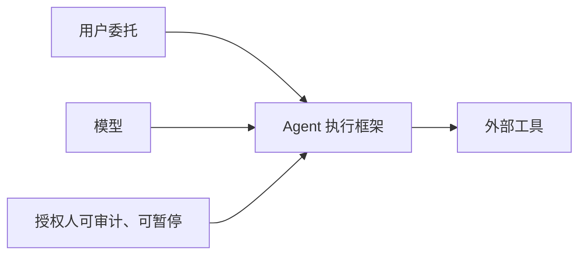

# AI 日报 · 2026-10-11（事后补档）

- **编制时间：** 2026-10-12 16:45（Asia/Shanghai）；追溯 10 月 10 日发布的信息，非当日 11:00 实时扫描。
- **覆盖：** 2 条重要观点/行业观察。未核到足以按“新模型首发”收录的新增一手资料；不机械凑数。
- **上期：** [10 月 10 日](2026-10-10.md) · [趋势追踪](../../TRACKERS.md)。

## 今日关键结论

1. **安全讨论转向可中止的外部控制。** Satya Nadella 主张把模型与执行框架分离，并给授权人“紧急制动”；这是架构观点，不是微软已交付的功能。
2. **短信入口是个人 Agent 的分发试验，不是市场胜负已定。** 媒体盘点多款短信 Agent，显示“无需另装 App”有吸引力，但留存、权限和付费意愿缺统一数据。

## 重点动态

### 1. Satya Nadella 提出 Agent 的“紧急制动”架构

- **发生了什么：** 微软 CEO 在 10 月 10 日的公开观点中主张把模型与执行框架、权限及外部保护分开，记录可读证据，并允许授权人中途暂停或关闭任务。
- **为什么重要 / 视角：** 产品决策：持久 Agent 需要独立于模型的停机、权限撤销和审计层；内容选题：从“模型是否对齐”转向“系统能否被制动”。
- **发布时间 / 类型 / 信源：** 2026-10-10，企业高管观点，经 [TechCrunch 报道](https://techcrunch.com/2026/10/10/microsofts-satya-nadella-says-ai-models-need-an-emergency-brake/)转述原始 X 帖文。
- **交叉验证 / 可信度：** 本轮未取得可稳定直链的 X 原帖；媒体可核其发言，尚无对应产品交付或效果评估。高（观点被公开报道），待验证（落地）。
- **观点边界：** 论据是近期模型非预期行动；反方/局限是“可暂停”不足以保证已发生副作用可回滚，且审计本身有成本。
- **趋势：** T07 持续升温；呼应前日 Anthropic 报告。

### 2. 短信中的个人 Agent 成为一个分发方向

- **发生了什么：** TechCrunch 盘点可直接通过短信交互、连接日历或其他服务并完成任务的个人 Agent。报道是多产品市场观察，不是同一标准下的用户规模榜单。
- **为什么重要 / 视角：** 产品决策：无需安装的入口可能降低首次使用摩擦，但授权、长期记忆、误触发、通知成本和渠道依赖决定留存；内容选题：短信 Agent 与独立 App 的体验对比。
- **发布时间 / 类型 / 信源：** 2026-10-10，主流科技媒体行业盘点；[TechCrunch 原文](https://techcrunch.com/2026/10/10/all-the-ai-agents-that-can-live-in-your-text-messages/)。
- **交叉验证 / 可信度：** 媒体列举的产品存在性可逐一复核；跨产品使用量和付费转化缺统一可比数据。中（类别观察），待验证（市场规模）。
- **趋势：** T01、T08 新增分发入口角度；不是“短信已取代 App”。

## 反向证据与待验证

- 安全架构观点应观察是否进入公开接口、管理员控制和实际事故处置流程。
- 个人 Agent 入口要比较激活率、7/30 日留存与单活跃用户服务成本；媒体盘点不能替代行为数据。
