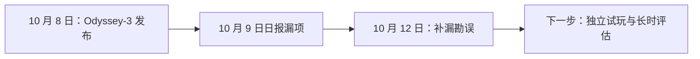

# AI 日报 · 2026-10-12（补漏与趋势版）

- **采集截止：** 2026-10-12 16:45（Asia/Shanghai），比原定 11:00 晚。本版区分原始发布与后续报道，不把 10 月 8 日事件冒充今日首发。
- **覆盖：** 2 条值得跟进的补漏/观点。**今日无重大更新**（按今日新首发口径）；但 Odyssey-3 漏项足以修正此前世界模型判断。
- **历史：** [10 月 11 日补档](2026-10-11.md) · [10 月 9 日勘误](2026-10-09.md) · [趋势追踪](../../TRACKERS.md)。

## 今日关键结论

1. **世界模型观察需纠偏。** Odyssey-3 在 10 月 8 日已发布可试玩研究预览，前日报“未找到新实证”的表述不准确；但公开试玩与厂商基准仍不足以证明长期状态一致性或游戏制作可用。
2. **语音 Agent 的瓶颈可能从说话自然度转向响应与任务完成。** 行业高管的观点强调全双工之后仍有推理速度和识别误差问题，须用真实业务任务复测。

## 重点动态

### 1. Odyssey-3 可试玩研究预览：对上期世界模型判断的更正

- **发生了什么：** Odyssey 官方 10 月 8 日发布 Odyssey-3，并提供 Flash 版浏览器试玩；可用提示词生成环境、移动视角并在生成中交互。团队宣称其 Pro 版在 Physics-IQ/WorldMark 有领先结果，部分比较使用多次生成后选优，不能直接解读成一次生成的玩家体验。
- **为什么重要 / 视角：** 产品决策/内容选题/AI 游戏：应把可试玩世界模型与 Google Playground 的游戏创作工具分开；进一步评估控制响应、长时记忆、物理一致性、画质、成本和玩法设计支持。
- **发布时间 / 类型 / 信源：** **2026-10-08**，公司技术发布；[Odyssey 原文](https://odyssey.systems/meet-odyssey-3) · [试玩入口](https://experience.odyssey.systems/)。10 月 11 日媒体集中报道的是已发布预览，不是另一次确认的新模型首发。
- **交叉验证 / 可信度：** [AI Market Watch 后续报道](https://www.ai-market-watch.com/news/odyssey-opens-a-public-preview-of-its-interactive-world-model-odyssey-3-mr1pdi)确认试玩范围；基准主要为团队报送，未完成独立长时评估。高（发布/入口），中（团队基准），待验证（生产级游戏可用性）。
- **趋势：** T02 从“没有可核新实证”修正为“有可试玩预览、效果待验证”；本条是补漏，不计今日新发布。

### 2. 语音 AI 高管观点：全双工之后仍缺低延迟推理与可靠识别

- **发生了什么：** TechCrunch 采访 PolyAI CTO Shawn Wen 等行业人士，受访者认为全双工语音技术已有进展，但快速推理、关键词识别和自然交互仍是实际障碍。
- **为什么重要 / 视角：** 产品决策：语音角色/助手应测打断恢复、端到端延迟、专有名词识别和任务完成率；内容选题：区分“声音像人”与“能把事情办成”。
- **发布时间 / 类型 / 信源：** 2026-10-11，媒体采访及 KOL/行业观点；[TechCrunch 原文](https://techcrunch.com/2026/10/11/these-execs-think-voice-ai-hasnt-reached-its-chatgpt-moment-yet/)。
- **交叉验证 / 可信度：** 可核受访者观点，未见跨产品统一实验支持“尚未迎来 ChatGPT 时刻”的总体判断；高（观点主体），低至中（行业普遍性）。
- **观点边界：** 论据是语音推理延迟、识别损失；反方是部分窄场景（客服、听写）可能已具商业价值，不能用单一叙事否定。
- **趋势：** T03、T08 延续，属于判断信号而非今日新模型。

## 连续观察与反向证据

- **世界模型：** Odyssey-3 的试玩是比静态视频更强的证据，但不自动证明可生成有目标、有经济系统、有多人协作的完整游戏。下一轮应实测 10–30 分钟状态一致性、交互延迟及单位成本。
- **中美/来源覆盖：** 本次周末补档对中国厂商官网、Hugging Face、X/YouTube 的实时覆盖不足；不能据缺席推断中国市场无进展。关键模型、融资和报告继续按原始信源核查。
- **档案完整性：** 10–11 日为事后短版，12 日本身晚于固定推送时间；周报将标明这些差异。
