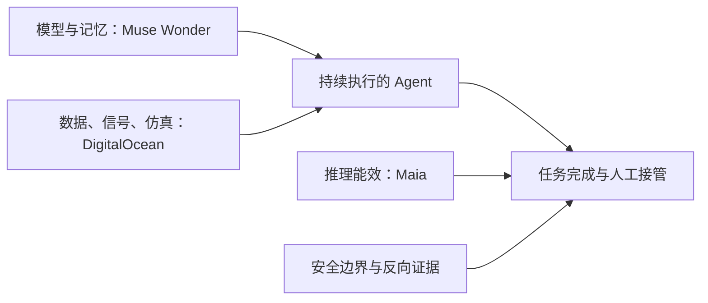

# AI 日报 · 2026-10-13

- **采集截止：** 2026-10-13 11:04（Asia/Shanghai）。主要覆盖 10 月 12 日全球发布；页面只给日期的，不推断精确时分。
- **本期：** 10 条经核对的动态，优先官方原文；不为凑 20–30 条纳入低质量重复报道。包含新发布、研究、应用案例和一条 10 月 9 日 KOL 补漏。
- **历史：** [10 月 12 日日报](2026-10-12.md) · [持续趋势](../../TRACKERS.md) · [完整索引](../../INDEX.md)。

## 今日关键结论

1. **Agent 竞争从模型单点能力转为“记忆—执行—复测”闭环。** Meta 的 Muse Wonder 强调 Active Memory/Focus；DigitalOcean 将生产异常转成多轮仿真回归。发布与可用性可核，实际任务成功率仍待独立对照。
2. **自研推理芯片已从远期路线进入生产与能效竞争。** 微软称 Maia 200 在 Copilot 生产运行，Maia 300 计划 2027 年部署；其能效/吞吐数字是厂商比较，不应写成已被独立证实。
3. **安全边界同时面临模型外部副作用、能力提取与自治复制风险。** Anthropic 的反蒸馏措施与自复制实验分别是运营措施和受控评估；都不是现实网络中已发生自主扩散的证据。
4. **垂直 AI 应用越来越强调持续上下文和可编辑交付物。** Ambi 的环境感知、Honeyjar 的公关工作流、Blueprints AI 的建筑图纸都值得观察，但融资、候补名单与厂商演示不能替代付费留存或合规结果。
5. **世界模型/AI 游戏今天没有足以覆盖 Odyssey-3 的新实证。** 维持对 10 月 8 日可试玩预览的长时状态、延迟、成本评估；“没有核到新发布”不等于领域停滞。

## 重点动态

### 1. Meta 发布 Muse Wonder / Wonder Full：面向个人与专业 Agent

- **发生了什么：** Meta 10 月 12 日推出 Muse Wonder 系列，宣称增强法律、金融、健康与编程任务，加入跨会话的 Active Memory、错误恢复和需要时求确认的 Active Focus。Wonder 已可经 Meta Model API、Muse Code 使用；Full 面向 Muse Code 订阅者，Muse 产品内推广仍是将来时。
- **为什么重要 / 视角：** 产品决策/内容选题：比较“长期记忆 + 持续执行 + 敏感动作确认”的交付闭环，而不只比较答题分数；AI 游戏方向可关注其造 app/小游戏能力，但不能等同于世界模型。
- **发布时间 / 类型 / 原始信源：** 2026-10-12，官方产品公告；[Meta 公告](https://about.fb.com/news/2026/10/introducing-muse-wonder-models/)。
- **交叉验证 / 可信度：** [TechCrunch 报道](https://techcrunch.com/2026/10/12/meta-releases-its-first-frontier-model-muse-wonder/)提供独立报道；高（发布/可用范围），中（厂商能力主张），待验证（跨应用真实任务成功率）。
- **趋势：** T01 持续升温；T08 待验证。

### 2. 微软 Maia 200 已服务生产负载，Maia 300 定于 2027 年部署

- **发生了什么：** 微软称 Maia 200 已服务 Copilot 等生产工作负载，GitHub Copilot/Foundry 计划后续接入；Maia 300 计划 2027 年开始生产部署，面向长上下文、低延迟与多步 Agent。微软预计每兆瓦 token 产出比领先 GPU 系统高 40%。
- **为什么重要 / 视角：** 投资观察/产品决策：推理成本、功耗与延迟会改变模型路由和 Agent 单任务经济性；“200 已部署”与“300 预计部署”必须分开。
- **发布时间 / 类型 / 原始信源：** 2026-10-12，官方基础设施公告；[Microsoft 官方博客](https://blogs.microsoft.com/blog/2026/10/12/microsoft-to-expand-azure-maia-system-to-multi-gigawatt-deployments/)。
- **交叉验证 / 可信度：** 官方技术描述可核，40%/7 倍等对比缺独立同负载复测；高（路线/厂商部署声明），中（比较值），待验证（2027 执行）。
- **趋势：** T06 持续升温。

### 3. Anthropic 公布反蒸馏措施及其副作用

- **发生了什么：** Anthropic 称其新防护令蒸馏者提取数据量下降约 90–99%，重点阻断隐藏推理提取，并承认有正常用户误拦和集成改动。文中关于具体中国实验室的指控仍属 Anthropic 单方主张。
- **为什么重要 / 视角：** 产品决策/投资观察：模型访问条款、推理内容可见性、风控误报与跨平台转售会成为模型采购的运营约束。
- **发布时间 / 类型 / 原始信源：** 2026-10-12，实验室研究/政策说明；[Anthropic 原文](https://www.anthropic.com/research/distillation-defenses)。
- **交叉验证 / 可信度：** 只有发布方的效果与归因数据，未见独立审计；高（措施公告），中低（90–99% 效果及具体归因）。勿将国别归因作为已确认事实。
- **趋势：** T07 首次出现的反蒸馏运营信号。

### 4. Anthropic 自复制研究：小模型的设备推理环节可行，现实传播未获证明

- **发生了什么：** 红队称一个 9B 模型在 9 类硬件中的 8 类完成推理部署；另将 Gemma4-26B-A4B 分布运行于 15 台廉价电视盒。实验重点是推理部署与简化链路，不是现实野外自复制事件；对“数月后可能”的说法是预测。
- **为什么重要 / 视角：** 知识扫盲/产品决策：安全评估应拆成目标发现、初始入侵、部署推理、继续传播，不能把任一环节成功写成端到端现实攻击。
- **发布时间 / 类型 / 原始信源：** 2026-10-12，实验室研究；[Anthropic 红队原文](https://www.anthropic.com/research/self-replicating-ai)。
- **交叉验证 / 可信度：** 有方法与设备细节，未见独立复现；高（研究发布），中（受控实验结果），低（现实传播时间预测）。
- **趋势：** T07 风险验证加深。

### 5. DigitalOcean 将生产异常接入 Agent 多轮仿真回归

- **发生了什么：** DigitalOcean 10 月 12 日变更日志列出 Signals 与 Simulations 公测：前者识别用户/工具/基础设施异常，后者把场景放进隔离环境进行多轮测试并用评估器比较版本。Signals 为选择加入；写入/付费工具可模拟，不能据此认为生产错误已自动消除。
- **为什么重要 / 视角：** 产品决策：建立从真实失败轨迹到回归用例的闭环，衡量最终任务状态、人工接管、误报和隐私处理。
- **发布时间 / 类型 / 原始信源：** 2026-10-12，官方变更日志；[DigitalOcean Changelog](https://ideas.digitalocean.com/changelog) · [机制说明](https://www.digitalocean.com/blog/introducing-signals-and-simulations)。
- **交叉验证 / 可信度：** 官方产品文档与变更日志相互印证发布日期/公测状态，但不构成独立效果验证；高（公测），中（效果）。博客页写“10 月 11 日更新”，本条以 10 月 12 日变更日志为上线时间。
- **趋势：** T01、T08 持续升温。

### 6. DigitalOcean Agent Data Services 提供私有预览的多模态上下文层

- **发生了什么：** 官方称 Agent Data Services 将文档、音视频、结构化记录和执行日志处理/索引为受治理目录，供 Agent 检索和写回；目前为私有预览。
- **为什么重要 / 视角：** 产品决策：多模态 Agent 的瓶颈不仅是模型，而是数据新鲜度、权限、可追溯性和失败复测的共用底座。
- **发布时间 / 类型 / 原始信源：** 2026-10-12，官方产品公告；[DigitalOcean 原文](https://www.digitalocean.com/blog/introducing-agent-data-services)。
- **交叉验证 / 可信度：** 可核公告与预览范围；无独立吞吐、检索质量或成本复测。高（发布），中低（性能/ROI）。
- **趋势：** T01 持续升温，T03 横向连接。

### 7. Ambi 宣布融资 2600 万美元并推出持续聆听的跨设备应用

- **发生了什么：** TechCrunch 采访称前 Plaud 高管创办的 Ambi 获 2600 万美元多轮融资，推出 iPhone、Mac、Apple Watch 应用；用户可选择全天收音，会议中主动提供建议与跨设备上下文。
- **为什么重要 / 视角：** 产品决策/投资观察：验证“持续感知”是否带来任务价值，同时必须单独核查隐私同意、旁人录音、数据保存与删除控制。
- **发布时间 / 类型 / 原始信源：** 2026-10-12 05:47 PDT，媒体采访；[TechCrunch 报道](https://techcrunch.com/2026/10/12/former-plaud-exec-raises-26m-for-ai-app-that-listens-to-you-in-the-background/)。
- **交叉验证 / 可信度：** 融资与产品能力主要来自公司/采访，未见独立运营指标；中（融资/上架主张），待验证（持续使用与隐私效果）。
- **趋势：** T01、T08 首次出现的环境感知应用案例。

### 8. Honeyjar 将公关策划和媒体触达做成 AI 工作流

- **发生了什么：** TechCrunch 采访 Honeyjar 创始人：产品整合稿件撰写、记者名单、社媒/新闻监测和传播机会判断；公司称候补名单首日 1 万人，发送/发布仍需人工操作。
- **为什么重要 / 视角：** 内容选题/产品决策：观察“专家判断 + 人工发布”的垂直 Agent 形态，也警惕 AI 扩大低质量公关推送。
- **发布时间 / 类型 / 原始信源：** 2026-10-12 08:45 PDT，媒体采访；[TechCrunch 报道](https://techcrunch.com/2026/10/12/honeyjar-offers-ai-tools-to-improve-pr-and-comms-at-every-company/)。
- **交叉验证 / 可信度：** 采访可核，候补人数和效果为公司自述，无独立留存数据；高（观点主体/产品定位），中低（规模/效果）。
- **趋势：** T01、T08 垂直化新案例。

### 9. Blueprints AI 预告可联动编辑的建筑图纸第二版

- **发生了什么：** 创始人在 TechCrunch 采访称新版从文字/草图生成建筑、结构、机电等图纸，一处设计改动可联动更新；公开发布计划在本周，许可申报前仍需持牌专业人员审核盖章。
- **为什么重要 / 视角：** 产品决策/知识扫盲：可编辑、合规约束的结构化资产比一次性生成图更有价值；“permit-ready”是厂商定位，并非免审自动获批。
- **发布时间 / 类型 / 原始信源：** 2026-10-12 08:27 PDT，媒体采访；[TechCrunch 报道](https://techcrunch.com/2026/10/12/this-ai-startup-says-it-can-generate-permit-ready-blueprints-in-minutes/)。
- **交叉验证 / 可信度：** 版本、价格和能力来自创始人采访；未见独立合规验收/客户 ROI。中（产品计划），待验证（速度及许可适用性）。
- **趋势：** T03 结构化控制外溢到行业资产。

### 10. 陶哲轩“Math 2.0”观点补漏：证明产量不是研究价值的全部

- **发生了什么：** 陶哲轩的公开演讲及本人审阅的持续更新页面指出，AI 加快证明生成后，核验、讲解、教育与社区吸收可能成为更慢的环节；这属于研究价值判断，不是“AI 已解决数学”的事实。
- **为什么重要 / 视角：** 内容选题/知识扫盲：给 AI 研究报道增加“生成—验证—消化”的衡量维度，避免用论文/证明数量替代实际科学进步。
- **发布时间 / 类型 / 原始信源：** 演讲 2026-10-09，本期补漏；[陶哲轩本人审阅的观点汇总](https://teorth.github.io/tao-web/ai-views.html) · [原始论文](https://arxiv.org/abs/2608.16753)。
- **交叉验证 / 可信度：** 可确认观点主体；其关于学术激励的推论存在领域差异，反方是自动化大规模搜索也可能发现人类忽略的线索。高（观点归属），不以真伪等级评价价值主张。
- **趋势：** T08 的反向证据；非今日首发。

## 连续观察与覆盖边界

- **T02 世界模型/AI 游戏：** 昨日报补记的 [Odyssey-3](https://odyssey.systems/meet-odyssey-3) 是 10 月 8 日首发，本期未找到可独立核验且更新鲜的同等级实证。后续重点是 10–30 分钟状态一致性、控制响应和单位交互成本。
- **中美与信源：** 已扫描中国厂商公开发布、Hugging Face 主站、社区与基金站点；本窗口未找到足够强的新中国模型/AI 游戏一手发布。X/YouTube 的实时覆盖仍不完整，不将缺席解读为“没有动向”。
- **下一轮触发：** Muse Wonder 实际 API 价格与第三方任务测评；Maia 300 的同负载能效复现；DigitalOcean 多轮仿真误报率；Anthropic 研究的独立安全复现；垂直应用真实客户留存。
