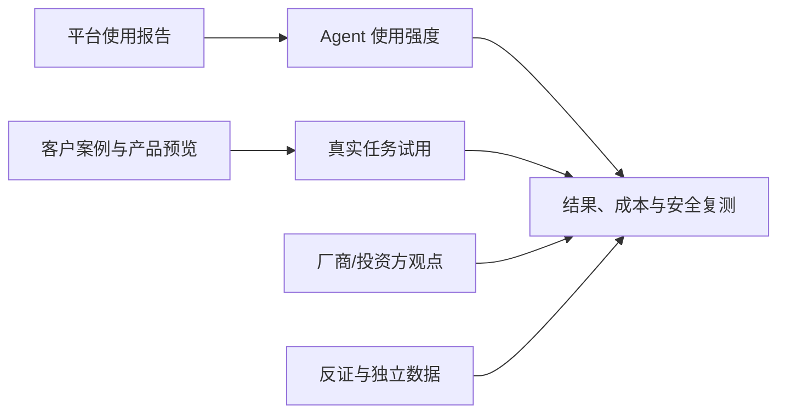

# AI 日报 · 2026-10-15

- **采集截止：** 2026-10-15 10:56（Asia/Shanghai），以本次自动任务触发时刻为准。主要核查 10 月 14 日发布；只标日期的页面不推断精确时分。
- **本期：** 12 条核对过的动态。低于通常 20–30 条的覆盖目标，是因为没有把同一公司的客户案例拆成许多条，也不把旧闻或单一媒体传言凑数。暂无足以取代昨日 Gemini 4 Argon 的可信新前沿模型首发。
- **历史：** [昨日报](2026-10-14.md) · [持续趋势](../../TRACKERS.md) · [完整索引](../../INDEX.md)。

## 今日关键结论

1. **Agent 使用量升温，但“token 份额”和“商业价值”仍是两回事。** OpenAI 的欧盟客户样本中，Codex 与 ChatGPT Work 已占过半输出 token；这是平台内使用强度，不是全欧企业采用率，更不是 ROI。
2. **旧模型迁移已变成产品运营事项。** OpenAI 宣布指定 GPT-4o/GPT-4.1 API 快照及其微调版将于 2027 年 1 月 14 日关闭；采用者应尽早做回归评测，不把“停用特定快照”误写为整个 GPT-4 系列今天下线。
3. **AI 娱乐/游戏出现一个可试用、可反驳的工程案例。** Epic Games 发布 AI 辅助重写的 Launcher 预览，首次覆盖 Linux；预览可下载不等于生产稳定或 AI 写代码优于其他方法。对照昨日 Character.AI 重整，两者分别检验供给效率与长期经营。
4. **中国产品侧有多模态工作流更新，而非新基础模型。** MiniMax Design Agent V3 被报道上线，官方站点可核多模态创作定位；“成本降低 30%”尚为媒体转述的厂商说法，不能直接当成独立实测。
5. **AI 安全从回答过滤扩展到跨步骤行为和终端交互。** Anthropic 的选举压力测试暴露分解成无害子任务的规避风险；Google 在 Android 增加对慢热诈骗、屏幕共享和呼叫转移的保护，但新功能分批推出，效果需要外部验证。
6. **资本与产品机会更偏向长期任务的上下文和结果归因。** a16z 的“接力赛”是投资观点；Third Moment 的万级长时 Agent 是客户自述。真正的产品指标应是任务最终状态、人工接管、总成本与事故率。

## 重点动态

### 1. OpenAI 报告欧盟客户 Agent 使用强度，但不代表全市场

- **发生了什么：** OpenAI Economic Research 称，在其欧盟 ChatGPT Enterprise/Business 样本中，Codex 与 ChatGPT Work 贡献超过一半输出 token；欧盟中小企业客户使用这两项产品的周活用户自 5 月增长 8.1 倍。各国样本的 token 占比差异显著。
- **为什么重要 / 视角：** 产品决策/投资观察：采用量、使用深度和可归因业务收益应分列；输出 token 可能随任务复杂度与模型冗长程度变化，不等于生产率。
- **发布时间 / 类型 / 原始信源：** 2026-10-14，厂商经济研究；[OpenAI 报告与 PDF 入口](https://openai.com/index/the-eus-next-chapter-in-ai-is-agentic/)。
- **交叉验证 / 可信度：** 报告公开口径可查，原始客户样本与业务效果未获独立审计；高（报告发布），中（平台内统计），低（外推为全欧企业采用/ROI）。
- **趋势：** T01 持续升温；T08 待验证。

### 2. OpenAI 通知指定 GPT-4 API 快照将于 2027 年 1 月停用

- **发生了什么：** OpenAI 开发者文档称，10 月 14 日已通知使用指定 GPT-4o、GPT-4o mini、GPT-4.1、GPT-4.1 mini 快照的开发者：这些 API 模型及基于它们的微调版将在 2027 年 1 月 14 日停用，推荐替代为 `gpt-6-luna`。这不等于所有 GPT-4 型号或 ChatGPT 产品今天停用。
- **为什么重要 / 视角：** 产品决策：提前盘点固定模型 ID、微调模型、提示词及工具调用依赖；迁移验收应包括质量、成本、时延、安全和回退方案。
- **发布时间 / 类型 / 原始信源：** 2026-10-14，官方 API 退役日程；[OpenAI 开发者文档](https://developers.openai.com/api/docs/deprecations)。
- **交叉验证 / 可信度：** 官方执行日期与型号列表直接可查，暂无独立迁移效果验证；高（日程），待验证（新模型任务等价性）。
- **趋势：** T01 模型运营新约束；T08 成本与迁移风险待测。

### 3. Meta/YouGov 亚太 SMB 调研：高自报采用与“需要指导”并存

- **发生了什么：** Meta 发布委托 YouGov 对亚太 9 个市场近 4000 名小企业主的调查：84% 受访者称正在使用 AI，76% 自报生产率有正面影响，86% 认为需要更多指导；内容制作、营销、翻译与客服是常见用途。
- **为什么重要 / 视角：** 产品决策/内容选题：SMB 的机会可能不只是再提供一个模型，而是明确成本、流程模板、隐私约束与可测量成效。
- **发布时间 / 类型 / 原始信源：** 2026-10-14，厂商委托调查；[Meta 原文及研究方法](https://about.fb.com/news/2026/10/more-than-three-quarters-of-small-business-owners-say-ai-makes-them-more-productive-but-most-need-more-guidance/)。
- **交叉验证 / 可信度：** 可核样本/地区/问题口径；未见独立销售或生产率数据，且样本不含中国内地和美国。高（调查披露），中（受访者自报），低（因果和全球外推）。
- **趋势：** T08 持续观察；与 OpenAI 的 token 强度构成不同证据层，不能合并为同一采用率。

### 4. Epic Games Launcher AI 辅助重写版开放预览

- **发生了什么：** Epic 10 月 14 日开放新 Launcher 预览，支持 Windows、macOS 和首次 Linux 版本，重点改进启动/导航、游戏库和下载信息；官方用“vibe coded”描述开发方式，并明确预览功能不全、可能有错误，建议竞技玩家及实时项目开发者暂用现版。
- **为什么重要 / 视角：** AI 游戏/产品决策/内容选题：这是大型游戏分发商将 AI 辅助开发交给真实用户测试的案例，值得比较启动速度、崩溃率、跨平台兼容和用户满意度，而非只报道“AI 写了代码”。
- **发布时间 / 类型 / 原始信源：** 2026-10-14，官方产品公告；[Epic 原文与下载入口](https://store.epicgames.com/news/epic-games-launcher-preview)。
- **交叉验证 / 可信度：** [Ars Technica 的初步试用](https://arstechnica.com/gaming/2026/10/programming-is-hard-epic-games-leans-on-vibe-coding-for-its-new-launcher-app/)支持预览可用并报告有限速度体验；高（公开预览），中（局部性能），待验证（稳定版质量与 AI 开发贡献）。
- **趋势：** T05 首次出现的游戏分发工程案例；T01 代码 Agent 落地信号。

### 5. MiniMax Design Agent V3 被报上线，30% 成本改善待证

- **发生了什么：** 10 月 14 日媒体称 MiniMax Design Agent V3 上线，支持跨对话复用素材、同页共享上下文与自定义 Agent 提示；其官方站点展示多模态创作平台和桌面端下载。所谓创作成本下降超过 30% 来自媒体转述的官方主张，目前未见可复核计算口径。
- **为什么重要 / 视角：** 产品决策/内容选题/AI 游戏：角色、场景与素材跨任务复用，比单次出图更接近连续内容生产；应测同一项目的返工次数、素材一致性和端到端成本。
- **发布时间 / 类型 / 原始信源：** 2026-10-14 14:43（页面所示时间），媒体快讯；[TechFlow 报道](https://www.techflowpost.com/en-US/newsletter/139986) · [MiniMax Design 官方产品页](https://design.minimax.cn/)。
- **交叉验证 / 可信度：** 官方页可确认产品定位，未单独证明“V3”版本细节与 30% 效果；中（上线报道），低（成本提升幅度），待验证（实际工作流质量）。
- **趋势：** T03 持续升温；非新基础模型。

### 6. Google Android 把诈骗检测延伸到慢热对话和屏幕共享

- **发生了什么：** Google 宣布 Google Messages 的可选增强保护将用 Private AI Compute 中的云端 Gemini 分析陌生联系人复杂对话，端侧 Gemini Nano 评估陌生链接；并逐步增加第三方聊天通知预警、共享屏幕敏感字段遮挡和呼叫转移保护。各功能的设备和上线时间不同。
- **为什么重要 / 视角：** 产品决策/知识扫盲：安全产品逐渐采用端侧检测、私密云分析和交互拦截的分层架构；隐私声明、误报、地区覆盖与设备门槛都应单独验证。
- **发布时间 / 类型 / 原始信源：** 2026-10-14，官方安全产品公告；[Google Android 原文及脚注](https://blog.google/security/new-android-scam-protections/)。
- **交叉验证 / 可信度：** Google 引述的第三方评估由 Google 付费委托，不是完全独立的无利益验证；高（功能计划/范围），中（现有拦截量），待验证（新增功能成效与隐私）。
- **趋势：** T07 持续升温。

### 7. Anthropic 选举防护披露：多步拆分可绕过单请求识别

- **发生了什么：** Anthropic 分析约 25 万条美国 Claude.ai 消费者对话（9 月 21–27 日）：约 0.51% 直接涉及选举或投票。与 Institute for Strategic Dialogue、McCain Institute 的压力测试显示，直接恶意请求容易被拒，但将欺骗性活动拆成研究、建站、写稿、分发等貌似无害步骤时可能漏检；Anthropic 称已加强分类器及处置。
- **为什么重要 / 视角：** 产品决策/知识扫盲：内容平台与 Agent 的安全评估应覆盖跨会话目标和完整传播链，而不只检查单条回答。
- **发布时间 / 类型 / 原始信源：** 2026-10-14，官方政策/研究说明；[Anthropic 原文与抽样方法](https://www.anthropic.com/news/2026-us-midterms)。
- **交叉验证 / 可信度：** 有独立组织参与压力测试，但误用比例与封禁情况主要由 Anthropic 发布；高（研究/措施披露），中（抽样结果），待验证（新防护的长期漏检率）。
- **趋势：** T07 持续升温；对“单次拒绝率即安全”的反证。

### 8. Anthropic 新加坡办公室与政府 MOU 扩大亚太布局

- **发生了什么：** Anthropic 宣布开设新加坡办公室，并与新加坡数字发展与新闻部签署谅解备忘录，合作范围包括 AI 安全/评估、采用影响研究及公私部门负责任应用。
- **为什么重要 / 视角：** 投资观察/产品决策：区域政策、评估与企业交付能力成为模型公司扩张的一部分；MOU 是合作意向，不等于采购合同或经济成果。
- **发布时间 / 类型 / 原始信源：** 2026-10-14，官方公司公告；[Anthropic 原文](https://www.anthropic.com/news/singapore-office-opening)。
- **交叉验证 / 可信度：** 单方公告，签署主体和合作范围清晰，未见具体交付指标；高（宣布），待验证（执行）。
- **趋势：** T06 持续升温。

### 9. Third Moment 披露万级、36–48 小时 Agent 研究流程

- **发生了什么：** OpenAI 客户案例称 Third Moment Research 可并行运行约 1 万个 Agent、单次研究持续 36–48 小时；其 Codex 优化将一项回测从约 3 小时缩至 3–5 分钟。团队以外层 harness 对未完成任务决定重试、终止或上交人工，并用 Daybreak 测试环境边界。
- **为什么重要 / 视角：** 产品决策/投资观察：长时 Agent 的基础设施重点是环境、回测、监控、恢复和隔离，不只是上下文窗口。
- **发布时间 / 类型 / 原始信源：** 2026-10-14，供应商发布的客户案例；[OpenAI 原文](https://openai.com/index/third-moment-research/)。
- **交叉验证 / 可信度：** 客户与供应商陈述，缺独立成本及投资结果审计；高（案例/架构描述），中低（规模/提效数字），待验证（收益与事故率）。
- **趋势：** T01 持续升温；T08 商业价值待验证。

### 10. SentinelOne 与 Block 提供 Daybreak 安全工作流案例

- **发生了什么：** OpenAI 同日发布两份客户案例：SentinelOne 称恶意软件逆向时间从 4–6 周缩至约 8 小时；Block 称在红队情境中从高层漏洞描述到自动建议补丁约 18 分钟，并保留人工审查。数字对应特定任务与团队流程，不是通用安全保证。
- **为什么重要 / 视角：** 产品决策/投资观察：对安全 Agent 应测漏洞是否真实、补丁是否有效、误报、人工复核负担与后续回归，而非只看生成速度。
- **发布时间 / 类型 / 原始信源：** 2026-10-14，供应商客户案例；[SentinelOne 案例](https://openai.com/index/sentinelone/) · [Block 案例](https://openai.com/index/block-ai-powered-security/)。
- **交叉验证 / 可信度：** 两个不同客户但均经同一供应商渠道发布，不能算独立性能基准；高（案例披露），中低（效率数字），待验证（可重复性和安全净收益）。
- **趋势：** T07、T08 持续观察。

### 11. a16z 长时 Agent 观点：从“卖座席”转向任务结果

- **发生了什么：** a16z 合伙人 David Haber 认为跨数周或数月的高价值客户旅程，可由持久 Agent 管理事件、上下文与协作；提出卖软件平台、承接服务和垂直整合三种商业路径，并预测按工作成果或结果计价的机会。
- **为什么重要 / 视角：** 内容选题/投资观察/产品决策：对 Yoroll 式连续内容生产，问题不只是生成某一幕，而是跨阶段资产、参与者与验收状态能否接力；商业模式须符合各行业责任和归因边界。
- **发布时间 / 类型 / 原始信源：** 2026-10-14，投资方观点；[David Haber 原文](https://a16z.com/winning-the-relay-race-long-running-agents-in-high-value-customer-journeys/)。
- **交叉验证 / 可信度：** 观点主体明确，文内也承认结果归因、采购和某些行业收费限制；高（观点归属），不以事实可信度评定预测。反方：长链路更易累积错误，法律/医疗等流程需强人工责任，结果定价未必可行。
- **趋势：** T01 观点升温；T08 待验证。

### 12. Google.org 选出 17 个 AI 科学项目，含海洋世界基础模型

- **发生了什么：** Google.org 宣布向 17 个机构合计提供 3600 万美元，并提供可选加速器；项目包括 Inria Chile 的海洋多模态世界基础模型、MIT 的显微图像实验 Agent 等。此为资助决定与研究方向，不是模型已完成或成果已验证。
- **为什么重要 / 视角：** 知识扫盲/投资观察：世界模型不仅指可玩虚拟空间，还可用于物理/生态系统的预测和数字孪生；评估应使用各领域真实预测与决策指标。
- **发布时间 / 类型 / 原始信源：** 2026-10-14，官方资助公告；[Google.org 名单](https://blog.google/company-news/outreach-and-initiatives/google-org/impact-challenge-ai-science-recipients/)。
- **交叉验证 / 可信度：** 可核受资助名单，金额为总承诺而非已实现科研回报；高（公告），待验证（项目进展与科学成果）。
- **趋势：** T02 世界模型范围扩展；T06 AI 科学投入延续。

## 连续观察与覆盖边界

- **世界模型/AI 游戏：** 本窗口未核到新的可独立试玩世界模型；昨日 [Argon 机器人案例](2026-10-14.md)和本期海洋研究资助都不能证明实时 AI 游戏引擎成熟。继续跟踪 [Odyssey-3](https://odyssey.systems/meet-odyssey-3) 的长时状态、延迟、交互成本。
- **交叉验证边界：** OpenAI 多篇客户案例不是多个独立审计；Meta 的调查与 OpenAI 的客户样本也不构成全市场采用率。MiniMax V3 的版本/成本说法仅媒体转述，明示待核。
- **中美/信源：** 已扫描中英文官方、媒体、Hugging Face、论文、X/YouTube 和基金站点。中国侧仅纳入 MiniMax 的有限证据，不机械分配区域条数；X/YouTube 实时覆盖不完整。
- **下一轮触发：** Epic 预览的稳定性/速度实测；MiniMax V3 官方版本说明和创作成本口径；EU Agent 使用的任务级 ROI；Anthropic 多步骤滥用防护复测；世界模型可玩性与科研成果。
