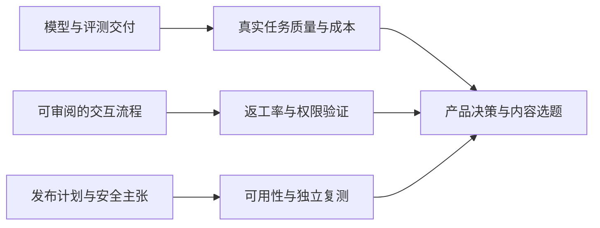

# AI 日报 · 2026-10-20

[中文（当前）](2026-10-20.md) · [English](../../en/daily/2026-10/2026-10-20.md)

- **采集截止：** 2026-10-20 10:30（Asia/Shanghai）；重点核查 10 月 19 日 10:30 后的新披露，并与[昨日](2026-10-19.md)排重。未标时分的官方文章只能确认发布日期，不能进一步确认精确上线时刻。
- **本期性质：** 8 条高信号更新。通常目标为 20–30 条，但本轮不以缺少独立证据的转载、传闻或旧闻凑数。
- **导航：** [趋势追踪](../../TRACKERS.md) · [历史索引](../../INDEX.md)。

## 今日关键结论

1. **中国模型竞争继续转向可交付的 Agent 任务性价比。** MiniMax M3.1 Flash 已进入 API、订阅和编程产品；价格可核，但“快三倍、任务成本降 70%”主要是厂商口径，需在固定任务上复测。权重尚未发布。
2. **AI 编程评测开始把“迁移时保留行为”与“从零写出功能”分开。** OpenAI 公布低资源语言评测和可检查的 MultiLangBench 测试集；漂亮的厂商成绩不等于遗留系统迁移已经可靠。
3. **生成式产品的交互重心从一次性出稿走向可审阅的中间过程。** Gemini Notebook 让用户先确认大纲与制作说明，Google Cloud 展示 MCP Apps 的可交互工具界面；两者都需要用返工率、任务完成率和权限边界验收。
4. **“已宣布”与“已普遍可用”必须分开。** Hugging Face 宣布 TorchNeuron 于 10 月 20 日进入公测；Google Cloud 同日强调 LLM 评判器的偏差需要稳定性、人类判断对齐和多模型比对，方法建议不是独立效果证明。
5. **Agent 安全叙事升级，但高管观点不能当成已验证控制效果。** 微软主张对企业内部 Agent 实施持续、分层监管；其产品方案需要独立的越权、误报、延迟和可中止性测试。

## 重点动态

### 1. MiniMax 发布 M3.1 Flash，权重仍待交付

- **发生了什么：** MiniMax 10 月 19 日宣布 M3.1 Flash 已通过 API、M Plan 和 MiniMax Code 提供，标价每百万输入/输出 token 分别为 0.15/0.60 美元，缓存输入为 0.015 美元。公司称其与此前匿名的 Space Bunny 模型有关，线上推理接近快三倍、Agent 任务成本降 70%；权重“稍后发布”，不是现已开放权重。
- **为什么重要 / 视角：** 产品决策、投资观察、内容选题。与 10 月 17 日的 DeepSeek 更新比较时，应固定编程、电脑操作及游戏开发任务，同时记录输出长度、重试、人审和总费用，不用单价或榜单代替单位任务成本。
- **发布时间 / 类型 / 原始信源：** 2026-10-19（公告未标时分）；[MiniMax 官方公告](https://www.minimax.io/blog/minimax-m31f) · [Artificial Analysis 模型页](https://artificialanalysis.ai/models/minimax-m3-1-flash/)。
- **交叉验证 / 可信度：** 第三方 Artificial Analysis 已列出模型和独立评测，但其当前动态页面与比较页榜分存在差异，本期不引用精确总分；厂商“快三倍、降 70%”尚无同口径外部复测。高（发布、标价与尚未放出权重）；中（性能/成本改善）。
- **趋势：** T01/T06 持续升温；下一步看权重实际交付、稳定任务成本和独立速度测试。

### 2. OpenAI 发布低资源编程语言评测，开放 MultiLangBench 测试集

- **发生了什么：** OpenAI 公布两个不同评测：MultiLangBench 让模型在 20 种语言中从零构建兼容 SQLite 的程序；另一评测考察 COBOL 程序迁移后能否保留行为。其报告称 GPT-6 Astra 在前者平均测试通过率 87.4%，GPT-6.1 Sol 在后者低推理强度下达 86.6%；这些是 OpenAI 的测试结果。MultiLangBench 测试代码与说明已公开。
- **为什么重要 / 视角：** 产品决策、知识梳理、内容选题。遗留系统迁移的核心是行为等价与可回归，而非只看生成代码可编译；高风险系统仍需业务规则、边界条件和人工审批。
- **发布时间 / 类型 / 原始信源：** 2026-10-19（未标时分）；[OpenAI 研究说明](https://openai.com/index/low-resource-programming-languages/) · [MultiLangBench 代码与测试集](https://github.com/openai/MultiLangBench)。
- **交叉验证 / 可信度：** 代码仓库可检查评测设置，但与文章同属 OpenAI，不构成独立性能验证。高（评测发布）；中（跨企业真实遗留代码的可迁移性）。
- **趋势：** T01 首次增加“低资源语言/迁移保真”专项验收点；不能把基准成绩写成生产迁移成功率。

### 3. Gemini Notebook 为幻灯片和视频概览加入生成前审阅

- **发生了什么：** Google 宣布 Gemini Notebook 可在生成 Slide Decks 和 Video Overviews 前，让用户确认主题、审阅幻灯片大纲或视频制作说明，并调整视觉风格及内容顺序；这些共创能力在随后一周面向全球用户逐步推出。
- **为什么重要 / 视角：** 产品决策、内容选题。先确认结构再渲染，可能减少整稿重做；对多模态制作工具，应比较返工时长、修改可控性、成片一致性，而非仅比较首稿速度。
- **发布时间 / 类型 / 原始信源：** 2026-10-19（未标时分）；[Google 产品公告](https://blog.google/innovation-and-ai/products/gemini-notebook/co-create-slides-videos/)。
- **交叉验证 / 可信度：** 单一官方信源确认功能和分批推出计划；未找到独立的可用范围或效果测量。高（公告）；待验证（全量上线及降低返工）。
- **趋势：** T03 持续升温；可观察中间产物是否可复用、能否对单段重做及创作者控制权。

### 4. Google Cloud 展示 Gemini Enterprise 中的交互式 MCP Apps

- **发生了什么：** Google Cloud 发布开发指南：MCP Apps 将工具调用与可交互 UI 配对，在 Gemini Enterprise 对话中以沙箱 iframe 显示，可展开到侧栏或全屏；示例架构把私有 Cloud Run 服务、企业身份和用户 OAuth 分层处理。文章是实现指南，不等于所有企业已经部署。
- **为什么重要 / 视角：** 产品决策、知识梳理。Agent 输出不必只有静态文本；可编辑工作区能降低每次调整都重跑模型的摩擦，但必须检验工具权限、状态同步、人工确认与错误恢复。
- **发布时间 / 类型 / 原始信源：** 2026-10-19（未标时分）；[Google Cloud 开发指南](https://cloud.google.com/blog/topics/developers-practitioners/devs-guide-to-mcp-apps-in-gemini) · [MCP Apps 规范/SDK](https://github.com/modelcontextprotocol/ext-apps)。
- **交叉验证 / 可信度：** 开放规范可核，Gemini Enterprise 集成、安全保证与可用范围仍主要由 Google 自述。高（文档发布与架构说明）；待验证（跨宿主兼容性和生产效果）。
- **趋势：** T01/T03 增加“对话内可交互交付物”方向；不与基础模型能力提升混同。

### 5. 印尼 GoTo 发布基于 Gemma 3 的 27B 地区语言模型

- **发生了什么：** GoTo 与 AI Singapore 开发的 27B 指令模型已在 Hugging Face 提供权重，模型卡列出英语、印尼语、爪哇语、巽他语、Toba Batak 语和巴厘语，标称 128k 上下文，许可为 **Gemma License**。GoTo 在 Bali Tech Week 对外介绍该模型；其“开源”措辞不应覆盖许可细节。
- **为什么重要 / 视角：** 产品决策、投资观察。区域语言模型为主权部署提供一种路线，但本地性能、授权条款和硬件成本都需逐项验证；模型卡估计 FP16/BF16 推理约需 54–60 GB 显存。
- **发布时间 / 类型 / 原始信源：** 2026-10-19（活动报道；模型卡未给精确首发时刻）；[GoTo 官方模型卡及权重](https://huggingface.co/GoToCompany/gemma3-27b-cpt-gotoai-v3-instruct) · [TechNode Global 独立报道](https://technode.global/2026/10/19/goto-releases-27b-indonesian-language-model/)。
- **交叉验证 / 可信度：** 媒体核对活动与发布，模型卡核对权重和许可；质量榜分与本地语言覆盖效果尚无独立任务复测。高（权重可获取）；中（实际适用性）。
- **趋势：** T06 首次纳入东南亚本地语言模型交付；开放权重不自动等于 OSI 意义的开源。

### 6. Hugging Face 宣布 TorchNeuron 将进入 AWS Trainium 公测

- **发生了什么：** Hugging Face 10 月 19 日介绍 TorchNeuron：作为 PyTorch 的 Trainium 后端，支持 eager mode、`torch.compile` 和原生分布式接口，并与 Transformers、Diffusers 等库衔接。文章称 **10 月 20 日起**开放公测，并报告常用文本生成模型架构覆盖率从旧适配方案的 46% 升至 89%；截稿时不把预告写成已经完成公测验收。
- **为什么重要 / 视角：** 产品决策、投资观察。非 NVIDIA 训练/推理栈的工程门槛若下降，可能拓宽基础设施选择；但兼容架构比例不代表所有算子、模型或工作负载都无迁移成本。
- **发布时间 / 类型 / 原始信源：** 2026-10-19（未标时分）；[Hugging Face 技术公告](https://huggingface.co/blog/hf-torchneuron) · [PyTorch/TorchNeuron 文档入口](https://awsdocs-neuron.readthedocs-hosted.com/en/latest/)。
- **交叉验证 / 可信度：** 文章含示例与文档入口，但覆盖率及性能为项目方数据；独立成本/兼容性复测未见。高（发布计划）；待验证（公测可用性与实际性能）。
- **趋势：** T06 算力供应竞争从芯片数量延伸到开发者适配；关注可迁移模型、调试时间和单位训练/推理成本。

### 7. Google Cloud 提出审计 LLM 评判器的三项检查

- **发生了什么：** Google Cloud 顾问 Héctor González Álvarez 在 10 月 19 日署名文章中建议从同输入多次评分稳定性、与人类专家判断的一致性、不同评判模型的分歧三方面审计 LLM-as-a-judge。文章援引既有研究解释位置、冗长、格式和同模型家族偏差，但没有发布一项新的跨行业实证评测。
- **为什么重要 / 视角：** 产品决策、知识梳理。Agent 和内容生产的自动评估若只看总体一致率，可能漏掉少数高风险错误；应加入困难负例、人工复核与分项指标，并记录评判器调用成本。
- **发布时间 / 类型 / 原始信源：** 2026-10-19（未标时分）；[Google Cloud 署名方法文章](https://cloud.google.com/blog/topics/consulting/three-ways-to-audit-your-llm-evaluators)。
- **交叉验证 / 可信度：** 文中链接到既有论文作为偏差背景；三项建议是作者的方法观点，未见该方法在特定产品上的独立前后效果测试。高（观点发表）；待验证（效果和适用范围）。
- **趋势：** T01/T07 增加“评估者自身也需评估”的控制点；局限是多评判器可能共享偏差并提高成本，不可把多数票当成事实真值。

### 8. 微软安全高管提出对企业 Agent 进行持续分层监管

- **发生了什么：** Microsoft Security 执行副总裁 Hayete Gallot 在署名文章中把拥有工具和权限的企业内部 Agent 称为“agentic insiders”，主张结合身份、权限、数据、网络与运行时信号，借助所谓 Guardian Agents 监督动作；文章将 Project Perception 作为方案方向。这是厂商高管的判断与产品论述，不是已证实的普遍事故率或控制效果。
- **为什么重要 / 视角：** 产品决策、内容选题。Agent 安全应从提示词安全延伸到最小权限、动作前审批、可追溯和停止机制；但监督 Agent 本身也会有漏检、误报、延迟与越权风险。
- **发布时间 / 类型 / 原始信源：** 2026-10-19（未标时分）；[微软官方署名文章](https://blogs.microsoft.com/blog/2026/10/19/securing-the-agentic-insider/)。
- **交叉验证 / 可信度：** 可确认观点主体与论据，未找到独立生产事故率或 Project Perception 效果评测。高（观点被发表）；低至待验证（方案效果和风险普遍性）。
- **趋势：** T07 持续升温；反方/局限是静态权限策略、确定性限制及人审可能在某些场景更可解释、更廉价，须用真实越权任务比较。

## 连续观察与覆盖缺口

- **较昨日变化：** 昨日重点是公司治理、Character.AI 重整和 Nscale 电力瓶颈；今日新证据集中于模型交付、编程评测、可审阅生产流程及 Agent 安全。Nscale 项目没有核到新的合同或供电结论。
- **世界模型与 AI 游戏：** 截稿前未核到足以改变 Matrix-Game 4.0、Odyssey-3 长时可玩性判断的新一手实证；游戏代码生成、3D 演示与持续可玩的世界模型仍分开评价。
- **下一轮验证：** MiniMax 权重与任务成本；OpenAI 低资源语言的外部迁移回归；Gemini Notebook 实际覆盖及返工数据；GoTo 的地区语言任务测试；TorchNeuron 公测兼容性；LLM 评判器的高风险漏检率；Agent 监管的独立红队结果。另据 Google Workspace 更新，Workspace 内 Skills 发布延期，须等官方新排期，不能与 Gemini 应用内的分批上线混写。
- **采集限制：** 核查了官方、模型库、论文/代码、主流媒体、社区及基金线索；本期没有足以单列的全新基金原始报告或高证据世界模型发布。独立第三方的可复现任务测试仍少，以上不构成投资、法律或安全保证。
