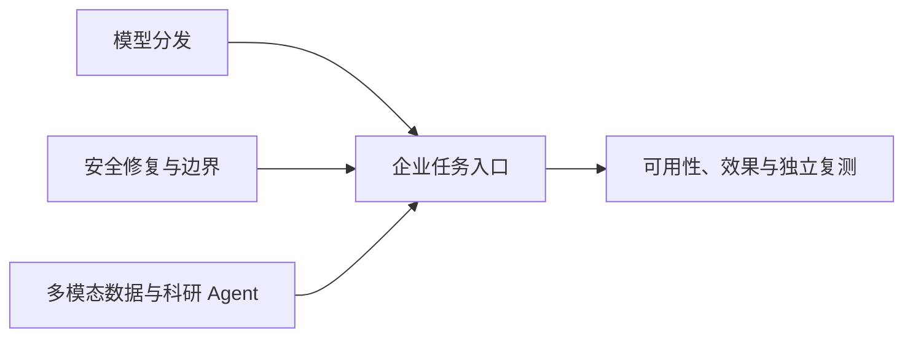

# AI 日报 · 2026-10-22

[中文（当前）](2026-10-22.md) · [English](../../en/daily/2026-10/2026-10-22.md)

- **采集截止：** 2026-10-22 10:30（北京时间）；主要核查 10 月 21 日 10:30 后披露，并与[昨日](2026-10-21.md)排重。仅标日期的文章无法确认精确上线时刻。
- **本期性质：** 9 条高信号动态；20–30 条是覆盖目标，不以同集团转载或缺证据热帖凑数。美国厂商一手材料占比高；中国新模型、AI 游戏和可玩世界模型在本窗口没有核到同等级新发布。
- **导航：** [趋势追踪](../../TRACKERS.md) · [历史索引](../../INDEX.md)。

## 今日关键结论

1. **OpenAI 与 Google Cloud 的模型分发合作改变企业采购入口，但尚非全面开放。** GPT-6 Astra、GPT-6.1 Sol、GPT-6 Luna 在 Model Garden 向部分企业私有预览；通用可用性和 Antigravity 集成尚待推出。两家合作方的公告可确认交易，不等于独立性能或数据隔离审计。
2. **AI 辅助漏洞发现进入公共软件基础设施的真实修复流程。** PHP 官方发布两项严重漏洞补丁，OpenAI、Wiz、Google 分别说明模型参与发现与响应；对部署方的直接行动是升级 PHP，而不是依赖临时缓解。
3. **Agent 的安全边界与商业化都在外置系统层竞争。** NVIDIA OpenShell 提供沙箱/策略控制参考架构；OpenAI 公开把广告选择与答案生成分离的架构。两者仍需要独立验证安全性和用户体验。
4. **多模态数据可用性比单个模型发布更值得产品团队关注。** BigQuery ObjectRef 正式可用，将图片、视频、音频与表格字段在 SQL 工作流中关联；数据授权、版本和成本是落地问题。
5. **科研 Agent 有了更具体的发现流程，但结果仍是待实验的线索。** OpenAI、PerturbAI、Scripps 在小鼠脑细胞数据上运行数千 Agent；32 分钟分析不等于治疗突破。

## 重点动态

### 1. OpenAI 模型进入 Google Cloud Model Garden 私有预览

- **发生了什么：** 双方宣布合作，Google Cloud 向部分企业客户私有预览 GPT-6 Astra、GPT-6.1 Sol、GPT-6 Luna，支持在其平台采购和调用；Codex CLI/Desktop 可连接平台推理。广泛可用性计划未来数周，Gemini for business 与 Antigravity 集成尚未上线；微软仍是 OpenAI 的主要云合作伙伴。
- **为什么重要 / 视角：** 产品决策、投资观察。云承诺抵扣、统一账单和模型路由会影响企业选择；应实测同任务质量、价格、可用区及数据边界。
- **发布时间 / 类型 / 信源：** 2026-10-21，双方官方公告；[OpenAI](https://openai.com/index/openai-models-google-cloud/) · [Google Cloud](https://cloud.google.com/blog/products/ai-machine-learning/google-cloud-brings-openai-models-to-customers)。
- **交叉验证 / 可信度：** 合作双方相互确认公告，但属利益一致的信源，非独立实测。高（合作及私有预览）；待验证（性能、覆盖、隔离）。
- **趋势：** T01/T06 持续升温；多模型平台竞争转向采购、治理和单位任务成本。

### 2. PHP 发布两项严重漏洞修复，AI 参与发现与协调

- **发生了什么：** PHP 安全团队发布 CVE-2026-109618 与 CVE-2026-109619 的修复版 8.5.12、8.4.27、8.3.36、8.2.35，建议处理 Web 请求的部署立即升级。OpenAI 称其模型参与发现，Wiz 独立发现并报告两项漏洞；Google 称 Gemini 也参与研究和补丁验证。不同机构对模型贡献的表述不等于可独立归因的发现优先权。
- **为什么重要 / 视角：** 产品决策、知识扫盲。开发团队应盘点运行版本和供应商回补；临时防护不是完整解决方案。AI 辅助漏洞研究的价值与滥用风险同步增加。
- **发布时间 / 类型 / 信源：** 2026-10-21（PHP 原定 14:00 UTC 发布）；[PHP 官方安全公告](https://www.php.net/archive/2026.php) · [OpenAI](https://openai.com/index/coordinated-disclosure-of-critical-vulnerabilities/) · [Wiz](https://www.wiz.io/blog/php2shell-php-rce) · [Google Cloud](https://cloud.google.com/blog/products/identity-security/responding-to-core-php-vulnerabilities-cve-2026-109618-cve-2026-109619)。
- **交叉验证 / 可信度：** PHP 官方版本与多方研究公告可核；各模型的具体独立贡献仍为机构自述。高（漏洞与补丁）；待验证（模型贡献比例及暴露规模）。
- **趋势：** T07 首次出现的重大实际修复案例；持续观察补丁采用率与已知攻击。

### 3. OpenAI 公开 ChatGPT 广告选择架构和年化收入运行率

- **发生了什么：** OpenAI 工程文章称广告系统用独立的后训练 LLM，跨会话理解意图并调用检索、排序、拍卖等工具；广告选择与 ChatGPT 答案生成分属服务。公司自报广告推出不足 200 天，年化收入运行率达到 10 亿美元，广告主超 10 万；这不是审计过的全年收入。
- **为什么重要 / 视角：** 产品决策、内容选题、投资观察。对话式广告需要状态、敏感信息过滤和明确赞助边界；用户信任、回答独立性及商业收益都需外部检验。
- **发布时间 / 类型 / 信源：** 2026-10-21，工程博客；[OpenAI 原文](https://openai.com/index/building-chatgpt-ad-stack/)。
- **交叉验证 / 可信度：** 单一厂商架构与收入自述；未见独立代码审计或财务核验。高（文章及架构声明）；待验证（实际隔离与收入）。
- **趋势：** T08 持续升温；商业化从搜索式请求转向多轮意图识别。

### 4. NVIDIA OpenShell 参考架构把 Agent 权限控制放在运行时之外

- **发生了什么：** NVIDIA 描述 OpenShell 的 Gateway、Supervisor、Sandbox 和 Policy Prover：管理生命周期、隔离工作负载、在沙箱外代理凭据、验证策略权限上限，并公开代码。Vera CPU 和 Sentry 硬件相关速度/阻断数字是厂商或合作方测试，不能与架构可获取性混为一谈。
- **为什么重要 / 视角：** 产品决策、技术背景。长时 Agent 不宜自己决定并监督全部权限；需测试越权阻断、误拦、审计、故障恢复和运行成本。
- **发布时间 / 类型 / 信源：** 2026-10-21，技术博客与代码；[NVIDIA 架构说明](https://developer.nvidia.com/blog/how-nvidia-openshell-reference-architecture-secures-and-governs-ai-agent-workloads-at-scale/) · [OpenShell 代码](https://github.com/NVIDIA/OpenShell)。
- **交叉验证 / 可信度：** 代码可检查，但性能和安全性没有独立同负载复测。高（架构/代码发布）；待验证（生产效果）。
- **趋势：** T01/T07 持续升温；权限执行从提示词外移到基础设施。

### 5. BigQuery ObjectRef 与多模态分析正式可用

- **发生了什么：** Google Cloud 宣布 BigQuery ObjectRef 与多模态分析 GA，可在表行中保存指向 Cloud Storage 图片、视频、音频、文档的引用，并在 SQL 查询中结合结构化字段调用 Gemini；引用可追踪对象版本。
- **为什么重要 / 视角：** 产品决策、技术背景。把媒体资产与业务字段接在同一数据查询流程，有利于内容检索和数据产品；仍需核对对象权限、推理成本、版本一致性和查询质量。
- **发布时间 / 类型 / 信源：** 2026-10-21，产品公告；[Google Cloud 原文](https://cloud.google.com/blog/products/data-analytics/analyze-unstructured-data-in-bigquery-with-objectref)。
- **交叉验证 / 可信度：** 单一平台官方信源，未见独立规模测试。高（GA 状态）；待验证（成本与实际质量）。
- **趋势：** T03 持续升温；多模态生产的瓶颈延伸到受治理的数据层。

### 6. 数千科研 Agent 分析小鼠脑细胞数据，提出待验证线索

- **发生了什么：** OpenAI、PerturbAI 与 Scripps Research 报告用 GPT-Rosalind 驱动数千并行 Agent，分析数百万小鼠脑细胞的基因扰动数据，称 32 分钟形成基因、细胞效应与文献的关联图谱，并由盲评专家评估部分线索。结论仍需要实验验证，不能称为已发现治疗方法。
- **为什么重要 / 视角：** 产品决策、知识扫盲。科研 Agent 的可复用结构是分任务、文献检索、汇总和专家复核；重点检查线索可重复性、错误关联和后续实验成本。
- **发布时间 / 类型 / 信源：** 2026-10-21 合作研究公告；预印本 10 月 16 日已刊登，本次为补充披露而非论文首发；[OpenAI 研究说明](https://openai.com/index/scaling-ai-research-for-complex-biological-data/) · [bioRxiv 预印本](https://www.biorxiv.org/content/10.64898/2026.10.15.759436v1)。
- **交叉验证 / 可信度：** 合作方同一研究项目，尚无外部独立重复实验。高（研究公开）；待验证（生物机制与临床意义）。
- **趋势：** T01/T08 持续升温；与昨日 Orchestra Bio 流程收购形成连续信号。

### 7. Confidential G4 GPU 正式可用，安全保证仍需环境级审计

- **发生了什么：** Google Cloud 称搭载 NVIDIA RTX PRO 6000 Blackwell Server Edition 的 Confidential G4 实例在 36 个区域可用区 GA，支持 Compute Engine 与 GKE；Confidential Space 支持仍在未来数周扩至 GA。远程证明与内存加密为厂商架构说明。
- **为什么重要 / 视角：** 产品决策、投资观察。敏感模型权重和推理数据的“使用中保护”成为算力采购维度；须验证威胁模型、部署范围、证明链和性能开销。
- **发布时间 / 类型 / 信源：** 2026-10-21，产品公告；[Google Cloud 原文](https://cloud.google.com/blog/topics/ai-infrastructure/confidential-g4-gpus-are-ga)。
- **交叉验证 / 可信度：** 单一厂商公告，未见第三方完整安全审计。高（GA 与范围）；待验证（具体保障与成本）。
- **趋势：** T06/T07 持续升温；与昨日隔离网络检索属于不同部署边界。

### 8. ZenteiQ 报告 llm-d/GKE 批量推理吞吐提升，属客户测试

- **发生了什么：** ZenteiQ 与 Google Cloud 合署案例称，GKE Inference Gateway 在其科学模型合成数据流水线中将聚合吞吐提高 4.07 倍，每千加速器的日产 token 从 14.7 亿增至 59.7 亿。未公开可独立重现的完整硬件、负载与成本口径。
- **为什么重要 / 视角：** 产品决策、投资观察。昨天 llm-d 1.0 发布后出现具体客户负载数字，但不能把批量吞吐直接推为在线 Agent 延迟或单位任务利润。
- **发布时间 / 类型 / 信源：** 2026-10-21，客户/供应商合署案例；[Google Cloud 原文](https://cloud.google.com/blog/products/containers-kubernetes/zenteiq-scales-physical-ai-inference-4x-with-gke-and-llm-d)。
- **交叉验证 / 可信度：** 客户与平台是合作方；无独立复测。高（案例发表）；待验证（可迁移收益）。
- **趋势：** T06 持续升温；下一步看等质量、等硬件的尾延迟与总成本。

### 9. OpenAI 提出网络防御治理蓝图，属于政策建议而非已实施规则

- **发生了什么：** OpenAI 发表政策蓝图，主张为前沿模型与 Agent 明确安全责任、为防御者提供工具/培训、加强政府评估和事故报告；文本属于公司建议，不能写成已生效监管。它引用自家安全事件经验，但没有证明此框架的效果。
- **为什么重要 / 视角：** 产品决策、内容选题。公共软件漏洞修复之外，行业还需可操作的责任边界和独立评估；提议者同时是模型供应商，应考虑权力集中与可审计性反方。
- **发布时间 / 类型 / 信源：** 2026-10-21，企业政策观点；[OpenAI 原文](https://openai.com/index/empowering-cyber-defenders/)。
- **交叉验证 / 可信度：** 可确认其发表与主张；政策利弊是观点，未见独立成效验证。高（文本存在）；待验证（采纳与效果）。
- **趋势：** T07 新增治理观点；与 PHP 补丁的已落地事实严格分开。

## 连续追踪与覆盖缺口

- **首次/升温：** OpenAI 模型进入 Google Cloud 私有预览；PHP 修补显示 AI 辅助安全研究进入真实上游修复；对话广告和 Agent 安全控制进一步系统化。
- **已落地与待验证：** PHP 补丁、ObjectRef 与 Confidential G4 已发布；Google Cloud 模型仍是私有预览；厂商安全、性能、收入、科研机制主张均待独立检验。
- **反证/缺口：** 本轮未核到同等级中国模型、AI 游戏或新可玩世界模型进展；不能由采集空白推断赛道停滞。NVIDIA RFD4-Proteina 文章写“开放模型”，但同文又称权重仓库需私有访问，暂不把它记为完全开放权重发布。

> 研究资讯，不构成投资、医疗、法律或安全操作建议。重要决策请查原始公告与适用环境。
