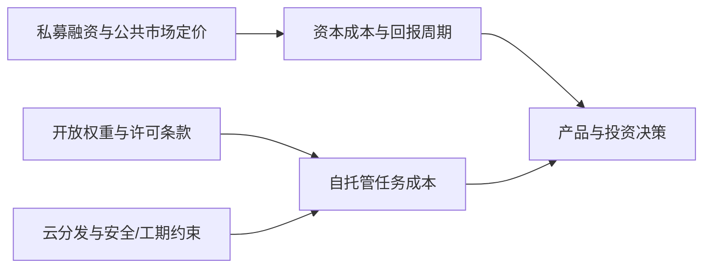

# AI 日报 · 2026-10-24

[中文（当前）](2026-10-24.md) · [English](../../en/daily/2026-10/2026-10-24.md)

- **采集截止：** 2026-10-23 21:30（Asia/Shanghai）。本期为 10-24 的提前生成版，覆盖 10-23 10:30 后的新披露；10-24 上午窗口留待下一期补录，涉及 10-22 至 10-23 的补漏均标原始日期。
- **本期性质：** 8 条高信号动态，其中 4 条为标注原始日期的补漏。资本、公共市场定价与产品交付分开；融资金额、厂商榜分和用户数均为披露口径，不等于独立验证。
- **导航：** [趋势追踪](../../TRACKERS.md) · [历史索引](../../INDEX.md)。

## 今日关键结论

1. **私募资本与公共市场正在给出相反信号。** 据报道 OpenAI 将以约 1.25 万亿美元投前估值完成最高 300 亿美元融资；同一周纳指跌 2.60%、费城半导体指数跌 6.7%、Meta 因 AI 开支出现十多年来首次现金净流出。私募高估值不是已实现回报，公共市场回调也不证明 AI 需求消失，二者共同指向“资本成本与回报周期”这一验收点。
2. **开放权重竞争从“是否发布”转向许可条款。** MiniMax M3.1 Flash 的 428B 总参数权重已可下载，但采用社区许可：商业使用需署名并通知，年收入超过 2000 万美元须事先书面授权。它是开放权重，不是 OSI 意义上的开源；部署前必须核对署名、再分发和收入门槛。
3. **模型分发层继续集中，但选择跨厂商化。** Google Cloud 正式向企业提供 OpenAI 前沿模型与 Codex，可通过 Marketplace 采购并用 GCP 承诺抵扣；企业采购与治理进一步收拢到同一云账户。上架不等于所有区域和套餐可用，SLA、价格与数据边界仍需逐项核对。
4. **应用层资本仍在加速，但金额与留存是两回事。** NVIDIA、TCV 追加投资 AI 视频公司 Higgsfield，Robinhood Ventures 向 AI 编程公司 Cognition 投资 1000 万美元。战略投资能带来算力、分发与信誉，不能替代付费留存、毛利率和单位任务成本。
5. **物理基础设施的约束是具体的。** 台积电高雄 Fab 22 工地事故致 4 人死亡并触发停工调查；先进制程扩产对施工安全、许可和工期高度敏感，但尚无公开的产能或量产时间影响，不能直接推导芯片涨价。

## 重点动态

### 1. OpenAI 据报以 1.25 万亿美元投前估值融资最高 300 亿美元

- **发生了什么：** 多家媒体引述知情人士称，OpenAI 正接近完成最高 300 亿美元的新一轮融资，投前估值约 1.25 万亿美元，由 Coatue 与阿联酋投资者联合领投；报道还提到部分安排与额外算力获取相关。相较一个月前传闻的 1.4 万亿美元有所下调。OpenAI 未公开确认金额、估值或投资方。
- **为什么重要 / 视角：** 投资观察、产品决策。若交易成立，融资已不只是财务行为，而是把股权、算力与能源绑定为基础设施安排；但估值不等于收入或利润，需继续核对实际到账、算力交付、股权稀释和上市时间表。
- **发布时间 / 类型 / 原始信源：** 2026-10-22 至 10-23，媒体引述消息人士；[CNBC](https://www.cnbc.com/2026/10/22/openai-funding-round-uae-investors.html) · [澎湃新闻转载报道](https://www.thepaper.cn/newsdetail_forward_34315469)。
- **交叉验证 / 可信度：** CNBC 与中文媒体均引述知情人士，未获 OpenAI 确认；金额、估值与领投方仍可能变化。中（交易传闻）；待验证（最终条款与交割）。
- **趋势：** T06 资本密集化；主权算力与股权绑定加深。

### 2. 美股 AI 交易回调，纳指跌 2.60%、半导体指数跌 6.7%

- **发生了什么：** 10 月 22 日美股收盘，纳指跌 2.60% 至 26,008.86，标普 500 跌 1.21% 至 7,663.43，道指微涨 0.02%；费城半导体指数跌 6.7%，较 6 月 22 日收盘高点回撤逾 26%。Meta 跌 7%，公司因 AI 相关开支出现十多年来首次现金净流出，并宣布以二比一拆股发行无投票权股份；特斯拉跌 3.1%。
- **为什么重要 / 视角：** 投资观察、技术背景。市场在重新定价 AI 资本开支的回收周期，而不是简单否定 AI 需求；这会收紧高估值公司的融资条件，并影响云厂商的资本开支指引、债务融资和供应链订单。需区分指数波动、公司基本面和分析师归因。
- **发布时间 / 类型 / 原始信源：** 2026-10-23（美股 10-22 收盘），通讯社市场报道；[Reuters 转载](https://profit.pakistantoday.com.pk/2026/10/23/nasdaq-plunges-26percent-sandp-500-falls-121percent-as-ai-spending-concerns-trigger-tech-selloff)。
- **交叉验证 / 可信度：** 单一通讯社的市场数据，指数与个股涨跌可与交易所行情核对；对下跌原因的解释来自分析师，不是因果证明。高（行情）；中（归因）。
- **趋势：** T06/T08 公共市场对 AI 投入回报的审视升温。

### 3. MiniMax M3.1 Flash 开放 428B 参数权重，采用社区许可

- **发生了什么：** 10 月 23 日 Hugging Face 上线 MiniMax-M3.1-Flash 权重：原生多模态 MoE，约 428B 总参数、23B 激活，支持最长 100 万 token 上下文，含 DSpark 推测解码。许可为 MiniMax Community License：非商业用途免费；商业使用须显著标注“Built with MiniMax M3.1-Flash”并一次性通知，年收入超过 2000 万美元须事先取得书面授权。模型卡自报 BankerToolBench 76.2、DeepSWE v1.1 73.7%、OSWorld V2 61.7 等；中文媒体称上线 72 小时处理超 100 万亿 token。
- **为什么重要 / 视角：** 产品决策、技术背景。此前“稍后发布权重”的承诺已落地，Agent、编程和 Computer Use 场景多了可自托管选项；但许可不是 OSI 开源，署名、通知和收入门槛会影响商业分发与再训练。榜分和吞吐为厂商/媒体口径，需在自有任务复测。
- **发布时间 / 类型 / 原始信源：** 2026-10-23，模型卡与许可；[Hugging Face 模型卡](https://huggingface.co/MiniMaxAI/MiniMax-M3.1-Flash) · [许可全文](https://huggingface.co/MiniMaxAI/MiniMax-M3.1-Flash/blob/main/LICENSE)。
- **交叉验证 / 可信度：** 权重、参数、上下文与许可条款可核；性能与 100 万亿 token 说法无独立复现。高（交付与许可）；待验证（任务表现、吞吐与许可执行）。
- **趋势：** T01/T03/T06 开放权重竞争从 API 价格转向许可条款。

### 4. Google Cloud 正式向企业提供 OpenAI 模型与 Codex

- **发生了什么：** OpenAI 10 月 21 日宣布与 Google Cloud 合作，将其前沿模型和 Codex Agent 工作流带入 Model Garden；Google 10 月 22 日称已正式向企业客户提供。客户可通过 Google Cloud Marketplace 购买，并用现有 GCP 承诺抵扣；OpenAI 模型还将进入 Antigravity 与 Gemini Agent（预告，尚未全面可用）。此前一期记录该合作仍为私有预览。
- **为什么重要 / 视角：** 产品决策、投资观察。企业可以在同一云账户内采购、治理和审计多家模型，模型选择进一步跨厂商化；但区域覆盖、模型清单、价格、SLA 与数据驻留仍需逐项核对，不能把“上架”当成所有客户已可生产使用。
- **发布时间 / 类型 / 原始信源：** 2026-10-21/22，双方公告；[OpenAI](https://openai.com/index/openai-models-google-cloud/) · [Google Cloud（中文）](https://blog.google/intl/zh-tw/products/cloud/google_cloud_brings_openai_models_to_customers/)。
- **交叉验证 / 可信度：** 两家公司公告互证合作与上架；无第三方可用性或性能测试。高（合作与商务路径）；待验证（覆盖范围与实际体验）。
- **趋势：** T01/T06 分发层竞争加剧；从私有预览转为正式提供。

### 5. 高盛投入 5 亿美元设立小企业 AI 研究所

- **发生了什么：** 高盛 10 月 22 日宣布 5 亿美元承诺，启动 Small Business AI Institute，并扩展 10,000 Small Businesses 项目；Anthropic、Google、Meta、OpenAI 分别参与课程、工具或研究。该项目自 2010 年以来已有近 2 万名企业家完成，此前累计承诺 12.5 亿美元。CEO David Solomon 在发布现场称，高盛“做的事情里很少需要前沿模型”，前沿模型主要关乎网络安全、国防和医疗等。
- **为什么重要 / 视角：** 产品决策、投资观察。小企业采用 AI 的瓶颈更像培训、流程重构与信任，而不是模型能力上限；四家模型公司参与是分发信号，不是课程完成率或营收提升的证据。
- **发布时间 / 类型 / 原始信源：** 2026-10-22，公司公告与现场报道；[高盛新闻稿](https://www.goldmansachs.com/pressroom/press-releases/2026/goldman-sachs-commits-500-million-to-launch-small-business-ai-institute) · [Fortune](https://fortune.com/2026/10/23/david-solomon-frontier-models-not-needed-small-business/)。
- **交叉验证 / 可信度：** 公告与 Fortune 现场报道互证金额、合作方与引语；课程完成率、留存和营收影响未公布。高（承诺与引语）；待验证（实际采用与效果）。
- **趋势：** T08 采用与价值证明分离。

### 6. 台积电高雄 Fab 22 工安事故致 4 死，钢构施工停工

- **发生了什么：** 10 月 20 日台积电高雄 Fab 22 工地发生钢构坠落事故，4 名工人从高处坠落，最初 3 人死亡、1 人重伤，第 4 人随后不治；初步调查指向钢构外侧连接板螺栓失效。南部科学园区管理局下令停工并保留现场，台积电称事故属承包商施工范围，项目已自主暂停；台媒报道全台新厂钢构工程一度停工待查。Fab 22 为 2nm 厂区。
- **为什么重要 / 视角：** 投资观察、技术背景。先进制程扩产不仅受设备与电力约束，也受施工安全、许可和工期影响；事故是真实的交付风险，但尚无公开的产能损失或量产时间变化，不能直接推导芯片涨价或供应短缺。
- **发布时间 / 类型 / 原始信源：** 2026-10-20/21，官方通报与媒体报道；[新华社](https://english.news.cn/20261020/ca367e2ebdce4f35bb058b06cfa39272/c.html) · [太报](http://dev.taisounds.news/news/content/76/295291)。
- **交叉验证 / 可信度：** 新华社与台媒对死亡人数、厂区和停工互证；事故原因与工期影响仍待调查。高（事故与停工）；待验证（产能与时间表）。
- **趋势：** T06 算力供给受施工、电力与安全约束。

### 7. NVIDIA、TCV 追加投资 AI 视频公司 Higgsfield

- **发生了什么：** 10 月 23 日 Bloomberg 报道，NVIDIA 与 TCV 参与 Higgsfield 的 B 轮扩展，金额未披露。公司 8 月完成 4 亿美元 B 轮，由 DST Global 领投，Goldman Sachs Alternatives、Tribe Capital、Intel Capital 等参与；Astana Times 称其年化收入约 7 亿美元、全球用户超过 3000 万。NVIDIA CEO 黄仁勋在访问哈萨克斯坦期间解释了投资理由，强调团队而非仅产品。
- **为什么重要 / 视角：** 产品决策、投资观察。AI 视频在广告、营销和创意生产已形成收入，战略投资可能同时带来算力、分发和国际市场入口；但金额与估值未披露，收入和用户数为公司口径，需用付费留存、毛利和单位生成成本验收。
- **发布时间 / 类型 / 原始信源：** 2026-10-23，Bloomberg 报道与公司背景披露；[Bloomberg](https://www.bloomberg.com/news/articles/2026-10-23/nvidia-tcv-invest-in-ai-video-startup-higgsfield-in-series-b-extension) · [Astana Times](https://astanatimes.com/2026/10/nvidia-backs-ai-startup-higgsfield-as-huang-visits-kazakhstan/)。
- **交叉验证 / 可信度：** Bloomberg 与 Astana Times 互证投资与 B 轮背景；用户、收入与估值无独立审计。高（投资发生）；待验证（金额、估值、留存与毛利）。
- **趋势：** T03/T06 视频生产与战略资本结合。

### 8. Robinhood Ventures 向 Cognition 投资 1000 万美元

- **发生了什么：** Fortune 10 月 23 日报道，Robinhood Ventures 向 AI 编程公司 Cognition 投资 1000 万美元，参与其 9 月超过 20 亿美元、估值 480 亿美元的 E 轮；这是 Robinhood 首次披露该笔投资。Cognition 称年化收入接近 9 亿美元（5 月为 4.92 亿美元）。Robinhood 此前于 4 月向 OpenAI 投资 7500 万美元。
- **为什么重要 / 视角：** 投资观察、产品决策。AI 编程已是多强竞争，资本与分销同时下注；1000 万美元是财务参与，不等于 Cognition 的留存、毛利率或 480 亿美元估值已被验证，也不能由 Robinhood 同时押注多家推断赢家。
- **发布时间 / 类型 / 原始信源：** 2026-10-23，Fortune 独家；[Fortune](https://fortune.com/2026/10/23/exclusive-robinhood-bets-10-million-ai-coding-tool-maker-cognition/)。
- **交叉验证 / 可信度：** Fortune 独家，Cognition 与 Robinhood 未另行公告；收入为公司此前披露口径。中（独家报道）；待验证（回报、留存与估值）。
- **趋势：** T01/T06 AI 编程资本竞争延续。

## 连续追踪与覆盖缺口

- **已落地/首次：** MiniMax M3.1 Flash 权重与许可可下载；Google Cloud 正式提供 OpenAI 模型；高盛 5 亿美元承诺公布；NVIDIA/TCV 与 Robinhood 的投资已发生。各自的任务效果、留存与回报仍未验证。
- **补漏/修正：** 本期补入 10 月 22 日美股收盘、Google Cloud 正式上架、高盛公告与台积电 10 月 20 日事故；上一期 10:30 截稿未覆盖这些时间点。补漏不改变原始日期。
- **待验证/反方：** OpenAI 融资条款未获公司确认；市场回调的因果归因仍属分析师判断；MiniMax 榜分与 100 万亿 token、Higgsfield 收入/用户、Cognition 估值均缺独立审计；台积电事故的产能影响未公布。世界模型与 AI 游戏本期无同等级新交付，不以融资或视频生成替代可玩性证据。

> 本仓库提供研究资讯，不构成投资、医疗、法律或临床建议。重要决策请复核原始信源和适用条件。
