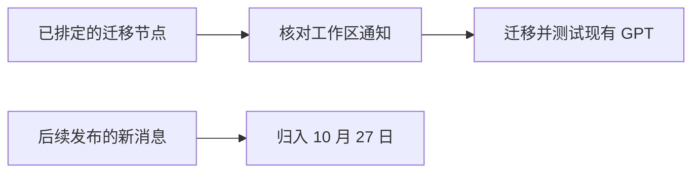

# AI 日报 · 2026-10-26（事后补档）

[中文（当前）](2026-10-26.md) · [English](../../en/daily/2026-10/2026-10-26.md)

- **基准截止：** 2026-10-26 10:30（Asia/Shanghai）；2026-10-27 事后核查并补档，不能视为 26 日准时发布。
- **本期性质：** 截至基准时点，未核到足以构成重大新发布的高证据事项。仅记录一项已排定且到期的企业产品迁移节点，不用后来的美国 10 月 26 日消息回填前一日上午。
- **导航：** [历史索引](../../INDEX.md) · [趋势追踪](../../TRACKERS.md)。

## 今日关键结论

1. **今日无重大更新。** 这表示本次有限信源复查未发现高证据重大增量，不代表全行业无新动态。
2. **受影响的 ChatGPT Enterprise 工作区进入 Custom GPT 新建冻结节点。** OpenAI 帮助文档将 10 月 26 日列为生效日；适用范围和实际启用以各工作区通知为准，现有 GPT 的可用性与迁移截止日是另一问题。

## 重点动态

### 1. 受影响 Enterprise 工作区停止新建 Custom GPT

- **发生了什么：** OpenAI 帮助文档称，10 月 26 日起，受影响的 Enterprise 工作区停止新建 GPT；FedRAMP 工作区除外。未迁移的现有 GPT 仍可编辑，迁移后原 GPT 只读；一般计划中的现有 GPT 退役日为 12 月 11 日，部分获准延期的工作区另有时间表。
- **为什么重要 / 视角：** 产品决策、技术背景。依赖旧 GPT 的团队应按自身通知核对插件迁移、所有者权限和回归测试；不应把新建冻结写成所有 GPT 即日下线。
- **发布时间 / 类型 / 原始信源：** 2026-10-26 为官方文档列出的适用节点；[OpenAI 帮助文档](https://help.openai.com/en/articles/20001519-custom-gpt-retirement-and-migration-faq)。文档更新时刻未核。
- **交叉验证 / 可信度：** 单一官方操作说明；高（公布的通用规则），待工作区通知确认（具体适用与迁移入口）。
- **趋势：** T01 已排定迁移节点；企业 Agent 资产治理持续升温。

## 连续追踪与限制

- 10 月 25 日所列世界模型、语音及安全事项未发现足以改变原判断的新独立结果。
- 本文是 27 日按 26 日上午基准时点补档；不能证明定时任务在 26 日运行。美国 10 月 26 日发布的材料见[次日日报](2026-10-27.md)。

> 行业资讯，不构成投资或法律建议；重要决策请核对原始信源和适用条件。
