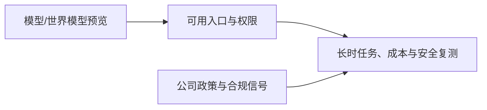

# AI 日报 · 2026-11-02（延迟补档）

[中文（当前）](2026-11-02.md) · [English](../../en/daily/2026-11/2026-11-02.md)

- **采集截止：** 2026-11-02 13:30（Asia/Shanghai）。本期是 10 月 28 日至 11 月 2 日的延迟补档，不能视为逐日准时发布；条目保留原始发布日期。
- **本期性质：** 7 条高信号事项。未以低证据消息补足 20–30 条，10 月 27 日后缺少的日报日程不被伪装为已按时运行。
- **导航：** [历史索引](../../INDEX.md) · [趋势追踪](../../TRACKERS.md)。

## 今日关键结论

1. **世界模型开始进入可交互预览，但仍是研究原型。** Google Genie 4 支持实时文字控制、原生音频和短时连续场景；官方明确承认长时漂移、物体持续性与复杂物理仍有限。
2. **企业 Agent 竞争转向工作流连接与权限。** OpenAI 与 ServiceNow 扩大集成，用户可在 ChatGPT 中查询并更新 ServiceNow 记录；客户定义的权限和实际部署边界比演示更重要。
3. **专业模型采用审批与隔离。** GPT-6 Rosalind Research 面向获批生命科学客户，不等于 ChatGPT 普遍可用；模型规格、访问和生物安全评测应分开记录。
4. **模型规范和内容治理正在产品化。** OpenAI 更新 Model Spec，并发布训练偏好 robots.txt 共同信号和社区安全报告；这些是公司政策与实施承诺，不等于跨行业标准或法院裁决。
5. **开放权重厂商继续补齐 Agent 工程栈。** Mistral 发布 Le Chonk 权重，定位于编码与网络安全；权重、许可证、独立基准和生产安全效果仍需分别核对。

## 重点动态

### 1. Google DeepMind 发布 Genie 4 世界模型研究预览

- **发生了什么：** Genie 4 面向可信测试者预览，支持键盘与文字实时控制、原生环境音和互动对话，并与 Gemini 组合进行多步任务引导。Google 明确称长时运行会出现细节和物体持续性漂移，复杂物理、空间准确度、可读文字和长期一致性仍在研究。
- **为什么重要 / 视角：** 产品决策、内容选题、技术背景。它提供游戏原型和机器人训练环境的研究入口，但不是稳定游戏运行时或可交付世界生成平台。
- **发布时间 / 类型 / 原始信源：** 2026-10-27；[Google DeepMind](https://deepmind.google/blog/genie-4-a-new-generation-of-world-simulation/)。
- **交叉验证 / 可信度：** 单一官方研究预览；高（发布与限制），待验证（外部设备、长时体验、成本）。
- **趋势：** T02/T05 首次出现；从单视频演示转向实时交互预览。

### 2. OpenAI 与 ServiceNow 扩大企业工作流合作

- **发生了什么：** OpenAI 宣布 ServiceNow 将把模型和 Agent 接入开发、安全与 IT 工作流；ChatGPT 中的新集成可在同一对话中查找相似事件、评估变更风险并更新 ServiceNow 记录。
- **为什么重要 / 视角：** 产品决策、投资观察。工作流连接器把 Agent 从回答层推向可执行系统；应验证授权、审计、回滚和人工审批，而非只看集成演示。
- **发布时间 / 类型 / 原始信源：** 2026-10-28；[OpenAI 公告](https://openai.com/index/openai-servicenow-partnership-expansion/)。
- **交叉验证 / 可信度：** 双方合作公告可核，生产效果未独立审计。高（合作发布），待验证（部署范围与 ROI）。
- **趋势：** T01/T08 持续升温。

### 3. GPT-6 Rosalind Research 进入限量生命科学预览

- **发生了什么：** OpenAI 发布 GPT-6 Rosalind Research，面向获批研究客户的 Work、Codex 和 API，企业工作区先以两周管理员预览开启，默认关闭；Chat 标签不可用，Discovery 仍使用 GPT-5.5 Rosalind Research。
- **为什么重要 / 视角：** 产品决策、行业知识。专业模型的访问审批、工具权限和生物安全控制必须作为产品边界；不能把限量预览写成普遍可用模型。
- **发布时间 / 类型 / 原始信源：** 2026-10-30；[OpenAI 模型发布说明](https://help.openai.com/en/articles/9624314-model-release-notes)。
- **交叉验证 / 可信度：** 官方发布说明与 Enterprise 版本说明一致。高（可用范围），待验证（科研任务质量与安全效果）。
- **趋势：** T01/T07 首次跟踪。

### 4. OpenAI 更新 Model Spec、训练偏好信号与社区安全报告

- **发生了什么：** OpenAI 更新 Model Spec，重组为忠实于用户意图、伤害最小化、诚实透明、人类能动性和关怀等价值；同时宣布将支持 robots.txt 的共同训练偏好信号，并发布社区安全报告。共同信号计划未来数月实施。
- **为什么重要 / 视角：** 技术背景、内容选题、投资观察。模型行为规范、网站训练选择和社区安全披露属于不同层级；政策文本不是跨供应商标准，支持信号也不是已完成执行。
- **发布时间 / 类型 / 原始信源：** 2026-10-29/30；[Model Spec 说明](https://help.openai.com/en/articles/9624314-model-release-notes) · [训练偏好信号](https://openai.com/index/helping-websites-express-ai-training-preferences/) · [社区安全报告](https://openai.com/index/community-safety-report-and-new-protections-for-teens/)。
- **交叉验证 / 可信度：** 同一公司多份一手材料，实施效果尚待外部观察。高（政策发布），待验证（采用率与治理效果）。
- **趋势：** T07 持续升温。

### 5. Mistral 发布 Le Chonk 开放权重

- **发生了什么：** Mistral 在 10 月 29 日新闻页列出 Le Chonk 权重发布，定位为编码与网络安全 Agent。具体许可证、硬件要求和独立测试需以模型卡及仓库逐项核对，不能因“开放模型”字样直接写成 OSI 开源。
- **为什么重要 / 视角：** 产品决策、技术背景、投资观察。编码和网络安全场景的权重交付扩大自托管选项，但生产安全责任、提示注入和工具权限仍需独立评测。
- **发布时间 / 类型 / 原始信源：** 2026-10-29；[Mistral 新闻页](https://mistral.ai/news/)。
- **交叉验证 / 可信度：** 官方新闻页确认发布标题；本轮未获得模型卡的完整许可证和基准细节。中高（发布事实），待验证（资产与性能）。
- **趋势：** T03/T06 持续升温。

### 6. Hugging Face 与平台侧基础设施继续完善

- **发生了什么：** Hugging Face 近期更新共享缓存、Jobs 重试/重跑和存储桶任务；Palantir 公告称 GPT-6.1 Terra 已在 AIP 以实验模型向符合条件的商业客户开放。平台接入并不代表所有区域、套餐或数据边界一致。
- **为什么重要 / 视角：** 产品决策。交付层的缓存、任务编排和多模型采购会影响单位任务成本；必须以自有网络、权限和 SLA 复测。
- **发布时间 / 类型 / 原始信源：** 2026-10-26 至 29；[Hugging Face 更新](https://huggingface.co/blog/huggingface/whats-new-in-the-hf-cli-and-huggingface-hub-librar) · [Palantir 公告](https://www.palantir.com/docs/foundry/announcements)。
- **交叉验证 / 可信度：** 各为平台方一手材料；高（功能公告），待验证（实测成本和覆盖）。
- **趋势：** T03/T06 持续升温。

### 7. 公开资料仍显示“预览、声明、可用”必须分开

- **发生了什么：** 本轮同时出现世界模型研究预览、企业集成公告、专业模型限量预览和公司治理文本；它们都提供可追踪入口，但没有一项单独证明普遍生产 ROI 或长期稳定性。
- **为什么重要 / 视角：** 全部视角。把入口、演示、权重、正式可用、独立实测和商业结果分层，才能避免把新闻热度误判为产品成熟度。
- **发布时间 / 类型 / 原始信源：** 2026-10-27 至 30，多份一手材料见上文。
- **交叉验证 / 可信度：** 综合判断，非单一事件；高（证据边界），待持续验证（端到端结果）。
- **趋势：** T01/T02/T07/T08 的共同验证要求。

## 连续追踪与限制

- **首次出现：** Genie 4、GPT-6 Rosalind Research、ServiceNow 工作流扩展。
- **持续升温：** Agent 连接器、专业模型审批、开放权重安全和世界模型交互预览。
- **待验证：** Genie 4 长时一致性与成本；ServiceNow 生产任务成功率；Rosalind 的科研与安全效果；Le Chonk 许可、基准与工具隔离。
- **覆盖说明：** 本期延迟补档合并 10 月 28 日至 11 月 2 日的高信号材料；10 月 28–31 日未逐日生成的缺口已明确记录，不伪装成按时日报。

> 行业资讯，不构成投资、医疗或法律建议；重要决策请核对原始信源和适用条件。
