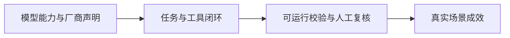

# AI 日报 · 2026-11-04

[中文（当前）](2026-11-04.md) · [English](../../en/daily/2026-11/2026-11-04.md)

- **采集截止：** 2026-11-04 11:00（Asia/Shanghai）。部分美方信源只标注 11 月 3 日，无法确定是否早于截稿时刻；按日期级收录并提示这一限制。
- **本期性质：** 6 条高信号短版；其中美团消息是 11 月 2 日发布、此前日报未收录的补漏，不计作 11 月 3 日首发。
- **导航：** [历史索引](../../INDEX.md) · [趋势追踪](../../TRACKERS.md)。

## 今日关键结论

1. **AI 正进入工程设计闭环，但可制造性仍需人工把关。** OpenAI 展示从 CAD、PCB 到样机的流程，也明确承认模型未稳定处理制造公差与装配约束。
2. **世界模型出现更明确的闭环仿真应用。** 百度 Apollo World 将交通参与者建模为可交互主体；公开材料尚不能独立证明模拟保真度或真实道路安全收益。
3. **同一模型的 Agent 任务表现会随执行框架显著变化。** IBM 的自测在 AppWorld 上报告 30%–81% 的完成率区间；配置公平性与独立复测仍是关键。
4. **可验证产物成为 AI 应用的差异化要素。** CWE-bench v2 公布可运行的安全修复任务；IBM Palette 将幻灯片渲染、溢出和事实溯源检查纳入生成流程。
5. **中国原生多模态模型继续强化长程 Agent 工作。** 美团 LongCat-2.5 的规模与国产算力训练为厂商披露；性能仍需第三方按统一环境验证。

## 重点动态

### 1. OpenAI 展示物理产品工程设计流程

- **发生了什么：** OpenAI 介绍 GPT-6 Astra 辅助设计外壳、PCB、固件及软件集成的样机项目，披露内部硬件团队使用 Codex 和 ChatGPT 处理 CAD、图纸与仿真，并与 Mazda 等合作。公司同时承认样机进入制造前仍需多轮人工审查，模型未稳定满足公差与装配要求。
- **为什么重要 / 视角：** 产品决策、内容选题。工程 Agent 的评估应覆盖从设计到可制造的全链条，不能把样机演示等同量产效率。
- **发布时间 / 类型 / 原始信源：** 2026-11-03，官方研究及案例；[OpenAI 原文](https://openai.com/index/accelerating-engineering-for-the-physical-world/)。
- **交叉验证 / 可信度：** 厂商案例；合作方观点见原文，但本轮未做独立复测。高（文章及合作披露），待验证（广泛工程收益）。
- **趋势：** T01/T06 持续升温；从纯软件编码延伸到物理设计。

### 2. 百度发布自动驾驶仿真世界模型 Apollo World

- **发生了什么：** 百度在 Apollo 专场披露 Apollo World，描述其让车辆、行人等交通参与者在仿真中响应自动驾驶系统的行为，并生成相机和激光雷达观测。其定位是闭环训练与验证系统，不是通用游戏生成工具。
- **为什么重要 / 视角：** 产品决策、行业知识。可交互、可反馈的场景比固定视频更接近自动驾驶验证需求；应跟踪仿真与真实道路的一致性和外部安全评估。
- **发布时间 / 类型 / 原始信源：** 2026-11-03，厂商活动经媒体报道；[36氪据百度披露](https://www.36kr.com/newsflashes/4054026915189896)；[Reuters 独立报道](https://www.marketscreener.com/news/china-s-baidu-launches-ai-model-simulating-road-environment-for-robotaxis-ce785fded98bff24)。
- **交叉验证 / 可信度：** 两家媒体可交叉确认发布及产品定位；技术指标主要来自百度，未独立验证。高（发布），待验证（保真度及安全效果）。
- **趋势：** T04 持续升温；世界模型走向特定工业场景。

### 3. CWE-bench v2 公布 100 项安全修复任务

- **发生了什么：** Collinear AI 在 Hugging Face 发布 CWE-bench v2，开放 100 项任务、覆盖 91 类 CWE。Agent 需在真实开源代码库中修复弱点且不破坏既有功能；团队提供程序化评分及保留测试集。
- **为什么重要 / 视角：** 产品决策、行业知识。安全 Agent 评测从发现漏洞延伸到可执行修复；公开任务可能带来训练污染，保留集复测仍必要。
- **发布时间 / 类型 / 原始信源：** 2026-11-03，研究团队技术文章；[Hugging Face 原文](https://huggingface.co/blog/cwe-bench)。
- **交叉验证 / 可信度：** 公共任务可检查；未独立复跑评测。高（任务集发布），待验证（模型排名与真实修复能力）。
- **趋势：** T07 持续升温；与上一期漏洞披露台账形成“发现—修复—验证”链条。

### 4. IBM 比较不同 Agent 执行框架

- **发生了什么：** IBM Research 使用同一开放权重模型，在 90 项 AppWorld 任务中比较 CUGA、Hermes、Deep Agents 等框架，报告任务完成率从 30% 到 81%。作者指出 CUGA 的配置不同，邀请外部提交更强配置复测。
- **为什么重要 / 视角：** 产品决策、内容选题。模型选择之外，工具接口、状态管理和策略执行也决定最终任务结果；该数字不能直接当作跨框架公平排名。
- **发布时间 / 类型 / 原始信源：** 2026-11-03，IBM Research 社区文章；[Hugging Face 原文](https://huggingface.co/blog/ibm-research/cuga-harness)。
- **交叉验证 / 可信度：** 团队自测并提供复现入口；本轮未复跑。高（实验披露），待验证（公平比较与真实企业收益）。
- **趋势：** T01 持续升温；Agent 评估从模型分数转向完整系统。

### 5. IBM Palette 将可验证检查用于幻灯片生成

- **发生了什么：** IBM Research 介绍 20B 开放权重模型 Palette 及其修复框架：检查渲染、重叠、溢出和事实溯源，仅保留通过检查的改写。作者报告在 PresentBench 三领域平均排名第二，但也承认基准不能测量用户自有设计语言的还原程度。
- **为什么重要 / 视角：** 产品决策、内容选题。结构化内容生成可用确定性检查提高交付稳定性，仍需人工判断信息层级、审美及真实业务可用性。
- **发布时间 / 类型 / 原始信源：** 2026-11-03，IBM Research 技术文章；[Hugging Face 原文](https://huggingface.co/blog/ibm-research/palette-deck-building)。
- **交叉验证 / 可信度：** 方法公开，分数由研究团队报告；本轮未独立复测。高（方法披露），待验证（外部模板和用户场景表现）。
- **趋势：** T08 首次出现；“生成后校验”进入办公内容工具。

### 6. 补漏：美团发布 LongCat-2.5 原生多模态模型

- **发生了什么：** 美团 11 月 2 日发布 LongCat-2.5，称总参数 1.6 万亿、每 token 激活约 480 亿参数，面向长程 Agent、视觉理解和编程任务，并称训练由国产算力完成。本条为上一期未纳入的延迟补漏。
- **为什么重要 / 视角：** 产品决策、投资观察。中国模型厂商继续将多模态、编程 Agent 与国产算力结合；参数规模和厂商基准不等于实际应用效果。
- **发布时间 / 类型 / 原始信源：** 2026-11-02，官方技术文章及公告；[美团技术团队](https://tech.meituan.com/2026/11/02/Meituan-LongCat-2.5.html)；[美团公告](https://www.meituan.com/news/NN261102280001343)。
- **交叉验证 / 可信度：** 两份同公司材料可核对发布，但不构成独立性能验证。高（发布及规格声明），待验证（基准、训练细节与可迁移效果）。
- **趋势：** T02/T03 持续升温；补漏，不计作 11 月 3 日新发布。

## 连续追踪与限制

- **持续升温：** Agent 的完整执行系统、世界模型的专业场景落地、可验证生成与安全修复。
- **待验证：** 工程设计的制造成品率、Apollo World 的仿真保真度、各 Agent 框架公平配置、模型独立实测。
- **覆盖限制：** 本期为高信号短版，未发现可核实的重大 AI 游戏发布。部分来源只有发布日期而无精确时刻；未把日期推断为截稿前发布时间。

> 行业资讯；重要决策请核对原始信源与适用条件。
