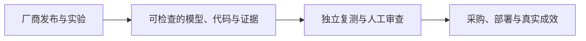

# AI 日报 · 2026-11-05

[中文（当前）](2026-11-05.md) · [English](../../en/daily/2026-11/2026-11-05.md)

- **采集截止：** 2026-11-05 11:00（Asia/Shanghai）。多数美欧页面只标注 11 月 4 日，无法反推精确上线时刻；以下按页面发布日期收录。
- **本期性质：** 6 条高信号短版，按产品与产业影响排序。没有用未经核实的传闻凑足常规 20–30 条。
- **导航：** [历史索引](../../INDEX.md) · [趋势追踪](../../TRACKERS.md)。

## 今日关键结论

1. **AI 安全研究已能规模化生成漏洞证据与候选补丁，维护者确认和真正修复仍是不同阶段。** OpenAI 报告在受控环境中形成 948 个不同的 Linux 本地提权漏洞候选补丁，API 成本约 121 万美元；这些数字来自公司实验，不能写成上游已合并 948 个补丁。
2. **图像模型竞争转向可编辑工作流与交付格式。** OpenAI Images 2.6 提供更快生成、局部标注编辑、SVG 导出及制作 GIF 的工作流；“快 50%”是厂商数据，需要按自己的素材复测。
3. **编码 Agent 的产品边界继续向代码存储与审查延伸。** OpenAI 宣布拟收购 Pierre；交易尚待完成。此前的内部 Git 后端 Pando 与此次收购分别对应底层并行能力和面向开发者的审查体验。
4. **开放权重模型与专用小模型提供两种不同的控制路径。** Mistral Large 4 权重已可下载，但模型即服务业务有单独许可条件；Dharma-AI 的 2B 字段提取模型报告特定任务优势，尚需外部文档与成本复测。
5. **网络安全模型的分发越发依赖身份、权限和运行环境。** OpenAI 公告 Daybreak Red 可供获批的 AWS GovCloud 客户使用；获批与 AWS 实际开通是两个步骤。

## 重点动态

### 1. OpenAI 报告 Linux 内核漏洞研究流水线

- **发生了什么：** OpenAI 披露一次使用尚未发布的网络安全模型进行的受控实验：2,308 个候选发现中，动态复现 1,724 个漏洞，生成 948 个不同本地提权问题的候选补丁；整轮 API 成本 1,213,430 美元。人类研究员之后审查并向维护者报告。文章没有说 948 个补丁已被内核上游接受。
- **为什么重要 / 视角：** 产品决策、内容选题、行业知识。漏洞发现、复现、可利用性评估和修补开始形成自动化链路；披露协调、重复报告、补丁质量及维护者负担会成为瓶颈。
- **发布时间 / 类型 / 原始信源：** 2026-11-04，官方安全研究；[OpenAI 研究报告](https://openai.com/index/a-thousand-fewer-paths-to-root/)。
- **交叉验证 / 可信度：** 详细方法与成本来自单一厂商；本轮未见 Linux 维护者对全部 948 项的独立确认。高（研究披露），待验证（去重、上游采纳和实际修复）。
- **趋势：** T07 持续升温；承接 11 月 3 日漏洞台账与 11 月 4 日 CWE-bench v2。

### 2. OpenAI 推出 Images 2.6

- **发生了什么：** OpenAI 在 ChatGPT、Codex 和 API 推出 Images 2.6；API 分为 GPT-Image-2.6 Flare 和 Sunburst。官方称生成平均快 50%，支持通过图像标注指定修改位置、SVG 导出，并展示生成 GIF 所需的多帧素材工作流。GIF 示例不能误写成模型直接输出视频。
- **为什么重要 / 视角：** 产品决策、内容选题、AI 游戏。角色与品牌一致性、局部可控编辑和可交付的矢量资产比单张画面质量更影响生产流程；实际一致性、速度和成本需实测。
- **发布时间 / 类型 / 原始信源：** 2026-11-04，官方产品发布；[OpenAI 发布说明](https://openai.com/index/introducing-images-2-6/)。
- **交叉验证 / 可信度：** 上线与功能见一手页面；性能和规模数字为厂商主张，未独立复测。高（发布及功能），待验证（速度和长期一致性）。
- **趋势：** T02/T05 持续升温；多模态生成走向可编辑资产。

### 3. OpenAI 宣布拟收购 Pierre Computer Company

- **发生了什么：** OpenAI 宣布将收购 Pierre，其 Trees、Diffs 已用于 Codex 应用；Pierre 还开发 Code Storage。OpenAI 表示交易完成后计划将代码存储和审查能力进一步整合到 Codex；交易仍受惯常交割及监管条件约束，双方当前保持独立。
- **为什么重要 / 视角：** 产品决策、投资观察。编码 Agent 的竞争涉及代码导航、差异审查、版本历史和协作界面；拟收购不等于产品整合已交付。
- **发布时间 / 类型 / 原始信源：** 2026-11-04，公司公告；[OpenAI 原文](https://openai.com/index/openai-to-acquire-pierre/)。
- **交叉验证 / 可信度：** 单一官方公告；高（拟收购公告），待验证（交易完成与功能落地）。
- **趋势：** T01/T06 持续升温；与先前 Pando 内部 Git 后端形成连续信号。

### 4. Mistral Large 4 开放权重

- **发生了什么：** Mistral 将 Large 4 改进版权重发布到 Hugging Face，并公布技术报告及许可。模型为原生多模态输入，支持编码与网络安全任务。其 Mistral Ecosystem Open-Weight License 允许一般使用、修改和商业化，但运营模型即服务业务需另取商业许可；不能把开放权重简称为无条件开源。
- **为什么重要 / 视角：** 产品决策、投资观察。自托管和定制选择增加，采购时要同时核对模型能力、显存成本和许可边界。文中基准分数要与独立实测区分。
- **发布时间 / 类型 / 原始信源：** 2026-11-04 左右（官网未标精确时刻），官方发布及模型页；[Mistral 公告](https://mistral.ai/news/mistral-large-4-oss/)；[Hugging Face 权重页](https://huggingface.co/mistralai/Mistral-Large-4-1T-A52B)。
- **交叉验证 / 可信度：** 权重与许可可在模型页直接检查；性能多为厂商披露或其引用的外部基准，未本轮复测。高（权重可用），待验证（具体任务性价比）。
- **趋势：** T03 持续升温；预览版进入可自行部署阶段。

### 5. OpenAI 公告 Daybreak Red 在 AWS GovCloud 可用

- **发生了什么：** OpenAI 称经其批准、完成 AWS 开通的客户可在 AWS GovCloud (US-East) 使用 GPT-5.6 Cyber，面向授权漏洞研究、复现与缓解。AWS 的产品信息页也列出此能力；OpenAI 公告日期为 11 月 4 日，AWS 页面可能更早上线，不能据此宣称当日首次技术可用。
- **为什么重要 / 视角：** 产品决策、行业知识。高能力网络安全模型的落地与客户身份核验、数据边界、监控及基础设施审批绑定；使用范围受资格限制。
- **发布时间 / 类型 / 原始信源：** 2026-11-04，官方产品公告；[OpenAI 公告](https://openai.com/index/daybreak-red-aws-govcloud/)；[AWS 产品信息](https://aws.amazon.com/about-aws/whats-new/2026/10/openai-daybreak-red-govcloud-east/)。
- **交叉验证 / 可信度：** 双方官方材料确认提供路径；未验证具体客户开通和效果。高（可用路径），待验证（实际采用与防御收益）。
- **趋势：** T07 持续升温；安全模型分发进一步细分。

### 6. Dharma-AI 发布专用文档字段提取模型

- **发生了什么：** Dharma-AI 介绍基于 2B 参数 OCR 模型训练的 Field Extractor，可按指定 schema 输出 JSON。团队在其 546 份文档、三类请求组成的评测中报告得分 0.834，高于其测试的几种通用前沿模型；成本比较按单张 L40S GPU 时间计算，并非商业报价。
- **为什么重要 / 视角：** 产品决策、内容选题。高频、边界清楚的文档任务可能适合专用小模型；采购前应以自有语种、表格和异常样本复测，并计入部署与人工复核成本。
- **发布时间 / 类型 / 原始信源：** 2026-11-04，团队技术文章；[Hugging Face 原文](https://huggingface.co/blog/Dharma-AI/dharma-field-extractor)。
- **交叉验证 / 可信度：** 单一团队自建基准；方法和示例可查，未独立复测。高（发布），待验证（对外性能与总成本）。
- **趋势：** T08 持续升温；专用模型与结构化校验并进。

## 连续追踪与限制

- **持续升温：** AI 安全发现—复现—修复链条、编码 Agent 基础设施、多模态资产可控编辑、开放权重模型。
- **待验证：** 948 个候选补丁的上游采纳与去重；Images 2.6 在真实素材上的一致性；Pierre 交易完成；Mistral 与 Dharma-AI 在统一环境下的性能和成本。
- **覆盖限制：** 本期主要是一手美欧材料；中国与世界模型方向本轮未找到同级别、可核实的新发布。Google 官方文档明确称 Gemini 2.5 Pro/Flash API **未弃用**，因此未收录“已弃用”的二手说法。不能以此推断相关方向停滞。

> 行业资讯；重要决策请核对原始信源、许可与适用条件。
