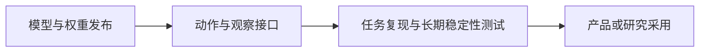

# AI 日报 · 2026-11-06

[中文（当前）](2026-11-06.md) · [English](../../en/daily/2026-11/2026-11-06.md)

- **采集截止：** 2026-11-06 11:00（Asia/Shanghai）。部分页面只标注发布日期，无法判断具体上线时刻。
- **本期性质：** 4 条高信号短版，其中 2 条 11 月 5 日发布、2 条较早发布的补漏；不以未经核实的传闻凑足常规 20–30 条。
- **导航：** [历史索引](../../INDEX.md) · [趋势追踪](../../TRACKERS.md)。

## 今日关键结论

1. **世界模型开始提供更明确的动作—观察接口。** NVIDIA 发布四个 Cosmos 3 开放权重检查点，覆盖驾驶多传感器仿真、模拟器控制和机器人动作预测；模型可用不等于仿真保真度已经独立证明。
2. **腾讯 Hy4 的产品能力与权重交付应分开看。** 腾讯 11 月 4 日发布 Hy4，加入视觉理解、计算机操作和游戏开发任务优化；官方说权重与系统卡片将在近期发布，因此目前不能写成权重已经开放。
3. **机器人模型竞争继续向数据与训练底座延伸。** LeRobot v0.7.0 增加语言交互、流式数据访问与大模型分布式训练流程；这属于具身 AI 基础设施进展，不代表特定机器人任务已通过独立实测。
4. **AI 游戏里的“玩游戏”与“生成游戏”是两条路线。** 补漏的 GameScaling 研究发布游戏操作智能体权重与推理代码，目标是从画面预测键鼠动作；它不是游戏内容生成模型，也不是可玩世界模型。

## 重点动态

### 1. NVIDIA 发布四个 Cosmos 3 交互世界仿真检查点

- **发生了什么：** NVIDIA 在 Hugging Face 公布四个 Cosmos3-Nano 后训练开放权重模型：Transfer-Auto 生成多视角驾驶数据，Sim-Auto 流式生成同步相机与 LiDAR 观察，Sim-Transfer 把模拟器控制与文字转成视频，Sim-Bimanual 根据机器人或相机动作预测视频。每个模型有 160 亿可训练参数，按 OpenMDW1.1 条款供商业和非商业使用。
- **为什么重要 / 视角：** 产品决策、内容选题、技术背景。世界模型的价值从单段视频转向可控制、可连续观察的仿真接口；但其对驾驶策略训练与机器人评估的保真度仍需独立测量。这不是现成的游戏引擎。
- **发布时间 / 类型 / 原始信源：** 2026-11-05，NVIDIA 团队在 Hugging Face 的官方技术文章；[发布说明与权重入口](https://huggingface.co/blog/nvidia/cosmos-interactive-world-simulation)。
- **交叉验证 / 可信度：** 文章链接到权重及技术报告，交付可检查；仿真质量、长期一致性和下游收益未见本轮独立复测。高（发布与权重），待验证（应用效果）。
- **趋势：** T02/T05 持续升温；与既有 Hy-Nomas、Matrix-Game 路线比较时须区分机器人/驾驶仿真和可玩游戏。

### 2. 腾讯 Hy4 增加视觉、计算机操作与游戏开发能力（11 月 4 日补漏）

- **发生了什么：** 腾讯 11 月 4 日发布 Hy4，并称其加入视觉理解和 Computer Use，针对 Blender、CAD 及跨应用任务训练；游戏开发部分覆盖 UE、Unity、Godot。腾讯自报 GameDev 和 GameLogic 评测较预览版提升 19.1% 和 9.8%。官方同时说明模型权重和系统卡片将在近期发布，现阶段不能把“计划开放”写成“已开放权重”。
- **为什么重要 / 视角：** 产品决策、内容选题、AI 游戏。它把模型能力对接到实际软件和游戏开发流程，但游戏开发任务能力不是世界模型，也不能由厂商榜分推定真实项目的稳定性。
- **发布时间 / 类型 / 原始信源：** 2026-11-04，公司公告；[腾讯原文](https://www.tencent.com/zh-cn/tencent-launches-hy4-joining-the-ranks-of-the-worlds-leading-open-source-ai-models/)。
- **交叉验证 / 可信度：** 发布状态来自腾讯一手页面；本轮无独立任务复测，权重尚待发布。高（发布公告），待验证（权重交付及能力数字）。
- **趋势：** T01/T05 首次补录、待验证；后续核查权重、许可和游戏开发实测。

### 3. Hugging Face 发布 LeRobot v0.7.0

- **发生了什么：** LeRobot v0.7.0 支持运行中以语言调整机器人目标、借助外部视觉语言模型规划、从 Hub 或存储桶流式读取训练数据，以及面向大型 world-action models 的分布式训练。团队称 Hub 上 LeRobot 格式的开放 Physical AI 数据接近 300 TB。
- **为什么重要 / 视角：** 产品决策、技术背景。数据读取、训练和远程推理成本会影响具身模型迭代速度；数据总量与工具功能不等于模型能安全完成真实任务。
- **发布时间 / 类型 / 原始信源：** 2026-11-05，Hugging Face 项目团队技术文章；[LeRobot 发布说明](https://huggingface.co/blog/lerobot/lerobot-release-v070)。
- **交叉验证 / 可信度：** 版本功能有项目一手说明；近 300 TB 为团队统计，本轮未独立核算或实机复测。高（版本发布），待验证（规模与任务收益）。
- **趋势：** T02 持续升温；具身 AI 从模型发布延伸到数据与训练基础设施。

### 4. GameScaling 研究游戏操作智能体（10 月 20 日论文补漏）

- **发生了什么：** 清华相关团队的 GameScaling 项目提供游戏操作视觉语言模型权重和推理代码，研究跨不同虚拟游戏环境的持续预训练，并让智能体根据画面预测键鼠动作。项目页面未提供完整训练代码。
- **为什么重要 / 视角：** AI 游戏、内容选题、技术背景。它适合观察游戏作为智能体训练和评测环境的价值；不能据此宣称模型能自动生成游戏、产出长时稳定可玩世界，或已经证明通用游戏能力。
- **发布时间 / 类型 / 原始信源：** 论文 2026-10-20 提交，代码与权重具体上线时间本轮未核实；[论文](https://arxiv.org/abs/2610.28698)；[GameScaling 项目](https://github.com/THUSI-Lab/GameScaling)；[模型权重](https://huggingface.co/THUSI-Lab/GameScaling)。本项为延迟发现，不是今日新发布。
- **交叉验证 / 可信度：** 代码与权重入口可检查；跨游戏泛化和实际操作成功率为研究方结果，本轮未独立复现。高（材料存在），待验证（泛化与成本）。
- **趋势：** T05 首次补录、待验证；与游戏生成工具及交互世界模型分开追踪。

## 连续追踪与限制

- **持续升温：** 可控世界仿真、机器人数据和训练底座、Agent 对真实软件的操作能力。
- **待验证：** Cosmos 3 的长时一致性和策略学习价值；Hy4 权重与系统卡片交付及第三方游戏开发测试；LeRobot 的数据规模与实机收益；GameScaling 的跨游戏泛化。
- **覆盖限制：** 本期 4 条中有 2 条补漏。未找到足够多且能在截稿前核实的一手高信号动态；页面仅标日期时不推断精确发布时间。未将截稿后发布的消息提前纳入。

> 行业资讯；重要决策请核对原始信源、许可与适用条件。
