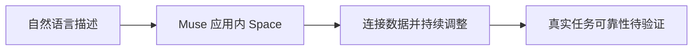

# AI 日报 · 2026-11-09（延迟补档）

[中文（当前）](2026-11-09.md) · [English](../../en/daily/2026-11/2026-11-09.md)

- **采集截止：** 2026-11-09 11:00（Asia/Shanghai）；11 月 10 日补编。收录一项当天发布的模型 API 与一项 11 月 6 日遗漏的 AI 应用更新。LG 官方仅标日期，媒体有当天较早的时间戳；精确官方上线时刻未披露。
- **本期性质：** 两条高信号补档；不以转发凑数。
- **导航：** [历史索引](../../INDEX.md) · [W45 周报](../../weekly/2026-W45.md) · [趋势追踪](../../TRACKERS.md)。

## 今日关键结论

1. **Meta 把自然语言创建的个人空间放进 Muse 应用。** 这是一种可持续调整、连接应用数据的应用内体验；发布说明没有证明复杂工作流的可靠性，也不等于生成独立可发布的游戏。
2. **LG 免费提供 K-EXAONE 2.5 文本模型 API。** 免费接口不等于开放权重或长期无限量商用；厂商榜分需独立复测。

## 重点动态

### 1. Meta 推出 Muse Spaces，允许描述并调整应用内个人空间

- **发生了什么：** Meta 于 11 月 6 日介绍 Muse Spaces。用户可描述礼物清单、日程板、问答小游戏或内容工作台，Muse 在应用内构建空间；空间可放在侧边栏或主标签，并继续通过对话调整。Meta 称其可连接其他应用并在后台更新，分享能力仍在探索。
- **为什么重要 / 视角：** 产品决策、内容选题、AI 游戏。自然语言创建的持久界面可能降低轻量工具与小游戏的制作门槛；但这仍是 Muse 中的功能，不能推断为可发布游戏引擎或已具备跨应用稳定执行能力。
- **发布时间 / 类型 / 原始信源：** 2026-11-06，Meta 产品公告；[Meta 原文](https://about.fb.com/news/2026/11/introducing-spaces-customize-muse-app/)。
- **交叉验证 / 可信度：** 单一官方公告；功能发布为高，跨应用稳定性、真实使用和留存待独立验证。
- **趋势：** T01/T05 首次收录、待验证；作为 11 月 6 日补漏，不视为 11 月 9 日新发布。

### 2. LG AI Research 免费开放 K-EXAONE 2.5 文本模型 API

- **发生了什么：** LG AI Research 宣布 K-EXAONE 2.5 API 经申请 key 免费使用。官方 API 文档列出 OpenAI 兼容的聊天接口、文本输入和 524,288 token 上下文上限。LG 用公开数据集的内部运行报告 AutomationBench-Openset、SWE-Bench Pro 等成绩；本次发布的是专有模型的 API，并未公布 2.5 权重。
- **为什么重要 / 视角：** 产品决策、投资观察、技术背景。韩国模型给 Agent 编程与工具任务增加测试选项；免费试用不等于长期价格、服务等级或权重开放，需核对条款、速率、语言效果与真实任务成本。
- **发布时间 / 类型 / 原始信源：** 2026-11-09，LG AI Research 新闻与 API 文档；[LG 公告](https://www.lgresearch.ai/news/view?seq=755) · [官方接口文档](https://docs.exaone.ai/en/docs/k-exaone-2.5)。
- **交叉验证 / 可信度：** 公告与文档均由 LG 提供；[MoneyToday 标注韩国时间 10:00 刊发](https://www.mt.co.kr/en/industry/2026/11/09/2026110909413580792)，相当于北京 09:00，是发布早于截止的独立时间线索，但不等于官方接口当时已可调用。高（发布公告），待验证（榜分、服务稳定性和商业条款）。
- **趋势：** T01/T04 首次收录、待验证；API 交付与开放权重分别记录。

## 连续追踪与限制

- **持续观察：** 可配置空间的权限、数据同步、修改后状态保持与小游戏的可分享性。
- **时间边界：** Anthropic 和 OpenAI 只标 11 月 9 日日期、无法证实在本期 11:00 前公开的消息列入 [11 月 10 日日报](2026-11-10.md)。
- **覆盖限制：** 本期非全面市场扫描；LG 的准确 API 可用时刻未由官方披露。

> 行业资讯；重要决策请复核原始信源、许可与适用条件。
