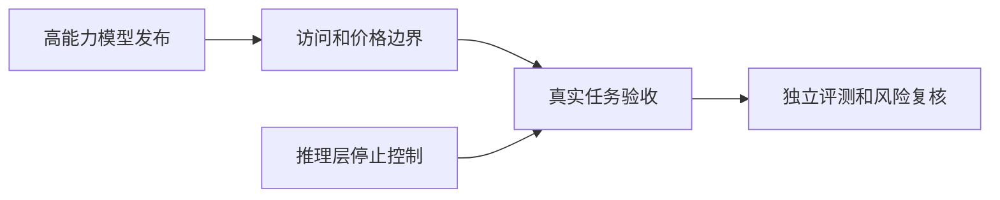

# AI 日报 · 2026-11-10

[中文（当前）](2026-11-10.md) · [English](../../en/daily/2026-11/2026-11-10.md)

- **采集截止：** 2026-11-10 11:00（Asia/Shanghai）。以下原始页面均标 11 月 9 日；无法推断精确发布时间。
- **本期性质：** 两条高信号短版；重大模型和研究治理系统各一项。LG API 已按可核实时间线索收录于[11 月 9 日补档](2026-11-09.md)。
- **导航：** [历史索引](../../INDEX.md) · [W45 周报](../../weekly/2026-W45.md) · [趋势追踪](../../TRACKERS.md)。

## 今日关键结论

1. **Anthropic 发布同一底层模型的两种访问形态。** Claude Fable 5.2 向普通用户开放并有网络安全、生物安全限制；Claude Mythos 5.2 对经核验机构开放。$8/$40 每百万输入/输出 token 是标准价，厂商任务榜分需独立复测。
2. **Agent 安全控制开始下沉到推理层。** OpenAI 称 Control Room 已在研究基础设施部署，用任务 ID 在推理引擎拒绝继续生成；35 秒为厂商说明的最大停止延迟，不能写成外部产品普遍具备此能力。

## 重点动态

### 1. Anthropic 发布 Claude Fable 5.2 与 Mythos 5.2

- **发生了什么：** Anthropic 称 Fable 与 Mythos 5.2 使用同一底层模型；Fable 加入网络安全和生物安全限制，可在 Claude 及云平台使用，Mythos 需经生命科学或网络安全核验计划申请。标准价均为每百万输入 token 8 美元、输出 token 40 美元；可选快速模式价格翻倍。官方称在 FrontierCode 2.0 等任务上提升，并披露约 1000 个子 Agent 协作构建原型操作系统、电子设备和机器人测试案例。
- **为什么重要 / 视角：** 产品决策、内容选题、投资观察、技术背景。能力分层与核验访问可能成为高风险领域的分发方式；多 Agent 演示涉及特定脚手架、预算和人工指导，不能直接推断普通产品中的成功率或投资收益。应按任务完成率、总成本与安全误拦率比较。
- **发布时间 / 类型 / 原始信源：** 2026-11-09，Anthropic 产品与研究公告；[主公告](https://www.anthropic.com/claude-fable-and-mythos-5-2) · [电子设备实验细节](https://www.anthropic.com/research/claude-electronics-design)。
- **交叉验证 / 可信度：** 两篇均为 Anthropic 材料，不构成独立互证；发布和标价可信度高，榜分、科研与硬件泛化效果待独立复核。电子设备实验有合作方参与，但仍属于该发布的案例。
- **趋势：** T01/T07 持续升温；访问权限、价格与实测质量分开跟踪。

### 2. OpenAI 公布研究任务停止系统 Control Room

- **发生了什么：** OpenAI 表示 Control Room 已覆盖其研究推理负载。每个任务关联 ID；推理引擎在生成前向中心服务查验许可，停止后拒绝继续输出。公司称收到停止指令后最多 35 秒阻断进一步输出；中心服务失效时采用拒绝式故障处理。该机制目前面向研究基础设施，剩余研究负载的拒绝式故障处理尚在部署。
- **为什么重要 / 视角：** 产品决策、技术背景、内容选题。把停止点设在较集中的推理引擎，可以减少依赖频繁变化的 Agent 任务代码；实际覆盖率、绕过风险和 35 秒指标尚须独立审计，不能外推为所有对外 API 的保护水平。
- **发布时间 / 类型 / 原始信源：** 2026-11-09，OpenAI 工程与安全公告；[Control Room 原文](https://openai.com/index/control-room/)。
- **交叉验证 / 可信度：** 单一官方披露；架构和部署声明可信度高，性能与完整覆盖仍待独立验证。
- **趋势：** T07 持续升温；与 GPT-6 Cyber 的受限分发和 Hacktron 合作组成不同层次的安全措施。

## 连续追踪与限制

- **持续升温：** 高能力模型的访问分级；推理层运行控制。
- **待验证：** Fable 5.2 在真实多 Agent 工作流中的总费用与成功率，Mythos 核验覆盖，以及 Control Room 独立审计。
- **覆盖限制：** 本期两条均标 11 月 9 日，无法确认精确上线时刻；未找到同等级、可确认属于本窗口的世界模型或中国新模型交付，不以旧消息补位。

> 行业资讯；重要决策请复核原始信源、许可与适用条件。
