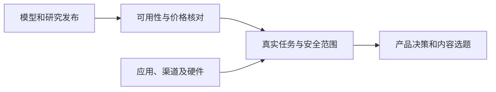

# AI 日报 · 2026-11-11

[中文（当前）](2026-11-11.md) · [English](../../en/daily/2026-11/2026-11-11.md)

- **采集截止：** 2026-11-11 11:00（Asia/Shanghai）。仅标日期的信源不推定精确上线时间；11 月 9 日遗漏事项标为补漏。
- **本期性质：** 12 条高信号版；按独立事件去重，厂商评测、实际交付与未来计划分开标注。
- **导航：** [历史索引](../../INDEX.md) · [趋势追踪](../../TRACKERS.md)。

## 今日关键结论

1. **高能力模型走向分层销售。** Gemini 4 Carbon 向付费 API 扩大开放，限时价格将于 12 月变动；Muse Ember 主攻高频 Agent 子任务。比较应落实到任务成功率和完整账单。
2. **AI 工作空间吸收可编辑产物与商业入口。** Claude 增加表格、白板和数据工作台；ChatGPT 增加企业资料和标识清楚的 Business Agent。功能状态与适用地域不同。
3. **具身与安全研究出现可检验交付物。** Gemini Robotics 2.5 进入伙伴测试，NVIDIA 发布 GR00T 2 与训练工具；AlphaProof Code 公开形式化验证产物。产线成功率和证明范围均有边界。
4. **多模态评测与行业报告更贴近交付任务。** MKA 测复杂视觉文件，Upwork 报告观察技能组合变化；样本和因果解释需谨慎。
5. **基础设施与分发渠道继续重组。** TPU 8tx/8i Max 面向机密推理与内存需求；AWS Marketplace 与 Adobe 合作改变采购和创作入口，尚需看实际采用。

## 重点动态

### 1. Google 将 Gemini 4 Carbon 扩大到付费 API 与 Ultra

- **发生了什么：** Google 称 Carbon 面向高难度长程 Agent、网络安全与科学任务，现向 AI Studio 和 Gemini for business 付费开发者开放 API，并逐步进入 Antigravity、Gemini App 与搜索 AI Mode 的 Ultra 方案。每百万输入/输出 token 暂定 2/10 美元，12 月 1 日起拟变为 4/20 美元。
- **为什么重要 / 视角：** 产品决策、投资观察、技术背景。与 Argon 分层，必须用真实任务成功率和总费用比较；厂商榜单名次并非独立生产验证。
- **发布时间 / 类型 / 原始信源：** 2026-11-10，Google 产品公告；[官方发布](https://blog.google/innovation-and-ai/models-and-research/gemini-models/gemini-4-carbon-now-available/)。
- **交叉验证 / 可信度：** 官方可用性与标价可信度高；能力和成本收益为厂商主张，待独立复测。
- **趋势：** T01 持续升温；承接 10 月限制访问预览。

### 2. Google DeepMind 推出 Gemini Robotics 2.5 合作伙伴版

- **发生了什么：** DeepMind 发布视觉-语言-动作模型 Robotics 2.5，并称在超过 200 项任务测试；在 Apptronik 与梅赛德斯奔驰的产线概念验证中，厂商报告 Apollo 2 分拣汽车部件成功率 96%。目前向机器人合作伙伴逐步开放。
- **为什么重要 / 视角：** 产品决策、技术背景、投资观察。产线操作与世界模型仿真不同；应核查任务样本、失败恢复、运行时间和单位成本，不能把概念验证当普遍部署。
- **发布时间 / 类型 / 原始信源：** 2026-11-10，DeepMind 模型公告；[官方发布](https://deepmind.google/blog/gemini-robotics-2-5-accelerates-real-world-physical-intelligence/)。
- **交叉验证 / 可信度：** 单一官方披露，合作方被点名但此处未独立核对试验数据；发布可信度高，96% 与泛化能力待验证。
- **趋势：** T02 持续升温；具身控制与 AI 游戏分开追踪。

### 3. DeepMind 用 AlphaProof Code 验证 Signal 协议代码性质

- **发生了什么：** DeepMind 称研究人员定义并审阅规范，由 Gemini Carbon 驱动的 Agent 生成 Lean 证明，验证 Signal 协议实现的关键安全性质；还在隔离版本中重新植入两个已修复漏洞进行反证。形式化验证产物已开放供检查。
- **为什么重要 / 视角：** 产品决策、内容选题、技术背景。这是对指定规范和代码范围的机器检查，不等于整个 Signal 应用或所有加密实现无漏洞；可借鉴“人定规范、机器证明、反例测试”。
- **发布时间 / 类型 / 原始信源：** 2026-11-10，DeepMind 研究文章；[官方研究](https://deepmind.google/blog/introducing-alphaproof-code/)。
- **交叉验证 / 可信度：** Signal CTO 在研究文章中评述，但证明范围与成本仍以研究方材料为主；公开产物允许外部复核。
- **趋势：** T07 首次收录；与漏洞发现、安全模型访问控制并行。

### 4. Anthropic 发布 Claude Whiteboards、Sheets 和 Data

- **发生了什么：** Anthropic 将 Whiteboards 与 Sheets 以 beta 发布，把 Dashboards 改名为 Claude Data 并正式提供；交互式连接器可在 Claude 内打开合作应用。Claude Meetings 在公告中仍写作即将推出。企业管理员可限制连接器的读写权限。
- **为什么重要 / 视角：** 产品决策、内容选题。AI 工作空间开始保留可协作、可修改的中间产物；需要测版本追踪、权限、导出和真实团队采用率，不能将 Meetings 写成已上线。
- **发布时间 / 类型 / 原始信源：** 2026-11-10，Anthropic 产品公告；[功能说明](https://claude.com/resources/articles/sheets-whiteboards-data) · [连接器与权限](https://claude.com/resources/articles/more-ways-to-work-with-claude-sheets-whiteboards-and-interactive-connectors)。
- **交叉验证 / 可信度：** 两篇公告同源，功能状态可信度高；实际工作流收益待独立验证。
- **趋势：** T01/T03 持续升温；结构化协作延伸单次聊天输出。

### 5. OpenAI 推出 Businesses in ChatGPT 测试版

- **发生了什么：** 符合条件的企业可认领资料并在 Business Hub 更新商品信息、查看汇总的提及和点击；美国合资格电商及在线服务可创建 Business Agent。Agent 对话与 ChatGPT 原答复分开标识，赞助展示另作标记。
- **为什么重要 / 视角：** 产品决策、投资观察、内容选题。AI 搜索分发开始形成企业资料入口与站内转化路径；需监测归因、广告边界和非美国可用性，不把测试版当全球开放。
- **发布时间 / 类型 / 原始信源：** 2026-11-10，OpenAI 产品公告；[官方发布](https://openai.com/index/introducing-businesses-chatgpt/) · [企业资料政策](https://openai.com/policies/businesses-in-chatgpt/)。
- **交叉验证 / 可信度：** 公司公告与政策同源；功能发布可信度高，流量与商业效果未独立验证。
- **趋势：** T01/T08 首次收录；Agent 与商业资料分发结合。

### 6. Meta 发布面向重复 Agent 任务的 Muse Ember（11 月 9 日补漏）

- **发生了什么：** Meta 11 月 9 日发布 Muse Ember，面向工具调用、路由、抽取和编程子任务，已在 Muse Code 与 Meta Model API 提供，价格为每百万输入/输出 token 0.10/0.50 美元；上下文窗口 100 万 token。官方将 Artificial Analysis 分数与估算任务成本并列展示。
- **为什么重要 / 视角：** 产品决策、投资观察。可作为高频 Agent 子任务的成本选项；仅 API 可用，不能写作开放权重；应按自己的工具任务核对质量、延迟与账单。
- **发布时间 / 类型 / 原始信源：** 2026-11-09，Meta 模型公告；[官方发布](https://research.meta.ai/blog/muse-ember)。
- **交叉验证 / 可信度：** 官方交付和价格可核；榜分引用第三方数据但模型任务成本为估算，实际收益待独立复测。
- **趋势：** T01/T04 首次收录，待验证；属前一日未收录补漏。

### 7. NVIDIA 在 CoRL 公布 GR00T 2 与 Isaac Lab 3.0（11 月 9 日补漏）

- **发生了什么：** NVIDIA 介绍 GR00T 2 世界动作模型、Isaac Lab 3.0 及机器人评测工具。公司报告在 50 项任务中 40 项至少成功一次；另一组少样本测试中，单次示范的平均成功率为 71%。Isaac Lab 3.0 增加物理求解器与训练环境选项。
- **为什么重要 / 视角：** 技术背景、投资观察。联合预测视频和动作可辅助机器人操控训练，但不等于可玩游戏世界模型；“至少一次成功”与稳定完成率必须区分。
- **发布时间 / 类型 / 原始信源：** 2026-11-09，NVIDIA 产品与研究公告；[官方发布](https://blogs.nvidia.com/blog/robotics-simulation-advancements-corl/) · [研究页](https://research.nvidia.com/labs/gear/gr00t-2/)。
- **交叉验证 / 可信度：** NVIDIA 研究与博客同源；交付状态和厂商指标应拆开，真实产线效果待独立验证。
- **趋势：** T02 持续升温；与 Cosmos 3 的仿真检查点形成不同层次。

### 8. Google 与 Artificial Analysis 发布多模态知识工作基准 MKA

- **发生了什么：** MKA 收录 200 项跨 10 个行业、83 类职业的多步骤视觉文件任务；统一使用 Stirrup Agent 脚手架、工具与轮次预算。完整集由 Artificial Analysis 私有运行，另开放 10 个样题。Google 称 Carbon 质量排名第二、任务均价约为最高分模型的六分之一。
- **为什么重要 / 视角：** 产品决策、技术背景。更接近图纸、表格、演示文稿等产物验收；私有题集有防污染价值，也限制外部逐题复核。厂商名次需看榜单方法与目标任务迁移。
- **发布时间 / 类型 / 原始信源：** 2026-11-10，Google 与评测机构合作公告；[基准介绍](https://blog.google/innovation-and-ai/models-and-research/gemini-models/multimodal-knowledge-agent-benchmark/)。
- **交叉验证 / 可信度：** Artificial Analysis 运营评测，合作公告并非完全独立复测；10 个公开样题可检查格式，完整排名需参考其方法。
- **趋势：** T01/T03 首次收录；从文本问答转向多模态交付物。

### 9. OpenAI 与 Upwork 报告自由职业任务组合变化

- **发生了什么：** 双方用 Upwork 招聘信息及 ChatGPT 使用数据分析自由职业需求。报告称 2023 年初至 2025 年末，AI 相关招聘任务组合的多样性增加约 45%；某些常见服务份额下降，AI 项目往往组合更多技能并有更高预算与工时。
- **为什么重要 / 视角：** 内容选题、产品决策、投资观察。观察需求从单项产出转向整合交付，但样本来自特定平台与 ChatGPT 行为；描述性相关性不能证明 AI 导致收入或就业变化。
- **发布时间 / 类型 / 原始信源：** 2026-11-10，OpenAI/Upwork 联合报告；[研究介绍](https://openai.com/index/ai-effect-on-freelance-work/) · [完整报告](https://cdn.openai.com/pdf/openai-upwork-full-report.pdf)。
- **交叉验证 / 可信度：** 两方合作数据不是独立复核；报告自身标注替代关系推断限制。
- **趋势：** T06 首次收录，待验证；关注创作服务打包。

### 10. Google 与 Adobe 扩大创作工具与 AI 产品合作

- **发生了什么：** Google 称将把 Acrobat 入口接入 Drive/Gmail，扩充 Gemini 和搜索 AI Mode 中的 Adobe 工具连接，并探索 Photoshop 的近实时图像编辑模型。多项能力使用“将”“探索”表述。
- **为什么重要 / 视角：** 产品决策、内容选题。生成模型的价值更多通过既有创作软件入口兑现；需区分现有连接、计划集成和研究探索，追踪具体交付时间与编辑质量。
- **发布时间 / 类型 / 原始信源：** 2026-11-10，Google 合作公告；[官方发布](https://blog.google/company-news/inside-google/company-announcements/adobe-google-partnership-integration/)。
- **交叉验证 / 可信度：** 单一官方公告；合作方向可信度高，未来功能交付和收益待核。
- **趋势：** T03 持续升温，部分待落地。

### 11. Google 公布 TPU 8tx 与 8i Max（11 月 9 日补漏）

- **发生了什么：** Google 新增 8tx 与 8i Max：前者主打机密推理与小规模训练，后者以双芯片组合提高算力和内存带宽。文中亦提及 TPU Sync 软件层与 Cloud Pathways，但不同组件的发布状态需分别核对。
- **为什么重要 / 视角：** 投资观察、技术背景。Agent 的长上下文与敏感数据部署推动芯片、内存、网络联合设计；厂商性能数字不等于已量产或客户实测。
- **发布时间 / 类型 / 原始信源：** 2026-11-09，Google 基础设施公告；[官方发布](https://blog.google/innovation-and-ai/infrastructure-and-cloud/global-network/tpu-8i-max-and-8tx/)。
- **交叉验证 / 可信度：** 单一官方资料；产品介绍可信度高，硬件可用性及对比数据待独立核验。
- **趋势：** T08/T09 首次收录，待验证。

### 12. ChatGPT Enterprise 进入 AWS Marketplace（11 月 9 日补漏）

- **发生了什么：** OpenAI 宣布企业可通过 AWS Marketplace 采购 ChatGPT Enterprise，沿用 AWS 采购和计费关系，并将合资格支出计入 AWS 承诺。公告称模型与功能更新与直接采购保持同步。
- **为什么重要 / 视角：** 产品决策、投资观察。采购入口与 Bedrock 中的模型 API 是两种产品形态；渠道摩擦下降不等于实际采用和投资回报率增加。
- **发布时间 / 类型 / 原始信源：** 2026-11-09，OpenAI 产品公告；[官方发布](https://openai.com/index/chatgpt-enterprise-aws-marketplace/)。
- **交叉验证 / 可信度：** OpenAI 公告含 AWS 负责人说明，但双方均为合作方；可用性可信度高，采用和收益待验证。
- **趋势：** T01/T08 持续升温；分发渠道变化。

## 连续追踪与限制

- **持续升温：** 模型按难度/价格分层，Agent 接入可编辑业务产物，世界动作模型与具身控制的工具链。
- **待验证：** Carbon 与 Ember 在同一任务上的总成本；机器人任务的长期稳定率；形式化验证范围外的安全风险；企业 Agent 的转化与误导风险。
- **覆盖限制：** 本期一手信源集中于美国公司，缺少同窗口可核的中国新模型发布；不据此推断中国研发放缓。11 月 9 日补漏不作 11 月 10 日新发布统计。

> 行业资讯；重要决策请复核原始信源、许可与适用条件。
