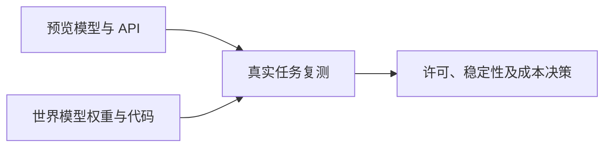

# AI 日报 · 2026-11-12（补档）

[中文（当前）](2026-11-12.md) · [English](../../en/daily/2026-11/2026-11-12.md)

- **采集说明：** 2026-11-13 事后补编。四项原始发布均早于补编日；按原始日期标注，不冒充 11 月 12 日 11:00 前的实时监测。
- **本期性质：** 4 条补漏；不以低信号内容凑数。[历史索引](../../INDEX.md) · [趋势追踪](../../TRACKERS.md)。

## 今日关键结论

1. **中国模型面向长任务与多模态交付继续扩展。** Qwen4-Max-Preview 已提供限时 Token Plan 接入；ERNIE 5.5 Flash Preview API 可用，但其后训练权重仍是未来计划。两者的演示和厂商榜分都需独立任务复测。
2. **世界模型出现两种可检查的交付。** Runway 公开 Praxis-1 机器人视频动作模型的权重及代码；IFM 发布 PAN 2 视频世界模型的权重和训练/推理代码。前者服务机器人控制，后者服务动作条件仿真，不能当作已验证的可玩游戏世界。

## 重点动态

### 1. 阿里云提供 Qwen4-Max-Preview 限时接入

- **发生了什么：** 阿里云文档列明 `qwen4-max-preview` 支持文本、图像/视频理解、工具调用和结构化输出，上下文上限 100 万 token；预览期为北京时间 11 月 11 日 10:00 至 11 月 25 日 24:00，仅支持 Token Plan，结束后下线。
- **为什么重要 / 视角：** 产品决策、投资观察。可测试复杂 Agent 和多模态工作流，但限时套餐不等于长期 API 定价，也不是开放权重。
- **发布时间 / 类型 / 原始信源：** 2026-11-11，阿里云官方产品文档；[中文文档](https://help.aliyun.cn/zh/model-studio/qwen4-max-preview) · [英文文档](https://help.aliyun.com/en/model-studio/qwen4-max-preview)。
- **交叉验证 / 可信度：** 两种语言同属阿里云，非独立交叉验证；交付与时限可信度高，能力与成本收益待独立复测。
- **趋势：** T01/T03 首次收录；11 月 11 日漏项补录。

### 2. 百度发布 ERNIE 5.5 Flash Preview

- **发生了什么：** 百度称这是此前 Base 模型的首个后训练版本，280B 总参数、14B 激活参数、100 万 token 上下文；API 已进入千帆。官方称权重将在 11 月 25 日前发布，尚不能把 Preview 写为已开放权重。游戏开发、3D 和视频案例使用了 Agent 框架与外部工具/素材。
- **为什么重要 / 视角：** 产品决策、AI 游戏、内容选题。长程游戏开发演示值得按可运行构建、素材许可、重试次数和人工介入复测；它是编程 Agent 演示，不是游戏世界模型。
- **发布时间 / 类型 / 原始信源：** 2026-11-11，百度官方模型公告；[中文发布](https://ernie.baidu.com/zh/release/ernie-5-5-flash-preview/) · [英文发布](https://ernie.baidu.com/release/ernie-5-5-flash-preview/)。
- **交叉验证 / 可信度：** 两版均为百度资料；API 上线可信度高，厂商示例和基准、未来权重交付待验证。
- **趋势：** T01/T05 首次收录；11 月 11 日漏项补录。

### 3. Runway 公开 Praxis-1 机器人世界动作模型

- **发生了什么：** Runway 将 27B Praxis-1 的基座及机器人微调检查点、推理与微调代码以 Apache 2.0 提供；模型联合预测视频和机器人动作。公司称 RoboLab-120 成功率 46.2%。
- **为什么重要 / 视角：** 产品决策、技术背景、投资观察。视频预训练进入机器人控制的交付链；需将可下载工件与实机泛化、长期任务成功率分开，并核算部署显存与调优成本。
- **发布时间 / 类型 / 原始信源：** 2026-11-11，Runway 官方发布；[发布说明](https://runway.com/news/company-news/praxis-1-is-now-available) · [研究报告](https://runway.com/research/praxis-1-video-pretraining-to-robot-control) · [代码](https://github.com/runwayml/praxis-1-oss)。
- **交叉验证 / 可信度：** 权重和代码可检查；研究与发布同源，榜分及实机成效待独立复测。与可玩游戏世界模型分开。
- **趋势：** T02 持续升温；9 月预告现转为工件交付。

### 4. IFM 发布 PAN 2 动作条件视频世界模型（11 月 10 日补漏）

- **发生了什么：** MBZUAI 旗下 IFM 称 PAN 2 根据起始画面和文字动作模拟后续视频，发布视频模型权重及训练/推理代码，采用 Apache 2.0。官方承认长期世界一致性仍是难题。
- **为什么重要 / 视角：** 技术背景、AI 游戏、内容选题。可研究动作条件仿真和可复现性；不能把短片生成或榜分写成长期可互动游戏已落地。
- **发布时间 / 类型 / 原始信源：** 2026-11-10，IFM 官方新闻稿及技术博客；[新闻稿](https://ifm.ai/pan2/press-release/) · [技术博客](https://ifm.ai/blog/pan2/)。
- **交叉验证 / 可信度：** 同一机构两份材料，不构成独立复测；工件发布可信度高，物理一致性和长程效果待外部验证。
- **趋势：** T02/T05 首次收录；11 月 10 日漏项补录。

## 连续追踪与限制

- **待验证：** Qwen4 预览结束后的正式可用性；ERNIE 权重是否按期交付；Praxis-1 跨硬件实机稳定性；PAN 2 长程状态一致性。
- **覆盖限制：** 这是补档，不代表对 11 月 11–12 日所有信源完成实时扫描。发布日期与上线时刻不同；厂商示例均不等于独立验收。
