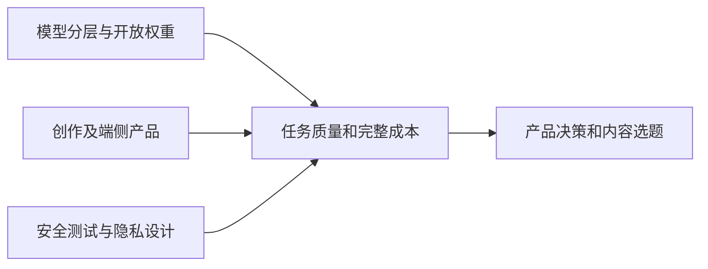

# AI 日报 · 2026-11-13

[中文（当前）](2026-11-13.md) · [English](../../en/daily/2026-11/2026-11-13.md)

- **采集截止：** 2026-11-13 11:00（Asia/Shanghai）。11 月 12 日仅标日期的发布无法确认具体上线时刻，按本期收录；另见[11 月 12 日补档](2026-11-12.md)。
- **本期性质：** 6 条高信号；同一 Hydrogen 发布的模型与搜索入口合并，避免重复计数。[历史索引](../../INDEX.md) · [趋势追踪](../../TRACKERS.md)。

## 今日关键结论

1. **高能力模型进一步按任务分工。** Google 发布 Gemini 4 Hydrogen，并在 Antigravity 用 Orchestrator 动态搭配 Carbon/Hydrogen。产品选型要看任务完成率、模型切换开销和整段工作流费用；厂商基准并非独立产线验收。
2. **创作软件开始把角色一致性与镜头变体做成可操作工具。** Flow 新增五个由创作者设计的工具。对互动内容产线，先验证跨镜头连续性、素材许可和返工时间。
3. **开放权重语音模型继续下沉到可自部署场景。** Salesforce SOV-Transcribe-1 提供 Apache 2.0 权重，面向非流式转录；命名实体、格式控制和噪声场景是更实际的验收点。
4. **安全与隐私成为交付设计的一部分。** Anthropic 的 Anvil 自动红队是内部研究结果；Google 的 Gemini 眼镜进入预订并披露多项隐私设计。两者都需要外部验证，而非把声明当成实际效果。

## 重点动态

### 1. Google 发布 Gemini 4 Hydrogen 与 Antigravity Orchestrator

- **发生了什么：** Google 将 Hydrogen 定位于高频编程和 Agent 执行，宣布覆盖 AI Studio、Gemini API、企业、Gemini App 与搜索等入口；API 标价每百万输入/输出 token 1.50/7.50 美元，上下文 100 万 token。Antigravity 的 Orchestrator 可在 Carbon 与 Hydrogen 间动态分工。Google 称在 Terminal-Bench 4.0 上接近 Carbon 成功率、平均少用 24% 配额并快 19%。
- **为什么重要 / 视角：** 产品决策、投资观察、技术背景。模型路由不只比单次调用价格，还要测端到端成功率、重试、延迟和配额；厂商榜分及合作伙伴评语不代替独立生产复测。
- **发布时间 / 类型 / 原始信源：** 2026-11-12，Google 模型与产品公告；[官方发布](https://blog.google/innovation-and-ai/models-and-research/gemini-models/introducing-gemini-4-hydrogen/)。
- **交叉验证 / 可信度：** 发布、接口及标价为官方资料，可信度高；性能与安全数字主要由 Google 披露，待独立复测。
- **趋势：** T01/T04 持续升温；承接 Carbon 和低价执行模型的分层路线。

### 2. Google Search 接入 Hydrogen，强化复杂问题与可视化回答

- **发生了什么：** Google 宣布 Hydrogen 面向全球 Google Search 用户，强调多子问题检索、网页链接、表格、图片和自定义工具等呈现形式。此项是同一 Hydrogen 模型发布的分发增量，不另算新基础模型。
- **为什么重要 / 视角：** 产品决策、内容选题。AI 搜索入口可能改变内容发现与商业转化；应实测来源可见度、跳转、引用准确性和地域差异。
- **发布时间 / 类型 / 原始信源：** 2026-11-12，Google 搜索产品公告；[官方发布](https://blog.google/products-and-platforms/products/search/gemini-4-hydrogen-search-upgrade/)。
- **交叉验证 / 可信度：** Google 两篇材料同源；功能发布可信度高，搜索流量影响尚无独立数据。
- **趋势：** T01/T08 持续升温；与第 1 条属于同一模型事件的产品延伸。

### 3. Google Flow 上线五项视觉叙事工具

- **发生了什么：** Flow 增加 Character Poster、Character Arc、Pixel Machine、Lucid Glass、Pocket Studio；分别面向视觉风格、跨年龄角色变化、复古画风、光学效果和单段手机视频的镜头变体。
- **为什么重要 / 视角：** 产品决策、内容选题、AI 游戏。角色连续性与镜头变体直接影响互动叙事素材生产，但需检查可编辑性、跨场景一致性、授权与完成片段的返工时间；这些是创作工具，不是游戏世界模型。
- **发布时间 / 类型 / 原始信源：** 2026-11-12，Google Labs 产品公告；[官方发布](https://blog.google/innovation-and-ai/models-and-research/google-labs/new-google-flow-tools/)。
- **交叉验证 / 可信度：** 单一官方说明；工具存在可信度高，节省工时及成片质量待独立实测。
- **趋势：** T03/T05 持续升温。

### 4. Salesforce 发布 SOV-Transcribe-1 开放权重语音转录模型

- **发生了什么：** Salesforce 在 Hugging Face 发布 SOV-Transcribe-1，4B 激活/26B 总参数，非流式 ASR，支持按指令控制转录格式、关键词提示和多语言；权重为 Apache 2.0。官方称其在特定榜单的开放权重模型中排名第一。
- **为什么重要 / 视角：** 产品决策、技术背景。语音 Agent 的关键错误常在邮箱、数字、专名和工具参数；应按实际口音、噪声、延迟与实体准确率复测。开放权重不等于可直接满足实时对话延迟。
- **发布时间 / 类型 / 原始信源：** 2026-11-12，Salesforce 团队 Hugging Face 文章与模型卡；[发布说明](https://huggingface.co/blog/salesforce-sovereign-intelligence/sov-transcribe-1) · [模型卡](https://huggingface.co/salesforce-sovereign-intelligence/SOV-Transcribe-1)。
- **交叉验证 / 可信度：** 权重和许可可直接检查；榜单引用第三方但发布方选择呈现结果，应用效果待独立评测。
- **趋势：** T03/T04 首次收录。

### 5. Anthropic 披露 Anvil 自动红队研究

- **发生了什么：** Anthropic 研究团队称内部 Anvil 系统在其生物、网络和反蒸馏防护测试中，比合作人类红队更快找到特定漏洞，并用于发布前检查。系统依赖内部高能力模型与防护细节；研究本身也指出攻击者条件和真实流量的差异。
- **为什么重要 / 视角：** 产品决策、技术背景。安全测试从静态提示转向自适应 Agent 压力测试；应核查测试范围、修复闭环、误报、成本与独立复核，不能把内部比较泛化为“所有防护均安全”。
- **发布时间 / 类型 / 原始信源：** 2026-11-12，Anthropic 官方安全研究；[研究文章](https://safeguards.anthropic.com/2026/automated-red-teaming/)。
- **交叉验证 / 可信度：** 单一研究团队披露，方法与限制可阅读；比较优势和生产防护效果未独立复现，可信度中。
- **趋势：** T07 持续升温。

### 6. Google Gemini 智能眼镜开放预订

- **发生了什么：** Google 宣布与 Gentle Monster、Warby Parker、Samsung 合作的智能眼镜开放预订，12 月 10 日开始上市；集成 Gemini、导航和实时翻译。公司披露相机视觉历史与训练用途限制、旁人面部遮盖、录制指示灯等隐私设计；不同款式与市场可用性不同。
- **为什么重要 / 视角：** 产品决策、投资观察、内容选题。多模态助手进入佩戴场景，交互、社会接受度与隐私约束同等关键；预订不等于销量或用户留存。
- **发布时间 / 类型 / 原始信源：** 2026-11-12，Google 硬件产品公告；[官方发布](https://blog.google/innovation-and-ai/technology/xr-ar/google-intelligent-eyewear-collections-pre-order/)。
- **交叉验证 / 可信度：** 单一厂商公告；预订状态可信度高，续航、隐私实际效果和市场采用待独立实测。
- **趋势：** T03/T08 首次收录，后续观察 12 月交付。

## 连续追踪与限制

- **持续升温：** 模型分层与自动路由；创作工具的角色/镜头控制；可自部署语音；安全测试自动化。
- **待验证：** Hydrogen 真实任务总成本与 Search 引流，Flow 长片段一致性，SOV-Transcribe-1 关键实体准确率，Anvil 外部复现，眼镜交付与隐私实际效果。
- **覆盖限制：** 11 月 12 日仅标日期的来源不推定早于昨日 11:00；本期高信号集中于美国厂商，不能据此推断其他地区没有进展。11 月 12 日补档单独列出。
