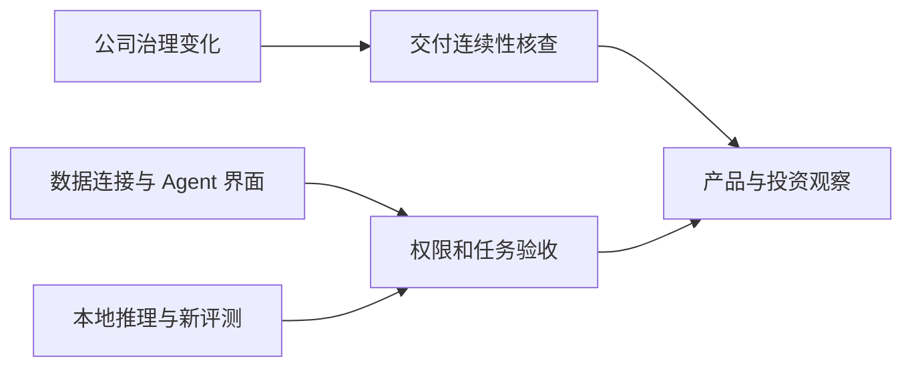

# AI 日报 · 2026-11-14

[中文（当前）](2026-11-14.md) · [English](../../en/daily/2026-11/2026-11-14.md)

- **采集截止：** 2026-11-14 11:00（Asia/Shanghai）。仅标日期的 11 月 13 日来源不推定具体上线时刻；11 月 11 日 A2UI 为明确补漏。
- **本期性质：** 5 条高信号短版，不以低质量内容凑数。[历史索引](../../INDEX.md) · [趋势追踪](../../TRACKERS.md)。

## 今日关键结论

1. **NVIDIA 管理层发生重大变化。** 官方确认黄仁勋辞任 CEO、总裁及董事，CFO Colette Kress 任临时 CEO，董事会启动继任搜索。业务连续性是董事会预期，尚非实际经营结果。
2. **个人 Agent 进入更敏感的数据域。** 美国 Gemini 用户可选择连接 Google Wallet 与 Plaid 关联账户读取消费信息；官方称连接器只读。产品决策应把权限、数据纠错、财务建议边界与退出机制列为验收项。
3. **Agent 产品的两个基础层在完善。** llama.cpp 1.0 聚焦库的 API/ABI 版本语义；Google A2UI 1.0 提供交互式 Agent 界面协议。前者关乎本地推理集成稳定性，后者关乎可确认、可编辑的交互界面。
4. **评测开始关注“用户问错问题”时的帮助质量。** Ai2 的 XYBench 测试助手识别用户提出的手段与真正目标不匹配的能力；榜分不能代替产品用户研究。

## 重点动态

### 1. NVIDIA 宣布 CEO 交接

- **发生了什么：** NVIDIA 董事会宣布黄仁勋自 11 月 12 日起辞任总裁、CEO 和董事；原 CFO Colette Kress 兼任临时 CEO，Harvey C. Jones 任董事长，董事会寻找正式继任者。
- **为什么重要 / 视角：** 投资观察、产品决策。需追踪 11 月 17 日财报、客户交付和技术路线的实证变化；公告中“业务不受中断”是董事会预期，不能当成已验证事实。对私人原因的报道不作未核实归因。
- **发布时间 / 类型 / 原始信源：** 2026-11-12，NVIDIA 投资者关系公告；[官方公告](https://investor.nvidia.com/news/press-release-details/2026/NVIDIA-Announces-CEO-Transition/) · [管理团队页](https://investor.nvidia.com/governance/management-team/default.aspx)。
- **交叉验证 / 可信度：** 两处官方资料可核对任命，但同属公司；人事事实可信度高，战略和经营影响待观察。
- **趋势：** T08 首次收录；关注后续财报和继任安排。

### 2. 美国 Gemini 用户可连接 Google Wallet

- **发生了什么：** Google 宣布美国 Gemini App 用户可选择连接 Wallet，亦可经 Plaid 关联银行卡账户，以消费记录生成预算、订阅等回答和图表。官方称该连接器只能读取信息，不能转移、管理或投资资金，可随时关闭。
- **为什么重要 / 视角：** 产品决策、投资观察。个性化 Agent 正接触高敏感数据；应验证授权范围、错误交易解释、退出后的数据处理与金融建议边界，不能把只读承诺推断为零隐私风险。
- **发布时间 / 类型 / 原始信源：** 2026-11-13，Google 产品公告；[官方发布](https://blog.google/innovation-and-ai/products/gemini-app/google-wallet-gemini-app/)。
- **交叉验证 / 可信度：** 单一厂商披露；推出与地域范围可信度高，隐私实现及实际收益待独立复核。
- **趋势：** T01/T08 首次收录；延伸跨应用个人上下文。

### 3. llama.cpp 发布库版本 1.0.0

- **发生了什么：** ggml-org 在 Hugging Face 宣布 llama.cpp 与 ggml 库 1.0.0，计划此后用主版本号表示 API 与 ABI 不兼容变化；这是一项本地多模态模型推理基础设施版本约定，不是新模型发布。
- **为什么重要 / 视角：** 产品决策、技术背景。本地与私有部署依赖稳定接口，升级时需测模型覆盖、后端兼容、量化质量和既有应用构建。
- **发布时间 / 类型 / 原始信源：** 2026-11-13，ggml-org 团队文章；[发布说明](https://huggingface.co/blog/ggml-org/llama-cpp-v1)。
- **交叉验证 / 可信度：** 维护团队一手说明，版本发布可信度高；下游迁移稳定性需项目实测。
- **趋势：** T04 持续升温；本地推理从快速迭代转向接口治理。

### 4. Ai2 发布 XYBench 评测资源

- **发生了什么：** Ai2 公开超过 8000 道问题的 XYBench，测助手能否发现用户提议的解决办法与真实目标不匹配，并提供论文、数据和代码；团队称该资源获 EMNLP 2026 最佳资源论文奖。
- **为什么重要 / 视角：** 产品决策、内容选题、技术背景。用户需求往往被错误解决路径遮蔽；可将这类案例加入 Agent 评测，但得结合真实用户意图、误纠正率与领域安全边界。
- **发布时间 / 类型 / 原始信源：** 2026-11-13，Ai2 团队 Hugging Face 文章；[发布说明](https://huggingface.co/blog/allenai/xybench) · [代码](https://github.com/allenai/xybench)。
- **交叉验证 / 可信度：** 数据与代码可检查，研究结论由团队陈述；迁移到真实产品的收益待独立验证。
- **趋势：** T01/T06 首次收录；从字面答题转向意图纠偏。

### 5. Google A2UI 1.0 稳定版（11 月 11 日补漏）

- **发生了什么：** Google 发布生成式 UI 协议 A2UI 1.0，Agent 可描述表单、图表等交互界面，由宿主应用原生组件渲染。协议增加双向函数调用与可访问性支持；Web、Flutter、SwiftUI 等渲染器已列出，Jetpack Compose 1.0 仍待推出。
- **为什么重要 / 视角：** 产品决策、技术背景。Agent 输出从长文本转向可确认、可编辑的产物；要测结构化内容安全、组件权限、可访问性与跨平台兼容，不能把协议稳定版等同所有 SDK 已达 1.0。
- **发布时间 / 类型 / 原始信源：** 2026-11-11，Google 开发者官方文章；[官方发布](https://developers.googleblog.com/a2ui-10-build-delightful-fast-reliable-agentic-experiences/)。
- **交叉验证 / 可信度：** 官方协议与 SDK 列表一手可核；互操作与生产采用待外部测试。
- **趋势：** T01/T03 首次收录；11 月 11 日漏项补录。

## 连续追踪与限制

- **待验证：** NVIDIA 人事变化对产品交付的实际影响；Wallet 权限与错误处理；llama.cpp 1.0 下游升级；XYBench 对真实用户任务的预测性；A2UI 跨宿主兼容。
- **覆盖限制：** 本期仅收录可读一手资料的高信号事件；公司公告、厂商产品描述和研究论文分别标注，未将相关报道或厂商测试当独立验证。
