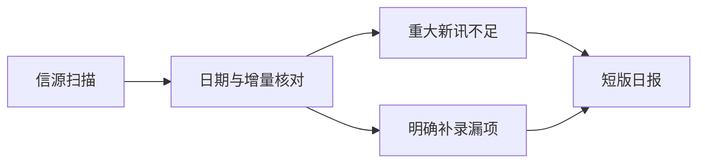

# AI 日报 · 2026-11-15

[中文（当前）](2026-11-15.md) · [English](../../en/daily/2026-11/2026-11-15.md)

- **采集截止：** 2026-11-15 11:00（Asia/Shanghai）；本次于截稿后编制。重点查看官方、研究和 Hugging Face 信源，不将搜索空白推断为全行业无发布。
- **本期判断：今日无重大更新。** 收录 1 条 11 月 13 日漏项，不计作今天新发布。[历史索引](../../INDEX.md) · [趋势追踪](../../TRACKERS.md)。

## 今日关键结论

1. **今天的高信号增量不足以扩写为常规 20–30 条。** 保持前期模型分层、Agent 权限与世界模型交付的观察清单，不重复计数旧消息。
2. **可复用数据集也是 AI 产业交付物。** DeepMind 公开 SatWeave 与 PARDIG 的历史及实时数据，有助于天气、水文模型研究；厂商精度主张仍需外部复核。

## 补漏动态

### 1. Google DeepMind 开放 SatWeave 与 PARDIG 天气数据集（11 月 13 日补漏）

- **发生了什么：** DeepMind 公开 SatWeave 卫星影像拼接数据与 PARDIG 降水数据的历史档案和实时数据流；二者用于 WeatherNext 3 的相关研发。官方称 PARDIG 数据时空分辨率约为 15 分钟、10 公里，并以雷达和气象站作内部评估。
- **为什么重要 / 视角：** 技术背景、产品决策。可复用数据可能降低天气和水文应用的训练与验证门槛；要核对许可、时延、区域误差和维护持续性，不把数据发布写成新基础模型。
- **发布时间 / 类型 / 原始信源：** 2026-11-13，Google DeepMind 研究公告；[官方说明](https://deepmind.google/blog/opening-the-datasets-behind-our-ai-weather-models/) · [论文与数据入口](https://developers.google.com/earth-engine/datasets)。
- **交叉验证 / 可信度：** 公开数据入口可检查；精度比较为发布方评估，未独立复现。交付可信度高，效果待验证。
- **趋势：** T02/T06 首次收录；11 月 13 日漏项补录。

## 连续追踪与限制

- **待验证：** 昨日 NVIDIA 人事变化后的实际交付、Gemini Wallet 权限边界，以及本条数据在不同区域的独立质量评估。
- **覆盖限制：** 短版表示本轮已核信源中无足够重大增量；不代表全球所有 AI 领域均无消息。
