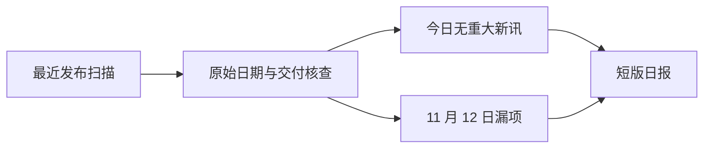

# AI 日报 · 2026-11-16

[中文（当前）](2026-11-16.md) · [English](../../en/daily/2026-11/2026-11-16.md)

- **采集截止：** 2026-11-16 11:00（Asia/Shanghai）；检查官方发布、Hugging Face 与科技媒体的最近更新。
- **本期判断：今日无重大更新。** 以下 1 条是 11 月 12 日官方发布的补漏，不能算作 11 月 16 日新发布。[历史索引](../../INDEX.md) · [上周周报](../../weekly/2026-W46.md)。

## 今日关键结论

1. **本轮没有足够已核实的重大新讯构成 20–30 条常规日报。** 不以旧消息或未经核实的社区转载填充篇幅。
2. **分类与路由模型值得单独评估。** Perplexity Decider v1.3 交付可下载权重与 API，用于概率判断、抽取和路由；它不是生成式 Agent，其厂商评测须在真实任务上复测。

## 补漏动态

### 1. Perplexity 发布 Decider v1.3 与 Decider Flash v1.3（11 月 12 日补漏）

- **发生了什么：** Perplexity 发布两款决策模型，支持二元/多类判断、分数和 `locate` 文本定位；Flash 为较小的蒸馏版。官方称两款均可通过 Hugging Face 下载 Apache 许可权重，也通过 OpenRouter 与 Decisions API 提供。
- **为什么重要 / 视角：** 产品决策、技术背景。可在审核、路由和内容标注中比较概率输出、延迟与单位任务成本；阈值应在自有标注集校准。不能把分类器写成会自主执行长任务的 Agent。
- **发布时间 / 类型 / 原始信源：** 2026-11-12，Perplexity 官方技术博客；[发布说明](https://www.perplexity.ai/hub/blog/perplexity-decider) · [API 社区公告](https://community.perplexity.ai/c/announcements/9)。
- **交叉验证 / 可信度：** 两处均属发布方，不能当独立交叉验证；权重、许可和接口交付可外部检查，性能提升仍为厂商主张。交付可信度高，效果待独立复测。
- **趋势：** T01/T04 持续升温；11 月 12 日漏项补录。

## 连续追踪与限制

- **待验证：** 决策模型在真实内容审核和模型路由中的误判、阈值漂移与总成本；上周模型/Agent 发布的权限、许可和长期效果见[W46 周报](../../weekly/2026-W46.md)。
- **覆盖限制：** “今日无重大更新”只针对本轮核查时段与信源，不代表全球没有 AI 发布。
