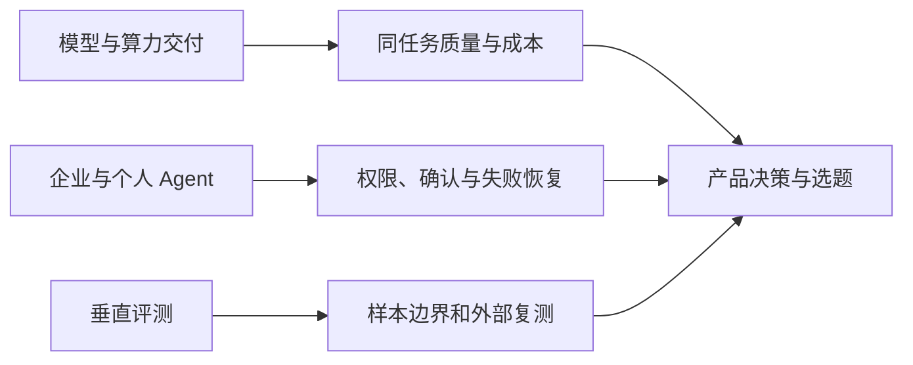

# AI 日报 · 2026-11-18

[中文（当前）](2026-11-18.md) · [English](../../en/daily/2026-11/2026-11-18.md)

- **采集截止：** 2026-11-18 11:00（Asia/Shanghai）。本期聚焦 11 月 17 日发布；与[前一日](2026-11-17.md)去重。原文未列时分的条目仅确认发布日期，不推断发布先后。
- **筛选与证据：** 13 条高信号动态。同一发布的功能合并，厂商性能及客户案例保留原口径；“发布已确认”不等于性能、可用性或效果经独立验证。[索引](../../INDEX.md) · [趋势追踪](../../TRACKERS.md)。

## 今日关键结论

1. **基础模型竞争延伸到完整任务和分层成本。** OpenAI 发布 GPT-6.2 Astra/Sol；微软推出编码、图像、语音、安全与决策模型。官方基准和价格不能替代同任务、同配置的实测。
2. **企业 Agent 争夺上下文、工具与权限控制。** ChatGPT for Sales、Microsoft IQ/Copilot 与 Gemini Tasks 把 CRM、组织知识、支付和跨应用操作接到执行流程；应优先检查授权范围、人工确认、失败恢复和账单。
3. **“可获得权重”的边界需要精确区分。** 微软 MAI Licensed Weights 是面向特定客户、即将推出的 Azure 内授权方案，不是公开开放权重或开源发布。
4. **算力供给已有财报和发货证据。** NVIDIA 第三财季收入 1158 亿美元、数据中心收入 1076 亿美元，Rubin NVL72 已发货；未来规模和客户收益仍需另证。
5. **垂直模型的榜分仍有样本边界。** Astra for Law 的公开法律基准结果值得跟踪，但不能直接推断所有法律任务可靠，也不能替代律师审核。
6. **世界模型与 AI 游戏本轮未发现同等级新交付。** NVIDIA 财报再次列出 Cosmos 既有进展，不作为 11 月 17 日新模型；继续关注长时一致性、可控性和玩家价值。

## 高信号动态

### 1. OpenAI 发布 GPT-6.2 Astra 与 Sol

- **发生了什么：** OpenAI 发布面向复杂专业工作的 Astra 和日常多步任务的 Sol；两者进入 ChatGPT Work、Codex 与 API。官方公布 Astra API 每百万输入/缓存输入/输出 token 为 8/0.40/40 美元，Sol 为 2/0.10/10 美元。
- **为什么重要 / 视角：** 产品决策、内容选题。模型选择转向成品质量、任务成功率和总成本；游戏与 3D 前端能力是厂商主张，应以同项目盲测验证。
- **发布时间 / 类型 / 原始信源：** 2026-11-17，OpenAI [模型公告](https://openai.com/index/introducing-gpt-6-2-astra-sol/)与[模型发布说明](https://help.openai.com/en/articles/9624314-model-release-notes)。
- **交叉验证 / 可信度：** 两份均为厂商资料，可核名称、接入与报价，不能独立验证基准排名。发布高；性能待独立实测。
- **趋势：** T01/T04 持续升温；基础模型进一步分层。

### 2. OpenAI 发布 ChatGPT for Sales

- **发生了什么：** 新 Sales 插件提供客户筛选、会前准备和跟进流程，配合 30 多个新增或增强的合作插件，连接 CRM、电话记录和销售资料。
- **为什么重要 / 视角：** 产品决策、投资观察。价值取决于连接数据的质量、权限和实际成交流程，而非插件数量；适合观察垂直 Agent 的销售渠道。
- **发布时间 / 类型 / 原始信源：** 2026-11-17，OpenAI [产品公告](https://openai.com/index/introducing-chatgpt-for-sales/)。
- **交叉验证 / 可信度：** 单一厂商来源；功能发布高，缩短销售周期的效果未独立验证。
- **趋势：** T04 持续升温；由通用助手转向销售工作流。

### 3. Astra for Law 更新并扩大申请入口

- **发生了什么：** OpenAI 更新基于 GPT-6.2 Astra 的法律模型配置与检索索引；所有 ChatGPT Enterprise 客户现在可通过 Trusted Access Program 申请使用，非自动开通。OpenAI 引述 Artificial Analysis 的 LAB-AA 120 项、24 个法律领域测试，称其完整达标率 20.8%。
- **为什么重要 / 视角：** 产品决策、知识扫盲。专用索引和指令可能改变垂直产品竞争，但 20.8% 完整达标率本身提示高风险任务仍需专业复核。
- **发布时间 / 类型 / 原始信源：** 2026-11-17，OpenAI [法律模型公告](https://openai.com/index/astra-law-6-2/)。
- **交叉验证 / 可信度：** 成绩引自第三方基准但目前以 OpenAI 发布页核读；可申请状态高，真实法律工作效果与跨法域适用性待复测。
- **趋势：** T04 已落地并扩展入口；与 9 月有限试用相比持续升温。

### 4. 微软 Ignite 发布 MAI Code 2 与 Code 2 Flash

- **发生了什么：** 微软推出两个 Agent 编码模型；官方称均已在 GitHub Copilot 提供，Code 2 Flash 在 Foundry 属有限预览。成本和性能对比来自微软公布的测试。
- **为什么重要 / 视角：** 产品决策、投资观察。编码模型按复杂修复和高频小改分层，可对照真实仓库的合并率、返工及完整任务账单。
- **发布时间 / 类型 / 原始信源：** 2026-11-17，微软 [MAI 模型总览](https://microsoft.ai/news/microsoft-ignite-2026/)及[Ignite 演讲](https://blogs.microsoft.com/blog/2026/11/17/ignite-2026-building-the-frontier-ecosystem/)。
- **交叉验证 / 可信度：** 两份同属微软；发布与访问状态高，性能价格比待独立复测。
- **趋势：** T01/T04 持续升温；编码模型按任务频率分层。

### 5. 微软扩大图像、实时语音与安全模型线

- **发生了什么：** MAI Image 2.7 与 Image 2.7 Flash 在 Foundry 提供；MAI Realtime 1 可在 Labs 试用并登记商业兴趣；MAI Cyber 2 Flash 聚焦安全任务。价格与榜分为厂商披露，实时语音每音频分钟起价 0.01 美元。
- **为什么重要 / 视角：** 多模态产品决策、内容选题。图像质量、语音延迟和安全模型误报率需要分别测试；试用、有限预览与正式服务不可混写。
- **发布时间 / 类型 / 原始信源：** 2026-11-17，微软 [模型总览](https://microsoft.ai/news/microsoft-ignite-2026/)。
- **交叉验证 / 可信度：** 单一厂商总览，部分榜单名称可查但未独立复跑；产品公告高、比较结论待验证。
- **趋势：** T01/T03/T07 首次出现新型号；多模态与防御模型继续分层。

### 6. 微软发布 Decision 1.1 与授权权重计划

- **发生了什么：** Decision 1.1 作为路由/分类决策模型宣布正式可用。MAI Licensed Weights 则是允许特定企业在自身 Azure 环境部署、定制模型权重的即将推出方案，需通过 Frontier Company 合作，不是公开权重下载。
- **为什么重要 / 视角：** 产品决策、投资观察。任务路由与模型控制权可能影响采购，但应分别核对申请资格、许可、迁移和厂商自报成本。
- **发布时间 / 类型 / 原始信源：** 2026-11-17，微软 [Ignite 演讲](https://blogs.microsoft.com/blog/2026/11/17/ignite-2026-building-the-frontier-ecosystem/)及 [Licensed Weights 说明](https://microsoft.ai/news/introducing-mai-licensed-weights/)。
- **交叉验证 / 可信度：** 同厂商资料；Decision 1.1 可用和权重方案公告高，权重实际交付、客户结果和 50 倍速度等主张待核。
- **趋势：** T01/T04 已落地与待验证并存；模型控制边界进一步细化。

### 7. Microsoft IQ 把企业上下文做成可复用插件

- **发生了什么：** Microsoft IQ 整合 Work、Fabric、Foundry、Web IQ 与 350 多个第三方连接器，让组织治理过的资料、规则和技能成为跨 Agent 复用的 business plugins；微软称可在 Copilot、Foundry 和其他助手中使用。
- **为什么重要 / 视角：** 产品决策、投资观察。组织知识层可能比单一模型更难替换；关键是权限继承、更新时效、引用准确性及跨平台互操作。
- **发布时间 / 类型 / 原始信源：** 2026-11-17，微软 [Azure 公告](https://azure.microsoft.com/en-us/blog/introducing-the-new-microsoft-iq-putting-your-organizations-intelligence-to-work-in-every-agent/)。
- **交叉验证 / 可信度：** 单一厂商公告；架构和功能方向高，跨平台生产可用性与收益待独立核查。
- **趋势：** T04 持续升温；Agent 竞争转向组织上下文。

### 8. Microsoft Copilot Home 正式可用，Autopilot 开始分批推出

- **发生了什么：** 微软称 Copilot Home 与 Office in Copilot 已正式可用；Code 将在未来数周正式提供，Autopilot 自当日起面向 Frontier 客户逐步推出，Today 仍是私有预览。
- **为什么重要 / 视角：** 产品决策、内容选题。统一入口加自动路由、跨应用上下文与常驻 Agent，必须验证租户权限、人工接管和执行审计；不同模块状态不可合并为“全部上线”。
- **发布时间 / 类型 / 原始信源：** 2026-11-17，微软 [Copilot 公告](https://www.microsoft.com/en-us/copilot/blog/2026/11/17/copilot-at-microsoft-ignite-expanding-whats-possible-with-intelligence-built-for-work/)。
- **交叉验证 / 可信度：** 单一厂商来源；发布状态高，长期任务效果待核。
- **趋势：** T04 持续升温；企业工作入口集中。

### 9. Gemini Tasks 面向六国扩大免费使用

- **发生了什么：** Google 宣布 Gemini Tasks 借助 Gemini 4 Hydrogen 在美国、日本、韩国、加拿大、澳大利亚和印度免费逐步推出；高阶功能先从美国开始。任务可跨电话、日程、购物和支付操作，官方描述使用隔离虚拟机、关键动作确认与支出上限。
- **为什么重要 / 视角：** 产品决策、内容选题。Agent 从问答走向代办交易；应按地区和用户资格复核实际可用性，并测误操作、商家选择及授权撤销。
- **发布时间 / 类型 / 原始信源：** 2026-11-17，Google [Gemini Tasks 公告](https://blog.google/innovation-and-ai/products/gemini-app/tasks-in-gemini-free-new-features/)。
- **交叉验证 / 可信度：** 单一官方来源；逐步推出高，安全效果和完成率未独立验证。
- **趋势：** T04 持续升温；个人 Agent 扩至交易环节。

### 10. Google Search AI Mode 增加临时会话

- **发生了什么：** AI Mode 新增 temporary threads，允许一次性查询不进入历史，也不使用既有偏好或影响后续个性化；用户可在界面切换。
- **为什么重要 / 视角：** 产品决策、知识扫盲。隐私模式与个性化可同时设计；需检查实际数据保留政策和地区开放范围，不能由“无历史记录”推断完全不留服务日志。
- **发布时间 / 类型 / 原始信源：** 2026-11-17，Google [Search 公告](https://blog.google/products-and-platforms/products/search/temporary-threads-ai-mode/)。
- **交叉验证 / 可信度：** 单一官方来源；功能公告高，隐私实现细节与体验待验证。
- **趋势：** T04/T07 首次出现；个性化控制更细。

### 11. NVIDIA 公布 FY27 第三财季业绩与 Rubin 发货

- **发生了什么：** 截至 2026-10-25 的财季收入 1158 亿美元、同比增 103%；数据中心收入 1076 亿美元、同比增 110%。公司表示 Vera Rubin NVL72 已开始发货；FY27 第四季收入指引 1300 亿美元上下 3%。
- **为什么重要 / 视角：** 投资观察、产品决策。财报比路线图更能证明当前供给和需求，但已发货不等于所有客户已投产；指引是未来预期。
- **发布时间 / 类型 / 原始信源：** 2026-11-17，NVIDIA [财报公告与 GAAP 表](https://nvidianews.nvidia.com/news/nvidia-announces-financial-results-for-third-quarter-fiscal-2027)。
- **交叉验证 / 可信度：** 公司正式财务披露，可核历史收入；发货与未来指引仍由公司陈述，客户部署待外部核查。历史数值高、前瞻待验证。
- **趋势：** T08 已落地；[此前](2026-11-15.md)待公布的财报已有数据。

### 12. OpenAI GPT-6.2 系统卡披露高能力风险分类

- **发生了什么：** OpenAI 同步发布 GPT-6.2 系统卡；其部署安全资料将 Astra 的 AI 自我改进能力列为 High，而 Sol 低于该阈值，网络安全能力另有风险管理描述。
- **为什么重要 / 视角：** 产品决策、知识扫盲。不同模型能力等级会改变访问、红队和部署控制；分类是 OpenAI 框架下评估，不等于独立测得的真实危害率。
- **发布时间 / 类型 / 原始信源：** 2026-11-17，OpenAI [系统卡](https://deploymentsafety.openai.com/gpt-6-2-astra-sol/alignment-to-our-model-spec)及[模型公告](https://openai.com/index/introducing-gpt-6-2-astra-sol/)。
- **交叉验证 / 可信度：** 同一厂商不同文档可核分类，外部效果未验证。披露高，风险实测待核。
- **趋势：** T07 持续升温；模型能力分层伴随不同安全要求。

### 13. 微软 Ignite 将 Agent 365 运营指标带入治理

- **发生了什么：** 微软宣布 Agent 365 Business Analytics，用于查看 Agent 花费与业务结果，并在 Ignite 演讲中称平台已有逾 5000 万个 Agent。人数和价值不能从 Agent 数量直接推算。
- **为什么重要 / 视角：** 产品决策、投资观察。Agent 规模化需要身份、治理与成本归因；应核活跃定义、重复计数和结果指标。
- **发布时间 / 类型 / 原始信源：** 2026-11-17，微软 [Ignite 演讲](https://blogs.microsoft.com/blog/2026/11/17/ignite-2026-building-the-frontier-ecosystem/)。
- **交叉验证 / 可信度：** 单一厂商来源；功能公告高，5000 万统计口径和 ROI 待外部核查。
- **趋势：** T04/T07 持续升温；企业 Agent 管理进入成本与效果层。

## 持续观察

- **中国及世界模型覆盖：** 本轮扫描了中文消息与世界模型线索，但未把 11 月 16 日已收录的 Qwen4-Max、Hy4 flash 重复计数；NVIDIA 财报列出的 Cosmos 工具指向更早发布。下轮继续找有明确发布日期与可检查工件的新进展。
- **优先复测：** GPT-6.2、MAI Code 2 同仓库任务；Gemini Tasks 的权限和失败恢复；Astra for Law 跨法域可靠性；Rubin 客户投产；Microsoft IQ 的跨平台权限。
