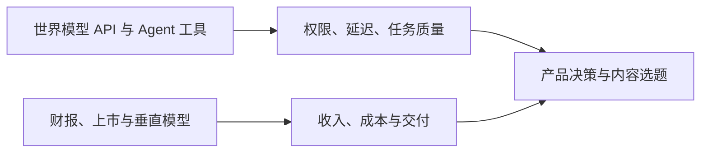

# AI 日报 · 2026-11-20

[中文（当前）](2026-11-20.md) · [English](../../en/daily/2026-11/2026-11-20.md)

- **采集截止：** 2026-11-20 11:00（Asia/Shanghai）；重点核查 11 月 19 日发布及前日漏收信息，与[前一日](2026-11-19.md)去重。原页面只有日期时，不推断时分。[索引](../../INDEX.md) · [趋势追踪](../../TRACKERS.md)。
- **筛选：** 11 条可核查动态，其中 2 条明确为 11 月 18 日补漏。未以低信号内容凑至 20 条。厂商自报性能、商业数据与独立结果分别标注。

## 今日关键结论

1. **Genie 4 从有限消费者体验进入开发者可调用阶段。** Google 开放 Gemini API / AI Studio 接入，给交互世界原型提供集成入口；长期一致性、交互延迟、玩家留存及成本仍须实测。
2. **Agent 产品竞争转向执行环境与工具管理。** Gemini Mac 增加后台电脑操作，Gemini API 的 Tool Retrieval 预览按需加载工具参数；两者都需要以权限、失败恢复及任务总成本验收。
3. **AI 商业化证据增加，但口径不能混用。** 阿里披露 AI 云及计算服务季度收入 609.73 亿元、同比增长 53%，并披露 AI Labs and Applications 半年调整 EBITA 亏损；Anthropic 已在纳斯达克开始交易，交割仍须单独核对。
4. **边缘部署和垂直模型提供新的替代路线。** Microsoft Edge 的 Aion Instruct 开放权重并进入浏览器，Cloudflare 的 Clairic 组合提供文档抽取专用权重；性能数据均需同任务复测。
5. **游戏方向新增角色行为证据，尚非可玩产品验证。** MyMems 宣布采用 Artificial Agency 的 Behavior Engine，目标 2027 年社区版本；现阶段是合作与开发计划，不是已验证的玩家体验。

## 高信号动态

### 1. Genie 4 开放 Gemini API 与 AI Studio 接入

- **发生了什么：** Google 在前一天 Project Genie 有限用户开放之后，宣布开发者可经 Interactions API 和 AI Studio 调用 Genie 4，从文字、参考图或两者生成带原生音频的连续 720p、24 FPS 可导航世界。该数值是输出规格，不代表模型生成速度。
- **为什么重要 / 视角：** 产品决策、AI 游戏、内容选题。开发者可把世界模型接进原型；应测试场景持久性、控制延迟、成本、失败恢复及实际玩家兴趣。
- **发布时间 / 类型 / 原始信源：** 2026-11-19，Google [开发者公告](https://blog.google/innovation-and-ai/technology/developers-tools/genie-4-in-gemini-api/)；独立[行业报道](https://www.testingcatalog.com/google-opens-genie-4-world-model-to-developers-in-gemini-api/)。
- **交叉验证 / 可信度：** 公告和独立报道确认开放事实；高。关于世界状态一致性的描述为厂商主张，尚无长期可玩性实测。
- **趋势：** T02/T05 已落地新接入方式；延续[昨日](2026-11-19.md)的有限消费者开放。

### 2. Gemini App for Mac 增加后台电脑操作

- **发生了什么：** Google 宣布 Gemini 可在独立后台窗口操作 Mac 应用、本地文件和网站，用户可指定应用权限、观看预览并批准关键动作；面向美国英语用户逐步开放，要求 Apple Silicon Mac 和 macOS 15+。
- **为什么重要 / 视角：** 产品决策、内容选题。与单纯对话相比，端到端任务可被执行；应验证应用权限、误操作撤回、隐私边界及完成率。
- **发布时间 / 类型 / 原始信源：** 2026-11-19，Google [产品公告](https://blog.google/innovation-and-ai/products/gemini-app/computer-use-mac/)。
- **交叉验证 / 可信度：** 单一官方信源；发布与限制条件可信度高，真实完成率待独立测试。
- **趋势：** T04 首次出现的 Mac 端执行入口；持续观察。

### 3. Gemini API 预览 Tool Retrieval

- **发生了什么：** Google 在 Interactions API 中加入 Tool Retrieval 预览，可按需检索并加载工具参数模式，避免在每次请求附上完整工具库；文档称适用于 Gemini 3.6 及后续模型。
- **为什么重要 / 视角：** 产品决策、知识扫盲。大工具库 Agent 的上下文和延迟可能下降，但应按真实工具选择准确率、输入 token、端到端耗时评测。
- **发布时间 / 类型 / 原始信源：** 2026-11-19，Google [API 公告](https://blog.google/innovation-and-ai/technology/developers-tools/gemini-api-tool-retrieval/)。
- **交叉验证 / 可信度：** 单一官方信源；功能状态可信度高，效率收益为厂商主张。
- **趋势：** T04 首次出现；预览待验证。

### 4. 阿里披露 2026 年 9 月季度 AI 云业务增长

- **发生了什么：** 阿里财报披露季度总收入 2715.19 亿元、同比增长 10%；AI Cloud and Compute Services 收入 609.73 亿元、同比增长 53%，外部客户收入增长 64%。另披露截至 9 月 30 日六个月 AI Labs and Applications 调整 EBITA 亏损 243.64 亿元，包含 AI 投入与千问推理成本；半年口径不可当作单季亏损。
- **为什么重要 / 视角：** 投资观察、产品决策。云收入增长与应用投入并存；应分别观察持续付费、毛利、推理成本和自由现金流，不以集团净利推断 AI 产品盈利。
- **发布时间 / 类型 / 原始信源：** 2026-11-19，阿里[业绩公告](https://data.alibabagroup.com/ecms-files/1532295521/e676aff4-e76d-489b-960a-47b9cf36485d/Alibaba%20Group%20Announces%20September%20Quarter%202026%20Results%20and%20Interim%20Results%20for%20the%20Six%20Months%20Ended%20September%2030%2C%202026.pdf)；[SEC 备案附件](https://www.sec.gov/Archives/edgar/data/1577552/000110465926130115/tm2630263d1_ex99-1.htm)。
- **交叉验证 / 可信度：** 财报与监管备案核对披露数字，但同属公司材料；披露事实高，未来盈利与 AI 因果贡献待验证。
- **趋势：** T08 持续升温；与昨日腾讯财报形成同业观察，不混并口径。

### 5. Anthropic 股票已在纳斯达克开始交易

- **发生了什么：** Nasdaq 确认 Anthropic 的 ANT 于 11 月 19 日开始交易，开盘价为每股 111.50 美元；此前公司 IPO 定价为 83 美元。交易开始不等于公司计划于 11 月 20 日完成的发行交割已发生。
- **为什么重要 / 视角：** 投资观察。上市从定价进入可观察二级市场阶段；短期价格与长期经营表现应分开。
- **发布时间 / 类型 / 原始信源：** 2026-11-19，Nasdaq [上市消息](https://www.nasdaq.com/newsroom/anthropic-marks-ipo-at-nasdaq)；Anthropic [定价公告](https://www.anthropic.com/news/anthropic-prices-initial-public-offering)。
- **交叉验证 / 可信度：** 交易所与发行人两个不同主体核对上市和定价；高。交割与长期估值待后续验证。
- **趋势：** T08 已从昨日“待交易”转为“已交易”；交割待验证。

### 6. Microsoft Edge 上线 Aion Instruct 与 Prompt API 试验

- **发生了什么：** Microsoft 宣布 23 亿参数的 Aion Instruct 作为 Edge 内置小语言模型，权重可从 Hugging Face 获取；网站开发者可通过 Prompt API 的 origin trial 测试。Edge 在设备适用且首次需要时下载模型，用户可关闭端侧 AI。
- **为什么重要 / 视角：** 产品决策、知识扫盲。浏览器端 AI 可能降低云推理依赖；需检查模型许可、设备覆盖、质量、下载体积与跨浏览器兼容。
- **发布时间 / 类型 / 原始信源：** 2026-11-19，Microsoft Edge [开发者公告](https://blogs.windows.com/msedgedev/2026/11/19/hybrid-intelligence-on-the-web-introducing-aion-instruct-and-prompt-api-in-microsoft-edge/)。
- **交叉验证 / 可信度：** 单一官方信源；发布及权重入口可信度高，与 Phi 相当等性能描述为厂商主张。
- **趋势：** T01/T04 新增端侧模型与浏览器 API 入口。

### 7. ChatGPT Health 扩展设备与连接范围

- **发生了什么：** OpenAI 更新发布说明：Health 逐步扩展至 Android、桌面、dots 与 sites，Android 支持 Health Connect；美国 Free、Go、Plus、Pro 用户有资格使用，dots 目前面向 Pro。隐私说明同日更新。
- **为什么重要 / 视角：** 产品决策、投资观察。健康连接形成高敏感度个人数据入口；应评估用户许可、数据隔离、建议准确性与可用地区，不能当作医疗效果证明。
- **发布时间 / 类型 / 原始信源：** 2026-11-19，OpenAI [产品更新日志](https://help.openai.com/en/articles/6825453-chatgpt-release-notes)与[健康隐私说明](https://openai.com/policies/health-privacy-policy/)。
- **交叉验证 / 可信度：** 两份均为 OpenAI 材料，不构成独立交叉验证；发布状态高，实际体验和隐私实施待验证。
- **趋势：** T04/T07 持续升温；渐进开放。

### 8. Gemini 增加跨助手会话迁移流程

- **发生了什么：** Google 说明用户可先把旧助手的偏好总结导入 Gemini，再从原服务导出聊天 ZIP 并上传，在 Gemini 中延续会话。
- **为什么重要 / 视角：** 产品决策、内容选题。助手切换成本降低，但摘要保真、数据格式、隐私及迁移后的长期记忆质量仍需测试。
- **发布时间 / 类型 / 原始信源：** 2026-11-19，Google [迁移说明](https://blog.google/innovation-and-ai/products/gemini-app/switch-ai-assistants-transfer-history/)。
- **交叉验证 / 可信度：** 单一官方信源；流程说明可信度高，迁移效果未独立验证。
- **趋势：** T04 新增竞争性迁移入口。

### 9. Google 与 Blue Origin 宣布太空 AI 算力发射合作

- **发生了什么：** Google 表示与 Blue Origin 合作，拟在 2029 年第一季度用 New Glenn 为 Project Suncatcher 发射卫星，目标探索轨道太阳能支持的 AI 基础设施。发射和运行均未发生。
- **为什么重要 / 视角：** 投资观察、知识扫盲。是长期算力供应探索，当前无法据此推断成本或商业可行性。
- **发布时间 / 类型 / 原始信源：** 2026-11-19，Google [合作公告](https://blog.google/innovation-and-ai/models-and-research/google-research/blue-origin-project-suncatcher-partnership/)。
- **交叉验证 / 可信度：** 单一官方信源；计划公布可信度高，实施和经济性待验证。
- **趋势：** T08 首次出现长期基础设施路线。

### 10. Cloudflare Clairic 系列开放权重（前日补漏）

- **发生了什么：** Cloudflare 于 11 月 18 日更新 27B Clairic 并推出 9B Clairic-flash，面向文档字段抽取，提供 Workers AI 接口及 Hugging Face 权重；厂商给出输入 token 计价与内部评测。权重可获取不自动等于所有使用场景均满足开源定义。
- **为什么重要 / 视角：** 产品决策、知识扫盲。结构化抽取可与通用 LLM 按准确率、延迟、许可和总成本比较，内部测试不能作为独立基准。
- **发布时间 / 类型 / 原始信源：** 2026-11-18，Cloudflare [模型公告](https://blog.cloudflare.com/open-clairic/)；11 月 20 日补录。
- **交叉验证 / 可信度：** 单一厂商发布；模型和权重入口高，性能与价格适用期依官方条件复核。
- **趋势：** T01/T03 补漏；垂直模型持续升温。

### 11. MyMems 宣布采用 Artificial Agency 角色行为引擎（前日补漏）

- **发生了什么：** Gallium Studios 与 Artificial Agency 于 11 月 18 日宣布合作，用 Behavior Engine 开发社交模拟游戏 MyMems，让玩家记忆与关系影响角色；计划 2027 年推出社区版本，目前在开发中。
- **为什么重要 / 视角：** AI 游戏、内容选题。可追踪 AI 角色行为与个人记忆如何组成玩法，但合作声明、演示和可玩交付是不同证据等级。
- **发布时间 / 类型 / 原始信源：** 2026-11-18，Artificial Agency [合作新闻稿](https://www.artificial.agency/news/gallium)与 Gallium [项目页](https://galliumstudios.com/)；11 月 20 日补录。
- **交叉验证 / 可信度：** 双方项目资料共同确认合作，但均为合作方材料；合作事实高，2027 年交付与玩家价值待验证。
- **趋势：** T05 补漏；待落地，不将角色行为系统写作世界模型。

## 下一轮观察

- 核实 Anthropic IPO 交割及后续公开财务，不以首日行情推断长期价值。
- 对 Genie 4 API、Gemini Mac、Tool Retrieval 做同任务原型，记录延迟、失败率、授权步骤和完整费用。
- 跟踪 AI 游戏可玩版本与真实玩家反馈；本轮 MyMems 仍处合作和开发阶段。
