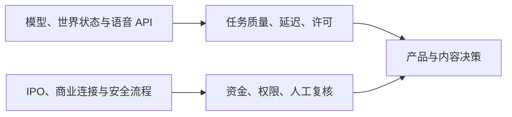

# AI 日报 · 2026-11-21

[中文（当前）](2026-11-21.md) · [English](../../en/daily/2026-11/2026-11-21.md)

- **采集截止：** 2026-11-21 11:00（Asia/Shanghai）；重点核查 11 月 20 日发布，与[昨日](2026-11-20.md)去重。网页只列日期时不推断具体发布时间。[索引](../../INDEX.md) · [趋势追踪](../../TRACKERS.md)。
- **筛选：** 10 条可核查动态，其中两篇论文按 11 月 18 日原始提交日期标为补漏。未以弱信号凑到 20 条；厂商数据与独立复测分开。

## 今日关键结论

1. **Anthropic IPO 从交易进入交割。** 公司披露 A 类股发行与同步私募均已完成；发行筹资、公司实际所得及二级市场市值不能混为一谈。
2. **本地多模态模型和 Agent 适配进入同一成本议题。** Inkling 2 Mini 提供可下载权重；Hugging Face 的 harness adapter 研究提示任务与执行框架的联合优化可能改变单位任务成本，但基准仍需独立复测。
3. **世界模型研究出现两种明确的状态设计。** WM^MLLM 使用带修订历史的全景状态；WorldRuler 使用可执行规则图。两者是研究论文，不等于已交付可玩游戏。
4. **语音与交易 Agent 继续扩展。** GPT-Live-1.1 进入开发者 API，Google 在美国的 Search/Gemini 接入更多购物和金融服务；分别验证真实对话质量、权限与交易完成率。
5. **高风险应用须区分辅助信号与最终判断。** Watch Duty 的 Gemini 无线电转写用于辅助人工核实火情；Google 报告的速度及错误率仍属合作项目口径。

## 高信号动态

### 1. Anthropic 宣布 IPO 与同步私募完成交割

- **发生了什么：** Anthropic 称 IPO 共发行 11.27 亿股 A 类股，发行价 83 美元，含承销商增购 1.47 亿股；IPO 募集总额约 935 亿美元，其中公司获得约 916 亿美元，另有面向七家科技企业的约 260 亿美元 N 类股同步私募。公司不获得售股股东出售部分的收益。
- **为什么重要 / 视角：** 投资观察。昨日已确认开始交易，本次新状态是交割；需区分发行总额、公司所得、私募和市场估值，并追踪算力支出与未来财报。
- **发布时间 / 类型 / 原始信源：** 2026-11-20，Anthropic [交割公告](https://www.anthropic.com/news/ipo-close)；此前 [SEC 最终招股书](https://www.sec.gov/Archives/edgar/data/2130357/000162828026074944/anthropicpbc-424b4.htm)列示交易条款。
- **交叉验证 / 可信度：** 招股书核对计划及条款，完成交割仍以发行人公告为准；高可信的已公告事实，资金运用效果待验证。
- **趋势：** T08 已落地，接续昨日“开始交易”。

### 2. Inkling 2 Mini 发布开放权重的本地多模态模型

- **发生了什么：** Thinking Machines Lab 的模型卡显示 Inkling 2 Mini 已提供权重，采用 Apache 2.0；接收文字与图像、输出文字。Hugging Face 技术文章称其为约 26B 总参数、每 token 约 3B 激活的循环层 MoE，并列出 Transformers、llama.cpp、MLX 等运行路径。
- **为什么重要 / 视角：** 产品决策、知识扫盲。可在本地测试视觉与编码任务；需按设备内存、吞吐、许可及完成任务成本与其他模型比较。
- **发布时间 / 类型 / 原始信源：** 2026-11-20，[模型卡](https://huggingface.co/thinkingmachines/Inkling-2-Mini)、[Hugging Face 技术介绍](https://huggingface.co/blog/inkling2mini)。
- **交叉验证 / 可信度：** 权重和许可可直接查验，性能比较主要为发布方及合作方口径；交付事实高，榜分结论待独立复测。
- **趋势：** T01/T03 首次出现；本地多模态开放权重继续升温。

### 3. Hugging Face 报告 Agent harness adapter 实验

- **发生了什么：** Hugging Face 发布在目标 Agent 执行框架和任务分布中训练 RL LoRA adapter 的方案；其示例称 Qwen3.8-27B 在指定 Terminal-Bench 2.1 / pi harness 设置下，pass@1 从 39% 升到 55%，平均 token 从 2.9K 降到 1.5K。
- **为什么重要 / 视角：** 产品决策、知识扫盲。模型采购不能脱离实际工具框架；应对照相同任务、训练开销、推理账单及失败重试做独立试验。
- **发布时间 / 类型 / 原始信源：** 2026-11-20，Hugging Face [研究与复现材料](https://huggingface.co/blog/harness-adapters-at-scale)。
- **交叉验证 / 可信度：** 方法和工件可检查；数值来自团队特定设置，并非跨框架普遍收益。发布事实高，泛化判断待验证。
- **趋势：** T01/T04 首次出现；任务定制训练持续升温。

### 4. GPT-Live-1.1 进入 OpenAI 开发者 API

- **发生了什么：** OpenAI API 更新日志将 GPT-Live-1.1 上线日期列为 11 月 19 日；官方社区于 11 月 20 日说明新增 WebRTC standby 配置，空闲时按较低费率计费。模型此前已用于 ChatGPT 语音；本次增量是开发者接入。官方价格页列活跃每分钟 0.05 美元、standby 每分钟 0.02 美元，后端模型与工具另计。
- **为什么重要 / 视角：** 产品决策、内容选题。实时角色交互和语音 Agent 可比较口音、打断、数字识别、空闲成本与完整任务账单。
- **发布时间 / 类型 / 原始信源：** 2026-11-19 [API 更新日志](https://developers.openai.com/api/docs/changelog)；2026-11-20 [官方社区说明](https://community.openai.com/t/gpt-live-1-1-has-arrived-in-the-api/1418537)、[模型价格页](https://developers.openai.com/api/docs/models/gpt-live-1.1)。
- **交叉验证 / 可信度：** 均为同一厂商资料；API 状态与标价高可信，质量提升为厂商主张。
- **趋势：** T03/T05 前日未收录的 API 交付；持续观察真实交互效果。

### 5. Google 在 Search 与 Gemini 扩展 Connected Apps

- **发生了什么：** Google 宣布在美国逐步接入 Albertsons、Safeway、Shaw’s、Target 的杂货服务，支持组单与结账；Experian 由 Gemini 扩至 Search，H&R Block 支持税务估算；Angi、Thumbtack 账户连接为未来几周计划。
- **为什么重要 / 视角：** 产品决策、投资观察。Agent 从搜索建议走向商业动作；应核查授权、商家覆盖、订单完成率和错误处理，不能把计划中的连接写成已上线。
- **发布时间 / 类型 / 原始信源：** 2026-11-20，Google [产品公告](https://blog.google/products-and-platforms/products/search/connected-apps-holiday-errands/)。
- **交叉验证 / 可信度：** 单一官方信源；已公布的开放范围高可信，使用成效及未来连接待验证。
- **趋势：** T04 持续升温；交易型 Agent 扩展。

### 6. WM^MLLM 以外部全景状态保持可编辑世界（论文补漏）

- **发生了什么：** 论文提出把世界状态放在生成器外，以全景图与修订历史管理场景，让多模态 LLM 规划、定位并检查局部编辑；作者报告同一修订版本的返回视图可复现，并给出多项自建基准结果。
- **为什么重要 / 视角：** 世界模型、AI 游戏、知识扫盲。显式状态有助于控制场景漂移，但还要检验大规模 3D、动态角色、实时交互与玩家体验。
- **发布时间 / 类型 / 原始信源：** 2026-11-18 原始提交，11 月 20 日社区收录；[arXiv 论文](https://arxiv.org/abs/2611.24193)。
- **交叉验证 / 可信度：** 论文可核查；实验为作者报告，尚无独立复现。论文存在高可信，泛化能力待验证。
- **趋势：** T02/T05 补漏；显式世界状态路线首次进入追踪。

### 7. WorldRuler 用规则图控制交互世界（论文补漏）

- **发生了什么：** 论文提出可执行 3D 规则图，保存规则、依赖与对象状态，再把规则执行、视频生成和感知反馈连接成循环；研究使用 GTA-V 和 Habitat 构建 RuleVerse 数据。11 月 19 日修订作者信息。
- **为什么重要 / 视角：** 世界模型、AI 游戏、知识扫盲。规则与状态保存关系到游戏式交互，需检验长期一致性、玩家可控性及实际运行成本。
- **发布时间 / 类型 / 原始信源：** 2026-11-18 原始提交、11 月 19 日修订，[arXiv 论文](https://arxiv.org/abs/2611.24869)。
- **交叉验证 / 可信度：** 方法和实验可见，但性能来自作者评估；论文事实高可信，真实游戏交付待验证。
- **趋势：** T02/T05 补漏；可配置规则路线首次进入追踪。

### 8. Google 披露 Watch Duty 火情无线电转写项目

- **发生了什么：** Google.org 团队表示与非营利组织 Watch Duty 利用历史无线电录音训练 Gemini 辅助转写工具，给人工值守者提供火情线索；Google 报告在特定退化音频测试中词错率由 38% 降至 22.34%，部分线索可在 30 秒内送达。
- **为什么重要 / 视角：** 产品决策、知识扫盲。高风险应用的合理分工是机器提供可追查线索、人员核实后发布警报；应在独立音频和漏报场景中复核。
- **发布时间 / 类型 / 原始信源：** 2026-11-20，Google [合作案例](https://blog.google/company-news/outreach-and-initiatives/google-org/watch-duty-gemini-tool/)。
- **交叉验证 / 可信度：** 单一合作方资料；项目存在可信度高，速度与错误率不能外推所有地区或事件。
- **趋势：** T04/T07 首次出现；公共安全工作流待独立验收。

### 9. Anthropic 更新 Claude 发现漏洞的协调披露原则

- **发生了什么：** Anthropic 发布适用于 Claude 在开源软件及获授权闭源软件中发现漏洞的处理原则：尽可能人工审阅报告并附修复建议，通常计划在通知后 30 天披露严重或高危问题、45 天披露其他问题，补丁先发布时可更早披露；具体安全原因可调整。
- **为什么重要 / 视角：** 产品决策、知识扫盲。自动化漏洞发现需要配套人工核实、维护者容量与披露节奏；原则文件不证明实际遵守率。
- **发布时间 / 类型 / 原始信源：** 2026-11-20 更新，Anthropic [协调披露原则](https://www.anthropic.com/coordinated-vulnerability-disclosure)。
- **交叉验证 / 可信度：** 单一官方政策文本；文件内容高可信，执行效果待外部观察。
- **趋势：** T07 安全治理持续升温。

### 10. OhanASR 发布亚美尼亚语语音模型

- **发生了什么：** Metric-AI 在 Hugging Face 发布录音转写和流式转写两个 OhanASR-v0.1 版本；团队称录音版基于约 20 亿参数多语言模型，以 820 小时亚美尼亚语语音微调。
- **为什么重要 / 视角：** 产品决策、知识扫盲。低资源语言的实时识别可补主流语音模型的覆盖空白；要按口音、噪声、延迟和许可条件实测。
- **发布时间 / 类型 / 原始信源：** 2026-11-20，Metric-AI [Hugging Face 发布页](https://huggingface.co/blog/Metric-AI/ohan-asr-v01)。
- **交叉验证 / 可信度：** 单一团队来源；发布事实高可信，质量与数据规模为团队口径。
- **趋势：** T03 新区域语音能力；待独立评测。

## 下一轮观察

- Anthropic 上市后财报与资金部署；不要从发行规模推断模型质量或商业回报。
- 对两条世界状态路线和 Genie 4 做同场景长期交互测试，区分论文、API、可玩产品。
- 对本地多模态及实时语音方案记录完整任务费用、权限、质量与失败恢复。
