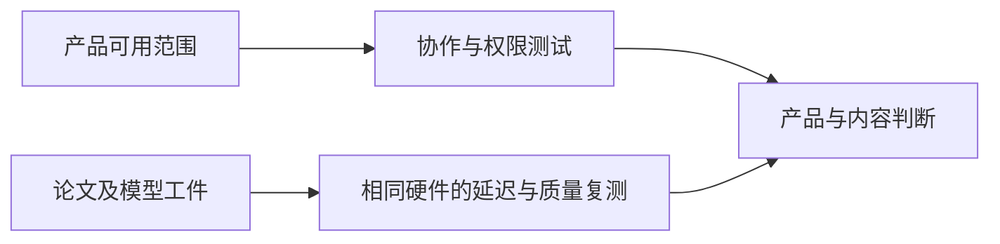

# AI 日报 · 2026-11-22

[中文（当前）](2026-11-22.md) · [English](../../en/daily/2026-11/2026-11-22.md)

- **采集截止：** 2026-11-22 11:00（Asia/Shanghai）；与[昨日](2026-11-21.md)去重。[索引](../../INDEX.md) · [趋势追踪](../../TRACKERS.md)。
- **筛选结果：今日无重大更新。** 核对 OpenAI、Anthropic、Google 和 Hugging Face 的官方发布页及近期论文后，收录此前未入档的两条补漏；它们原始发布于 11 月 20 日和 17 日，不冒充今天的新发布。此结论限于本次扫描范围，不代表全球没有其他发布。

## 今日关键结论

1. **产品界面的变化值得跟踪，但仍需真实使用数据。** ChatGPT Space 向 Plus 用户逐步开放，交互页面和演示文稿可结合连接的应用与工具更新；权限、协作效率和内容质量有待检验。
2. **交互视频的关键指标是响应延迟，不是播放帧率。** FastFrames 论文报告特定 B200 配置下的逐帧延迟，并提供模型工件；数值属于作者测试，不能推断玩家长期体验。

## 补漏动态

### 1. ChatGPT Space 开始向 Plus 用户推出

- **发生了什么：** OpenAI 更新日志称 Space 自 11 月 20 日起面向全球年满 18 岁的 Plus 用户逐步开放，可创建交互页面与演示文稿，并结合已连接的应用和工具自动更新；共享内容需要访问权限，免费用户当前不能打开共享页面，公开链接尚不可用。同日更新还列出面向所有计划逐步开放的 Live Dictation。
- **为什么重要 / 视角：** 产品决策、内容选题。可观察 AI 工作空间从单次回答转向持续更新的协作产物；验收应看可用人群、连接权限、更新准确率和编辑成本，不能把“逐步推出”写成所有用户已经可用。
- **发布时间 / 类型 / 原始信源：** 2026-11-20，OpenAI [ChatGPT 更新日志](https://help.openai.com/en/articles/6825453-chatgpt-release-notes)，官方产品说明。
- **交叉验证 / 可信度：** 单一厂商一手信源；发布范围和限制可信度高，实际采用率与生产率效果待独立验证。
- **趋势：** T04/T06，11 月 20 日补漏；可编辑、可持续更新的 AI 工作产物继续升温。

### 2. Apple 研究团队发布 FastFrames 交互视频论文与模型工件

- **发生了什么：** Apple 与 Cornell 研究者提出 FastFrames，自回归视频生成系统通过简化像素解码和 KV 缓存更新降低端到端逐帧延迟。论文报告 1.3B 版本在单张 B200 上为 36 毫秒/帧，14B 版本在 8 张 B200 上为 45 毫秒/帧；Apple 的 Hugging Face 页面提供模型工件与复现路径。上述是不同模型和硬件配置的作者测量，非同配置优劣比较。
- **为什么重要 / 视角：** 多模态、AI 游戏、产品决策、知识扫盲。交互世界生成需检验用户操作到画面响应的延迟、长期一致性和总运行成本；该论文展示技术路线，并不证明已形成可持续游玩的游戏。模型与代码许可也须分别核查。
- **发布时间 / 类型 / 原始信源：** 2026-11-17 原始提交，[arXiv 论文](https://arxiv.org/abs/2611.23226)；Apple [模型页](https://huggingface.co/apple/FastFrames-L)，论文与官方模型工件。
- **交叉验证 / 可信度：** 模型工件可检查，性能数字仅为作者实验，尚无独立同配置复测；论文和工件存在可信度高，效果外推待验证。
- **趋势：** T02/T05，11 月 17 日补漏；交互视频研究从播放帧率转向逐帧响应指标。

## 下一轮观察

- 继续核查一手发布，尤其是世界模型、AI 游戏、LLM 与中美市场；低信号周末不凑条数。
- 对 Space 做权限与更新准确率试用；对 FastFrames 复测相同分辨率、硬件和交互输入下的端到端响应。
