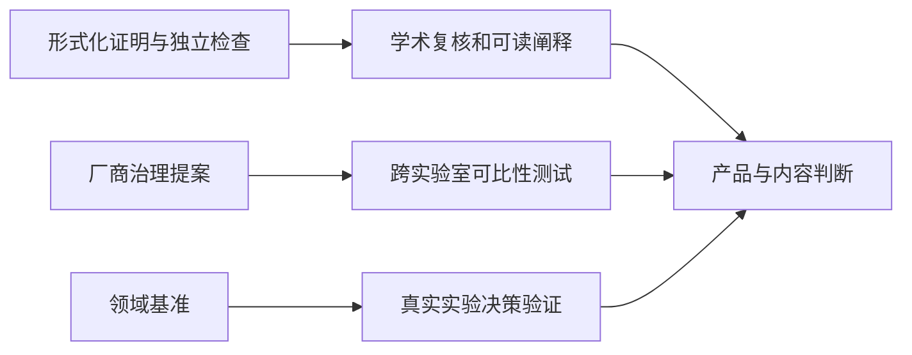

# AI 日报 · 2026-11-23

[中文（当前）](2026-11-23.md) · [English](../../en/daily/2026-11/2026-11-23.md)

- **采集截止：** 2026-11-23 11:00（Asia/Shanghai）；与[昨日](2026-11-22.md)去重。[索引](../../INDEX.md) · [趋势追踪](../../TRACKERS.md) · [W47 周报](../../weekly/2026-W47.md)。
- **筛选：** 本期 3 条；第一条是昨日漏收的重大事件及核验进展，第二条为 11 月 22 日公开观点，第三条为 11 月 20 日基准补漏。原始网页只给日期时，不推断精确发布时分；不以旧闻凑足 20 条。

## 今日关键结论

1. **Claude 参与的黎曼猜想证明获得重要形式化核验。** 研究者 11 月 20 日提出证明，Lean/Mathlib 社区 21 日声明定理陈述与证明通过检查；MIT 的复核页记录多种检查器、隔离构建和仍在运行的检查。应准确归因于人机协作及形式化验证，继续等待数学论证的可读阐释和进一步学术讨论。
2. **前沿能力治理出现以预训练损失为共同指标的公开提案。** OpenAI 首席科学家 Jakub Pachocki 主张跨实验室共享困惑度/交叉熵口径并据此讨论能力阈值；这是一项有利益相关性的研究与治理观点，尚非行业标准，且其本人列出数据集可比性和任务脱节等局限。
3. **AI for Science 基准需要把题目成绩与实际发现隔开。** MedChemBench 测试历史药物化学研究中的结构识别、证据解释、化合物选择和性质预测；OpenAI 承认它不证明发现新药或改善实验决策。

## 高信号动态

### 1. Lean/Mathlib 核验 Claude 参与的黎曼猜想形式化证明（重大补漏）

- **发生了什么：** Anthropic 研究员、数学家 Levent Alpöge 于 11 月 20 日公布其与 Claude 合作找到的黎曼猜想证明及 Lean 工件。Lean 与 Mathlib 社区 11 月 21 日联合声明，称目标定理与证明正确：检查了 Mathlib 中的陈述、源码编译、目标陈述匹配及形式化证明。MIT 数学家 Andrew Sutherland 的复核页记录隔离环境重建、模块核验和独立检查器结果；截至该页 11 月 22 日 16:20 UTC 更新，部分端到端检查仍在运行。
- **为什么重要 / 视角：** 内容选题、知识扫盲、产品决策。这是 AI 辅助数学研究和可机器检查成果的高信号案例；编辑时应分别写清提出证明、形式化核验和人类数学家理解新论证的阶段，不能把 Claude 写成独立证明主体，也不能把形式化检查写成所有后续学术工作已结束。
- **发布时间 / 类型 / 原始信源：** 2026-11-20 [Alpöge 原始说明](https://alpo.ge/remark.pdf)；2026-11-21 [Lean/Mathlib 联合声明](https://leanprover-community.github.io/blog/posts/riemann-hypothesis/)；[MIT 复核记录](https://math.mit.edu/~drew/grh/)截至 2026-11-22 16:20 UTC。研究者原始资料、社区核验与独立检查记录。
- **交叉验证 / 可信度：** 联合声明与 MIT 复核记录可交叉核对主要形式化检查；独立检查器接受导出证明的事实可信度高。可读数学阐释、论证简化及长期学术评议仍在继续。
- **趋势：** T07 新增“AI 辅助发现—形式化产物—独立复核”链条；11 月 21 日事件补漏，核验进展截至 11 月 22 日。

### 2. OpenAI 首席科学家提议以困惑度讨论前沿能力与安全边界

- **发生了什么：** Jakub Pachocki 公开其团队在固定内部代码数据集上的预训练交叉熵进展，并提议跨实验室建立可比较的困惑度指标及开发节奏限制；文中预测更低损失可能伴随新能力，但明确这是其推断而非已验证的阈值规律。
- **为什么重要 / 视角：** 产品决策、投资观察、知识扫盲、内容选题。若有共同测量口径，可更早讨论能力与安全门槛；但内部数据集不透明、训练数据差异、推理阶段能力和下游任务效果均限制可比性。不能把单一预训练指标等同“通用智能”或已达成的治理共识。
- **发布时间 / 类型 / 原始信源：** 2026-11-22，OpenAI 首席科学家 Jakub Pachocki [原文](https://openai.com/index/perplexity-and-intelligence/)，具利益相关性的研究者观点与厂商内部数据披露；页面未列具体时分。
- **交叉验证 / 可信度：** 作者身份和提案内容可由一手文章确认；内部损失曲线、能力外推及跨实验室可行性尚无独立复现。事实为“提出观点”，不是行业结论。
- **趋势：** T01/T07 首次出现的跨实验室预训练指标提案；治理与测量讨论升温。

### 3. OpenAI 发布药物化学推理基准 MedChemBench（补漏）

- **发生了什么：** MedChemBench 从 117 篇论文和专利中构建 99 道题，检验分子结构识别、实验依据解释、候选化合物排序与性质预测。OpenAI 同时指出，历史材料可能进入模型训练，且测试是单次、无工具、无新实验的回答；页面展示的模型分数属于厂商评测。
- **为什么重要 / 视角：** 产品决策、知识扫盲、投资观察。药物研发工具应在结构正确性、实验可复现性及真实决策影响上分层验收；题目分数不等于发现新药或实验室生产率。
- **发布时间 / 类型 / 原始信源：** 2026-11-20，OpenAI [研究介绍与论文入口](https://openai.com/index/introducing-medchembench/)，官方研究及厂商基准。
- **交叉验证 / 可信度：** 题目构成和发布事实可由一手资料检查；性能比较缺独立同设置复测，真实发现能力未获证实。基准发布高可信，应用效果待验证。
- **趋势：** T01/T07，11 月 20 日补漏；领域基准从通用问答细化到结构与证据推理。

## 下一轮观察

- 跟踪黎曼猜想证明剩余形式化检查、可读论文和独立数学阐释；及时纠正过度或错误归因。
- 等待跨实验室损失指标的共同数据集与可比协议；对 MedChemBench 做独立复测和实验决策验证。
- 继续寻找可核查的 LLM、多模态、世界模型与 AI 游戏新交付，不把旧发布重复计数。
