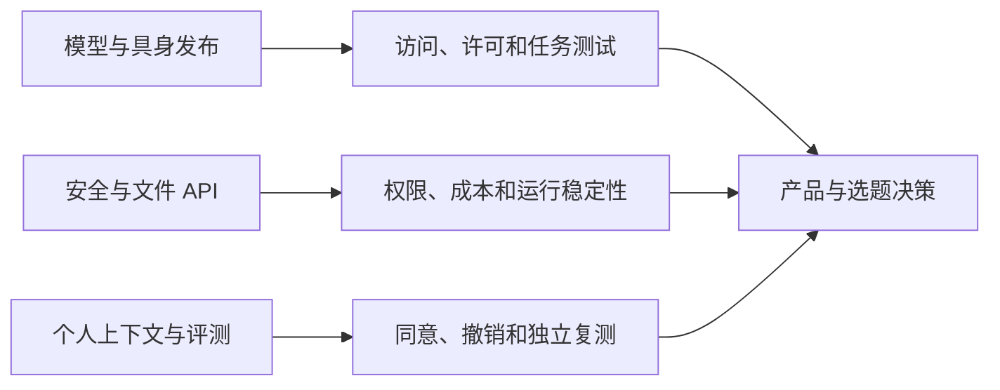

# AI 日报 · 2026-11-24

[中文（当前）](2026-11-24.md) · [English](../../en/daily/2026-11/2026-11-24.md)

- **采集截止：** 2026-11-24 11:00（Asia/Shanghai）；核对 11 月 23 日一手发布，与[昨日](2026-11-23.md)去重。[索引](../../INDEX.md) · [趋势追踪](../../TRACKERS.md)。来源仅标日期时，不推断具体时分。
- **筛选：** 7 条可核查动态。新模型、具身模型、Agent 安全、文件处理、个人上下文与评测方法均有覆盖；未以弱信号凑足 20 条。厂商评测、社区项目与产品已开放范围分开。

## 今日关键结论

1. **模型新品与可获得性要分开。** 智谱 GLM-5.4 已进入 AutoClaw 的 GLM Coding Plan；官方模型文章可确认发布日期，但未据此推断权重已开放或全渠道上线。
2. **具身模型开始把动作纳入预训练。** 自变量 WALL-OSS-1.0 公布视觉、语言和动作联合训练及 WALL-API-1.0；公司真机成绩与公开仿真榜单的测量条件不同，尚不能推断大规模生产可用。
3. **Agent 安全和成本进入运行时。** OpenAI/Cisco 的 Shirudo 让人工批准的 eBPF 临时防护在补丁部署前运行；Gemini API 文件切片把大文件的选择与计费边界移到服务端。两者都应按生产工作负载验证。
4. **个人化入口的权限范围是产品核心。** Google Wallet 正逐步接入 Search AI Mode；Drive 与 Gemini App 的连接仍属未来数周计划。Wallet 读取权限不等于转账或投资执行权限。
5. **小型决策模型与 Agent 评测方法同时更新。** IVE/Ivonnet 提供文档视觉决策工件，Hugging Face 提出从主张到评分的评测维护流程；厂商/作者成绩需在自有数据和错误样本上复测。

## 高信号动态

### 1. 智谱 GLM-5.4 进入 Coding Plan 与 AutoClaw

- **发生了什么：** Z.ai 于 11 月 23 日发布 GLM-5.4 官方文章；其 AutoClaw 团队同日确认该旗舰模型已集成 AutoClaw，可通过 GLM Coding Plan 使用，V2、V3 和 Team Edition 用户在 AutoClaw 使用时有 1.5 倍额度。可直接核查的交付范围是上述产品接入。
- **为什么重要 / 视角：** 产品决策、投资观察、内容选题。可把新模型纳入编码 Agent 同任务比较，记录套餐额度、失败重试、价格和可用地区；不能把套餐可用写成公开权重已交付。
- **发布时间 / 类型 / 原始信源：** 2026-11-23，Z.ai [官方模型文章](https://z.ai/blog/glm-5.4)及 [AutoClaw 接入公告](https://autoclaw.z.ai/en/blog/model/GLM-5.4/)，公司一手资料。
- **交叉验证 / 可信度：** 两份同集团资料仅为内部互证；接入事实高可信，架构性能和跨场景收益待独立实测。
- **趋势：** T01/T04 首次出现；模型与编码 Agent 套餐联动。

### 2. 自变量发布 WALL-OSS-1.0 具身基础模型

- **发生了什么：** 公司称 WALL-OSS-1.0 将视觉、语言与动作数据纳入预训练，并通过 WALL-API-1.0 面向研究机构和企业提供能力。官方列出真机任务与 RoboDojo 仿真评测，第三方媒体确认发布；成绩主要来自公司设置与陈述。
- **为什么重要 / 视角：** 产品决策、投资观察、知识扫盲。机器人预训练与动作生成衔接的路线值得追踪，但应在新物体、新任务、人工接管率和持续运行上复测。它是视觉语言动作模型，不等同于可玩游戏世界模型；API 可访问也不等于新权重已公开。
- **发布时间 / 类型 / 原始信源：** 2026-11-23，自变量[官方模型介绍](https://x2robot.com/en/blog/wall-oss-1)、[官方新闻页](https://x2robot.com/en/news)；[新京报报道](https://www.bjnews.com.cn/detail/1795412560129297.html)。公司公告与独立媒体。
- **交叉验证 / 可信度：** 发布事实由公司和媒体交叉确认；实际任务成绩及泛化主要为厂商口径，待独立真机复测。
- **趋势：** T02/T05 首次出现的具身模型更新；动作预训练路线升温。

### 3. OpenAI 与 Cisco 发布开源运行时 Shirudo

- **发生了什么：** 双方宣布 Shirudo 项目，以 eBPF 在运行中的 Linux 系统加载经人工批准的临时防护，目标是在正式补丁完成前限制漏洞利用；项目提供可检查代码。OpenAI 的 Java4Shell/Elasticsearch 演示属于受控测试，不是大规模生产有效性证明。
- **为什么重要 / 视角：** 产品决策、知识扫盲。Agent 安全从检测延伸到防护部署和审计；应检查签名、误拦、回滚、内核兼容与人工批准。项目开源是代码许可状态，不代表所有自动生成防护都安全。
- **发布时间 / 类型 / 原始信源：** 2026-11-23，OpenAI [技术介绍](https://openai.com/index/introducing-shirudo/)及 Cisco [联合公告](https://newsroom.cisco.com/c/r/newsroom/en/us/a/y2026/m11/cisco-and-openai-launch-shirudo-a-new-project-to-safeguard-agentic-ai.html)，合作双方一手资料。
- **交叉验证 / 可信度：** 双方公告可核对项目交付，非独立第三方性能验证；发布高可信，生产防护效果待复测。
- **趋势：** T07 首次出现；Agent 安全由扫描走向受控运行时防护。

### 4. Gemini API 支持服务端文件切片与更多文档格式

- **发生了什么：** Google 宣布 Gemini 4 API 可指定 PDF、Office/OpenDocument、表格、音视频的页、单元格或时间片段及内容层，服务端按实际查看部分处理和计费；Google AI Studio 与 Gemini 平台已提供相关接口，原有文件大小与页数限制继续适用。
- **为什么重要 / 视角：** 产品决策、知识扫盲。多模态 Agent 可按需读取大文件，减少整文件上下文与本地转换开销；但账单改善、检索遗漏和数据权限要按真实文件集测试。
- **发布时间 / 类型 / 原始信源：** 2026-11-23，Google [官方开发者公告](https://blog.google/innovation-and-ai/technology/developers-tools/file-slicing-controls/)，产品与 API 文档。
- **交叉验证 / 可信度：** 单一官方来源；接口和范围高可信，节省比例和任务质量待独立测量。
- **趋势：** T03/T04 持续升温；多模态输入控制移到 API 层。

### 5. Google Search AI Mode 扩展 Personal Intelligence 连接

- **发生了什么：** Google 宣布用户可选择把 Wallet 连接到 Search AI Mode，功能正逐步推出；Drive 与 Gemini App 连接计划未来数周加入。官方明确 Wallet 在此仅供读取信息，不能代用户转移、管理或投资资金，并允许关闭连接。
- **为什么重要 / 视角：** 产品决策、内容选题、投资观察。搜索产品把支付与文档上下文纳入回答，须区分“个人化建议”和“执行交易”；验收授权粒度、撤销、可解释性、错误建议与实际可用地区。
- **发布时间 / 类型 / 原始信源：** 2026-11-23，Google [Search 产品公告](https://blog.google/products-and-platforms/products/search/google-search-personal-intelligence-apps/)，官方一手来源。
- **交叉验证 / 可信度：** 单一官方来源；公布的上线阶段和只读边界高可信，实际效果与未来连接待验证。
- **趋势：** T04/T06 持续升温；个人上下文进入搜索入口。

### 6. Illuin 发布 IVE 与 Ivonnet 文档决策模型

- **发生了什么：** Illuin 团队在 Hugging Face 社区发布 IVE-4B 与 Ivonnet-0.8B，输入文档图像或文本、问题与候选选项，输出选项概率；模型权重、推理代码与服务端代码按 Apache 2.0 发布。团队公布 Decision Index 与文档视觉任务成绩，同时承认主要按英语训练、长文本输入和多步推理能力有限。
- **为什么重要 / 视角：** 产品决策、知识扫盲。抽取、分类、重排和界面决策可尝试统一概率式模型，但不能把决策分类器当自主执行的 Agent；要在中文票据、长文档和校准数据上独立评测。
- **发布时间 / 类型 / 原始信源：** 2026-11-23，团队 [Hugging Face 社区文章](https://huggingface.co/blog/QuentinJG/ive-release)与[模型页](https://huggingface.co/illuin/IVE-4B)，发布者原始资料。
- **交叉验证 / 可信度：** 工件和许可可查；榜单与延迟为团队口径，实际跨语言效果待复测。发布高可信，泛化判断待验证。
- **趋势：** T01/T04 首次出现；专用决策模型继续扩展。

### 7. Hugging Face 发布 Agent 评测维护方法

- **发生了什么：** Hugging Face 文章将 Agent 评测拆为任务主张、环境、运行轨迹、评分与维护等环节，讨论错误题目、评分器问题和应公开的工件；文中列出的平台榜单数量是平台自报，不是行业总量。
- **为什么重要 / 视角：** 产品决策、知识扫盲、内容选题。Agent 评价不能只看一个榜分；应保存可复核轨迹、任务版本、人工审查和失败样本，并跟踪评分器修订对排名的影响。
- **发布时间 / 类型 / 原始信源：** 2026-11-23，Hugging Face [方法文章](https://huggingface.co/blog/agentic-evals)，平台一手方法与观点。
- **交叉验证 / 可信度：** 文章存在和流程内容高可信；方法效用与平台规模数字缺独立验证，属于可操作建议而非统一标准。
- **趋势：** T01/T04/T07 持续升温；评测从模型回答扩至 Agent 过程和产物。

## 下一轮观察

- 同任务核对 GLM-5.4 的可用渠道、许可、总成本与独立表现；复核 WALL-OSS-1.0 的真机任务和人工接管。
- 在生产相似负载测试 Shirudo 的误拦/回滚、Gemini 文件切片的遗漏与账单，以及 Google Personal Intelligence 的授权边界。
- 继续追踪世界模型与 AI 游戏的实际可玩交付；本轮没有将机器人 VLA 或小游戏创作功能误记为新世界模型。
