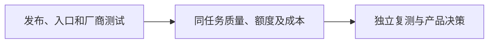

# AI 日报 · 2026-11-27（迟到补发）

[中文（当前）](2026-11-27.md) · [English](../../en/daily/2026-11/2026-11-27.md)

- **原定采集截止：** 2026-11-27 11:00（Asia/Shanghai）；本期于 11 月 28 日迟到整理。以 11 月 26 日发布为主，阿里云 11 月 25 日更新明确标为补录。与[前一期](2026-11-26.md)去重。[索引](../../INDEX.md) · [趋势](../../TRACKERS.md)。日期型信源不推断具体时分。
- **筛选：** 5 条可核查动态；未发现足以收录的新可玩世界模型或 AI 游戏交付。不以转载或弱信号凑满 20 条。

## 今日关键结论

1. **订阅额度需要按真实任务重新估算。** OpenAI 员工承认 GPT‑6.2 Astra 与 Sol 上线时被错误低计用量；修正后，相比此前一周，同样用量更快触及限额。这是计费更正，不是模型退化。
2. **文档理解进入可复用训练数据与推理优化阶段。** NVIDIA 为 Nemotron 3.5 Parse 公开三套合成数据、微调流程和 DFlash2 推理方案；厂商基准与实际业务表格准确率仍须分开。
3. **本地模型比较需要公开负载定义。** ggml-org 与 Hugging Face 上线 AMD Ryzen/Radeon 的 llama.cpp 基准面板，区分提示处理、生成和上下文增长；现有设备覆盖有限。
4. **多 Agent 不是天然优于单 Agent。** Hugging Face 的四 Agent 教学实验强调通信需训练、成本需计入；不能用 Agent 数量代替任务质量与每任务成本。
5. **阿里云新增结构化决策模型入口，但商业价值待测。** `decision-model` 出现在 11 月 25 日官方更新中；可用入口不等于已证实内容审核或路由效果。

## 高信号动态

### 1. OpenAI 更正 GPT‑6.2 的订阅用量计算

- **发生了什么：** OpenAI 的 Thibault Sottiaux 于 11 月 26 日在 X 称，GPT‑6.2 Astra 和 Sol 上线时对多数用户的使用量错误打折。修正后，相比前一周，用户在 Astra 和 Sol 上分别会快约 40% 和 25% 达到额度上限；既往不追收，并向 Go、Plus、Pro、Business 用户发放一次性额度重置。
- **为什么重要 / 视角：** 产品决策、投资观察。订阅产品需展示任务成本和额度变化；两个百分比是到达限额速度比较，不能当成 API 价格涨幅。
- **发布时间 / 类型 / 原始信源：** 2026-11-26，[OpenAI 员工原帖](https://x.com/thsottiaux/status/2125784147889393806)，公司员工公开说明；[TechRadar 报道](https://www.techradar.com/ai-platforms-assistants/chatgpt/weve-fixed-this-now-so-the-same-work-will-use-more-of-your-plans-usage-allowance-openai-admits-it-made-a-mistake-when-launching-gpt-6-2-and-now-paying-chatgpt-users-could-hit-their-usage-limits-up-to-40-percent-faster)，媒体转述。
- **交叉验证 / 可信度：** 原帖由媒体引用，属同一源的转述，尚无独立账单审计。更正公告高可信，用户实际额度影响待核对。
- **趋势：** T01/T03 持续升温；从模型标价转向完整任务额度。

### 2. NVIDIA 扩展 Nemotron 3.5 Parse 的数据与推理配套

- **发生了什么：** NVIDIA 公开三套合成数据：约 998 万图表样例、100 万表格样例和 790 万多语种 OCR 页；同时给出微调流程与 DFlash2 推测解码。厂商报告在单 H200、指定配置下，相比关闭推测解码的同模型，低并发吞吐提升 7.62 倍，高并发提升 1.52 倍。
- **为什么重要 / 视角：** 产品决策、知识扫盲。文档 Agent 可按版面、表格和图表分别验证抽取；合成数据适配需要真实企业文件的错误分析。
- **发布时间 / 类型 / 原始信源：** 2026-11-26，NVIDIA [Hugging Face 技术文章和数据入口](https://huggingface.co/blog/nvidia/building-on-nemotron-35-parse-open-data-fine-tunin)，公司技术资料。
- **交叉验证 / 可信度：** 数据与流程可检查；吞吐和准确率为团队基准，不代表不同硬件或真实文件表现。发布高可信，性能外推待验证。
- **趋势：** T01/T04 持续升温；模型交付延伸到训练数据与推理栈。

### 3. llama.cpp 与 AMD 提供可检查的本地推理基准面板

- **发生了什么：** ggml-org 在 Hugging Face 上发布 AMD Ryzen/Radeon 面板，按硬件、模型、量化和构建版本展示 512 token 提示处理、128 token 生成及上下文增长测试；底层结果与工作流公开。当前列出 Radeon 8060S 和 Radeon AI Pro R9700S 两类硬件。
- **为什么重要 / 视角：** 产品决策、知识扫盲。本地部署不能只看单一 tokens/s，须按长上下文、内存、功耗和任务质量选择设备。
- **发布时间 / 类型 / 原始信源：** 2026-11-26，[ggml-org/Hugging Face 文章](https://huggingface.co/blog/ggml-org/llamacpp-amd-bench)，项目方技术发布。
- **交叉验证 / 可信度：** 面板和原始结果可检查；平台和负载范围有限，尚非跨硬件独立总排名。交付高可信，普适性有限。
- **趋势：** T03 持续升温；推理硬件比较走向公开负载。

### 4. Hugging Face 发布多 Agent 训练教学实验

- **发生了什么：** Hugging Face 系列首篇以四个 Agent、共享语言模型和可验证任务演示通信训练，并说明增加 Agent 会改变上下文和预算。其文中引用其他团队的复杂案例，不能视作本次实验结果。
- **为什么重要 / 视角：** 产品决策、知识扫盲。多 Agent 系统应和单 Agent 在同任务、同预算下比较成功率、延迟和成本。
- **发布时间 / 类型 / 原始信源：** 2026-11-26，Hugging Face [教学文章](https://huggingface.co/blog/training-swarms)，项目方方法资料。
- **交叉验证 / 可信度：** 示例可复现，关于大规模 Agent 系统的泛化仍是方法观点。教程高可信，收益未证实。
- **趋势：** T04/T07 持续升温；Agent 数量从卖点转为需验证的设计变量。

### 5. 阿里云上线结构化决策模型入口（补录）

- **发生了什么：** Model Studio 更新日志在 11 月 25 日列出 `decision-model`，描述其接受文本、图像或业务上下文并输出分类、二元决策或评分的分布和置信度，可用于工单路由、内容审核和 Agent 路由。
- **为什么重要 / 视角：** 产品决策、内容选题。专门决策模型可能减少以通用聊天模型承担高频路由的成本；实际校准、误判和地区可用性需测量。
- **发布时间 / 类型 / 原始信源：** 2026-11-25，阿里云 [Model Studio 更新日志](https://docs.modelstudio.console.alibabacloud.com/en/model-studio/newly-released-models)，官方产品文档；本期补录。
- **交叉验证 / 可信度：** 入口可核查，效果与定价无独立实测。发布高可信，业务价值待验证。
- **趋势：** T01/T04 首次补录；模型供给继续向专门任务细分。

## 下一轮观察

- 用固定任务比较 GPT‑6.2 的额度消耗、Nemotron Parse 的真实表格错误率、本地模型在长上下文下的端到端表现。
- 比较单 Agent 与多 Agent 的同预算成功率；核查 `decision-model` 的地区、价格与误判率。
