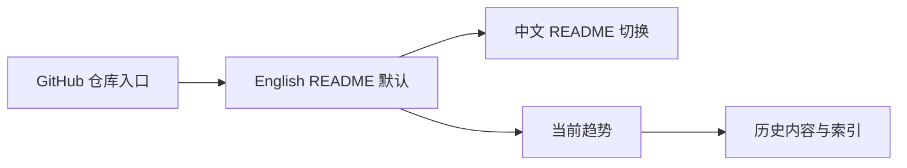
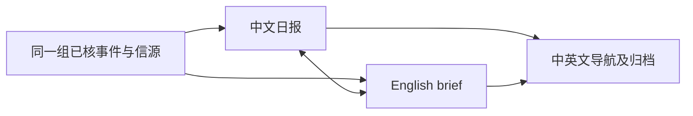
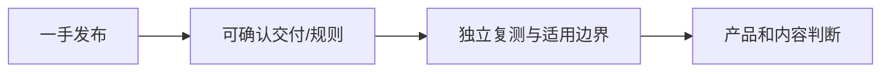
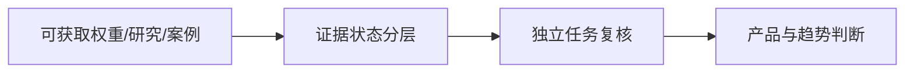
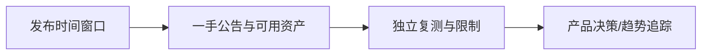
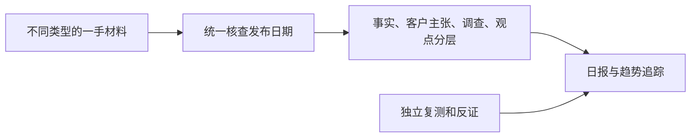
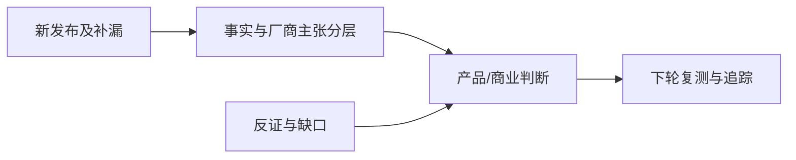
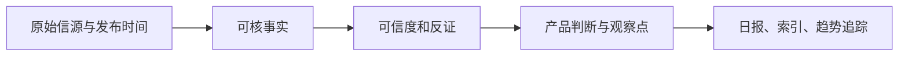
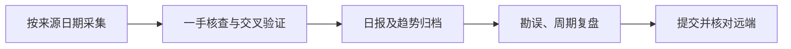

# AI News 决策与运行记录

## 2026-10-18 · 英文默认首页与 GitHub 原生 README 排版

- **Output：** 根目录 `README.md` 改为英文默认；`README.zh-CN.md` 为中文入口；中英文首页均将“当前关键趋势”置于“历史内容”之前。采用 GitHub 可渲染的 HTML 标题、居中简介与语言/导航链接，不引入网站框架或自定义 CSS。
- **Decisions：** 既有 `en/README.md` 改为兼容旧链接的入口；不改变既有中英文日报和索引的路径。HTML 渲染器针对 README 使用英文根目录与中文同级文件配对，其余日报仍按中文根目录与 `en/` 镜像配对。
- **Evidence：** GitHub 官方 README 规则优先展示仓库根目录 README；本仓库无独立网站应用。中英文首页与静态 HTML 的语言链接、趋势/历史顺序及原有日报路径均需检查。
- **Reusable assets：** 轻量 GitHub README 页头模式、双语首页路径约定与自动校验规则。
- **Anti-bubble：** 英文默认只改变首页语言，不意味着历史新闻已经全量翻译；旧档案继续明确标为中文内容。GitHub Markdown 的 HTML 排版不是完整网站主题系统。
- **Next：** 后续每日运行先更新根目录英文首页及中文首页，再同步日报；如要真正的网站式语言状态保持与搜索筛选，需要另行设计站点。

## 2026-10-18 · 中英文日报与显式语言切换

- **Output：** 从 10 月 18 日日报起，提供完整英文对应版；中英文 README、索引、日报 Markdown 互链，并生成带语言导航的静态 HTML。旧档案暂保留中文，在英文索引明确标为未翻译。
- **Decisions：** 不引入新的站点框架或机器即时翻译。GitHub Markdown 是主阅读界面，语言切换采用同篇日报的显式链接；HTML 为可直接打开的渲染产物。双版本沿用同一事件顺序、事实状态、原始信源、日期、可信度和反证，英文信源可优先用同一发布方英文页面。
- **Evidence：** 仓库此前为 Markdown/HTML 静态文档，没有网站应用或前端运行时；10 月 18 日日报已逐条对译为五条英文摘要。`scripts/render_html.py` 在仓库内生成 HTML，不依赖用户目录下的渲染脚本，但浏览器渲染仍需访问 marked 与 mermaid CDN。
- **Reusable assets：** 双语目录约定为根目录中文版与 `en/` 镜像路径；报告顶部及 HTML 导航仅在对应版本存在时展示语言切换。
- **Anti-bubble：** 双语切换不等于旧档案已翻译；英文读者不能从简化标题推断去除了原报告限制条件。若未来翻译漏掉时间或可信度，必须以原始信源重核并两版同步更正。
- **Next：** 每日运行同步产出并校验双版本；视阅读需求决定是否逐步回填旧档案，避免批量低质量翻译。

## 2026-10-18 · 出口登记、模型工具层与记忆写入反证

- **Output：** 北京时间 11:01 截稿，周末高信号短版 5 条；同步 README、INDEX、TRACKERS 和日报 HTML。W42 尚未结束，周报待 10 月 19 日运行时生成。
- **Decisions：** 严格区分中国技术出口目录草案与已生效的临时出口前登记；DeepSeek 模型权重/许可与厂商自报基准分层；游戏项目生成样例不算实时世界模型。腾讯论文提交日为 10 月 15 日，10 月 17 日为框架发布记录，不把论文改写成当日首发。
- **Evidence：** 商务部/科技部公告及商务部答问、AP 独立报道；DeepSeek 官方公告/API 文档/Hugging Face 权重；腾讯权重、论文、代码和版本记录；AtMem 社区作者复盘。仅标日期的 10 月 17 日材料精确发布时间未核。
- **Reusable assets：** 将跨境技术转移、境外 API 服务和已开源技术分开判断；记忆系统验收同时观察漏写、误写、连续状态和延迟。
- **Anti-bubble：** 不能从公司自测得分推断应用可靠性；单个小项目的失败复盘也不能否定所有学习式记忆；短版反映截稿和信源质量门槛，不是 AI 游戏研究停滞。
- **Next：** 复核目录最终版及登记实践；DeepSeek 固定任务质量/价格；Search/Fetch 真实来源质量；记忆系统独立回放；Matrix-Game 长时玩家测评。

## 2026-10-17 · 开放权重交付、Agent 用工与科学实体闭环

- **Output：** 北京时间 11:01 截稿；13 条日报（10 条 10 月 16 日新材料、3 条 10 月 14–15 日补漏），同步 README、INDEX、TRACKERS 和同名 HTML。
- **Decisions：** Beam 从早期访问预告改记为权重已可下载；补查发现 Ling 3.1 于 10 月 14 日开源而非本期首发，已校正日期。NVIDIA/AI4Bharat 的语料仍为待交付；不把客户案例 ROI、公司内部就业变化、受访者预期和利益相关方观点混作同一类事实。
- **Evidence：** Reflection/Hugging Face、InclusionAI、Anthropic 两份经济报告与两项技术研究、Google Research VERID、OpenAI 客户案例、NVIDIA/AI4Bharat 技术文、ChinaTalk 原访谈、OneWM 及 Agent 脚手架预印本。
- **Reusable assets：** 以“已交付权重/待交付数据/自报客户结果/调查预期/实体实验”五类状态标注证据；昨日 Matrix-Game 仍保留作为游戏世界模型验证基线。
- **Anti-bubble：** 前沿实验室内部用工不等于整体劳动力市场；程序验收的科研结果不等于量子硬件或临床成果；无新 AI 游戏首发不等于赛道停滞。
- **Next：** Beam/Ling 固定任务成本；Matrix-Game 长时体验；VERID 外部复现；组织用工跨公司可比数据；客户案例净收益。

## 2026-10-16 · 可复核游戏世界模型与开放权重竞争

- **Output：** 自动任务北京时间 11:01 截稿；13 条日报（6 条 10 月 15 日发布、7 条 10 月 14 日补漏），同步 README、INDEX、TRACKERS 和同名 HTML。
- **Decisions：** Matrix-Game 4.0 的 10 月 15 日 11:42 报道处于昨日 10:56 与今日 11:01 两次截稿之间，归入本期。Meta/StepFun/NVIDIA 明确区分权重开放、预告与推理规格；不把厂商 FPS、基准或 ROI 写成独立实测。
- **Evidence：** Skywork GitHub/HF、Meta Research/HF、StepFun 官方/HF、NVIDIA、OpenAI、Amazon 官方；xAI、Paper Instruments、Ai2、Mirelo、Pluralsight、Leash Bio 原文及 Nature 论文。
- **Reusable assets：** 按发布时间窗口、权重/许可/硬件可用性和模型—环境—成果证据层分列的日报格式。
- **Anti-bubble：** 世界模型能跑单人演示，不代表长时游戏质量或商用可玩性；开放权重不等于宽松许可或廉价本地运行。厂商场景案例不代表普遍 ROI。
- **Next：** Matrix-Game 单卡延迟与状态复测；Step 5/Muse Spark Open 许可与真实任务成本；Bee 隐私及留存；Rosalind 科学成果。

## 2026-10-15 · 使用强度、AI 游戏工程预览与多步安全

- **Output：** 本次自动任务于北京时间 10:56 提前触发并以此截稿；产出 12 条日报，更新根目录关键趋势、索引和追踪，生成同名 HTML。
- **Decisions：** 把 OpenAI 客户样本 token 强度、Meta/YouGov 受访者自报、OpenAI 客户案例和 a16z 投资观点分开；指定 GPT-4 API 快照的停用日程与全系列停用区分；Epic 预览与稳定产品分开；MiniMax V3 的媒体报道与官方产品页分别标注，不把 30% 改善写成独立验证。
- **Evidence：** OpenAI、Meta、Google、Anthropic、Epic、Google.org 官方发布，MiniMax 官方站及 TechFlow 快讯，a16z 原文，Ars 初步试用。
- **Reusable assets：** 日报的观点/事实分层、连续趋势和跨来源口径对照，可用于后续周报。
- **Anti-bubble：** 不能从厂商平台内的 token 或受访者感受外推全球 AI 经济收益；没有新可玩世界模型也不等于该方向停滞。
- **Next：** Epic 稳定性；MiniMax 官方版本/成本口径；长时 Agent 最终任务成本与事故；多步误用防护的独立复测。

## 2026-10-14 · 模型开放、世界模型案例与 AI 娱乐反证

- **Output：** 北京时间 11:04 截稿，日报 8 条；同步 README、INDEX、TRACKERS 及图文 HTML。没有为 20–30 条目标填充低可信新闻。
- **Decisions：** 把 Argon “扩大开放”与“首次亮相”分开；机器人视频世界模型案例与可玩 AI 游戏分开；Character.AI 10 月 12 日 Chapter 11 明确标为重大补漏，Disney 的基准竞标是特定 IP 非独占许可而非整体收购。
- **Evidence：** Google/DeepMind、Liquid、Anthropic、Meta、Character.AI 公司原文；Character.AI 正式新闻稿与独立媒体报道。厂商性能、安全和客户效率数据仍需独立复测。
- **Anti-bubble：** 不从一家互动娱乐公司重整推出“AI 角色赛道失败”；不把多篇同集团文章误计为独立交叉验证；中美/游戏覆盖不足如实记录。
- **Next：** Argon 标准价下任务成本、机器人闭环长时表现、Character.AI 竞标结果、端侧中文 Agent、推荐控制和长视频真实工时。

## 2026-10-13 · 固定时段日报与证据分层

- **范围：** 北京时间 11:04 截稿，核查 10 月 12 日全球发布；输出 10 条，不以 20–30 条目标填充重复或未经核实消息。
- **决策：** 将 Meta Muse Wonder、Microsoft Maia、Anthropic 安全研究、DigitalOcean Agent 反馈闭环作为核心增量。Ambi/Honeyjar/Blueprints AI 为应用观察，不以公司自述证明结果；陶哲轩 10 月 9 日观点作为补漏，注明非今日首发。
- **证据边界：** 官方发布可确认公告与可用范围，但不能自动验证性能；媒体采访可确认发言，不自动确认增长或 ROI。中国模型、AI 游戏和世界模型在此截稿窗无同等级新证据，保留覆盖局限。
- **后续：** 实测模型任务完成率、Maia 同负载能效、仿真误报/回归效果、长时世界模型控制与应用留存。HTML 为 Markdown 衍生物，使用 CDN 渲染，离线打开需联网。

## 2026-10-12 · 补档、勘误与图文版

- **目标：** 维持逐日归档、周期汇总与可核验趋势，不以条数目标覆盖证据质量。
- **本轮变更：** 补齐 10 月 10–11 日事后短版，发布 10 月 12 日补漏版及 W41 周报；修正 10 月 9 日漏记 Odyssey-3 的判断；更新 README、INDEX、TRACKERS。
- **来源原则：** 原始发布日期、报道日期和归档日期分开写。团队基准、投资观点、媒体转述与独立实测分层。对错判留可审计勘误，不无痕改写旧结论。
- **展示：** 新报告和主要趋势文档保留 Mermaid 源码，并生成同名 HTML。HTML 使用 CDN 加载 marked 与 mermaid，离线打开时图文渲染可能不可用；Markdown 是源文件。
- **风险：** 10–11 日是事后补档，覆盖强度低于按时日报；部分页面仅提供日期，无法反推精确发布时间。周报不可用于全周热度统计。
- **下一步：** 恢复固定 11:00 采集；复测 Odyssey-3 长时状态/延迟/成本；核查 Agent 事故通报正式文本；对周末中国厂商与 X/YouTube 一手内容做补充扫描。

