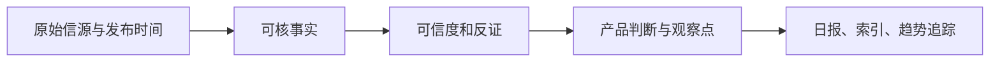
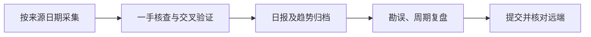

# AI News 决策与运行记录

## 2026-10-13 · 固定时段日报与证据分层

- **范围：** 北京时间 11:04 截稿，核查 10 月 12 日全球发布；输出 10 条，不以 20–30 条目标填充重复或未经核实消息。
- **决策：** 将 Meta Muse Wonder、Microsoft Maia、Anthropic 安全研究、DigitalOcean Agent 反馈闭环作为核心增量。Ambi/Honeyjar/Blueprints AI 为应用观察，不以公司自述证明结果；陶哲轩 10 月 9 日观点作为补漏，注明非今日首发。
- **证据边界：** 官方发布可确认公告与可用范围，但不能自动验证性能；媒体采访可确认发言，不自动确认增长或 ROI。中国模型、AI 游戏和世界模型在此截稿窗无同等级新证据，保留覆盖局限。
- **后续：** 实测模型任务完成率、Maia 同负载能效、仿真误报/回归效果、长时世界模型控制与应用留存。HTML 为 Markdown 衍生物，使用 CDN 渲染，离线打开需联网。

## 2026-10-12 · 补档、勘误与图文版

- **目标：** 维持逐日归档、周期汇总与可核验趋势，不以条数目标覆盖证据质量。
- **本轮变更：** 补齐 10 月 10–11 日事后短版，发布 10 月 12 日补漏版及 W41 周报；修正 10 月 9 日漏记 Odyssey-3 的判断；更新 README、INDEX、TRACKERS。
- **来源原则：** 原始发布日期、报道日期和归档日期分开写。团队基准、投资观点、媒体转述与独立实测分层。对错判留可审计勘误，不无痕改写旧结论。
- **展示：** 新报告和主要趋势文档保留 Mermaid 源码，并生成同名 HTML。HTML 使用 CDN 加载 marked 与 mermaid，离线打开时图文渲染可能不可用；Markdown 是源文件。
- **风险：** 10–11 日是事后补档，覆盖强度低于按时日报；部分页面仅提供日期，无法反推精确发布时间。周报不可用于全周热度统计。
- **下一步：** 恢复固定 11:00 采集；复测 Odyssey-3 长时状态/延迟/成本；核查 Agent 事故通报正式文本；对周末中国厂商与 X/YouTube 一手内容做补充扫描。

