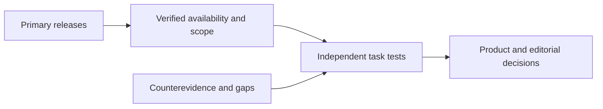

# AI News

[English (current)](README.md) · [中文](../README.md)

An evidence-linked AI intelligence archive for product decisions and story ideas, with investment watch and AI literacy as secondary lenses. Coverage includes LLMs, multimodal and world models, AI applications, AI games, companies, research, and important expert perspectives.

## Latest bilingual brief

- [2026-10-18 AI Daily Brief — export registration, DeepSeek 1017, agent memory](daily/2026-10/2026-10-18.md) · [HTML](daily/2026-10/2026-10-18.html) · [中文](../daily/2026-10/2026-10-18.md)

From October 18, 2026 onward, new daily briefs are intended to have complete Chinese and English editions, with language links at the top of each. Older briefs remain [available in Chinese](../INDEX.md); they are not labeled as translated until an English edition has actually been reviewed and published. The two versions must share the same underlying events, primary links, dates, confidence labels, and separation of facts from claims and opinions.

## Current decision signals

1. **Separate announced controls from effective requirements.** China's proposed technology-export catalog remains a draft, but specified pre-export registration took effect when the October 16 notice was published. Licensing technology abroad and serving an API abroad are not the same transaction.
2. **Judge agent infrastructure by complete tasks.** DeepSeek V4.1 Flash 1017 weights and Search/Fetch APIs are available; vendor benchmark gains and search-scale claims need independent tests, and retrieval adds its own cost and risk.
3. **Treat memory writing as a state-management problem.** Tencent's specialized memory writer and the AtMem failure retrospective use different methods; both motivate tests of missed writes, false writes, updates, latency, and long-run recovery.
4. **Do not conflate generated game projects with interactive world models.** DeepSeek's game-development examples are not evidence of persistent, real-time simulated worlds. Long-session player tests remain essential.

[English archive index](INDEX.md) · [Chinese methodology](../METHODOLOGY.md) · [Chinese trend tracker](../TRACKERS.md)

> Research information only; not investment, medical, or legal advice. Check primary sources before consequential decisions.
