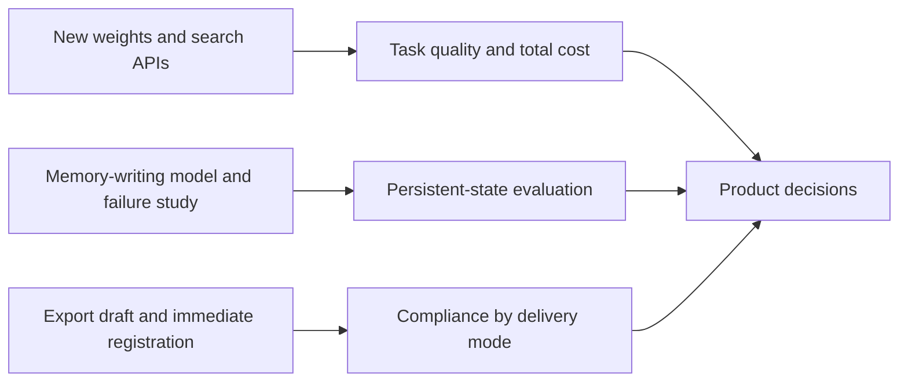

# AI Daily Brief · 2026-10-18

[English (current)](2026-10-18.md) · [中文](../../../daily/2026-10/2026-10-18.md)

- **Collection cutoff:** 2026-10-18 11:01 (Asia/Shanghai), when the scheduled task triggered. Sources dated October 17 without a time cannot establish whether they were published before the exact cutoff; any later publication should be corrected in the next issue.
- **This edition:** Five high-signal items in a short weekend brief. We did not pad the usual 20–30-item target with reposts, old papers, or unverified claims. Cross-checked against the [October 17 brief (Chinese only)](../../../daily/2026-10/2026-10-17.md).
- **Navigation:** [English index](../../INDEX.md) · [Chinese trend tracker](../../../TRACKERS.md). Week 42 had not ended at the cutoff, so no weekly report was published early.

## Key takeaways

1. **China has introduced an immediate compliance step for some technology exports, but it has not yet formally banned 23 AI technologies.** On October 16 at 16:00 Beijing time, the commerce and science ministries proposed adding 40 technologies to the export-control catalog, including 23 AI-related technologies. The catalog revision remains a draft, while pre-export registration for specified transactions involving technologies listed in the notice took effect when the notice was published. Product teams should separate model weights or technology licensing, overseas deployment, and offshore API/SaaS access; qualified counsel must assess specific transactions.
2. **DeepSeek advanced both its model and agent search infrastructure.** V4.1 Flash 1017 weights and an MIT license are verifiable; the claim that its website, app, and API have switched is from DeepSeek. Vendor benchmark gains are not independent task tests. Search and Fetch are publicly available at ¥5 per 1,000 successful calls for each endpoint. Certain server-side tool calls remain free until November 1 at 00:00 Beijing time. Total task cost must include model tokens, search, and fetching.
3. **Long-term agent memory is shifting from “can retrieve” to “writes and updates the right things.”** Tencent released Hy-Memory-30B-A3B weights for memory writing and its framework. A separate small community retrospective found that improved offline classifier scores coincided with worse operational replay. These are not the same benchmark and cannot be used to declare a winner. Both point to false writes, missed writes, latency, and downstream state as evaluation targets.
4. **No verifiable commercial step-change in AI games or world models emerged in this issue.** DeepSeek's browser racing game and Godot examples showcase an agent building projects, not a real-time playable world model with persistent state. Matrix-Game 4.0 still needs long-session tests of experience, latency, and cost.

## Developments

### 1. China proposes export-catalog changes and begins temporary pre-export registration

- **What happened:** Joint Announcement No. 48 from the Ministry of Commerce and Ministry of Science and Technology proposes adding 40 AI, biomedicine, and photovoltaic technologies to the catalog, including 23 AI technologies. Comments are open until November 15. The catalog revision is not yet in force. Separately, pre-export registration took effect on October 16 for specified transactions involving technologies in the notice's annex, including transfer of technology ownership abroad, licensing domestic technology for use abroad, and a change to a foreign owner or controller. Technologies already in the public domain are excluded from the notice's scope.
- **Why it matters / lens:** Product decisions / investment monitoring. Publishing model weights, local overseas deployment, licensing, overseas cloud infrastructure, and API access need separate compliance analysis. In its Q&A, the ministry says local overseas deployment of a technology ultimately classified as restricted would be within scope, whereas access via API, app, or SaaS generally would not constitute export of the large-model technology. This is not legal advice for any particular deal.
- **Published / source type / primary sources:** 2026-10-16 16:00 Beijing time; government announcement and official Q&A. [Joint announcement](https://www.mofcom.gov.cn/zcfb/blgg/art/2026/art_1666fcaa24424766afe0683498ff0908.html) · [Ministry Q&A](https://www.mofcom.gov.cn/syxwfb/art/2026/art_a4acff07e134447fbe7bbeb486df3ea6.html).
- **Cross-check / confidence:** The announcement and Q&A come from the same government system. [AP's independent report](https://apnews.com/article/5ac381c0c6d6628bbea2e0da7d855a5b) confirms the draft's publication; the primary text governs the specific requirements. High confidence in publication, counts, and temporary registration; unresolved final catalog and case-by-case applicability.
- **Trend:** First new policy variable for T06/T07. Track the proposed catalog separately from the immediate registration obligation.

### 2. DeepSeek releases V4.1 Flash 1017 weights and says its services have switched

- **What happened:** DeepSeek issued a minor V4.1 Flash update. Weights are available on Hugging Face under MIT; the model card specifies a 1M-token context window. DeepSeek says its website, app, and API now serve the update. Its own model card reports DeepSWE v1.1 improving from 74.2 to 77.0 and Terminal-Bench 4.0 from 31.2 to 42.3. We did not independently rerun these benchmarks, harnesses, or competitor comparisons.
- **Why it matters / lens:** Product decisions / editorial planning / AI-assisted game development. Compare output quality and total cost on fixed coding, tool-use, multimodal understanding, and game-development tasks. The browser racing game and Godot examples are generated-project demonstrations, not evidence that a game world model supports long-running real-time interaction.
- **Published / source type / primary sources:** Official post dated 2026-10-17 without a precise time. [DeepSeek announcement](https://api-docs.deepseek.com/news/news261017/) · [Hugging Face model card and weights](https://huggingface.co/deepseek-ai/DeepSeek-V4.1-Flash-1017).
- **Cross-check / confidence:** The post and weights corroborate delivery but both originate from the same publisher, so they do not independently validate performance. High confidence in weights and license; medium in the claimed service switch; performance, task cost, and effective 1M context remain to be tested.
- **Trend:** T01/T06 continue to heat up. T05 gains a game-development tool, not a playable world-model breakthrough.

### 3. DeepSeek opens Search and Fetch APIs to developers

- **What happened:** DeepSeek opened separate web-search and page-fetch endpoints, returning structured results and page content as Markdown, respectively. Each costs ¥5 per 1,000 successful calls. According to DeepSeek, server-side Search/Fetch tool calls made by its API users through DeepSeek Harness, Claude Code, Codex, and similar integrations are exempt from those endpoint fees until November 1 at 00:00 Beijing time, after which per-call billing starts. Model-token charges are separate.
- **Why it matters / lens:** Product decisions / investment monitoring. Evidence retrieval for agents becomes a separately priced infrastructure layer. Test search recall, page availability, source reliability, prompt-injection defenses, calls per completed task, and overall cost. DeepSeek's index-size and daily-volume claims have not been independently audited.
- **Published / source type / primary sources:** 2026-10-17 (the announcement gives no precise time); official product and API documentation. [Announcement](https://api-docs.deepseek.com/news/news261017/) · [Search & Fetch guide](https://api-docs.deepseek.com/guides/search/).
- **Cross-check / confidence:** The announcement, API guide, and pricing page corroborate each other within a single vendor; they are not independent usability tests. High confidence in documented endpoints and list prices; search quality, volume, and realized costs remain unverified.
- **Trend:** A first tool-layer addition to T01. Recheck billing and task value after November 1.

### 4. Tencent opens Hy-Memory-30B-A3B, a specialized memory-writing model

- **What happened:** Tencent Hunyuan's model card offers Apache-2.0 weights for a 30B-parameter model with roughly 3B active parameters. It is designed to decide what to retain and how to update or reconcile memories in external frameworks including Mem0, MemOS, and Hy-Memory. The paper was submitted October 15; the repository dates Hy Memory 2.0.2/2.0.3 releases to October 17. The authors report a 55.49% mean across four of their evaluation harnesses versus 54.62% for the Claude Opus 5 configuration they tested. These are team-defined benchmarks.
- **Why it matters / lens:** Product decisions / technical background. A specialist model for the write path may be useful, but assess missed high-value information, false memories, conflict resolution, deletion provenance, and full operating cost instead of substituting a benchmark mean for product acceptance.
- **Published / source type / primary sources:** Paper submitted 2026-10-15 16:46 UTC; framework updates dated 2026-10-17. The weights were accessible during this issue, but their exact first-publication time was not confirmed. Official model card, preprint, and code: [Hugging Face weights](https://huggingface.co/tencent/Hy-Memory-30B-A3B) · [paper](https://arxiv.org/abs/2610.22196) · [changelog](https://github.com/Tencent-Hunyuan/Hy-Memory/blob/main/CHANGELOG.md).
- **Cross-check / confidence:** Weights, code, and paper are inspectable but come from the same team; no independent task replay was found. High confidence in delivery and license; medium-to-low confidence in transfer of its reported lead to other products.
- **Trend:** First entry for memory-write governance under T01/T08. The paper was not first published October 17.

### 5. Community retrospective: offline memory-classifier gains collapsed in live replay

- **What happened:** AtMem's developer documented a memory classifier they chose not to ship. “Fully correct” decisions rose from 18.4% to 73.8% on a sealed set, but an always-reject baseline scored 91.1% on that same set. In a matched 100-observation replay, deterministic rules made 30 correct decisions versus 16 each for the original and fine-tuned models. The learned approaches were slower and missed all required store, update, and duplicate actions. The developer kept deterministic synchronous writing and proposed using learned models off the critical path.
- **Why it matters / lens:** Product decisions / editorial planning. Severe class imbalance and feedback through persistent state can make aggregate offline accuracy misleading. Measure recall of must-save facts, error propagation, latency, and rollback separately. This is a small single-project counterexample, not proof that all learned memory systems fail, nor a direct rebuttal of Tencent's differently configured model.
- **Published / source type / primary source:** 2026-10-17 (no precise time); Hugging Face community engineering retrospective. [Full post and reproduction pointers](https://huggingface.co/blog/javadtaghia/we-fine-tuned-a-memory-classifier-for-our-agent-he).
- **Cross-check / confidence:** The author links data, checkpoints, and replay receipts; we did not independently rerun them. High confidence that the retrospective was published; medium-to-low confidence in generalizing its results.
- **Trend:** New counterevidence for T01/T08 against treating offline scores as deployment value; independent reproduction remains open.

## Ongoing watch and coverage gaps

- **What changed from the prior brief:** T06's open-weight model discussion extends from Beam/Ling to DeepSeek 1017 and export policy. T01 adds a web-tool layer and a specialized memory-writing model. T05 has no fresh playable world-model evidence; DeepSeek's game example is not equivalent to Matrix-Game.
- **Next falsification checks:** DeepSeek's real coding and game-production quality and full task cost; search-source quality and injection risk; Hy-Memory's recall of valuable facts and cross-day state consistency; thresholds in the Chinese catalog annex, the post-consultation version after November 15, and registration practice; long-session player tests of Matrix-Game.
- **Collection limits:** We scanned official posts, model hubs, papers, community material, and Chinese/English media and fund leads. No equally substantiated new commercial world-model or AI-game launch, or original fund report, was verified for this issue. There was no sufficiently evidenced fresh KOL item. The community replay is not a universal law, and vendor benchmarks are not independent validation. The policy summary is informational, not legal advice.
