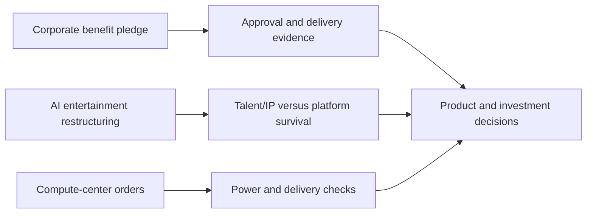

# AI Daily Brief · 2026-10-19

[中文](../../../daily/2026-10/2026-10-19.md) · [English (current)](2026-10-19.md)

- **Research cutoff:** 2026-10-19 11:00 Asia/Shanghai. This edition focuses on disclosures since 11:00 on October 18 and is deduplicated against [yesterday's brief](2026-10-18.md).
- **Edition:** Three high-signal items after a relatively quiet weekend. No newly verified model, world-model, or AI-game launch warranted a standalone item; older stories were not used to fill the usual 20–30 slots.
- **Navigation:** [Trend tracker (Chinese)](../../../TRACKERS.md) · [Archive index](../../INDEX.md).

## Key conclusions

1. **Anthropic is turning its public-benefit commitment into a proposed equity arrangement, not reporting a completed transfer.** It says 5% of shares are intended for a wholly owned fund, subject to stockholder approval. A further 2% for each 50% valuation increase is at the board's discretion. Governance, the valuation baseline, and actual disbursements remain undisclosed.
2. **The Character.AI/Disney case further separates talent and IP transfer from survival of the original platform.** A newly discussed bankruptcy filing says Disney agreed to offer jobs to at least 60 employees. The earlier $20 million arrangement concerns a non-exclusive license to certain IP, not an acquisition of the whole product, and the stalking-horse bid remains subject to the court process.
3. **Power access is now a concrete risk to AI-infrastructure order fulfillment.** Multiple outlets report Microsoft's exit from its planned arrangement for Nscale's Essex site. Nscale acknowledges the local grid problem and says its other Microsoft contracts are unaffected. Neither cancellation of the site, an exit from all Nscale cooperation, nor a definitive revised launch year has been established.

## Key developments

### 1. Anthropic announces a proposed equity-backed Public Benefit Fund

- **What happened:** On October 18, Anthropic said it intends to allocate 5% of its shares to a wholly owned LLC public-benefit fund, subject to stockholder approval. For each 50% increase in value above an undisclosed baseline, the board may add another 2%. Its statement that roughly 20% of shares would be dedicated to the public good combines founders' personal giving pledges, employee donation matching, and this proposed arrangement; it does not mean the new fund already owns 20%.
- **Why it matters / lenses:** Investment monitoring and editorial planning. A frontier lab is proposing to tie public-benefit spending and AI labor-market effects to long-term equity value. Approval, fund governance, valuation triggers, and spending disclosures will determine substance; independence should not be assumed for a wholly owned LLC.
- **Publication / type / primary source:** 2026-10-18 (no exact time supplied), company announcement; [Anthropic announcement](https://www.anthropic.com/news/public-benefit-fund).
- **Cross-check / confidence:** [AP's independent report](https://apnews.com/article/8181332fbbc48f2ef9447cef096f14de) confirms the announcement, not completion of the transfer. High for the proposal; pending for approval, governance, and disbursement.
- **Trend status:** New signal on AI-company governance and distribution mechanisms. Related to Anthropic's workforce study covered on October 17, but not evidence of labor-market causation or mitigation.

### 2. Bankruptcy filing adds detail to Disney's Character.AI staff arrangements

- **What happened:** Media coverage on October 18 says a bankruptcy filing shows Disney agreed to offer jobs to at least 60 Character.AI staff, with estimated annual compensation of about $60 million; most recipients reportedly accepted. This adds detail to the previously announced stalking-horse bid and transition-services arrangement. A better bid is still possible, and the original platform's future is not settled.
- **Why it matters / lenses:** Product decisions, AI games, and investment monitoring. User demand, IP, and team value in character-based entertainment may diverge from the independent platform's economics and safety liabilities. Talent transfers do not mean Disney has taken over Character.AI's user content, subscriptions, or service.
- **Publication / type / primary source:** 2026-10-18 09:30 PDT (October 19 00:30 Beijing time), media report based on a court filing; [court filing link](https://cases.stretto.com/public/x936/14939/PLEADINGS/1493910132680000000114.pdf) · [TechCrunch report](https://techcrunch.com/2026/10/18/disney-agrees-to-hire-the-majority-of-character-ais-workforce/) · [earlier Character.AI announcement](https://blog.character.ai/an-update-on-character-ai/).
- **Cross-check / confidence:** The court filing was located but access was blocked during this run, so the staffing and compensation figures remain the outlet's description of the document. The earlier company statement supports the bankruptcy and $20 million partial-IP license, not these staffing numbers. Medium for staffing details; high for the earlier restructuring; pending for court approval and the platform's outcome.
- **Trend status:** Continuing follow-up to the October 14 backfill. The staffing detail is new; the bankruptcy itself is not counted again as a new event.

### 3. Microsoft reportedly exits Nscale's Essex data-center arrangement

- **What happened:** The Guardian and Reuters followed the Telegraph's initial report that Microsoft is no longer a planned customer for Nscale's Loughton, Essex data center. Nscale told the Guardian it remains committed to the site, is exploring alternative power, and says other Microsoft contracts are unaffected. Grid access has reportedly been delayed until the early-to-mid 2030s; that is not a confirmed final operational date for the project.
- **Why it matters / lenses:** Investment monitoring and product decisions. AI-compute contracts need checks on anchor customers, grid connection, deliverable power, and financing. Announced GPU capacity is not the same as compute available on schedule; delays can affect cloud price and availability.
- **Publication / type / primary source:** First reported 2026-10-18 08:28 EDT (20:28 Beijing time), media reporting; [Guardian reporting and Nscale response](https://www.theguardian.com/uk-news/2026/oct/18/microsoft-drops-huge-ai-datacentre-project-in-essex-over-power-supply-concerns) · [Reuters report](https://www.investing.com/news/stock-market-news/microsoft-pulls-out-of-uk-data-center-deal-with-nscale-telegraph-reports-4955864) · [original Nscale partnership announcement](https://www.nscale.com/press-releases/nscale-uk-ai-infrastructure-announcement).
- **Cross-check / confidence:** Reuters also reported the exit, initially without direct Microsoft or Nscale confirmation; the Guardian subsequently included Nscale's response. Medium-high for the customer's exit from this project; pending for contract terms, replacement customers, and power timing.
- **Trend status:** Rising infrastructure-delivery constraint; this does not establish cancellation of all Microsoft–Nscale cooperation.

## Continuing watch and coverage gaps

- **Change from yesterday:** Yesterday's focus was China's technology exports, DeepSeek's model/search releases, and agent memory. Today's incremental signals concern governance, AI-entertainment restructuring, and power-constrained compute delivery. No verified commercial leap in new models or world models was found.
- **Next verification points:** Stockholder approval and governance documents for Anthropic's fund; Character.AI's auction and platform continuity; Nscale's power and customer arrangements; DeepSeek Search/Fetch costs on real tasks and longer world-model sessions.
- **Collection limits:** Official announcements, major media, model repositories, and English/Chinese leads were reviewed. Reposts, forecasts, and KOL claims without source evidence were excluded. This is neither investment nor legal advice.
