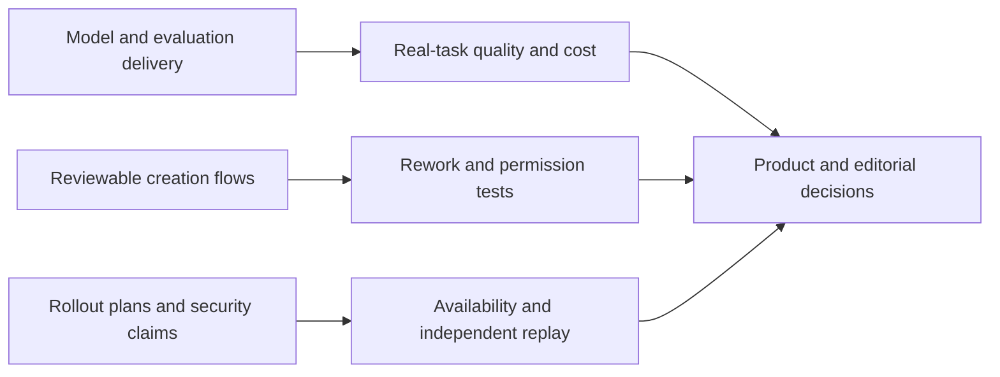

# AI Daily Brief · 2026-10-20

[中文](../../../daily/2026-10/2026-10-20.md) · [English (current)](2026-10-20.md)

- **Research cutoff:** 2026-10-20 10:30 Asia/Shanghai. This edition checks disclosures since 10:30 on October 19 and deduplicates against [yesterday](2026-10-19.md). Official posts without a time establish a publication date, not an exact launch hour.
- **Edition:** Eight high-signal updates. The usual target is 20–30 items, but unverified reposts, rumors, and older stories were not added to reach a quota.
- **Navigation:** [Trend tracker (Chinese)](../../../TRACKERS.md) · [Archive index](../../INDEX.md).

## Key conclusions

1. **Chinese model competition continues to shift toward deliverable agent-task value.** MiniMax M3.1 Flash is available through its API, subscription plan, and coding product. List prices are documented, but the “nearly 3× faster” and “70% lower task cost” claims largely come from MiniMax; fixed-task replay is needed. Weights are not yet available.
2. **AI coding evaluation is separating behavior-preserving migration from building functionality from scratch.** OpenAI published low-resource-language evaluations and an inspectable MultiLangBench test suite. Strong vendor-reported scores do not establish reliable legacy-system migration.
3. **Generative products are moving from one-shot output toward reviewable intermediate steps.** Gemini Notebook lets users approve outlines and producer notes; Google Cloud describes interactive MCP Apps. Both should be assessed for rework, task completion, and permission boundaries.
4. **“Announced” and “widely available” remain different states.** Hugging Face said TorchNeuron would enter public beta on October 20. Google Cloud also argued that LLM judges need stability checks, alignment with human judgment, and multi-model comparison; methodological advice is not independent proof of improved outcomes.
5. **Agent-security narratives are expanding, but an executive view is not validated control effectiveness.** Microsoft argues for continuous, layered supervision of internal agents; its approach needs independent tests of unauthorized action, false alarms, latency, and interruptibility.

## Key developments

### 1. MiniMax releases M3.1 Flash; weights remain forthcoming

- **What happened:** On October 19, MiniMax said M3.1 Flash was available through its API, M Plan, and MiniMax Code. Listed prices per million input/output tokens are $0.15/$0.60, with cached input at $0.015. The company linked it to the previously anonymous Space Bunny model and claimed nearly 3× faster online inference and 70% lower agent-task costs. It says weights will be released later; this is not yet an open-weight release.
- **Why it matters / lenses:** Product decisions, investment monitoring, and editorial planning. When comparing it with DeepSeek's October 17 update, use fixed coding, computer-use, and game-development tasks while logging output length, retries, human review, and total cost. Neither token price nor a leaderboard equals cost per completed task.
- **Publication / type / primary sources:** 2026-10-19 (no exact time supplied); [MiniMax announcement](https://www.minimax.io/blog/minimax-m31f) · [Artificial Analysis model page](https://artificialanalysis.ai/models/minimax-m3-1-flash/).
- **Cross-check / confidence:** Artificial Analysis lists the model and independent evaluations, but its dynamic model and comparison pages currently differ on the aggregate score, so this brief does not quote a precise total. The vendor's nearly 3×/70% claims lack an external like-for-like replay. High for release, list price, and unavailable weights; medium for performance and cost improvement.
- **Trend status:** T01/T06 continue to rise. Next checks: actual weight delivery, stable task cost, and independent speed tests.

### 2. OpenAI publishes low-resource coding evaluations and the MultiLangBench test suite

- **What happened:** OpenAI described two distinct evaluations: MultiLangBench asks models to build a SQLite-compatible program from scratch in 20 languages; another tests whether COBOL programs retain their behavior after migration. OpenAI reports an 87.4% average test pass rate for GPT-6 Astra on the former and 86.6% accuracy for GPT-6.1 Sol at low reasoning effort on the latter. These are OpenAI-run results. The MultiLangBench tests and setup are public.
- **Why it matters / lenses:** Product decisions, technical context, and editorial planning. Preserving behavior and running regression checks matter more in legacy migrations than merely compiling generated code. High-stakes systems still require business-rule review, edge-case tests, and human approval.
- **Publication / type / primary sources:** 2026-10-19 (no exact time supplied); [OpenAI research post](https://openai.com/index/low-resource-programming-languages/) · [MultiLangBench code and tests](https://github.com/openai/MultiLangBench).
- **Cross-check / confidence:** The repository makes the evaluation setup inspectable, but it is from the same publisher and does not independently validate model performance. High for publication; medium for transfer to real enterprise legacy code.
- **Trend status:** T01 gains a dedicated low-resource-language/behavior-preserving migration check. Benchmark scores are not production migration success rates.

### 3. Gemini Notebook adds pre-generation review for slide decks and video overviews

- **What happened:** Google said Gemini Notebook can propose topics, then let users review a slide outline or video producer notes and adjust visual style and content order before rendering Slide Decks and Video Overviews. These co-creation features are rolling out globally over the following week.
- **Why it matters / lenses:** Product decisions and editorial planning. Approving a structure before rendering may reduce whole-artifact rework. Multimodal creation tools should be judged on rework time, controllability, and finished consistency, not just first-draft speed.
- **Publication / type / primary source:** 2026-10-19 (no exact time supplied); [Google product announcement](https://blog.google/innovation-and-ai/products/gemini-notebook/co-create-slides-videos/).
- **Cross-check / confidence:** One official source establishes the feature and rollout plan. No independent coverage or effect measurement was found. High for the announcement; pending for full availability and reduced rework.
- **Trend status:** T03 continues to rise. Watch whether intermediate artifacts are reusable, sections can be regenerated independently, and creators retain control.

### 4. Google Cloud describes interactive MCP Apps in Gemini Enterprise

- **What happened:** A Google Cloud developer guide describes MCP Apps pairing tool calls with interactive UI. In Gemini Enterprise, the UI appears in a sandboxed iframe within the conversation and can expand to a side panel or full screen. Its reference architecture separates a private Cloud Run service, enterprise identity, and user OAuth. This is an implementation guide, not proof that all enterprises have deployed it.
- **Why it matters / lenses:** Product decisions and technical context. Agent deliverables need not be static text: an editable workspace can reduce repeated model turns for small adjustments. Tool permissions, state synchronization, human approval, and failure recovery still need testing.
- **Publication / type / primary sources:** 2026-10-19 (no exact time supplied); [Google Cloud developer guide](https://cloud.google.com/blog/topics/developers-practitioners/devs-guide-to-mcp-apps-in-gemini) · [MCP Apps specification and SDK](https://github.com/modelcontextprotocol/ext-apps).
- **Cross-check / confidence:** The open specification is inspectable. Gemini Enterprise integration, security assurances, and availability remain mainly Google's claims. High for documentation and architecture; pending for cross-host portability and production impact.
- **Trend status:** T01/T03 add in-conversation interactive deliverables. This is not a base-model capability gain.

### 5. Indonesia's GoTo releases a 27B Gemma 3-based regional-language model

- **What happened:** Weights for a 27B instruction model developed by GoTo and AI Singapore are available on Hugging Face. Its card lists English, Indonesian, Javanese, Sundanese, Toba Batak, and Balinese, a stated 128k-token context window, and the **Gemma License**. GoTo introduced the model at Bali Tech Week; its “open source” wording should not override the actual license terms.
- **Why it matters / lenses:** Product decisions and investment monitoring. A regional-language model offers one route to sovereign deployment, but local-language quality, license conditions, and hardware costs require separate checks. The card estimates about 54–60 GB VRAM for FP16/BF16 inference.
- **Publication / type / primary sources:** 2026-10-19 (event coverage; no exact first-publication time for the model card); [official GoTo model card and weights](https://huggingface.co/GoToCompany/gemma3-27b-cpt-gotoai-v3-instruct) · [independent TechNode Global report](https://technode.global/2026/10/19/goto-releases-27b-indonesian-language-model/).
- **Cross-check / confidence:** The report covers the event and release; the card establishes weight availability and license. No independent task replay yet validates the reported language coverage or quality. High for accessible weights; medium for practical suitability.
- **Trend status:** T06 adds a first Southeast Asian regional-language model delivery. Open weights are not automatically OSI open source.

### 6. Hugging Face says TorchNeuron will enter public beta on AWS Trainium

- **What happened:** On October 19, Hugging Face introduced TorchNeuron, a PyTorch backend for Trainium supporting eager mode, `torch.compile`, and native distributed interfaces, with integration into Transformers, Diffusers, and other libraries. The post says public beta begins **October 20** and reports coverage of common text-generation architectures rising from 46% under the older integration to 89%. At the cutoff, a planned beta was not treated as completed beta validation.
- **Why it matters / lenses:** Product decisions and investment monitoring. Lower engineering friction on a non-NVIDIA training/inference stack could widen infrastructure options. Architecture coverage does not establish zero migration cost for every operator, model, or workload.
- **Publication / type / primary sources:** 2026-10-19 (no exact time supplied); [Hugging Face technical post](https://huggingface.co/blog/hf-torchneuron) · [PyTorch/TorchNeuron documentation entry](https://awsdocs-neuron.readthedocs-hosted.com/en/latest/).
- **Cross-check / confidence:** The post links examples and documentation, but coverage and performance are project-team figures; no independent cost/compatibility replay was found. High for the announced plan; pending for beta availability and real performance.
- **Trend status:** T06 infrastructure competition extends from chip supply to developer support. Watch model portability, debugging time, and cost per training/inference task.

### 7. Google Cloud proposes three checks for auditing LLM judges

- **What happened:** In an October 19 signed article, Google Cloud consultant Héctor González Álvarez recommends auditing LLM-as-a-judge systems through repeated-score stability, agreement with expert human judgment, and disagreement among different judge models. The article cites prior research on position, verbosity, formatting, and same-family bias; it does not publish a new cross-industry empirical evaluation.
- **Why it matters / lenses:** Product decisions and technical context. If automated evaluation for agents and content creation tracks only aggregate agreement, it may miss rare high-risk errors. Include hard negative cases, human review, per-category metrics, and judge-inference cost.
- **Publication / type / primary source:** 2026-10-19 (no exact time supplied); [signed Google Cloud methods article](https://cloud.google.com/blog/topics/consulting/three-ways-to-audit-your-llm-evaluators).
- **Cross-check / confidence:** The article links prior papers as background on bias. The three checks are the author's methodological view; no independent before/after test of this method in a specific product was found. High that the view was published; pending for effectiveness and scope.
- **Trend status:** T01/T07 add “evaluate the evaluator” as a control. Limitation: multiple judges may share biases and raise costs; majority agreement is not ground truth.

### 8. Microsoft security executive calls for continuous, layered governance of enterprise agents

- **What happened:** In a signed article, Microsoft Security EVP Hayete Gallot calls tool- and permission-bearing internal agents “agentic insiders.” She argues for identity, permission, data, network, and runtime signals plus so-called Guardian Agents to supervise actions, positioning Project Perception as one approach. This is an executive perspective and product argument, not a verified general incident rate or established control effectiveness.
- **Why it matters / lenses:** Product decisions and editorial planning. Agent security should extend beyond prompt safety to least privilege, pre-action approval, traceability, and stopping mechanisms. Supervisory agents themselves may miss violations, produce false alarms, add latency, or exceed authority.
- **Publication / type / primary source:** 2026-10-19 (no exact time supplied); [signed Microsoft article](https://blogs.microsoft.com/blog/2026/10/19/securing-the-agentic-insider/).
- **Cross-check / confidence:** The author and reasoning are verifiable; no independent production incident-rate or Project Perception effectiveness study was found. High that the view was published; low-to-pending for effectiveness and generality.
- **Trend status:** T07 continues to rise. Counterview/limit: static permission policies, deterministic controls, and human review may be more interpretable or cheaper in some settings; compare them on real unauthorized-action tasks.

## Continuing watch and coverage gaps

- **Change from yesterday:** Yesterday emphasized governance, Character.AI's restructuring, and Nscale's power bottleneck. Today's evidence centers on model delivery, coding evaluation, reviewable creation flows, and agent security. No new Nscale contract or power outcome was verified.
- **World models and AI games:** Before the cutoff, no new primary evidence changed the assessment of Matrix-Game 4.0 or Odyssey-3 long-session playability. Game-code generation, 3D demonstrations, and persistent playable world models remain separate categories.
- **Next checks:** MiniMax weights and full task cost; independent replay of OpenAI's legacy-code migration; actual Gemini Notebook coverage and rework data; GoTo regional-language tasks; TorchNeuron beta compatibility; high-risk misses by LLM judges; independent red-team results for agent supervision. A separate Google Workspace update says Skills inside Workspace are delayed: wait for a new official schedule rather than conflating them with the Gemini app rollout.
- **Collection limits:** Official sites, model hubs, papers/code, major media, communities, and fund leads were reviewed. No new fund-authored report or high-evidence world-model launch merited a standalone item. Reproducible independent task tests remain scarce. This is not investment, legal, or security assurance.
