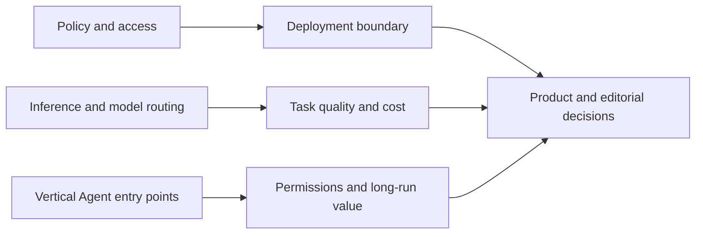

# AI Daily Brief · 2026-10-21

[English (current)](2026-10-21.md) · [中文](../../../daily/2026-10/2026-10-21.md)

- **Cutoff:** 2026-10-21 10:30 Asia/Shanghai; mainly checked disclosures after October 20, 10:30 against [yesterday's brief](2026-10-20.md). Date-only posts cannot establish an exact release hour.
- **Scope:** 10 high-signal items, including one formally published policy order surfaced as a catch-up. The 20–30 target does not justify low-evidence reposts. Google primary sources are overrepresented; several posts from one group do not provide independent corroboration.
- **Navigation:** [Trend tracker](../../../TRACKERS.md) · [Archive](../../INDEX.md).

## Key conclusions

1. **US federal AI procurement boundaries narrowed, but this is not a newly signed ban on all civilian use.** The DeepSeek order was signed in July, made public on October 19, and published on October 20. It addresses federal civilian agency procurement and IT systems, including third-party products developed using DeepSeek implementations; private use is not directly covered by this notice.
2. **Inference competition is shifting toward inspectable systems engineering.** DeepSeek published the DeepInfer offline inference framework, while llm-d released a Kubernetes distributed inference stack. They operate at different layers; neither code release nor vendor demo alone proves lower production cost.
3. **Agent entry points are becoming more vertical and contextual.** OpenAI acquired Orchestra Bio to add biopharma workflow coordination; Google is rolling out Gemini personalization first on Android Auto and introducing small-business tools. Permission boundaries, task completion, auditability, and reuse matter more than a one-off demo.
4. **Multi-model choice and sovereign deployment are enterprise variables.** Google Antigravity added Claude Opus/Sonnet 5.5, and GDC previewed Gemini search within an air-gapped environment. Cross-model review is not an independent benchmark, and deployment boundaries still need verification.
5. **No independently verifiable step-change in playable world models or AI gaming surfaced in this window.** Google Cloud's robotics simulation-to-deployment stack is a physical-AI toolchain, not a new playable game world model.

## Key developments

### 1. US formally publishes DeepSeek exclusion and removal order for federal civilian agencies

- **What happened:** A Department of Homeland Security notice excludes IT products and services developed by DeepSeek or affiliates from federal civilian procurements. It also directs removal from existing agency systems of DeepSeek products, affiliate products, and third-party products or services developed using DeepSeek implementations. The underlying order dates to July; the notice was filed for public inspection on October 19 and published on October 20. It was not newly signed that day and is not a universal ban on US private users.
- **Why it matters / lenses:** Product decisions, investment monitoring, editorial planning. Vendors serving US government should review model provenance, deployment, and contract language individually; private deployment cannot simply be inferred to be unlawful.
- **Published / source type / primary links:** October 20, 2026 formal publication (public October 19); [US Federal Register notice](https://www.govinfo.gov/content/pkg/FR-2026-10-20/html/2026-21447.htm) · [independent AP report](https://apnews.com/article/2bffa5b0131808735280b2c0e6f0d856).
- **Cross-check / confidence:** Official notice and AP independently corroborate the public event. High for scope and timeline; implementation exemptions, contract interpretation, and effects remain unverified.
- **Trend:** T06/T07 intensifying; watch supply-chain reviews and implementation guidance.

### 2. OpenAI acquires Orchestra Bio for biopharma workflow coordination

- **What happened:** OpenAI announced its acquisition of Orchestra Bio and plans to combine the company's drug-development coordination platform with Rosalind's life-sciences models and workbench. The proposed agents would help teams track studies, decisions, and next steps. No transaction price was disclosed.
- **Why it matters / lenses:** Product decisions, investment monitoring. Vertical agents could move from answering scientific questions into cross-team execution; faster drug development and treatment outcomes have not been independently demonstrated.
- **Published / source type / primary links:** October 20, 2026 (no hour stated); [OpenAI announcement](https://openai.com/index/openai-to-acquire-orchestra-bio/) · [Axios reporting](https://www.axios.com/2026/10/20/exclusive-openai-biotech-startup-drug-development).
- **Cross-check / confidence:** Company disclosure and independent reporting corroborate the transaction; results are future aims. High for the acquisition, unverified for integration and clinical-process outcomes.
- **Trend:** T01/T08 intensifying; watch institutional integration, audit trails, and R&D milestones.

### 3. DeepSeek publishes DeepInfer, currently centered on offline inference

- **What happened:** DeepSeek's GitHub repository offers DeepInfer source under Apache-2.0. Its README currently lists DeepSeek-V4.1-Flash, NVIDIA SM100, and Huawei Ascend 950 support, plus scheduling, parallelism, and structured outputs. It explicitly says a full online serving stack still needs components such as a KV-cache system and prefill/decode disaggregation.
- **Why it matters / lenses:** Product decisions, investment monitoring, technical context. Published inference code makes adaptation and deployment more inspectable, but is not a drop-in replacement for a commercial service or proof that vendor benchmarks generalize.
- **Published / source type / primary links:** October 20, 2026 (IT Home reported the official announcement at 17:05 Beijing time; exact initial code-publication time unconfirmed). [DeepSeek source repository](https://github.com/deepseek-ai/DeepInfer) · [IT Home reporting](https://www.ithome.com/1/015/429.htm).
- **Cross-check / confidence:** Official code and independent media corroborate the same-day announcement and license; performance is not independently reproduced. High for available code, scope, and announcement date; production cost unverified.
- **Trend:** T06 adds open inference engineering; keep separate from the October 18 model-weight release.

### 4. llm-d 1.0 releases a Kubernetes-native distributed inference stack across TPUs and GPUs

- **What happened:** Google Cloud announced llm-d 1.0 as an open-source, Kubernetes-native stack for multi-tenant inference orchestration, including cache-aware routing, tiered KV cache, and flow control. It says the PyTorch Conference demo served 1,000 agents through one endpoint. This cluster orchestration layer is distinct from DeepInfer's model inference engine.
- **Why it matters / lenses:** Product decisions, technical context. Long-context and bursty agent traffic require cache-hit, tail-latency, and isolation measurement, not only single-host tokens per second.
- **Published / source type / primary links:** October 20, 2026 (no hour stated); [Google Cloud announcement](https://cloud.google.com/blog/topics/ai-infrastructure/llm-d-1-0-an-open-source-stack-for-distributed-inference) · [llm-d project](https://github.com/llm-d/llm-d).
- **Cross-check / confidence:** Project code is inspectable; the 1,000-agent demo and efficiency claims come from participants without an independent matched-workload test. High for the 1.0 release; benefits remain unverified.
- **Trend:** T01/T06 intensifying; test production tail latency and cost per completed task.

### 5. Google Antigravity adds Claude Opus 5.5 and Sonnet 5.5

- **What happened:** Google Cloud says enterprise administrators can enable Anthropic's two Claude models in Antigravity 2.0, its CLI, and IDE extensions alongside Gemini models. The post recommends using different models for implementation and review; that is an engineering suggestion, not a measured outcome.
- **Why it matters / lenses:** Product decisions. Unified model routing and billing can reduce switching friction. Cross-model review may reduce shared blind spots but does not replace test suites or independent audit.
- **Published / source type / primary links:** October 20, 2026 (no hour stated); [Google Cloud announcement](https://cloud.google.com/blog/products/ai-machine-learning/claude-opus-55-and-claude-sonnet-55-available-in-antigravity).
- **Cross-check / confidence:** Single platform-owned source; no same-day Anthropic confirmation or independent availability test found. High for Google's announcement; region, plan, and task benefits unverified.
- **Trend:** T01 intensifying; measure multi-model cost, review accuracy, and access controls on identical tasks.

### 6. Gemini in-car personalization rolls out first on Android Auto; built-in cars follow later

- **What happened:** Google says Gemini is available globally in Android Auto and cars with Google built-in. Opt-in Personal Intelligence began rolling out on Android Auto on October 20; cars with Google built-in will follow in the coming months. It can draw on authorized email, photos, and calendar data. Eligibility currently covers some personal accounts aged 18+ globally, excluding the EEA, Switzerland, the UK, and Nigeria; Workspace business, enterprise, and education accounts are excluded.
- **Why it matters / lenses:** Product decisions, editorial planning. Driving is a hands-free interface, but distraction, revocable permissions, mistaken actions, and data minimization need evaluation.
- **Published / source type / primary links:** October 20, 2026 (no hour stated); [Google product announcement](https://blog.google/products-and-platforms/platforms/android/android-auto-cars-with-google-built-in-gemini-personal-intelligence/).
- **Cross-check / confidence:** One first-party source establishes the announcement and opt-in mechanism. Actual coverage and safety effects lack independent tests. High for announcement; unverified for reach and driving-task performance.
- **Trend:** T01/T08 intensifying; watch whether permissioned long-running tasks outperform ordinary voice assistants.

### 7. Gemini introduces a small-business entry point and brand workflows

- **What happened:** Google announced a small-business landing page, brand image styles, connected apps and Skills, and content templates. It says global rollout will occur over coming days; this does not mean every user has access now.
- **Why it matters / lenses:** Product decisions, investment monitoring. A vertical entry point packages a general model into repeatable workflows; value should be judged by reusable assets, human revision time, and paying retention.
- **Published / source type / primary links:** October 20, 2026 (no hour stated); [Google product announcement](https://blog.google/innovation-and-ai/products/gemini-app/new-tools-small-business-owners/).
- **Cross-check / confidence:** Single first-party source. Google's claim that tens of millions of small-business owners use Gemini has no independent matched definition here. High for feature announcement; rollout, adoption, and ROI unverified.
- **Trend:** T01/T08 intensifying; watch cross-session reuse of brand assets and task state.

### 8. Google Distributed Cloud previews Gemini enterprise search inside an air-gapped perimeter

- **What happened:** Google Cloud previewed Gemini enterprise search on air-gapped GDC for cited retrieval across documents, images, audio, and video, with persistent conversations inside a customer's physical security perimeter. Its claim of no public-internet or global-cloud connection is an architectural assertion, not an independent security audit.
- **Why it matters / lenses:** Product decisions, investment monitoring. Sovereign and sensitive-sector AI shifts the question toward data residency, permission mapping, and auditability; penetration tests, update paths, and citation accuracy remain essential.
- **Published / source type / primary links:** October 20, 2026 (no hour stated); [Google Cloud announcement](https://cloud.google.com/blog/topics/hybrid-cloud/managed-rag-search-inside-the-sovereign-perimeter-gemini-on-gdc-enterprise-search).
- **Cross-check / confidence:** Single vendor source; no third-party air-gapped deployment audit found. High for preview announcement; isolation, deployment cost, and retrieval quality unverified.
- **Trend:** T06/T07 intensifying; distinguish its risk model from public SaaS retrieval.

### 9. Google Cloud links robotics simulation, training, and deployment into a physical-AI stack

- **What happened:** Google Cloud published a stack combining NVIDIA Isaac Sim/Cosmos, MuJoCo Warp, Google compute, and data tools to connect robotic simulation, vision-language-action training, and deployment logs. The post does not release new world-model weights or provide independent robot task-success rates.
- **Why it matters / lenses:** Product decisions, technical context. Physical AI bottlenecks include data acquisition, sim-to-real transfer, and edge latency. This cloud toolchain should not be described as a playable AI-game world-model breakthrough.
- **Published / source type / primary links:** October 20, 2026 (no hour stated); [Google Cloud solution post](https://cloud.google.com/blog/topics/ai-infrastructure/scale-robotics-with-google-cloud-physical-ai-and-nvidia).
- **Cross-check / confidence:** Single vendor architecture post. Components exist separately, but end-to-end gains have not been independently validated. High for the post; long-horizon outcomes and cost unverified.
- **Trend:** T02 research continues; track robot world modeling separately from playable game worlds.

### 10. Terminal X uses a 54-criterion rubric for investment-agent outputs; results are a customer case

- **What happened:** OpenAI published a Terminal X case study: the firm encodes investment workflows into agents and uses an Eval Agent with a 54-criterion rubric. The article claims GPT-6.1 Sol detected about 25% more recommendations outside a fund's mandate than the comparator, and one customer reported $2.4 million in annualized savings. Comparator identity, sample, and net costs are not fully disclosed.
- **Why it matters / lenses:** Product decisions, investment monitoring. Auditable vertical-agent evaluation is closer to a production gate than sounding like a senior investor, but the case cannot be extrapolated to investment accuracy or returns.
- **Published / source type / primary links:** October 20, 2026 (no hour stated); [OpenAI customer case](https://openai.com/index/terminal-x/).
- **Cross-check / confidence:** Single vendor/customer account; no independent benchmark or financial audit. High for publication and its description; low to unverified for numerical gains and ROI.
- **Trend:** T01/T08 adds a test for codified task standards and traceable evaluation.

## Trend continuity and coverage limits

- **New / intensifying:** DeepInfer and llm-d make inference stacks more inspectable; Anthropic models entering Google's coding surface broaden enterprise model choice.
- **To verify:** Implementation of the DeepSeek federal order; Orchestra Bio integration; GDC air-gapped deployment; real reach of in-car and small-business features; all vendor performance and ROI claims.
- **No equivalent new evidence found:** No independently playable new world model or AI-game commercial result surfaced. Chinese and US coverage is not balanced, with a cluster of October 20 Google posts. Social-media buzz without a primary timeline, old model retrospectives, and unverified financing rumors were excluded.
