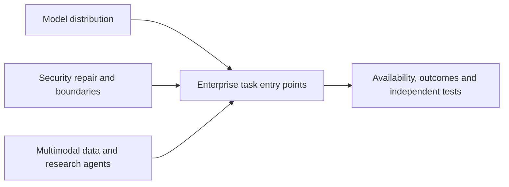

# AI Daily Brief · 2026-10-22

[English (current)](2026-10-22.md) · [中文](../../../daily/2026-10/2026-10-22.md)

- **Cutoff:** October 22, 2026, 10:30 Asia/Shanghai; primarily checked disclosures after October 21, 10:30 against [yesterday](2026-10-21.md). Date-only posts do not establish an exact publication hour.
- **Scope:** Nine high-signal items. The 20–30 target does not justify reposts from the same group or unevidenced viral claims. US vendor primary sources dominate; no comparably verified new Chinese model, AI game, or playable world model surfaced in this window.
- **Navigation:** [Trend tracker](../../../TRACKERS.md) · [Archive](../../INDEX.md).

## Key conclusions

1. **The OpenAI–Google Cloud distribution partnership changes enterprise procurement, but is not broadly available yet.** GPT-6 Astra, GPT-6.1 Sol, and GPT-6 Luna are in Model Garden private preview for selected enterprises; general availability and Antigravity integration are pending. The two partners confirm the agreement, not independent performance or data-boundary assurance.
2. **AI-assisted vulnerability research has entered a real upstream repair process.** PHP shipped fixes for two critical flaws, while OpenAI, Wiz, and Google described model-assisted discovery and response. The direct action for operators is to upgrade PHP, not rely on temporary mitigations.
3. **Agent security boundaries and monetization increasingly depend on systems outside the model.** NVIDIA OpenShell offers a sandbox/policy-control reference architecture; OpenAI described ad selection separated from answer generation. Both need independent security and user-experience validation.
4. **Multimodal data access may matter more to product teams than another standalone model release.** BigQuery ObjectRef is generally available for linking media and tabular fields in SQL workflows; authorization, versioning, and cost remain practical questions.
5. **Research agents now have a more concrete discovery workflow, but the results are leads awaiting experiments.** OpenAI, PerturbAI, and Scripps ran thousands of agents over mouse-brain cell data; a 32-minute analysis is not a treatment breakthrough.

## Key developments

### 1. OpenAI models enter Google Cloud Model Garden private preview

- **What happened:** The partners announced selected-enterprise private previews of GPT-6 Astra, GPT-6.1 Sol, and GPT-6 Luna on Google Cloud, with purchasing and API access; Codex CLI/Desktop can connect to the platform for inference. Broad availability is planned for coming weeks, while Gemini for business and Antigravity integrations are not yet live. Microsoft remains OpenAI's primary cloud partner.
- **Why it matters / lenses:** Product decisions, investment monitoring. Cloud-commitment drawdown, unified billing, and model routing can affect enterprise choice; test matched-task quality, price, regions, and data boundaries.
- **Published / type / sources:** October 21, 2026; both companies' announcements. [OpenAI](https://openai.com/index/openai-models-google-cloud/) · [Google Cloud](https://cloud.google.com/blog/products/ai-machine-learning/google-cloud-brings-openai-models-to-customers).
- **Cross-check / confidence:** The commercial partners corroborate the announcement but are aligned sources, not independent tests. High for partnership and private preview; performance, coverage, and isolation unverified.
- **Trend:** T01/T06 intensifying; multi-model platforms compete on procurement, governance, and cost per completed task.

### 2. PHP ships fixes for two critical flaws after AI-assisted discovery and coordination

- **What happened:** PHP's security team shipped patched versions 8.5.12, 8.4.27, 8.3.36, and 8.2.35 for CVE-2026-109618 and CVE-2026-109619 and urges web-serving deployments to upgrade. OpenAI says its model helped find a flaw; Wiz independently found and reported both; Google says Gemini aided research and patch validation. These accounts do not establish independently attributable priority for each model.
- **Why it matters / lenses:** Product decisions, technical context. Teams should inventory runtime versions and vendor backports; temporary defenses are not complete fixes. AI-assisted vulnerability research raises both defensive value and misuse risk.
- **Published / type / sources:** October 21, 2026 (PHP had scheduled 14:00 UTC); [PHP security advisory](https://www.php.net/archive/2026.php) · [OpenAI](https://openai.com/index/coordinated-disclosure-of-critical-vulnerabilities/) · [Wiz](https://www.wiz.io/blog/php2shell-php-rce) · [Google Cloud](https://cloud.google.com/blog/products/identity-security/responding-to-core-php-vulnerabilities-cve-2026-109618-cve-2026-109619).
- **Cross-check / confidence:** PHP's versions and multiple research disclosures are checkable; individual model contributions remain institutional claims. High for flaws and fixes; contribution shares and exposure scale unverified.
- **Trend:** T07 first major observed real-world repair case; watch patch adoption and known exploitation.

### 3. OpenAI describes ChatGPT ad selection and an annualized revenue run rate

- **What happened:** OpenAI says a separate post-trained LLM interprets intent across conversations and calls retrieval, ranking, and auction tools; ad selection and ChatGPT answer generation run in separate services. It reports a $1 billion annualized ad revenue run rate in under 200 days and more than 100,000 advertisers. That is not audited full-year revenue.
- **Why it matters / lenses:** Product decisions, editorial planning, investment monitoring. Conversational ads need state, sensitive-data filters, and clear sponsorship boundaries; user trust, answer independence, and commercial return require outside tests.
- **Published / type / source:** October 21, 2026, engineering post; [OpenAI](https://openai.com/index/building-chatgpt-ad-stack/).
- **Cross-check / confidence:** Single-vendor architecture and revenue claims; no independent code or financial audit found. High for publication and stated design; actual separation and revenue unverified.
- **Trend:** T08 intensifying; monetization moves from search-like requests toward multi-turn intent.

### 4. NVIDIA OpenShell reference architecture places Agent access controls outside the workload

- **What happened:** NVIDIA describes OpenShell's Gateway, Supervisor, Sandbox, and Policy Prover for lifecycle management, workload isolation, credential mediation outside the sandbox, and checking policy ceilings, and publishes code. Vera CPU and Sentry speed/blocking figures are vendor or partner measurements, separate from code availability.
- **Why it matters / lenses:** Product decisions, technical context. Long-running agents should not self-govern all permissions; test unauthorized-action blocking, false positives, audit logs, recovery, and runtime cost.
- **Published / type / sources:** October 21, 2026, technical blog and code; [NVIDIA architecture](https://developer.nvidia.com/blog/how-nvidia-openshell-reference-architecture-secures-and-governs-ai-agent-workloads-at-scale/) · [OpenShell repository](https://github.com/NVIDIA/OpenShell).
- **Cross-check / confidence:** Code is inspectable; performance and security lack independent matched-workload validation. High for architecture and code publication; production outcomes unverified.
- **Trend:** T01/T07 intensifying; permission enforcement moves from prompts to infrastructure.

### 5. BigQuery ObjectRef and multimodal analytics reach general availability

- **What happened:** Google Cloud says BigQuery ObjectRef and multimodal analytics are GA. Table rows can hold references to Cloud Storage images, video, audio, and documents alongside structured fields, pass them to Gemini in SQL queries, and track object versions.
- **Why it matters / lenses:** Product decisions, technical context. Joining media assets to business fields in one query flow can support content search and data products; object authorization, inference cost, version consistency, and query quality still need testing.
- **Published / type / source:** October 21, 2026, product announcement; [Google Cloud](https://cloud.google.com/blog/products/data-analytics/analyze-unstructured-data-in-bigquery-with-objectref).
- **Cross-check / confidence:** Single first-party platform source; no independent scale test found. High for GA status; cost and task quality unverified.
- **Trend:** T03 intensifying; multimodal production bottlenecks extend into governed data layers.

### 6. Thousands of research agents analyze mouse-brain data and propose testable leads

- **What happened:** OpenAI, PerturbAI, and Scripps Research report using thousands of GPT-Rosalind agents to examine gene-perturbation data from millions of mouse-brain cells. They say the agents created a gene–cell-effect–literature atlas in 32 minutes and blinded experts assessed some leads. Experimental validation remains necessary; these are not discovered treatments.
- **Why it matters / lenses:** Product decisions, technical context. The reusable workflow is task partitioning, literature retrieval, synthesis, and expert review; test reproducibility, spurious links, and downstream experiment cost.
- **Published / type / sources:** October 21, 2026 collaborative announcement; the preprint was posted October 16, so this is additional disclosure rather than the paper's debut. [OpenAI research post](https://openai.com/index/scaling-ai-research-for-complex-biological-data/) · [bioRxiv preprint](https://www.biorxiv.org/content/10.64898/2026.10.15.759436v1).
- **Cross-check / confidence:** Partners in one project, with no external independent replication found. High for research publication; biological mechanisms and clinical relevance unverified.
- **Trend:** T01/T08 intensifying; follows yesterday's Orchestra Bio workflow acquisition.

### 7. Confidential G4 GPUs become GA, but environment-level assurance still needs audit

- **What happened:** Google Cloud says Confidential G4 instances with NVIDIA RTX PRO 6000 Blackwell Server Edition GPUs are GA in 36 zones on Compute Engine and GKE. Confidential Space support is planned to reach GA in coming weeks. Remote attestation and memory encryption are vendor architectural claims.
- **Why it matters / lenses:** Product decisions, investment monitoring. Protection of model weights and inference data while in use becomes a compute-buying dimension; validate threat model, deployment scope, attestation chain, and performance overhead.
- **Published / type / source:** October 21, 2026, product announcement; [Google Cloud](https://cloud.google.com/blog/topics/ai-infrastructure/confidential-g4-gpus-are-ga).
- **Cross-check / confidence:** Single vendor; no full independent security audit found. High for GA and stated scope; specific assurance and cost unverified.
- **Trend:** T06/T07 intensifying; distinct from yesterday's air-gapped search deployment boundary.

### 8. ZenteiQ reports llm-d/GKE batch throughput gains in a customer test

- **What happened:** A ZenteiQ–Google Cloud co-authored case says GKE Inference Gateway raised aggregate throughput 4.07× in a scientific-model synthetic-data pipeline, from 1.47 to 5.97 billion daily generated tokens per 1,000 accelerators. Full hardware, workload, and cost details sufficient for independent reproduction were not disclosed.
- **Why it matters / lenses:** Product decisions, investment monitoring. This adds customer-workload numbers after yesterday's llm-d 1.0 announcement, but batch throughput does not establish online Agent latency or profit per completed task.
- **Published / type / source:** October 21, 2026, customer/vendor case; [Google Cloud](https://cloud.google.com/blog/products/containers-kubernetes/zenteiq-scales-physical-ai-inference-4x-with-gke-and-llm-d).
- **Cross-check / confidence:** Customer and platform are partners; no independent replication. High for case publication; transferable gains unverified.
- **Trend:** T06 intensifying; next compare tail latency and total cost at matched quality and hardware.

### 9. OpenAI proposes a cyber-defense governance blueprint, not enacted rules

- **What happened:** OpenAI published a policy blueprint proposing clearer safety duties for frontier models and agents, tools and training for defenders, and stronger public evaluations and incident reporting. This is a company proposal, not effective regulation; citing its own safety experience does not establish the framework's impact.
- **Why it matters / lenses:** Product decisions, editorial planning. Beyond patching shared software, the sector needs actionable accountability and independent assessment. As the proponent is a model supplier, concentration of authority and auditability are relevant counterarguments.
- **Published / type / source:** October 21, 2026, company policy opinion; [OpenAI](https://openai.com/index/empowering-cyber-defenders/).
- **Cross-check / confidence:** Publication and position are confirmed; policy merits are opinion, with no independent effectiveness evidence. High for text existence; adoption and outcomes unverified.
- **Trend:** T07 adds a governance viewpoint; keep distinct from the shipped PHP fixes.

## Continuing trends and coverage gaps

- **First appearance/intensifying:** OpenAI models enter Google Cloud private preview; PHP fixes show AI-assisted security research in an upstream repair; conversational ads and Agent controls become more system-level.
- **Shipped versus pending:** PHP fixes, ObjectRef, and Confidential G4 shipped; Google Cloud model access is still private preview. Vendor security, performance, revenue, and scientific-mechanism claims need independent verification.
- **Counterevidence/gaps:** No comparably verified Chinese model, AI-game, or playable-world-model advance surfaced this window; absence in collection is not evidence of stagnation. NVIDIA's RFD4-Proteina article calls it an “open model” but also says model weights require private repository access, so this brief does not count it as a fully available open-weight release.

> Research information only, not investment, medical, legal, or security-operations advice. Check primary sources and your environment before consequential decisions.
