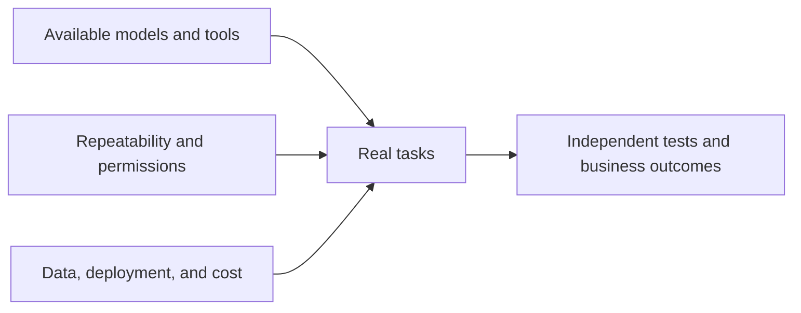

# AI Industry Briefing · 2026-10-23

[English (current)](2026-10-23.md) · [中文](../../../daily/2026-10/2026-10-23.md)

- **Cutoff:** 2026-10-23 10:30 Asia/Shanghai. We checked disclosures after the October 22 cutoff and de-duplicated against [yesterday](2026-10-22.md). A date-only source does not establish its precise publication time.
- **Scope:** Ten high-signal items, including two explicitly dated catch-ups. An executive forecast is distinguished from a shipped product, and vendor benchmarks from independent testing. We did not pad the list to the usual 20–30 with unverified claims.
- **Navigation:** [Trend tracker](../../../TRACKERS.md) · [Archive index](../../INDEX.md).

## Key conclusions

1. **Getting a task right once and completing it reliably are different agent metrics.** OpenAI's Decisions API reached general availability; Microsoft and Hugging Face's ThinkingBox training uses final database state as an RL reward. The number of tasks passed in all 20 repetitions rose from 38 to 107, but the number passed at least once fell. Production acceptance should examine latency, average success, repeatability, and unauthorized behavior together.
2. **Multimodal infrastructure is specializing in retrieval and geospatial data.** NVIDIA released Nemotron 3.5 document-retrieval/parsing weights; Ai2 released OlmoEarth v1.3 and precomputed global satellite embeddings. Publisher benchmarks do not automatically transfer to a team's Chinese-language documents or geospatial tasks.
3. **A catch-up corrects our world-model coverage.** Cosmos3-H-Dreams, released on October 20 with code and weights, generates action-conditioned surgical video; the previous two editions missed it. It is a research simulator, not a playable AI game, and lacks clinical or biomechanical validation.
4. **Enterprise agent deployment is not evidence of impact.** Uber says it is rolling out ChatGPT Work to more than 30,000 employees, while an Australian SME report estimates the potential economic value of broad AI adoption. The former provides no actual productivity results; the latter is a scenario estimate, not realized revenue.
5. **An optimistic physical-AI timeline remains an opinion.** Unitree founder Wang Xingxing expects a possible breakthrough within one to three years and sees commercial services preceding home and industrial uses. His rationale and market position warrant tracking, but independent long-horizon task data does not establish that inflection point.

## Developments

### 1. OpenAI Decisions API moves from limited preview to general availability

- **What happened:** Built on GPT-6 Luna, Decisions API accepts text, images, and JSON and returns probabilities, predefined choices, or scores. It supports up to 400 questions per request and adds native GPT-Live integration, prompt caching, and US/EU inference residency. OpenAI claims up to 10× the speed of calling Luna via Responses API; Box and Datadog figures are customer measurements in their own settings.
- **Why it matters / lens:** Product decisions; editorial planning. Small routing or risk decisions in agents could be separated from main-model calls. Test misclassification, tail latency, and failure costs on the same workload—not speed alone.
- **Publication / type / primary source:** 2026-10-22; product announcement; [OpenAI](https://openai.com/index/decisions-api/).
- **Cross-check / confidence:** The official announcement establishes availability and features; speed and customer benefits have no independent same-workload replication. High for release status; pending validation for performance and business impact.
- **Trend:** T01/T04, shipped; limited preview has advanced to general availability.

### 2. ThinkingBox uses final database state to reward agent training

- **What happened:** A joint Microsoft/Hugging Face post publishes ThinkingBox-Training code and rewards training tasks against their actual final database state. After 50 GRPO steps on Qwen3.8-27B, the team reports average success rising from 51.70% to 60.78% across 507 held-out tasks; tasks passed in all 20 trials rose from 38 to 107. Tasks passed at least once fell from 453 to 446.
- **Why it matters / lens:** Product decisions; technical context. Final state is closer to business acceptance than an agent's claim of completion. Improved repeatability can trade off against task coverage; retest with real permissions and failure paths.
- **Publication / type / primary source:** 2026-10-22; joint technical report and code; [Microsoft/Hugging Face](https://huggingface.co/blog/microsoft/thinkingbox-training).
- **Cross-check / confidence:** Code and setup are inspectable, but the research team reports the scores and no outside replication is established. High for the published method; pending validation for scores and transfer.
- **Trend:** T01, intensifying; attention shifts from one-shot pass@1 to repeated success and final state.

### 3. NVIDIA releases Nemotron 3.5 embedding, reranking, and parsing weights

- **What happened:** NVIDIA posted model pages for Nemotron 3.5 Embed 8B/1B, Rerank 8B, and Parse 631M on Hugging Face, covering visual-text retrieval, candidate reranking, and document structure extraction, with multiple precision variants. Its article cites ViDoRe v3.1, ParseBench, and customer tests; samples, hardware, and comparators limit those results.
- **Why it matters / lens:** Product decisions; technical context. Evidence retrieval may affect agent cost and completion more than enlarging the main model. Compare recall, citation accuracy, latency, and license on mixed Chinese-language documents.
- **Publication / type / primary sources:** 2026-10-21 (catch-up); company community technical post and model card; [NVIDIA/Hugging Face overview](https://huggingface.co/blog/nvidia/nemotron-retriever-world-class-agentic-retrieval) · [Embed 8B model card](https://huggingface.co/nvidia/Nemotron-3.5-Embed-8B-BF16).
- **Cross-check / confidence:** The open weights and cards can be inspected; vendor benchmark and partner claims are not independent tests. High for available assets; pending validation on target corpora.
- **Trend:** T03/T06, intensifying; multimodal retrieval is becoming a specialized layer.

### 4. Cosmos3-H-Dreams surgical-robotics world model was released October 20

- **What happened:** NVIDIA released weights, code, and a research demonstration for its action-conditioned surgical-video model Cosmos3-H-Dreams. Given endoscopic imagery and dual-arm actions, it generates subsequent frames for a cholecystectomy setting; four-step and two-step denoising student variants are described. NVIDIA claims real-time interaction on one RTX PRO 6000. The model card confirms an October 20 release missed by the previous two editions.
- **Why it matters / lens:** Product decisions; technical context; editorial planning. This models environment dynamics; it is neither a game-development tool nor a playable world. Visual plausibility does not prove tissue mechanics, and the model is not clinically certified.
- **Publication / type / primary sources:** 2026-10-20 (retrospective catch-up); NVIDIA technical post, code, and model card; [technical overview](https://huggingface.co/blog/nvidia/cosmos3-h-dreams) · [model card](https://huggingface.co/nvidia/Cosmos3-H-Dreams).
- **Cross-check / confidence:** Code, weights, and date are inspectable. Real-time performance and physical fidelity lack independent replication; NVIDIA says it is not for patient care. High for release and scope; pending validation for long-horizon consistency and biomechanics.
- **Trend:** T02, collection gap corrected; world models are branching into specialized simulation, with no equivalent newly shipped AI-game product here.

### 5. IBM releases Granite Speech 5.0 and updates two speech models

- **What happened:** IBM's Granite team released Granite Speech 5.0 2B and updated 470M Turbo CTC and Granite Speech 4.1 2B Plus. They address multilingual transcription/translation, low-latency transcription, and speaker attribution respectively. The 2B model card is available under Apache 2.0; speed and error-rate claims are team measurements on specified test sets.
- **Why it matters / lens:** Product decisions; technical context. Speech workflows need separate acceptance tests for Chinese/English code-switching, noise, proper nouns, speaker timestamps, and device cost. English short-utterance WER does not predict every language's experience.
- **Publication / type / primary sources:** 2026-10-21 (catch-up); IBM community release and model card; [Granite team post](https://huggingface.co/blog/ibm-granite/granite-speech-5) · [2B model card](https://huggingface.co/ibm-granite/granite-speech-5.0-2b).
- **Cross-check / confidence:** Weights and license can be checked; target-setting performance has not been independently tested here. High for delivery; pending validation for multilingual, noisy, and on-device use.
- **Trend:** T03/T04, another production speech option; do not conflate it with a general chat model.

### 6. Uber announces ChatGPT Work rollout to over 30,000 staff

- **What happened:** Uber and OpenAI say they will expand ChatGPT Work from a 1,000-person pilot to over 30,000 employees worldwide, with Drive, Gmail, Calendar, and Slack connections plus an internal Skills library and training. The announcement does not publish pilot task-completion rates, hours saved, or company-wide ROI.
- **Why it matters / lens:** Product decisions; investment monitoring. Enterprise-agent expansion depends on permissions, internal knowledge, training, and auditability. Seat coverage does not establish daily use or productivity gain.
- **Publication / type / primary source:** 2026-10-22; partnership announcement; [OpenAI/Uber announcement](https://openai.com/index/uber-chatgpt-work-rollout/).
- **Cross-check / confidence:** Both parties share one commercial announcement; actual adoption and results remain undisclosed. High for rollout plan; pending validation for usage and ROI.
- **Trend:** T01/T08, intensifying; a large enterprise moves from pilot to broad access.

### 7. Australian SME report estimates A$93 billion in potential annual AI value

- **What happened:** The Tech Council of Australia, with Google and other partners, estimates that broader SME AI adoption over five years could add up to A$93 billion in annual economic value; the potential annual productivity value for an average broadly adopting SME is around A$136,000. These are modeled estimates, not realized output; Google is also a report partner.
- **Why it matters / lens:** Investment monitoring; background knowledge; product decisions. The adoption-to-potential gap may create opportunities in training, workflow redesign, and measurement, but a macro scenario is not direct evidence for product pricing or addressable market.
- **Publication / type / primary sources:** 2026-10-22; industry research report; [Tech Council research and download](https://techcouncil.com.au/research/) · [Google summary](https://blog.google/intl/en-au/company-news/ai-could-add-93-billion-to-australian-small-businesses/).
- **Cross-check / confidence:** The report and estimate can be located; a partner's summary is not independent validation. We did not review the full 18 MB report methodology this run. High for publication; medium/pending validation for the economic estimate.
- **Trend:** T08, intensifying; next evidence should be longitudinal measured net benefits.

### 8. Unitree founder forecasts a possible physical-AI inflection in one to three years

- **What happened:** At an October 22 event in Hangzhou, Unitree founder Wang Xingxing said physical AI may break through in roughly one to three years. He identified aligning model inputs/outputs with physical robots as a central challenge and suggested commercial services could precede home and industrial adoption. These are reports of his speech, not a newly released general-purpose robot model.
- **Why it matters / lens:** Product decisions; investment monitoring; editorial planning. Track controlled-setting tasks, hardware scaling, and service unit economics. Counterpoints include unproven long-horizon reliability, generalization to messy settings, safety certification, and maintenance cost.
- **Publication / type / original reports:** 2026-10-22; executive opinion/event coverage; [The Paper](https://www.thepaper.cn/newsDetail_forward_34306053) · [21st Century Business Herald](https://m.21jingji.com/article/20261022/herald/4e992c2e926a4dcb1c1cca152ef1b0ad_zaker.html).
- **Cross-check / confidence:** Two outlets corroborate the speech and date; the timeline is still an interested executive's forecast, unsupported by independent task testing. High that the remarks were made; pending validation for timing and deployment order.
- **Trend:** T02/T06, opinion gaining attention; not evidence of shipped capability.

### 9. Ai2 publishes OlmoEarth v1.3 and global satellite embeddings

- **What happened:** Ai2 released the OlmoEarth v1.3 model, code, data, annual precomputed global embeddings for 10-meter satellite imagery, and a browser explorer. The team says its 128-dimensional version leads on 20 of 27 evaluations; that is a publisher benchmark, not independent application impact.
- **Why it matters / lens:** Product decisions; background knowledge. Precomputed features may lower the modeling barrier for change detection, small-field crops, and disaster analysis. Check regional bias, freshness, ground truth, and retraining cost.
- **Publication / type / primary sources:** 2026-10-22; research release and model card; [Ai2/Hugging Face post](https://huggingface.co/blog/allenai/olmoearth-v1-3) · [model card](https://huggingface.co/allenai/OlmoEarth-v1_3-Base).
- **Cross-check / confidence:** Assets are inspectable; the reported ranking was not independently reproduced this run. High for release; pending validation for regional and task benefit.
- **Trend:** T03, expanding multimodal infrastructure; this is an Earth-observation embedding model, not a playable world model.

### 10. Google and Voltus announce an expanded 1 GW virtual-power-plant plan

- **What happened:** Google says it expanded its Voltus agreement to aggregate controllable home and business loads in the US PJM grid region, targeting 1 GW versus an earlier 100 MW arrangement. The announcement is a procurement/development plan; it does not report 1 GW of delivered dispatchable capacity or net data-center emissions savings.
- **Why it matters / lens:** Investment monitoring; background knowledge. Power constraints are pushing cloud providers toward distributed flexibility. Verify contracted capacity, peak-hour delivery, metering, and grid incentives; a target capacity is not delivered compute.
- **Publication / type / primary source:** 2026-10-22; company announcement; [Google](https://blog.google/innovation-and-ai/infrastructure-and-cloud/global-network/virtual-power-plant-1-gigawatt/).
- **Cross-check / confidence:** A single-party announcement; no independent utility or Voltus delivery data found. High for the announced agreement; pending validation for deployment and outcomes.
- **Trend:** T06, intensifying; AI infrastructure depends on electricity and dispatch as well as chips.

## Continuing signals and coverage gaps

- **First seen/shipped:** Decisions API reached general availability; ThinkingBox training code, Nemotron retrieval weights, Granite Speech weights, and OlmoEarth data are available. Their task-level benefits still need independent testing.
- **Catch-up/correction:** Cosmos3-H-Dreams shipped on October 20 and was omitted in the prior two editions. This corrects collection completeness; it is not an October 22 model debut or commercial AI-game breakthrough.
- **Unverified/counterpoints:** Uber's broad access versus real usage, Australian economic potential, Unitree's timeline, and Google's virtual-power-plant delivery all lack outcome evidence. Visual coherence in a world model does not establish physical fidelity. We found no new playable AI-game world-model product this period.

> This repository provides industry research, not investment, medical, legal, or clinical advice. Verify primary sources and applicable conditions before consequential decisions.
