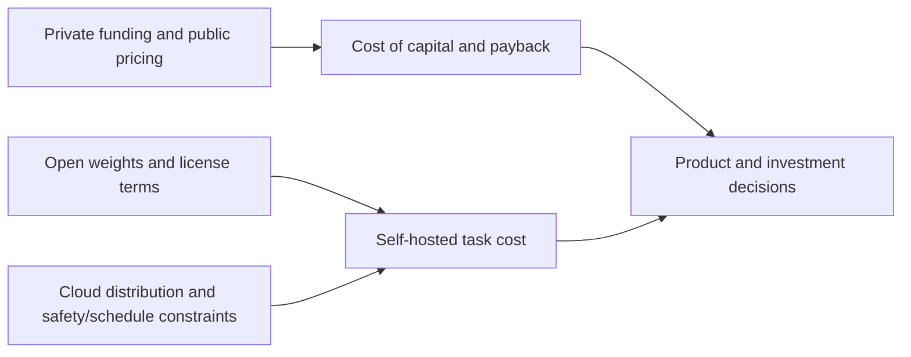

# AI Industry Briefing · 2026-10-24

[English (current)](2026-10-24.md) · [中文](../../../daily/2026-10/2026-10-24.md)

- **Cutoff:** 2026-10-23 21:30 Asia/Shanghai. This is an early edition for October 24 covering disclosures after the October 23 10:30 cutoff. The October 24 morning window will be covered by the next edition; catch-ups from October 22–23 retain their original dates.
- **Scope:** Eight high-signal items, four of them explicitly dated catch-ups. Capital, public-market pricing, and product delivery are kept separate. Funding figures, vendor benchmarks, and user numbers are as disclosed, not independently verified.
- **Navigation:** [Trend tracker](../../../TRACKERS.md) · [Archive index](../../INDEX.md).

## Key conclusions

1. **Private capital and public markets are sending opposite signals.** OpenAI is reported to be raising up to $30 billion at a pre-money valuation of about $1.25 trillion, while the Nasdaq fell 2.60%, the Philadelphia Semiconductor Index fell 6.7%, and Meta recorded its first net cash outflow in more than a decade because of AI spending. A private mark is not a realized return, and a public selloff does not prove that AI demand has disappeared; both point to the cost of capital and the payback period as the acceptance test.
2. **Open-weight competition has shifted from whether weights ship to the license terms.** MiniMax M3.1 Flash's 428B-total-parameter weights are downloadable, but under a community license: commercial use requires attribution and notice, and annual revenue above $20 million requires prior written authorization. These are open weights, not open source in the OSI sense; teams must check attribution, redistribution, and the revenue threshold before deployment.
3. **Model distribution is consolidating, even as choice becomes cross-vendor.** Google Cloud is formally offering OpenAI frontier models and Codex to enterprises, purchasable through Marketplace and drawable against GCP commitments. Procurement and governance are converging on one cloud account. Listing does not mean every region and plan is available; SLA, pricing, and data boundaries still need item-by-item checks.
4. **Application-layer capital is still accelerating, but funding and retention are different things.** NVIDIA and TCV joined an extension to Higgsfield's Series B, and Robinhood Ventures invested $10 million in Cognition. Strategic capital can bring compute, distribution, and credibility; it does not replace paid retention, gross margin, or cost per completed task.
5. **Physical-infrastructure constraints are concrete.** A fatal accident at TSMC's Kaohsiung Fab 22 site killed four workers and triggered a construction halt and investigation. Advanced-node expansion is highly sensitive to construction safety, permits, and schedules, but no public capacity or ramp-date impact has been disclosed, so a chip-price increase cannot be inferred directly.

## Developments

### 1. OpenAI reported to raise up to $30 billion at a $1.25 trillion pre-money valuation

- **What happened:** Multiple outlets, citing people familiar with the matter, say OpenAI is nearing a round of up to $30 billion at a pre-money valuation of about $1.25 trillion, co-led by Coatue and investors from the UAE. Reports also link part of the arrangement to additional compute access. The figure is down from a reported $1.4 trillion a month earlier. OpenAI has not publicly confirmed the amount, valuation, or investors.
- **Why it matters / lens:** Investment monitoring; product decisions. If completed, the deal is more than a financial transaction: it binds equity, compute, and energy into an infrastructure arrangement. Valuation is not revenue or profit; track actual cash received, compute delivery, dilution, and the listing timetable.
- **Publication / type / primary sources:** 2026-10-22 to 10-23; media reports citing unnamed sources; [CNBC](https://www.cnbc.com/2026/10/22/openai-funding-round-uae-investors.html) · [The Paper reprint](https://www.thepaper.cn/newsdetail_forward_34315469).
- **Cross-check / confidence:** CNBC and Chinese-language outlets both cite unnamed sources; OpenAI has not confirmed. Amount, valuation, and leads may change. Medium for the reported transaction; pending validation for final terms and closing.
- **Trend:** T06, capital intensification; sovereign compute and equity are becoming linked.

### 2. US AI trade sells off: Nasdaq -2.60%, semiconductor index -6.7%

- **What happened:** At the October 22 US close, the Nasdaq fell 2.60% to 26,008.86, the S&P 500 fell 1.21% to 7,663.43, and the Dow rose 0.02%. The Philadelphia Semiconductor Index fell 6.7% and is more than 26% below its June 22 record close. Meta fell 7% after recording its first net cash outflow in more than a decade tied to AI spending and announcing a two-for-one split with non-voting shares; Tesla fell 3.1%.
- **Why it matters / lens:** Investment monitoring; technical context. Markets are repricing the payback period for AI capital expenditure, not simply rejecting AI demand. This tightens financing conditions for high-valuation companies and affects cloud capex guidance, debt financing, and supply-chain orders. Distinguish index moves, company fundamentals, and analyst attribution.
- **Publication / type / primary source:** 2026-10-23 (October 22 US close); wire-service market report; [Reuters reprint](https://profit.pakistantoday.com.pk/2026/10/23/nasdaq-plunges-26percent-sandp-500-falls-121percent-as-ai-spending-concerns-trigger-tech-selloff).
- **Cross-check / confidence:** One wire service's market data; index and single-stock moves can be checked against exchange prices. The explanation for the decline comes from analysts and is not causal proof. High for prices; medium for attribution.
- **Trend:** T06/T08, public-market scrutiny of AI spending returns intensifies.

### 3. MiniMax M3.1 Flash releases 428B-parameter open weights under a community license

- **What happened:** On October 23, Hugging Face listed MiniMax-M3.1-Flash weights: a native multimodal MoE with about 428B total parameters and 23B activated, supporting up to a 1-million-token context and including a DSpark speculative-decoding head. The MiniMax Community License makes non-commercial use free; commercial use must prominently display "Built with MiniMax M3.1-Flash" and send a one-time notice, and annual revenue above $20 million requires prior written authorization. The model card self-reports BankerToolBench 76.2, DeepSWE v1.1 73.7%, OSWorld V2 61.7, and other scores; Chinese media say it processed more than 100 trillion tokens in its first 72 hours.
- **Why it matters / lens:** Product decisions; technical context. The earlier promise to release weights later has been delivered, adding a self-hostable option for agents, coding, and computer use. But the license is not OSI open source; attribution, notice, and the revenue threshold affect commercial distribution and retraining. Benchmarks and throughput are vendor/media claims and need replication on your own tasks.
- **Publication / type / primary sources:** 2026-10-23; model card and license; [Hugging Face model card](https://huggingface.co/MiniMaxAI/MiniMax-M3.1-Flash) · [full license](https://huggingface.co/MiniMaxAI/MiniMax-M3.1-Flash/blob/main/LICENSE).
- **Cross-check / confidence:** Weights, parameter count, context, and license terms are inspectable; performance and the 100-trillion-token claim have no independent replication. High for delivery and license; pending validation for task performance, throughput, and enforcement.
- **Trend:** T01/T03/T06, open-weight competition shifts from API pricing to license terms.

### 4. Google Cloud formally offers OpenAI models and Codex to enterprises

- **What happened:** OpenAI announced on October 21 that it is partnering with Google Cloud to bring its frontier models and Codex agentic workflows into Model Garden. Google said on October 22 that the models are now formally available to enterprise customers. Customers can buy through Google Cloud Marketplace and draw down existing GCP commitments; OpenAI models will also come to Antigravity and Gemini Agent (announced, not yet broadly available). Our previous edition recorded the partnership as a private preview.
- **Why it matters / lens:** Product decisions; investment monitoring. Enterprises can procure, govern, and audit multiple model families within one cloud account, further cross-vendorizing model choice. Region coverage, model list, pricing, SLA, and data residency still need item-by-item checks; a listing is not proof that every customer can use it in production.
- **Publication / type / primary sources:** 2026-10-21/22; joint announcements; [OpenAI](https://openai.com/index/openai-models-google-cloud/) · [Google Cloud (Chinese)](https://blog.google/intl/zh-tw/products/cloud/google_cloud_brings_openai_models_to_customers/).
- **Cross-check / confidence:** The two companies' announcements corroborate the partnership and listing; there is no third-party availability or performance test. High for the partnership and commercial path; pending validation for coverage and actual experience.
- **Trend:** T01/T06, distribution-layer competition intensifies; private preview becomes formal availability.

### 5. Goldman Sachs commits $500 million to a small-business AI institute

- **What happened:** On October 22, Goldman Sachs announced a $500 million commitment to launch the Small Business AI Institute and expand 10,000 Small Businesses. Anthropic, Google, Meta, and OpenAI will each contribute courses, tools, or research. Nearly 20,000 entrepreneurs have completed the program since 2010 under a prior $1.25 billion commitment. CEO David Solomon said at the launch that there is "very little that we do where we need frontier models," and that frontier models mainly matter for cybersecurity, defense, and health care.
- **Why it matters / lens:** Product decisions; investment monitoring. The small-business bottleneck looks more like training, workflow redesign, and trust than the model capability ceiling. Participation by four model companies is a distribution signal, not evidence of course completion or revenue gains.
- **Publication / type / primary sources:** 2026-10-22; company announcement and on-site report; [Goldman Sachs release](https://www.goldmansachs.com/pressroom/press-releases/2026/goldman-sachs-commits-500-million-to-launch-small-business-ai-institute) · [Fortune](https://fortune.com/2026/10/23/david-solomon-frontier-models-not-needed-small-business/).
- **Cross-check / confidence:** The release and Fortune's on-site report corroborate the amount, partners, and quote; completion rates, retention, and revenue impact are not disclosed. High for the commitment and quote; pending validation for adoption and outcomes.
- **Trend:** T08, adoption and proof of value remain separate.

### 6. Fatal accident at TSMC's Kaohsiung Fab 22 halts steel construction

- **What happened:** On October 20, four workers fell from height at TSMC's Fab 22 construction site in Kaohsiung; three died initially and the fourth died later, with a preliminary investigation pointing to a failed bolt on an outer connecting plate of the steel structure. The Southern Taiwan Science Park Bureau ordered work halted and the site preserved. TSMC said the work fell within the contractor's scope and that the project had been voluntarily suspended; Taiwanese media reported that steel-structure work at new fabs across Taiwan was temporarily halted pending checks. Fab 22 is a 2nm site.
- **Why it matters / lens:** Investment monitoring; technical context. Advanced-node expansion is constrained not only by tools and power but by construction safety, permits, and schedules. The accident is a real delivery risk, but no public capacity loss or ramp-date change has been disclosed, so higher chip prices or shortages cannot be inferred directly.
- **Publication / type / primary sources:** 2026-10-20/21; official statements and media reports; [Xinhua](https://english.news.cn/20261020/ca367e2ebdce4f35bb058b06cfa39272/c.html) · [TaiSounds](http://dev.taisounds.news/news/content/76/295291).
- **Cross-check / confidence:** Xinhua and Taiwanese media corroborate the deaths, site, and halt; the cause and schedule impact remain under investigation. High for the accident and halt; pending validation for capacity and timing.
- **Trend:** T06, compute supply is constrained by construction, power, and safety.

### 7. NVIDIA and TCV invest in AI video company Higgsfield

- **What happened:** Bloomberg reported on October 23 that NVIDIA and TCV participated in an extension of Higgsfield's Series B; the amount was not disclosed. The company raised a $400 million Series B in August led by DST Global, with Goldman Sachs Alternatives, Tribe Capital, Intel Capital, and others participating. The Astana Times reported annualized revenue of about $700 million and more than 30 million users. NVIDIA CEO Jensen Huang explained the investment during a visit to Kazakhstan, emphasizing the team rather than only the product.
- **Why it matters / lens:** Product decisions; investment monitoring. AI video already generates revenue in advertising, marketing, and creative production, and strategic investment may bring compute, distribution, and international market access. But the amount and valuation are undisclosed, revenue and user figures are company claims, and paid retention, gross margin, and cost per generated asset still need verification.
- **Publication / type / primary sources:** 2026-10-23; Bloomberg report and company background; [Bloomberg](https://www.bloomberg.com/news/articles/2026-10-23/nvidia-tcv-invest-in-ai-video-startup-higgsfield-in-series-b-extension) · [Astana Times](https://astanatimes.com/2026/10/nvidia-backs-ai-startup-higgsfield-as-huang-visits-kazakhstan/).
- **Cross-check / confidence:** Bloomberg and the Astana Times corroborate the investment and Series B background; users, revenue, and valuation are not independently audited. High for the investment; pending validation for amount, valuation, retention, and margin.
- **Trend:** T03/T06, video production meets strategic capital.

### 8. Robinhood Ventures invests $10 million in Cognition

- **What happened:** Fortune reported on October 23 that Robinhood Ventures invested $10 million in AI coding company Cognition as part of its September Series E, which raised more than $2 billion at a $48 billion valuation; this is the first public disclosure of Robinhood's participation. Cognition says annualized revenue is approaching $900 million, up from $492 million in May. Robinhood previously invested $75 million in OpenAI in April.
- **Why it matters / lens:** Investment monitoring; product decisions. AI coding is a multi-player race, with capital and distribution backing several competitors. A $10 million check is a financial participation; it does not validate Cognition's retention, gross margin, or $48 billion valuation, and Robinhood backing multiple companies does not identify a winner.
- **Publication / type / primary source:** 2026-10-23; Fortune exclusive; [Fortune](https://fortune.com/2026/10/23/exclusive-robinhood-bets-10-million-ai-coding-tool-maker-cognition/).
- **Cross-check / confidence:** Fortune exclusive; Cognition and Robinhood issued no separate announcement; revenue is the company's earlier disclosure. Medium for the exclusive; pending validation for returns, retention, and valuation.
- **Trend:** T01/T06, capital competition in AI coding continues.

## Tracking and coverage gaps

- **Shipped/first:** MiniMax M3.1 Flash weights and license are downloadable; Google Cloud formally offers OpenAI models; Goldman Sachs announced its $500 million commitment; NVIDIA/TCV and Robinhood have made their investments. Task performance, retention, and returns remain unverified.
- **Catch-ups/corrections:** This edition adds the October 22 US market close, Google Cloud's formal availability, Goldman's announcement, and TSMC's October 20 accident, none of which the previous 10:30 cutoff covered. Catch-ups do not change the original dates.
- **Pending/opposing:** OpenAI has not confirmed the funding terms; the causal attribution for the selloff remains analyst judgment; MiniMax benchmarks and the 100-trillion-token claim, Higgsfield's revenue and users, and Cognition's valuation lack independent audits; TSMC has not disclosed capacity impact. There was no comparable new world-model or playable AI-game delivery; funding or video generation is not substituted for playability evidence.

> Research information only; not investment, medical, legal, or clinical advice. Check primary sources and applicable conditions before consequential decisions.
