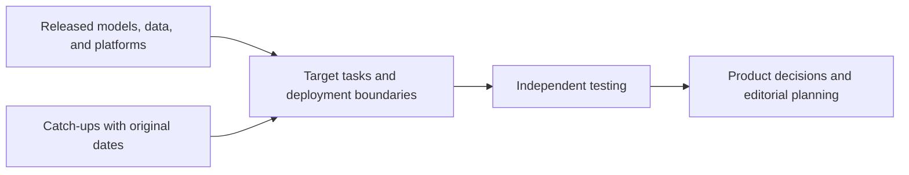

# AI Industry Briefing · 2026-10-25

[English (current)](2026-10-25.md) · [中文](../../../daily/2026-10/2026-10-25.md)

- **Cutoff:** 2026-10-25 21:00 Asia/Shanghai. We checked Chinese and English primary sources since the [early October 24 edition](2026-10-24.md).
- **Edition type:** No major new update today. This edition catches up on six still decision-relevant releases originally dated October 20–23. It does not present older events as October 25 launches or pad the usual 20–30 items with rumors.
- **Navigation:** [Trend tracker](../../../TRACKERS.md) · [Archive index](../../INDEX.md). Some October 20–23 publications may have appeared before or after the respective edition cutoffs; date-only pages do not establish an exact release time.

## Key conclusions

1. **Tencent Hy-Nomas is an interactive-video world-model catch-up worth testing.** We can inspect weights, code, a demo, and a 280-case test set; text and camera trajectories can steer successive generated segments. Tencent has not published comparable scores. The stated 24 FPS is video playback rate, not actual generation speed, and does not establish a mature game experience.
2. **Embodied AI's bottleneck extends beyond seeing and grasping to task state and branching decisions.** Tencent WeVisOne-VL supplies object-to-pixel visual-perception components; AGIBOT's new dataset connects goals, process, and real-robot actions. These are respectively a vision model and training data, not a robot product proven to complete long-running service tasks autonomously.
3. **Agent security boundaries now have more concrete failure modes.** OpenAI reports that internal red teams found virtual-machine escapes, routes to the live internet, and cross-isolation communications in research environments; it says it repaired findings and resumed training. These are company-reported research-environment results, not proof that all production agents have equivalent isolation or absolute safety.
4. **One cloud procurement account does not imply one data-responsibility boundary.** Google Cloud added an Anthropic-managed Claude deployment alongside its Google-managed option. They share cloud purchasing paths but differ in data processor, terms, and timing of new platform features; enterprises must review contracts and residency per deployment mode.
5. **Voice agents gain a European product option, still in preview.** Mistral released Voxtral 3 and the Voice Agents SDK on October 20, with public previews for transcription, synthesis, and a bidirectional voice pipeline. Recognition/generation quality and end-to-end latency still require testing across real languages, noise, and interruptions.

## Developments

### 1. Tencent publishes Hy-Nomas interactive-video world-model weights and code

- **What happened:** Tencent's model card and code repository provide Hy-Nomas weights, segment-autoregressive video generation, text and camera-trajectory control, an online demo, and Hy-Nomas-Bench with 280 test cases. A distilled configuration uses eight denoising steps and outputs 720×1280 video at 24 FPS; a separate quantized/CPU-offload configuration targets one RTX 4090. The card gives no official benchmark scores or measured generation frame rate on general hardware.
- **Why it matters / lens:** Product decisions; editorial planning; technical context. It enables research into controllability and state memory in continuing scenes. Long-horizon tests should measure action response, object persistence, latency, and cost per minute. A testable demo is not proof of a complete game-production system.
- **Publication / type / primary sources:** 2026-10-23 (catch-up); model card, weights, and code; [Tencent on Hugging Face](https://huggingface.co/tencent/Hy-Nomas) · [code repository](https://github.com/Tencent-Hunyuan/Hy-Nomas).
- **Cross-check / confidence:** Weights, code, and test set are inspectable, but all come from the same publisher and are not independent performance replication. High for delivered assets; pending validation for generation speed, long-term consistency, and playability.
- **Trend:** T02/T05 catch-up, inspectable prototype; neither an October 25 launch nor evidence of game commercialization.

### 2. OpenAI discloses containment red-team findings in frontier-model research environments

- **What happened:** OpenAI says it discovered and fixed several classes of issue in internal research environments, including microVM escapes, live-internet access through internal services, and communication between isolated agents through shared resources. Following a September 20 incident, it says it paused its most capable models' training/evaluation and resumed RL training and internal inference on October 1 after hardening. Frontier-model training currently has no live-internet access.
- **Why it matters / lens:** Product decisions; technical context. Long-running agent risks concern files, networks, hosts, and cross-task resources as well as prompts. Real products need separate permissions, egress, audit, and stop-control tests; laboratory conclusions do not automatically transfer.
- **Publication / type / primary source:** 2026-10-23 (catch-up); security technical disclosure; [OpenAI](https://openai.com/index/securing-our-frontier-model-training-environment/).
- **Cross-check / confidence:** The first-party technical description and some upstream patch links are inspectable; overall red-team coverage and residual risk have not been independently audited. High for disclosure; pending validation for control effectiveness and external applicability.
- **Trend:** T07 concrete failure modes disclosed; fixing known findings is not proof that no escape path remains.

### 3. WeChat Vision team releases WeVisOne-VL visual-perception model

- **What happened:** Tencent's WeChat Vision team published a WeVisOne-VL-4B model card, weights, and inference code. Built on Qwen3-VL, it covers open-vocabulary detection, localization, counting, OCR, referring segmentation, and image matting; pixel tasks additionally require an approximately 9.6M-parameter decoder. The card limits the intended workflow to single-turn image perception, and the pixel decoder does not handle video grids.
- **Why it matters / lens:** Product decisions; technical context. Creation tools could combine finding a character or object with generating a precise mask in one vision workflow. Retest Chinese prompts, occlusions, transparent boundaries, and license conditions; do not label this image-perception model a video generator.
- **Publication / type / primary sources:** 2026-10-22/23 (model-page and coverage dates differ; catch-up); model card, weights, and code; [model card](https://huggingface.co/tencent/WeVisOne-VL-4B) · [project page](https://tencent.github.io/WeVisOne-VL/).
- **Cross-check / confidence:** Assets and intended-use limits are inspectable; publisher performance claims lack independent tests on a target asset library. High for release and task scope; pending validation for target-setting quality.
- **Trend:** T03 intensifying; from image description toward structured object and pixel operations.

### 4. AGIBOT releases AGIBOT WORLD 2026 Release 4 physical-reasoning data

- **What happened:** AGIBOT announced and linked the AGIBOT WORLD 2026 Release 4 “Physical Reasoning” dataset, capturing different decisions and real-robot actions for the same task under changing quantities, occlusion, space, and progress. The company says the initial batch contains about 150 hours of data. Annotations connect high-level goals, subtasks, actions, and outcomes, including successful and erroneous segments. Later robots, an agent framework, and a 24-hour convenience-store demonstration are scheduled plans, not results validated in this edition.
- **Why it matters / lens:** Product decisions; technical context; editorial planning. Training data increasingly emphasizes state memory and executable branches. Check data license, coverage bias, error-sample quality, and independent robot-task gains.
- **Publication / type / primary sources:** 2026-10-22 (catch-up); company announcement and dataset; [AGIBOT English announcement](https://agibot.com/article/231/detail/129.html) · [Hugging Face dataset](https://huggingface.co/datasets/agibot-world/AgiBotWorld2026).
- **Cross-check / confidence:** Announcement and dataset are from the same publisher and do not independently prove training effects. High for data publication; pending validation for coverage and transfer.
- **Trend:** T02 data layer delivered; not proof of long-running autonomous robot service.

### 5. Google Cloud adds an Anthropic-managed deployment option for Claude

- **What happened:** Google Cloud announced general availability of an Anthropic-managed Claude deployment alongside its existing Google-managed option. Both use Google Cloud billing and eligible commitment drawdown. Anthropic is the data processor in the former, which gets Claude Managed Agents and other new platform features earlier; Google is the processor in the latter, which retains existing governance, customer-managed keys, and regional residency capabilities.
- **Why it matters / lens:** Product decisions; investment monitoring. Multi-model procurement consolidates under a cloud bill, but data responsibility, terms, and feature timing may diverge. Procurement and legal teams should review each mode instead of inferring one processing boundary from the shared cloud.
- **Publication / type / primary source:** 2026-10-22 (catch-up); cloud-product announcement; [Google Cloud](https://cloud.google.com/blog/products/ai-machine-learning/expanding-claude-availability-on-google-cloud/).
- **Cross-check / confidence:** A single-party announcement; purchasers must review actual terms and product availability. High for announced availability; pending validation for specific regions, contracts, and experience.
- **Trend:** T01/T06 shipped; model distribution now competes on deployment responsibility, not merely listing.

### 6. Mistral puts Voxtral 3 and Voice Agents into public preview

- **What happened:** Mistral's changelog records the October 20 public preview of the Voxtral 3 audio family, covering offline/live transcription, speaker attribution, and text-to-speech. Its Voice Agents SDK connects capture, transcription, a chat model, speech synthesis, and playback into a bidirectional pipeline. Hosted access and licenses differ by model; the whole family should not be called open-weight.
- **Why it matters / lens:** Product decisions; editorial planning. Voice competition increasingly concerns the complete experience. Test Chinese/English code-switching, noise, interruptions, tool-call latency, voice consistency, and cost rather than a single model's WER alone.
- **Publication / type / primary sources:** 2026-10-20 (retrospective catch-up); official changelog and developer docs; [Mistral changelog](https://docs.mistral.ai/resources/changelogs) · [Voice Agents docs](https://docs.mistral.ai/studio/audio/voice-agents/overview).
- **Cross-check / confidence:** Official products and docs are inspectable; no independent voice-task test was run for this edition. High for public preview; pending validation for multilingual quality and end-to-end experience.
- **Trend:** T03/T04 catch-up; another European voice-agent stack option.

## Continuing signals and coverage gaps

- **New today:** By 21:00, we found no high-evidence October 24–25 model, product, or AI-game shipment substantial enough to displace these catch-ups, so this edition explicitly records no major new update. Search gaps do not establish industry stagnation.
- **Catch-up/correction:** Hy-Nomas weights/code/test set, OpenAI's containment disclosure, WeVisOne-VL, AGIBOT data, the Claude deployment mode, and Voxtral 3 carry their original October 20–23 dates. Earlier coverage was incomplete; historical files are not silently rewritten.
- **Pending validation:** Hy-Nomas generation speed and sustained playability, robot-data transfer gains, visual-model quality on Chinese assets, independent containment audit, actual cloud-contract boundaries, and voice-agent experience.

> Industry research only, not investment, medical, or legal advice. Verify primary sources and applicable conditions before consequential decisions.
