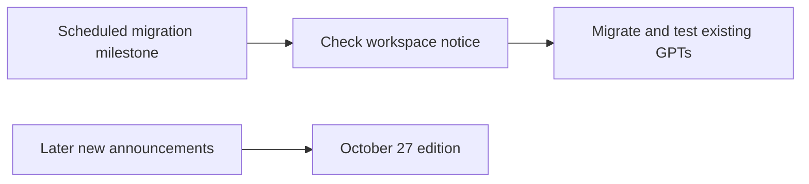

# AI Industry Briefing · 2026-10-26 (retrospective backfill)

[English (current)](2026-10-26.md) · [中文](../../../daily/2026-10/2026-10-26.md)

- **Reference cutoff:** 2026-10-26 10:30 Asia/Shanghai. Checked and backfilled on October 27; this is not an on-time October 26 publication.
- **Edition type:** No high-evidence major launch was verified by the reference cutoff. We record one scheduled enterprise-product migration milestone, without retroactively assigning later U.S. October 26 releases to the previous Beijing morning.
- **Navigation:** [Archive index](../../INDEX.md) · [Trend tracker](../../../TRACKERS.md).

## Key conclusions

1. **No major update today.** This means a bounded source review found no high-evidence major increment; it does not mean the entire industry was inactive.
2. **Affected ChatGPT Enterprise workspaces reached the Custom GPT creation freeze.** OpenAI's help page lists October 26 as the effective date. Each workspace's notice governs applicability and actual access; existing-GPT availability and the migration deadline are separate matters.

## Development

### 1. Custom GPT creation stops in affected Enterprise workspaces

- **What happened:** OpenAI's help page says affected Enterprise workspaces can no longer create GPTs from October 26; FedRAMP workspaces are excepted. Existing unmigrated GPTs can still be edited, while migration makes the original read-only. The standard scheduled retirement of existing GPTs is December 11; some approved deferrals have different dates.
- **Why it matters / lens:** Product decisions; technical context. Teams relying on old GPTs should check their own notices, plugin migration, owner permissions, and regression tests. A creation freeze is not an immediate shutdown of every GPT.
- **Publication / type / primary source:** October 26, 2026 is the milestone in the official help page; [OpenAI help page](https://help.openai.com/en/articles/20001519-custom-gpt-retirement-and-migration-faq). The page's update time was not verified.
- **Cross-check / confidence:** Single official operational source; high for the published general rule, pending workspace notice for specific applicability and migration access.
- **Trend:** T01 scheduled migration milestone; enterprise agent-asset governance continues to intensify.

## Continuing signals and limits

- We found no new independent result that would change the October 25 assessment of world models, voice, or security.
- This was backfilled on October 27 against the previous morning's reference cutoff; it does not establish that the scheduled task ran on October 26. U.S. October 26 publications appear in the [next edition](2026-10-27.md).

> Industry information only, not investment or legal advice. Check primary sources and applicable conditions before consequential decisions.
