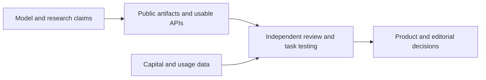

# AI Industry Briefing · 2026-10-27 (late edition)

[English (current)](2026-10-27.md) · [中文](../../../daily/2026-10/2026-10-27.md)

- **Cutoff:** 2026-10-27 14:45 Asia/Shanghai, later than the scheduled 11:00 delivery. U.S. October 26 releases enter today's Beijing-time review; date-only pages do not establish an exact launch hour.
- **Edition type:** Six high-signal items with primary sources. The usual goal is 20–30, but this run does not pad the count with weak claims. The missing [October 26 edition](2026-10-26.md) was backfilled separately.
- **Navigation:** [Archive index](../../INDEX.md) · [Trend tracker](../../../TRACKERS.md).

## Key conclusions

1. **GPT-6.1 Terra combines visual understanding, computer use, and lower prices in one model.** The API model and prices are listed; the large performance gains are OpenAI's own benchmark results. Product teams should retest their interfaces, recovery paths, and total task cost.
2. **Anthropic announced an S-1 filing for a proposed IPO.** Share count and price range are undetermined, and the registration statement is not effective. This is a financing-process milestone, not a completed listing or an available security.
3. **Extraordinary AI-assisted research claims now need serious verification.** OpenAI announced results in mathematics, complexity theory, and quantum field theory with different academic-review paths. Public natural-language materials and Lean formalizations are evidence to inspect, not a substitute for independent scholarly assessment. In particular, “ETH has been refuted” is not yet an accepted consensus finding.
4. **AI usage data and infrastructure are becoming more researchable and operational.** OpenAI Signals released grouped data for 165 work activities; Hugging Face updated shared caching, Jobs, and storage tools. The former samples one product; the latter's speed figures are platform tests.
5. **Model routers need a same-task static baseline to justify their value.** An AutoBench community study reports that tested routers did not beat a fixed mid-range model on quality and cost together. Its calls were made in late August and early September; findings apply to the specified model pool, router versions, and metric.

## Developments

### 1. OpenAI releases GPT-6.1 Terra

- **What happened:** OpenAI introduced GPT-6.1 Terra for visual reasoning, computer use, and writing, with API ID `gpt-6.1-terra`. Standard pricing is $1 per million input tokens, $0.05 per million cached input tokens, and $5 per million output tokens. It is announced for Plus, Pro, Enterprise, and Edu in ChatGPT Work/Codex. Agents' Last Exam, Terminal-Bench 4.0, and speed improvements are vendor tests.
- **Why it matters / lens:** Product decisions; editorial planning. Teams can reconsider the model mix for forms, drawings, and editing software, but should test real-task completion, recovery, permissions, and cost per completed task.
- **Publication / type / primary sources:** October 26, 2026 (U.S. page date); [OpenAI launch](https://openai.com/index/introducing-gpt-6-1-terra/) · [API changelog](https://developers.openai.com/api/docs/changelog).
- **Cross-check / confidence:** The launch and API record share one publisher; high for model ID, public price, and announced availability; independent validation pending for performance, safety, and cost gains.
- **Trend:** T01/T03 first appearance; from model scores toward graphical-interface task economics.

### 2. Anthropic announces a proposed-IPO registration filing

- **What happened:** Anthropic says it filed Form S-1 for a proposed initial public offering of Class A common stock with the U.S. SEC and intends to list on Nasdaq Global Select Market as `ANT`. Share count and price range are not fixed; the registration statement is not effective.
- **Why it matters / lens:** Investment monitoring; industry context. A later prospectus may add evidence on revenue, cost, and governance. This edition cannot infer a valuation, listing date, or successful offering.
- **Publication / type / primary sources:** October 26, 2026; the SEC filing index records acceptance at 09:00:11 U.S. Eastern (21:00:11 Beijing); [Anthropic announcement](https://www.anthropic.com/news/s1-sec) · [original SEC EDGAR filing index](https://www.sec.gov/Archives/edgar/data/2130357/000162828026067168/0001628280-26-067168-index.html).
- **Cross-check / confidence:** The company announcement and regulator's filing index corroborate the date, form, and registrant. We did not review every page of the prospectus or its financial details. High for the filing itself; detailed terms and effectiveness remain pending.
- **Trend:** T08 first proposed public-market financing milestone; track separately from the October 19 proposed benefit fund.

### 3. OpenAI announces three AI-assisted research claims and review plans

- **What happened:** OpenAI claims model-produced results related to Kakeya/local smoothing, the Exponential Time Hypothesis (ETH), and four-dimensional gauge theory. Its release plan opens the mathematical materials, assigns the complexity result to an external group and releases natural-language and Lean materials, and has an external physics group explain results before all generated materials are released. The company says researchers are free to assess the work independently and will not be credited as authors of model output.
- **Why it matters / lens:** Editorial planning; industry context. Separate company publication, formal checking, scholarly understanding, and acceptance. Lean verification depends on the encoded statements and axioms; it does not automatically establish every informal scientific claim.
- **Publication / type / primary source:** October 26, 2026 (U.S. page date); [OpenAI statement and artifact links](https://openai.com/index/building-scientific-understanding-with-academic-communities/).
- **Cross-check / confidence:** One-party release with some public artifacts; no independent expert conclusion established in this review. High that claims and review plans were published; underlying mathematical and physical claims await validation.
- **Trend:** T09 first appearance; AI-assisted research moves from discovery claims to public review.

### 4. OpenAI Signals releases work-activity data

- **What happened:** OpenAI released ChatGPT usage data for 165 work-activity categories across nearly 100 countries, quarterly from Q1 2025 to Q3 2026. It reports that, among 74 countries observed in every quarter, the top ten categories' average share of classified work messages fell from 56.0% to 51.1%. The sample includes work-related messages on individual ChatGPT plans but excludes Enterprise and Codex use.
- **Why it matters / lens:** Product decisions; investment monitoring; industry context. The data can support questions about task mix and geographic variation. Message mix is not job displacement, enterprise adoption, or productivity.
- **Publication / type / primary sources:** October 26, 2026 (U.S. page date); [OpenAI Signals explanation](https://openai.com/index/chatgpt-expanding-world-of-work/) · [data entry point](https://openai.com/signals/data-download/).
- **Cross-check / confidence:** Official methodology and download entry are inspectable; sample comes from one platform. High for release and stated scope; exact statistics and extrapolation await independent recalculation.
- **Trend:** T08 continuing rise; adoption research moves toward task-category data.

### 5. Hugging Face summarizes Hub CLI, Jobs, and shared-cache updates

- **What happened:** Hugging Face authors describe shared Xet-file caching, single-file cleanup, Job retries/reruns, Bucket-triggered Jobs, and faster bucket downloads. An example deduplicates a shared 9.5 GB text encoder; download comparisons come from Hugging Face's own Jobs environment. This is a recap of recent features, not a claim that every feature first launched October 26.
- **Why it matters / lens:** Product decisions; technical context. Model-asset and data-job engineering costs may fall, but teams should measure this in their own repositories, networks, hardware, and permissions.
- **Publication / type / primary source:** October 26, 2026 (page date); [Hugging Face staff article](https://huggingface.co/blog/huggingface/whats-new-in-the-hf-cli-and-huggingface-hub-librar).
- **Cross-check / confidence:** Official feature description; high for announced features, pending retest for speed and savings.
- **Trend:** T03/T06 continuing rise; open-model ecosystems compete on workflow infrastructure.

### 6. AutoBench community study questions LLM router quality-cost gains

- **What happened:** A research team posted a cost-aware test of seven routers and 17 settings on Hugging Face. It reports that none simultaneously beat a fixed mid-range model on quality and cost under its model pool and metric. Calls were made August 30–September 1, 2026, though the article appeared October 26; findings do not describe all current versions or the whole market.
- **Why it matters / lens:** Product decisions; editorial planning. Before buying a router, compare a fixed model and multi-model selector on a representative prompt set and full task cost.
- **Publication / type / primary source:** October 26, 2026 article, earlier experiment; [AutoBench team article](https://huggingface.co/blog/PeterKruger/router-benchmark-2026-10).
- **Cross-check / confidence:** Researcher-reported method and results, independent of tested vendors but not rerun here. Medium for the reported experiment; cross-task and version generalization pending validation.
- **Trend:** T01/T06 pending validation; counterevidence for dynamic model routing.

## Continuing signals and coverage gaps

- **First appearance:** GPT-6.1 Terra, Anthropic's S-1 statement, and OpenAI's new research-review plan.
- **Intensifying:** Task-level model and agent costs, work-activity measurement, and open-model infrastructure.
- **Pending validation:** Terra's independent effectiveness and safety; financial and governance detail in the SEC prospectus; external research review; extrapolation from Signals; router results on updated systems.
- **Coverage gap:** This is a late, high-signal short edition, not a claim to exhaust global Chinese and English news over 24 hours. No comparably substantiated new world-model or AI-game delivery was verified in this review; older demos are not recycled as new launches.

> Industry information only, not investment or legal advice. Check primary sources and applicable conditions before consequential decisions.
